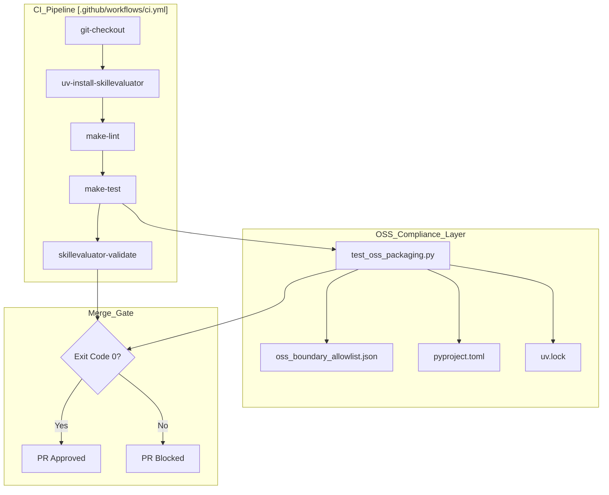
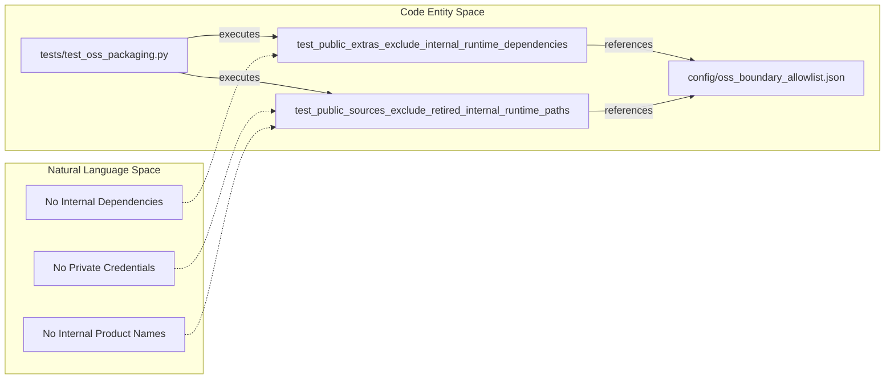

<!-- source: DeepWiki mcp.deepwiki.com · repo NVIDIA/SkillEvaluator · page 6 CI/CD Integration and OSS Compliance · fetched 2026-10-26 -->

# CI/CD Integration and OSS Compliance

Relevant source files

The following files were used as context for generating this wiki page:

- [.github/CODEOWNERS](.github/CODEOWNERS)
- [config/oss_boundary_allowlist.json](config/oss_boundary_allowlist.json)
- [docs/ci-integration.mdx](docs/ci-integration.mdx)
- [tests/test_oss_packaging.py](tests/test_oss_packaging.py)

This section outlines how SkillEvaluator is integrated into automated workflows and the rigorous mechanisms used to maintain its Open Source Software (OSS) integrity. SkillEvaluator is designed to act as a definitive merge gate in CI/CD pipelines, ensuring that every skill contribution meets schema, security, and quality standards before integration.

## CI/CD Integration Overview

SkillEvaluator provides a unified `validate` command that serves as a programmable gate for CI systems. It communicates results through standard exit codes, enabling seamless integration with GitHub Actions, GitLab CI, and other automation platforms.

### Exit Code Semantics
The `skillevaluator validate` command [skillevaluator/cli.py:21-21]() uses specific exit codes to signal the nature of a run's outcome, allowing pipelines to distinguish between skill failures and infrastructure issues.

| Exit Code | Meaning | Action Required |
| :--- | :--- | :--- |
| `0` | Success | All gating checks passed; safe to merge. |
| `1` | Validation Failure | One or more gating checks failed (Schema, Security, Quality). |
| `2` | Configuration Error | Invalid flags or unreadable targets. |
| `3` | Runtime Error | Unexpected internal failure or crash. |

### Integration Workflow
A typical CI integration involves installing the `skillevaluator` package with the `[security]` extra, configuring external scanners (Semgrep, Gitleaks, SkillSpector), and executing the validation suite against a repository of skills. For details on setting up these workflows, see [GitHub Actions CI Integration](#6.1).

**Sources:** [docs/ci-integration.mdx:9-18](), [docs/ci-integration.mdx:63-71]()

---

## OSS Boundary Enforcement

As a project developed within NVIDIA but released to the public, SkillEvaluator employs a "Boundary Enforcement" system. This system ensures that internal-only dependencies, private product names, and NVIDIA-specific credentials do not leak into the public codebase.

### The Allowlist System
The boundary is managed via `config/oss_boundary_allowlist.json` [config/oss_boundary_allowlist.json:1-85](). This file explicitly tracks intentional references that might otherwise trigger boundary violations, such as negative assertions in tests.

**Boundary Rule Categories:**
*   `internal-runtime-dependency`: Prevents leakage of private Python packages (e.g., `pymilvus`, `sandbox-k8s`).
*   `internal-product-name`: Blocks references to internal project codenames.
*   `internal-nvidia-credential`: Ensures no internal API keys or environment variable names (e.g., `NVIDIA_INFERENCE_KEY`) are present.
*   `execution-service-integration`: Restricts code related to internal execution backends.

### Regression Testing
The `tests/test_oss_packaging.py` [tests/test_oss_packaging.py:4-21]() suite acts as a sentinel, verifying that the `pyproject.toml` and source code remain free of private package indexes or retired internal paths. For details on the boundary schema and regression suite, see [OSS Boundary Enforcement](#6.2).

**Sources:** [config/oss_boundary_allowlist.json:4-10](), [tests/test_oss_packaging.py:121-142]()

---

## Contribution and Governance

SkillEvaluator follows a structured governance model to ensure code quality and legal compliance for all contributions.

### Development Workflow
Contributors are expected to utilize the provided `Makefile` targets to maintain consistency:
*   `make lint`: Executes Ruff for style and static analysis.
*   `make test`: Runs the full `pytest` suite, including the OSS boundary checks.
*   `make build`: Validates the packaging process.

### Governance Requirements
All pull requests must adhere to the Developer Certificate of Origin (DCO) sign-off requirement. Furthermore, the repository utilizes a `CODEOWNERS` [/.github/CODEOWNERS:1-6]() file to route reviews to the appropriate maintainers. For detailed contribution guidelines, see [Contributing and Development Workflow](#6.3).

**Sources:** [/.github/CODEOWNERS:4-5](), [tests/test_oss_packaging.py:24-41]()

---

## System Relationship: CI to OSS Compliance

The following diagram illustrates how the CI pipeline interacts with the OSS boundary checks to ensure a compliant release.

### CI/OSS Compliance Flow

**Sources:** [.github/workflows/ci.yml](), [tests/test_oss_packaging.py:66-73](), [config/oss_boundary_allowlist.json:1-3]()

### Code Entity Mapping: Boundary Enforcement
This diagram bridges the conceptual boundary rules to the specific code entities that enforce them.

**Sources:** [tests/test_oss_packaging.py:121-142](), [config/oss_boundary_allowlist.json:4-10]()

---

