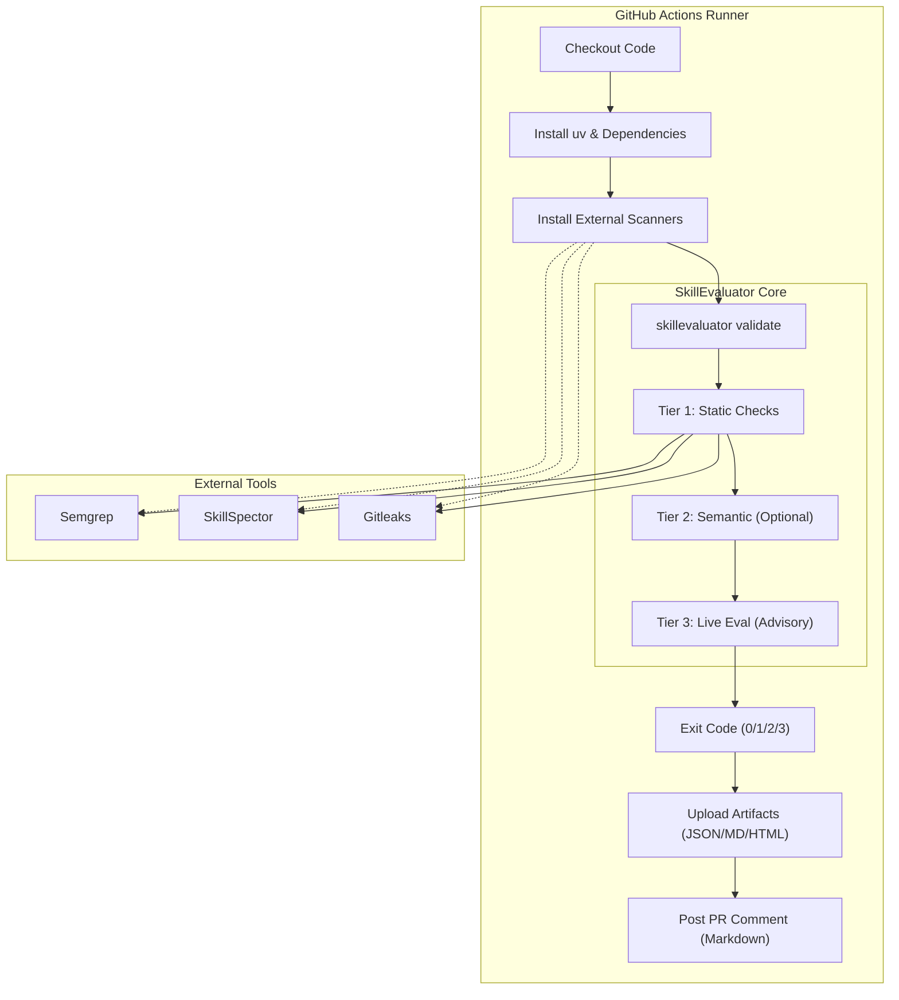
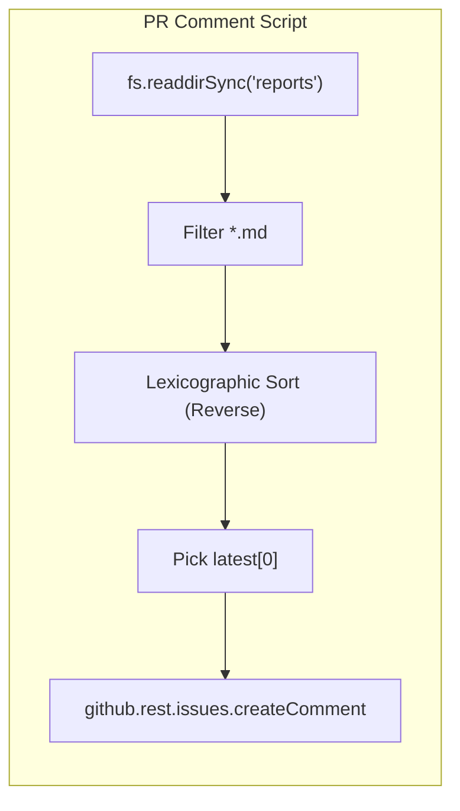

<!-- source: DeepWiki mcp.deepwiki.com · repo NVIDIA/SkillEvaluator · page 6.1 GitHub Actions CI Integration · fetched 2026-10-26 -->

# GitHub Actions CI Integration

<details>
<summary>Relevant source files</summary>

The following files were used as context for generating this wiki page:

- [.github/workflows/dco.yml](.github/workflows/dco.yml)
- [docs/ci-integration.mdx](docs/ci-integration.mdx)
- [sonar-project.properties](sonar-project.properties)

</details>


The `skillevaluator` CLI is designed to operate as a merge gate within CI/CD pipelines. By leveraging specific exit codes and machine-readable report formats, it allows teams to enforce schema compliance, security standards, and quality thresholds before code is merged into a repository [docs/ci-integration.mdx:6-10]().

## Pipeline Architecture and Data Flow

When integrated into GitHub Actions, SkillEvaluator follows a linear execution flow that transitions from environment setup to validation and finally to artifact reporting.

### CI Execution Logic
The following diagram illustrates how the `skillevaluator validate` command interacts with the local environment and the GitHub Actions runner to produce gating signals.

**SkillEvaluator CI Data Flow**

**Sources:** [docs/ci-integration.mdx:41-107]()

## Exit Code Semantics

SkillEvaluator uses specific exit codes to distinguish between skill-level failures and infrastructure or configuration issues. This allows CI engineers to decide whether a failure requires a developer's attention or a pipeline fix [docs/ci-integration.mdx:9-18]().

| Exit Code | Meaning | Context |
| :--- | :--- | :--- |
| `0` | **Success** | All gating checks passed. The PR is safe to merge [docs/ci-integration.mdx:14-14](). |
| `1` | **Validation Failed** | One or more gating checks (Schema, Security, Quality < `--min-score`) failed [docs/ci-integration.mdx:15-15](). |
| `2` | **Configuration Error** | Invalid flags, missing directories, or unreadable policy files [docs/ci-integration.mdx:16-16](). |
| `3` | **Runtime Error** | Unexpected internal crash or unhandled exception [docs/ci-integration.mdx:17-17](). |

**Sources:** [docs/ci-integration.mdx:9-19]()

## Recommended Workflow Implementation

The standard integration utilizes `uv` for fast dependency management and installs external security scanners to provide a comprehensive Tier 1 validation [docs/ci-integration.mdx:35-40]().

### Workflow YAML
The following configuration demonstrates a robust merge gate that triggers on changes to the `skills/` directory [docs/ci-integration.mdx:41-47]().

```yaml
name: Validate skills
on:
  pull_request:
    paths:
      - "skills/**"

jobs:
  validate:
    runs-on: ubuntu-latest
    permissions:
      contents: read
      pull-requests: write
    steps:
      - uses: actions/checkout@v7

      - name: Install uv
        uses: astral-sh/setup-uv@v8
        with:
          python-version: "3.13"

      - name: Install SkillEvaluator
        run: uv tool install --python 3.13 "skillevaluator[security] @ git+https://github.com/NVIDIA/SkillEvaluator.git"

      - name: Install external Python scanners
        run: |
          uv tool install semgrep
          uv tool install git+https://github.com/NVIDIA/SkillSpector.git

      - name: Install Gitleaks
        run: |
          GITLEAKS_VERSION=8.30.0
          curl -sSfL "https://github.com/gitleaks/gitleaks/releases/download/v${GITLEAKS_VERSION}/gitleaks_${GITLEAKS_VERSION}_linux_x64.tar.gz" \
            | tar -xz gitleaks
          sudo mv gitleaks /usr/local/bin/

      - name: Validate skills
        run: |
          skillevaluator validate ./skills --external --no-dedup \
            -r json,markdown -o reports --min-score 70 --continue-on-failure

      - name: Upload reports
        if: always()
        uses: actions/upload-artifact@v7
        with:
          name: skillevaluator-reports
          path: reports/
```
**Sources:** [docs/ci-integration.mdx:41-89]()

### Key CLI Flags for CI
*   **`--external`**: Pins the public-publication profile to ensure consistent behavior across different runner environments [docs/ci-integration.mdx:29-29]().
*   **`--no-dedup`**: Disables Tier 2 semantic checks, allowing for a "keyless" run that requires no LLM API keys [docs/ci-integration.mdx:30-30]().
*   **`-c, --continue-on-failure`**: Ensures the scanner processes every skill in a collection even after finding a critical error, providing a complete report to the contributor [docs/ci-integration.mdx:124-134]().
*   **`-r json,markdown`**: Generates both machine-readable data for automation and human-readable summaries for PR comments [docs/ci-integration.mdx:31-31]().

## Reporting and PR Automation

SkillEvaluator generates timestamped reports in the specified output directory (e.g., `reports/skillevaluator-output-20240101120000.md`) [docs/ci-integration.mdx:112-113]().

### Posting PR Comments
To provide immediate feedback to developers, use the `actions/github-script` to locate the latest Markdown report and post it as a comment on the Pull Request [docs/ci-integration.mdx:90-107]().

**Report Selection Logic**

**Sources:** [docs/ci-integration.mdx:91-107]()

## Progressive Adoption Path

Organizations can transition from basic linting to full Tier 3 evaluation through a phased approach:

1.  **Advisory Mode**: Run the command but append `|| true` to the step to prevent blocking merges while developers familiarize themselves with the findings [docs/ci-integration.mdx:141-147]().
2.  **Tier 1 Gating**: Remove the `|| true` to enforce schema, security, and quality scores (Keyless) [docs/ci-integration.mdx:149-151]().
3.  **LLM-Backed Validation**: Add `SKILL_EVAL_LLM_PROVIDER` and `NVIDIA_API_KEY` to CI secrets and enable `--llm` for rubric-based judging [docs/ci-integration.mdx:157-159]().
4.  **Tier 3 Integration**: Enable live agent evaluation. Note that Tier 3 results are currently **advisory** within the `validate` command and do not flip the exit code to `1`, ensuring CI stability [docs/ci-integration.mdx:19-19]().

**Sources:** [docs/ci-integration.mdx:136-159]()

---

