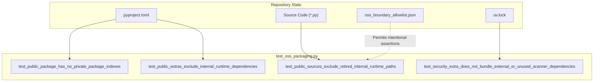

<!-- source: DeepWiki mcp.deepwiki.com · repo NVIDIA/SkillEvaluator · page 6.2 OSS Boundary Enforcement · fetched 2026-10-26 -->

# OSS Boundary Enforcement

<details>
<summary>Relevant source files</summary>

The following files were used as context for generating this wiki page:

- [.github/CODEOWNERS](.github/CODEOWNERS)
- [SECURITY.md](SECURITY.md)
- [config/oss_boundary_allowlist.json](config/oss_boundary_allowlist.json)
- [tests/test_oss_packaging.py](tests/test_oss_packaging.py)

</details>


The OSS Boundary Enforcement system ensures that the Open Source Software (OSS) edition of SkillEvaluator remains free of internal-only dependencies, private credentials, and non-public product integrations. This is maintained through a combination of a structured allowlist for intentional boundary assertions and a regression test suite that validates the packaging state.

## Boundary Enforcement Architecture

The enforcement mechanism operates by scanning the codebase for patterns that signify internal NVIDIA infrastructure or private metadata. To prevent false positives—specifically in tests that verify the *absence* of these items—the system uses a central allowlist.

### Data Flow: Packaging Validation
The following diagram illustrates how `test_oss_packaging.py` interacts with the repository configuration to enforce the OSS boundary.

**OSS Packaging Regression Flow**

**Sources:** [tests/test_oss_packaging.py:23-41](), [config/oss_boundary_allowlist.json:1-3]()

## The Allowlist Schema

The `config/oss_boundary_allowlist.json` file serves as the source of truth for sanctioned exceptions. These exceptions are typically "negative assertions" where a test file must explicitly mention an internal term to verify that the term is *not* present in the runtime code.

### Schema Fields
| Field | Description |
| :--- | :--- |
| `path` | The relative path to the file containing the boundary-crossing term [config/oss_boundary_allowlist.json:5](). |
| `rule` | The category of the boundary violation (see Rule Categories below) [config/oss_boundary_allowlist.json:6](). |
| `line` | The specific line number where the violation occurs [config/oss_boundary_allowlist.json:7](). |
| `reason` | A human-readable explanation for the exception [config/oss_boundary_allowlist.json:8](). |
| `expires` | An ISO-8601 date for re-reviewing the necessity of the exception [config/oss_boundary_allowlist.json:9](). |
| `review_owner` | The group or individual responsible for the exception [config/oss_boundary_allowlist.json:10](). |

**Sources:** [config/oss_boundary_allowlist.json:4-11]()

## Rule Categories

Boundary enforcement is categorized into five distinct rules to provide granular control over what is permitted in the OSS distribution:

1.  **`internal-runtime-dependency`**: Prevents the inclusion of internal Python packages (e.g., `py` + `mil` + `vus`) in `pyproject.toml` or `uv.lock` [tests/test_oss_packaging.py:126](), [config/oss_boundary_allowlist.json:6]().
2.  **`internal-product-name`**: Restricts the use of internal project codenames or unreleased product identifiers [config/oss_boundary_allowlist.json:22]().
3.  **`internal-nvidia-credential`**: Ensures environment variable names like `NVI` + `DIA` + `_INFERENCE_KEY` do not appear in source files [tests/test_oss_packaging.py:134](), [config/oss_boundary_allowlist.json:30]().
4.  **`execution-service-integration`**: Blocks code paths that rely on internal-only execution sandboxes or proprietary K8s clusters [tests/test_oss_packaging.py:127](), [config/oss_boundary_allowlist.json:38]().
5.  **`harbor-upload-integration`**: Prevents the OSS version from attempting to upload evaluation results to internal NVIDIA Harbor telemetry endpoints [config/oss_boundary_allowlist.json:54]().

**Sources:** [tests/test_oss_packaging.py:121-143](), [config/oss_boundary_allowlist.json:4-83]()

## Regression Suite: `test_oss_packaging.py`

The `test_oss_packaging.py` suite implements the actual enforcement logic. It uses `tomllib` to parse project metadata and `subprocess` to inspect tracked files.

### Key Implementation Details

*   **Source Scanning**: The function `_public_source_files` uses `git ls-files` to identify all tracked text files while excluding build artifacts like `.egg-info` and `__pycache__` [tests/test_oss_packaging.py:76-101]().
*   **Dependency Auditing**: `test_public_extras_use_public_dependency_sources` validates that all `optional-dependencies` in `pyproject.toml` point to public PyPI names or public GitHub URLs [tests/test_oss_packaging.py:110-119]().
*   **Scanner Isolation**: `test_security_extra_does_not_bundle_external_or_unused_scanner_dependencies` ensures that heavy scanners like `semgrep` or `skillspector` are not listed as hard dependencies in the `security` extra, as they should be managed by the user's environment [tests/test_oss_packaging.py:164-179]().
*   **Retired Path Checks**: `test_public_sources_exclude_retired_internal_runtime_paths` performs a global string search across the `src/` directory for prohibited internal terms [tests/test_oss_packaging.py:131-142]().

### File-Level Boundary Map
The diagram below maps the enforcement logic to the specific entities in the codebase.

**Boundary Enforcement Entity Mapping**
```mermaid
classDiagram
    class OSSPackagingTester {
        +_project() Dict
        +_lock() Dict
        +_public_source_files(repo_root) List
    }
    class BoundaryRules {
        +internal-runtime-dependency
        +internal-nvidia-credential
        +harbor-upload-integration
    }
    class ProjectMetadata {
        +pyproject.toml
        +uv.lock
    }
    
    OSSPackagingTester --> ProjectMetadata : "Validates [tests/test_oss_packaging.py:66-73]"
    OSSPackagingTester --> BoundaryRules : "Enforces [config/oss_boundary_allowlist.json:6-62]"
    OSSPackagingTester --> cli : "Tests CLI entrypoint [tests/test_oss_packaging.py:21]"
```
**Sources:** [tests/test_oss_packaging.py:21-73](), [config/oss_boundary_allowlist.json:6-62]()

## Packaging Integrity Checks

Beyond boundary enforcement, the suite ensures the package is "clean" for release:
*   **No Private Indexes**: `test_public_package_has_no_private_package_indexes` confirms that `extra-index-url` is absent from the `uv` configuration [tests/test_oss_packaging.py:104-108]().
*   **License Compliance**: The suite verifies the presence of mandatory legal files such as `LICENSE`, `NOTICE`, and `THIRD_PARTY_NOTICES.md` [tests/test_oss_packaging.py:24-35]().
*   **Dependency Pinning**: `test_release_lock_avoids_accidental_prereleases_and_known_fixed_versions` checks `uv.lock` to ensure critical security patches (e.g., `cryptography >= 48.0.1`) are present [tests/test_oss_packaging.py:187-200]().

**Sources:** [tests/test_oss_packaging.py:24-35](), [tests/test_oss_packaging.py:104-108](), [tests/test_oss_packaging.py:187-200]()

---

