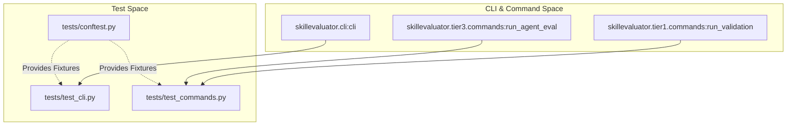

<!-- source: DeepWiki mcp.deepwiki.com · repo NVIDIA/SkillEvaluator · page 7 Testing Infrastructure · fetched 2026-10-26 -->

# Testing Infrastructure

Relevant source files

The following files were used as context for generating this wiki page:

- [tests/conftest.py](tests/conftest.py)
- [tests/test_cli.py](tests/test_cli.py)
- [tests/test_commands.py](tests/test_commands.py)

The SkillEvaluator testing infrastructure is a comprehensive suite comprising over 129 files that validate the entire pipeline from static analysis to live agent evaluation. The suite is designed to ensure the reliability of the three-tier evaluation system, maintaining high standards for security, performance, and cross-platform compatibility.

## Test Suite Structure

The codebase utilizes `pytest` as its primary testing framework, with tests organized to mirror the system's tiered architecture.

| Category | Description | Key File Patterns |
| :--- | :--- | :--- |
| **CLI & Commands** | Validates command routing, help text, and argument parsing. | `tests/test_cli.py`, `tests/test_commands.py` |
| **Tier 1 (Static)** | Unit tests for schema, security, and quality validators. | `tests/test_schema.py`, `tests/test_security.py` |
| **Tier 2 (Semantic)** | Tests for embedding-based similarity and deduplication. | `tests/test_similarity.py` |
| **Tier 3 (Dynamic)** | Integration tests for Harbor, sandboxes, and agent grading. | `tests/test_harbor_*.py`, `tests/test_nvidia_build_bridge.py` |
| **Infrastructure** | Global fixtures, OSS boundary checks, and packaging. | `tests/conftest.py`, `tests/test_oss_packaging.py` |

### Code Entity to Test Logic Mapping

The following diagram illustrates how the CLI entry points and internal validators are associated with their respective test entities.

**Sources:** [tests/test_cli.py:14-15](), [tests/test_commands.py:12-13](), [tests/conftest.py:1-7]()

## Global Fixtures and Configuration

The `tests/conftest.py` file defines a set of standard fixtures used to simulate various skill states (valid, invalid, insecure). These fixtures ensure that tests remain consistent with the `SKILL.md` specifications defined in the contribution guides.

*   **`sample_skill_dir`**: Generates a valid skill directory structure with correct frontmatter [tests/conftest.py:18-66]().
*   **`invalid_skill_dir`**: Creates a skill with name format violations (e.g., underscores instead of kebab-case) [tests/conftest.py:70-85]().
*   **`skill_with_pii`**: Injects simulated Personal Identifiable Information (emails, home paths) to test `SecretsValidator` [tests/conftest.py:129-149]().
*   **`skill_with_security_issues`**: Contains dangerous code patterns (e.g., `os.system`, hardcoded keys) for `SecurityValidator` testing [tests/conftest.py:152-188]().

**Sources:** [tests/conftest.py:18-188]()

## Key Test Patterns

### CLI Interaction Testing
The suite uses `click.testing.CliRunner` to simulate terminal execution. This is used to verify that the branded header is displayed [tests/test_cli.py:42-50](), commands are grouped correctly by workflow [tests/test_cli.py:52-71](), and that non-finite similarity thresholds are rejected [tests/test_cli.py:102-113]().

### Tiered Execution Ordering
A critical test pattern ensures that Tier 1 results are flushed to the terminal before Tier 3 begins. This ensures visibility in CI environments even if the long-running agent evaluation is interrupted [tests/test_commands.py:117-151]().

### Symlink and Reparse Point Safety
Tier 2 and Tier 1 validators include specific tests to ensure they reject unresolved root symlinks to prevent directory traversal or recursive loops during scanning [tests/test_cli.py:149-174]().

**Sources:** [tests/test_cli.py:42-174](), [tests/test_commands.py:117-151]()

## Major Test Areas

For detailed information on specific testing domains, refer to the child pages:

### [Validator and Reporting Tests](#7.1)
Covers the testing of deterministic Tier 1 checks and the reporting engine. Includes tests for:
*   `SchemaValidator` and `QualityScoreValidator`.
*   Security scanning (Semgrep, Gitleaks, Bandit).
*   Report generation (JSON, HTML, Markdown).
*   Golden benchmark card comparisons.

### [Tier 3 and Harbor Tests](#7.2)
Covers the testing of the live agent evaluation infrastructure. Includes tests for:
*   `HarborRunner` status and environment lifecycle.
*   Secure Docker and OS-level sandboxing (Bubblewrap/Seatbelt).
*   The `nvidia_build_bridge.py` for API translation.
*   Dataset generation from skill context.

**Sources:** [tests/test_commands.py:180-194](), [tests/test_cli.py:17-19]()

---

