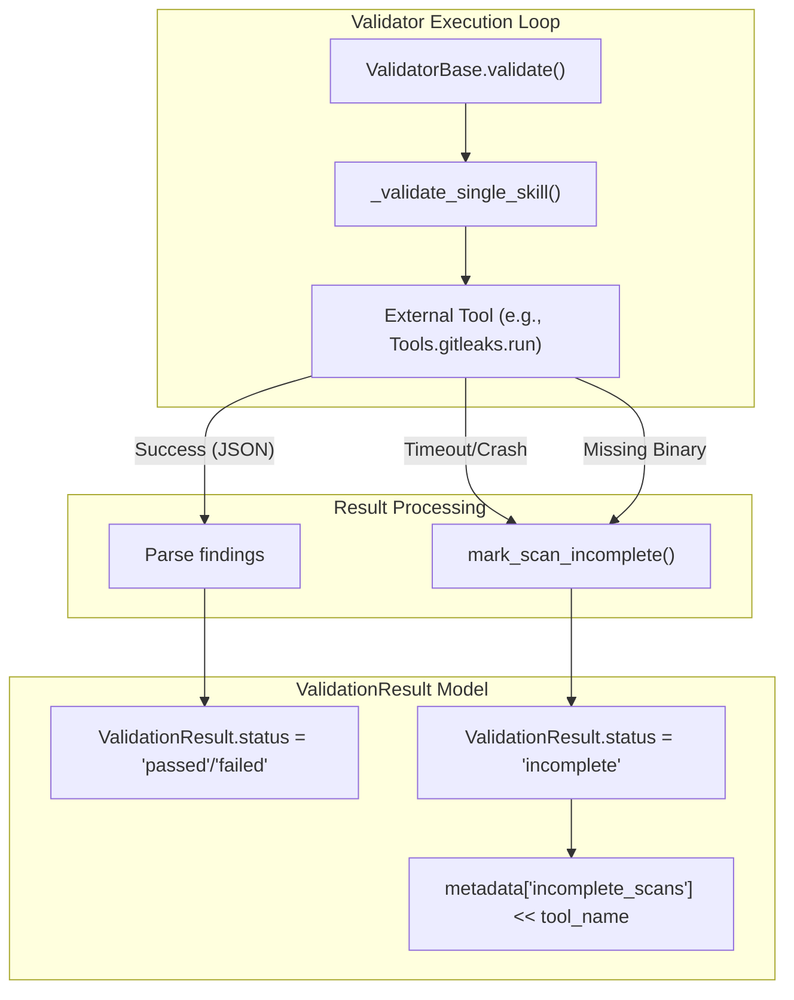
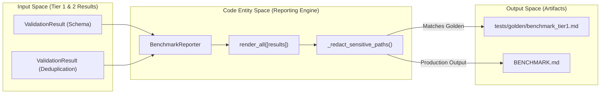

<!-- source: DeepWiki mcp.deepwiki.com · repo NVIDIA/SkillEvaluator · page 7.1 Validator and Reporting Tests · fetched 2026-10-26 -->

# Validator and Reporting Tests

Relevant source files

The following files were used as context for generating this wiki page:

- [tests/golden/benchmark_tier1.md](tests/golden/benchmark_tier1.md)
- [tests/golden/test_benchmark_card.py](tests/golden/test_benchmark_card.py)
- [tests/reporting/test_advisory_skip_verdict.py](tests/reporting/test_advisory_skip_verdict.py)
- [tests/reporting/test_reporters.py](tests/reporting/test_reporters.py)
- [tests/reporting/test_unified_tier3_report.py](tests/reporting/test_unified_tier3_report.py)
- [tests/validators/test_artifact_dir_exclusion.py](tests/validators/test_artifact_dir_exclusion.py)
- [tests/validators/test_base.py](tests/validators/test_base.py)
- [tests/validators/test_folder_validation.py](tests/validators/test_folder_validation.py)
- [tests/validators/test_quality_score.py](tests/validators/test_quality_score.py)
- [tests/validators/test_scan_incomplete.py](tests/validators/test_scan_incomplete.py)
- [tests/validators/test_schema.py](tests/validators/test_schema.py)
- [tests/validators/test_security.py](tests/validators/test_security.py)

This section details the testing infrastructure for Tier 1 static validation and the unified reporting engine. These tests ensure that skill manifests, security policies, and quality metrics are enforced consistently across the codebase.

## Validator Test Suite

The Tier 1 validators are tested through a combination of unit tests and integration tests that simulate various skill directory states. These tests verify that the `ValidatorBase` [skillevaluator/validators/base.py:8-10]() correctly handles directory traversal while individual subclasses enforce specific domain rules.

### Schema and Folder Validation
The `SchemaValidator` is tested for its ability to enforce the SkillEvaluator specification, including kebab-case naming, frontmatter requirements, and directory structure compliance.

*   **Manifest Naming:** Tests verify that `SKILL.md` is detected case-insensitively, but a `HIGH` finding is issued if the filename is not exactly `SKILL.md` [tests/validators/test_schema.py:88-117]().
*   **Directory Matching:** Ensures the `name` field in the frontmatter matches the directory name [tests/validators/test_schema.py:80-87]().
*   **Recursive Discovery:** `TestFolderLevelValidation` confirms that validators can process a root directory containing dozens of skills, correctly identifying compliant `skills/` or `team-skills/` subdirectories [tests/validators/test_folder_validation.py:206-240]().

### Security and PII Detection
The `SecurityValidator` tests focus on identifying sensitive information and malicious patterns using both regex-based checks and external tool integrations.

*   **PII Scanning:** Validates detection of personal email addresses and local filesystem paths (e.g., `/Users/johndoe`) while ignoring common false positives like REST API routes [tests/validators/test_security.py:105-165]().
*   **Hardcoded Secrets:** Tests the integration with `gitleaks` to detect AWS keys, JWTs, and other credentials [tests/validators/test_security.py:21-46]().
*   **Artifact Exclusion:** A critical performance test ensures that the validator prunes `evals/` and `results/` directories during traversal to avoid scanning gigabytes of Tier 3 execution artifacts [tests/validators/test_artifact_dir_exclusion.py:11-13]().

### Quality Scoring
The `QualityScoreValidator` is tested against its 4-dimension scoring algorithm (Correctness, Discoverability, Reliability, Efficiency).

*   **Skill Type Detection:** Tests verify that the validator correctly categorizes skills as `guide-only`, `script-based`, `lib-based`, or `hybrid` to apply appropriate scoring weights [tests/validators/test_quality_score.py:147-185]().
*   **Weighting Formula:** Confirms that the overall score is calculated as: `(Correctness * 0.35) + (Discoverability * 0.25) + (Reliability * 0.25) + (Efficiency * 0.15)` [tests/validators/test_quality_score.py:137-145]().

### Scanner Reliability and "Incomplete" Status
External tools (Semgrep, Bandit, Gitleaks) may fail due to timeouts or missing binaries. The `test_scan_incomplete.py` suite ensures these failures result in an `INCOMPLETE` status rather than a false `PASS`.

*   **Tool Timeouts:** If a tool like `skillspector` times out, the result is marked as `incomplete` and the specific tool is added to `metadata["incomplete_scans"]` [tests/validators/test_scan_incomplete.py:32-38]().
*   **Missing Binaries:** If a required scanner is not found in the environment, the validation fails with an incomplete status [tests/validators/test_scan_incomplete.py:73-81]().

Sources: [tests/validators/test_schema.py:14-117](), [tests/validators/test_security.py:92-165](), [tests/validators/test_quality_score.py:11-185](), [tests/validators/test_folder_validation.py:11-240](), [tests/validators/test_artifact_dir_exclusion.py:4-13](), [tests/validators/test_scan_incomplete.py:4-81]().

## Reporting and Golden Tests

SkillEvaluator provides multiple output formats (CLI, JSON, Markdown, HTML, and Benchmark). The reporting tests ensure that findings from all three tiers are unified into a coherent summary.

### Unified Tier 3 Reporting
Tests in `test_unified_tier3_report.py` verify that live agent evaluation data is correctly merged into the final HTML and JSON outputs.

*   **Payload Construction:** `build_agent_eval_payload` is tested for its ability to aggregate metrics across multiple trials and agents [tests/reporting/test_unified_tier3_report.py:129-155]().
*   **Sanitization:** Reporting tests verify that sensitive paths (e.g., local user directories) are redacted from the final report [tests/reporting/test_advisory_skip_verdict.py:81-91]().

### Advisory Skips
A unique feature of the reporting engine is the "Advisory Skip." This occurs when Tier 3 cannot run (e.g., missing API keys) but Tier 1 passes. The tests ensure this state is reported as `SKIPPED` and does not block CI/CD pipelines [tests/reporting/test_advisory_skip_verdict.py:32-44]().

### Golden Benchmark Card
The `BENCHMARK.md` file is a canonical artifact produced for every skill. `test_benchmark_card.py` uses "Golden" regression testing to ensure the format remains deterministic.

*   **Deterministic Rendering:** The test compares a rendered `BenchmarkReporter` output against a static file `benchmark_tier1.md` [tests/golden/test_benchmark_card.py:48-53]().
*   **Markdown Escaping:** Verifies that agent labels or finding messages containing Markdown characters (like `#` or `1.`) are escaped to prevent breaking the report structure [tests/golden/test_benchmark_card.py:140-170]().

Sources: [tests/reporting/test_reporters.py:20-134](), [tests/reporting/test_unified_tier3_report.py:110-168](), [tests/reporting/test_advisory_skip_verdict.py:4-123](), [tests/golden/test_benchmark_card.py:4-170]().

## Data Flow Diagrams

### Validator Execution and Incomplete Marking
The following diagram illustrates how external tool results flow into the `ValidationResult` and how failures trigger the `INCOMPLETE` status.

**Validator Data Flow**

Sources: [skillevaluator/validators/base.py:79-103](), [tests/validators/test_scan_incomplete.py:31-81]().

### Reporting Pipeline: Tier 1 to Benchmark
This diagram maps the association between validation results and the final user-facing `BENCHMARK.md`.

**Natural Language to Code Entity Space: Reporting**

Sources: [tests/golden/test_benchmark_card.py:23-53](), [skillevaluator/reporting/benchmark.py:18-20]().

## Test Coverage Summary

| Test File | Focus Area | Key Classes/Functions Tested |
| :--- | :--- | :--- |
| `test_schema.py` | Manifest & Structure | `SchemaValidator`, `SkillManifest` |
| `test_quality_score.py` | Quality Metrics | `QualityScoreValidator`, `QualityScoreResult` |
| `test_security.py` | PII & Security Tools | `SecurityValidator`, `_skillspector_child_env` |
| `test_scan_incomplete.py` | Reliability | `ValidationResult.mark_scan_incomplete` |
| `test_reporters.py` | CLI/JSON/HTML | `CLIReporter`, `JSONReporter`, `HTMLReporter` |
| `test_benchmark_card.py` | Regression Guard | `BenchmarkReporter` |
| `test_unified_tier3_report.py`| Live Eval Integration | `build_agent_eval_payload`, `render_agent_eval_html_report` |

Sources: [tests/validators/test_schema.py:14-17]() [tests/validators/test_quality_score.py:11-12](), [tests/validators/test_security.py:18-18](), [tests/validators/test_scan_incomplete.py:31-31](), [tests/reporting/test_reporters.py:20-20](), [tests/golden/test_benchmark_card.py:18-18](), [tests/reporting/test_unified_tier3_report.py:14-22]().

---

