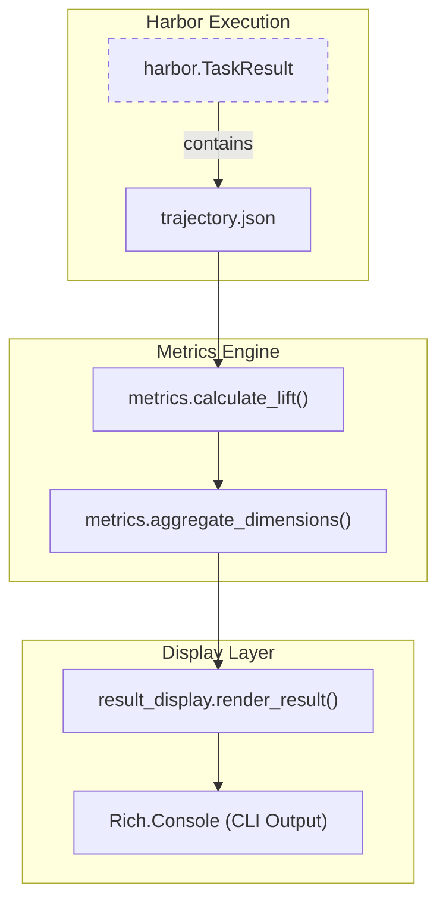

<!-- source: DeepWiki mcp.deepwiki.com · repo NVIDIA/SkillEvaluator · page 7.2 Tier 3 and Harbor Tests · fetched 2026-10-26 -->

# Tier 3 and Harbor Tests

Relevant source files

The following files were used as context for generating this wiki page:

- [tests/test_evaluation_service.py](tests/test_evaluation_service.py)
- [tests/test_harbor_input_staging.py](tests/test_harbor_input_staging.py)
- [tests/test_tier3_result_display.py](tests/test_tier3_result_display.py)
- [tests/tier3/test_generate_dataset_results.py](tests/tier3/test_generate_dataset_results.py)
- [tests/validators/test_version.py](tests/validators/test_version.py)

The Tier 3 pipeline represents the most complex evaluation stage in SkillEvaluator, involving live agent execution within isolated sandboxes. Testing this infrastructure requires verifying the orchestration of Harbor runners, the security of Docker and OS-level environments, the accuracy of the NVIDIA Build Bridge, and the integrity of dataset generation.

## Harbor Runner and Environment Testing

The Harbor framework integration is tested to ensure that evaluation tasks are correctly staged and executed across various environment modes (Docker, local, and sandboxed).

### Input Staging and Traversal Protection
The system must safely stage files from the skill's `evals/files/` directory into the task's environment without allowing path traversal attacks. This is verified by `tests/test_harbor_input_staging.py`.

*   **Global Staging**: Ensures `evals/files/` are copied to the task `input/` directory [tests/test_harbor_input_staging.py:55-64]().
*   **Entry-Specific Staging**: Validates that individual evaluation entries can reference specific files via the `files` key [tests/test_harbor_input_staging.py:43-47]().
*   **Security Enforcement**: Tests explicitly block absolute paths and directory traversal (e.g., `../../etc/passwd`) [tests/test_harbor_input_staging.py:78-89]().

### Evaluation Service Orchestration
The `EvaluationService` acts as the high-level API for triggering Tier 3 runs. Tests ensure parity between the CLI and the programmatic API [tests/test_evaluation_service.py:4-5]().

| Test Case | Code Entity | Purpose |
| :--- | :--- | :--- |
| **Signature Match** | `EvaluationOptions` | Ensures dataclass fields match the `evaluate` function signature [tests/test_evaluation_service.py:85-93](). |
| **Progress Reporting** | `NullProgressReporter` | Verifies that the service defaults to a silent reporter if none is provided [tests/test_evaluation_service.py:112-130](). |
| **Autopilot Logic** | `create_autopilot_dataset` | Ensures existing datasets are reused during autopilot runs to prevent redundant LLM calls [tests/test_evaluation_service.py:167-190](). |

**Sources:** [tests/test_harbor_input_staging.py:1-95](), [tests/test_evaluation_service.py:1-190]()

## Dataset Generation Tests

Dataset generation (`create-eval-dataset`) is the precursor to live evaluation. Testing focuses on the `generate_dataset` module and its ability to synthesize evaluation cases from skill documentation or existing agent trajectories.

### Trajectory Discovery and Refinement
When running in `--refine` mode, the generator looks for existing agent trajectories to improve the evaluation dataset.
*   **Environment Overrides**: Tests verify that `SKILLEVALUATOR_RESULTS_DIR` is respected when searching for `trajectory.json` files [tests/tier3/test_generate_dataset_results.py:20-31]().
*   **CLI Overrides**: Ensures the `--results-dir` flag takes precedence over environment variables [tests/tier3/test_generate_dataset_results.py:34-46]().

### Data Integrity and Permissions
*   **Atomic Writes**: Tests simulate disk failures to ensure existing `evals.json` files are not corrupted during partial writes [tests/tier3/test_generate_dataset_results.py:120-145]().
*   **Permission Preservation**: Verifies that the filesystem permissions (e.g., `0o640`) of the dataset are maintained after an update [tests/tier3/test_generate_dataset_results.py:147-162]().

**Sources:** [tests/tier3/test_generate_dataset_results.py:1-198]()

## Result Display and Metric Reporting

Tier 3 produces complex metrics including "Skill Lift" (the delta between agent performance with vs. without the skill). The `result_display` module is tested to ensure these are rendered correctly for the operator.

### Rendering Logic
The `render_result` function is tested against various execution outcomes [tests/test_tier3_result_display.py:15-16]().

*   **Baseline Skipping**: When `--skip-baseline` is used, the UI must explicitly mark "No Skill" dimensions as "skipped" rather than "0.0" [tests/test_tier3_result_display.py:65-92]().
*   **Metric Sets**: Tests verify the rendering of both `DEFAULT_METRIC_SET` (Security, Correctness, etc.) and `CUSTOM_ONLY_METRIC_SET` [tests/test_tier3_result_display.py:14]().
*   **Edge Case Handling**: The display logic must handle non-finite scores (`NaN`, `Inf`) gracefully by rejecting them from aggregates [tests/test_tier3_result_display.py:123-140]().

### Data Flow: Evaluation to UI
The following diagram illustrates how raw evaluation data from Harbor flows through the metrics engine to the CLI display.

**Tier 3 Result Processing Flow**

**Sources:** [tests/test_tier3_result_display.py:36-211]()

## NVIDIA Build Bridge and Agent Tests

The bridge (`nvidia_build_bridge.py`) translates standard LLM API calls into NVIDIA-compatible requests. Testing ensures that multi-turn conversations and tool calls remain coherent.

### Bridge Verification
Tests for the bridge focus on:
*   **Credential Isolation**: Ensuring capability tokens are correctly passed through the environment.
*   **Response Translation**: Verifying that OpenAI-style `choice` objects are correctly synthesized from NVIDIA Build Chat Completion responses.

### Local Agent Wrappers
The `local_agents.py` wrappers (for `codex`, `claude-code`, etc.) are tested to ensure they correctly implement the Harbor `Agent` interface and can be invoked within the sandbox.

## Version and Metadata Validation

While primarily a Tier 1 check, version validation is critical for Tier 3 reproducibility. The `VersionValidator` ensures that skills follow Semantic Versioning (SemVer) and that versions are monotonic.

*   **SemVer Enforcement**: Rejects malformed versions like `1.2` (missing patch) or `v1.2.3` (unsupported prefix) [tests/validators/test_version.py:56-68]().
*   **Monotonicity**: Rejects version downgrades (e.g., changing `1.2.0` to `1.1.9`) [tests/validators/test_version.py:125-132]().
*   **CI Integration**: Validates that the validator correctly picks up the previous version from the `SKILLEVALUATOR_PREVIOUS_VERSION` environment variable [tests/validators/test_version.py:177-198]().

**Sources:** [tests/validators/test_version.py:1-212]()

---

