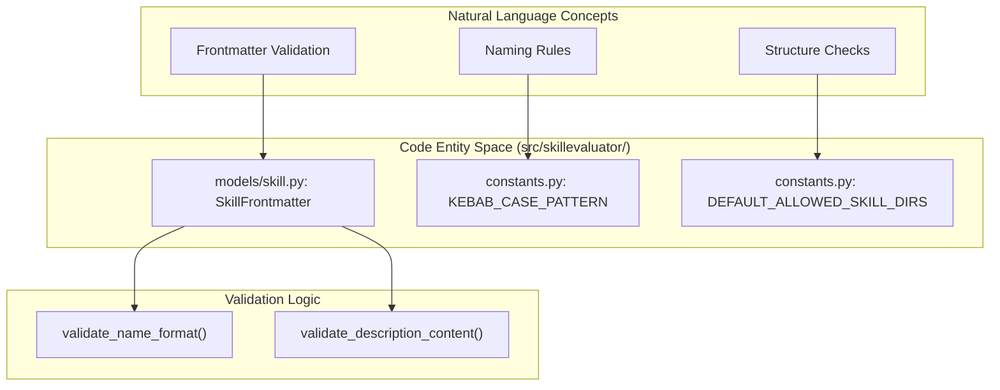
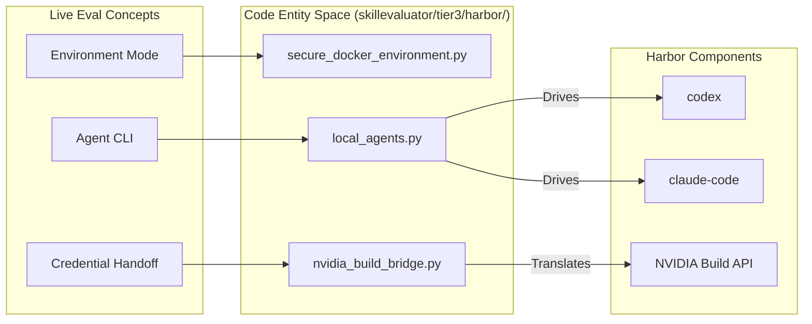

<!-- source: DeepWiki mcp.deepwiki.com · repo NVIDIA/SkillEvaluator · page 8 Glossary · fetched 2026-10-26 -->

# Glossary

Relevant source files

The following files were used as context for generating this wiki page:

- [.github/CODEOWNERS](.github/CODEOWNERS)
- [CHANGELOG.md](CHANGELOG.md)
- [README.md](README.md)
- [config/oss_boundary_allowlist.json](config/oss_boundary_allowlist.json)
- [docs/agents-and-sandboxes.mdx](docs/agents-and-sandboxes.mdx)
- [docs/index.mdx](docs/index.mdx)
- [docs/tier1-validation.mdx](docs/tier1-validation.mdx)
- [src/skillevaluator/constants.py](src/skillevaluator/constants.py)
- [src/skillevaluator/models/skill.py](src/skillevaluator/models/skill.py)
- [tests/test_oss_packaging.py](tests/test_oss_packaging.py)

This page defines codebase-specific terms, abbreviations, and domain concepts used throughout the SkillEvaluator framework. It serves as a technical reference for onboarding engineers to understand the mapping between conceptual terminology and the underlying implementation.

## Core Concepts

### Agent Skill
An **Agent Skill** is a directory-based artifact containing instructions and supporting files that extend an AI agent's capabilities. It must contain a `SKILL.md` file following the [Agent Skills specification](https://agentskills.io/).
*   **Implementation**: Validated via `SkillFrontmatter` [src/skillevaluator/models/skill.py:76-198]() and `SkillManifest` [src/skillevaluator/models/skill.py:200-206]().
*   **Structure**: Expected subdirectories include `agents/`, `tests/`, and `tools/` [src/skillevaluator/constants.py:43-45]().

### Three-Tier Pipeline
The evaluation architecture is divided into three distinct stages (Tiers) that can be run independently or sequentially.
1.  **Tier 1 (Validation)**: Static analysis (schema, security, quality, PII) [docs/index.mdx:20-22]().
2.  **Tier 2 (Deduplication)**: Semantic analysis to find overlaps using embeddings [docs/index.mdx:23-25]().
3.  **Tier 3 (Live Evaluation)**: Measuring "Skill Lift" by running agents in sandboxed environments [docs/index.mdx:26-28]().

### Skill Lift
A Tier 3 metric representing the delta in performance between an agent running with a skill versus a baseline run without it [docs/index.mdx:61-61]().

## Technical Terms & Components

### Harbor
The open-source agent evaluation framework integrated into SkillEvaluator to power Tier 3. It handles the execution of trials across various backends (Docker, Local, Cloud) [docs/agents-and-sandboxes.mdx:13-15]().
*   **Source**: `skillevaluator/tier3/harbor/` [tests/test_oss_packaging.py:44-46]().

### NVIDIA Build Bridge
A loopback compatibility layer that translates OpenAI or Anthropic API calls from agent CLIs into NVIDIA Build Chat Completions. This allows using a single `NVIDIA_API_KEY` for agents that don't natively support the Build API [docs/agents-and-sandboxes.mdx:57-74]().
*   **Implementation**: `nvidia_build_bridge.py` [tests/test_oss_packaging.py:45-45]().

### SkillSpector
A specialized security scanner for agent skills integrated into the Tier 1 pipeline. It provides deep static analysis for malicious instructions or insecure patterns [README.md:30-31]().

### OSS Boundary Enforcement
A mechanism to ensure the Open Source edition of SkillEvaluator does not leak internal NVIDIA dependencies, credentials, or product names.
*   **Configuration**: `oss_boundary_allowlist.json` [config/oss_boundary_allowlist.json:1-85]().
*   **Verification**: `test_oss_packaging.py` [tests/test_oss_packaging.py:1-201]().

## Code Entity Mapping

### Natural Language to Code Entity Space: Tier 1
The following diagram maps the logical validation checks to their respective constants and models in the codebase.

**Diagram: Tier 1 Validation Mapping**

**Sources**: [src/skillevaluator/models/skill.py:76-167](), [src/skillevaluator/constants.py:43-45](), [src/skillevaluator/constants.py:115-115]().

### Natural Language to Code Entity Space: Tier 3
This diagram shows how live evaluation concepts map to the Harbor integration and bridging logic.

**Diagram: Tier 3 Execution Mapping**

**Sources**: [tests/test_oss_packaging.py:43-47](), [docs/agents-and-sandboxes.mdx:57-74](), [docs/agents-and-sandboxes.mdx:132-148]().

## Domain Abbreviations

| Abbreviation | Full Term | Context |
| :--- | :--- | :--- |
| **NVS** | NVIDIA Verified Skills | The broader ecosystem SkillEvaluator belongs to [README.md:15-16](). |
| **PII** | Personally Identifiable Information | Scanned in Tier 1 via `pii-scan` [docs/tier1-validation.mdx:19-19](). |
| **SPDX** | Software Package Data Exchange | Standard for license identifiers used in `SKILL.md` [CHANGELOG.md:81-82](). |
| **MCP** | Model Context Protocol | Mentioned in the context of plugin validation [src/skillevaluator/constants.py:139-141](). |
| **DCO** | Developer Certificate of Origin | Contribution requirement verified in CI [CHANGELOG.md:9-11](). |

## Content Types Reference
The system automatically detects content types based on file patterns defined in `constants.py`.

| Logical Type | Code Constant | Detection Signal |
| :--- | :--- | :--- |
| **Skill** | `CONTENT_TYPE_SKILL` | `SKILL.md` [src/skillevaluator/constants.py:118-118]() |
| **Rules** | `CONTENT_TYPE_RULES` | `.mdc` files [src/skillevaluator/constants.py:119-119]() |
| **Workflows** | `CONTENT_TYPE_WORKFLOWS` | `workflow-rules.mdc` [src/skillevaluator/constants.py:120-120]() |
| **Plugin** | `CONTENT_TYPE_PLUGIN` | `agent_plugin.yaml` or `.claude-plugin/` [src/skillevaluator/constants.py:121-121]() |

**Sources**: [src/skillevaluator/constants.py:117-123](), [src/skillevaluator/constants.py:128-132](), [docs/tier1-validation.mdx:74-79]().