# Page: SkillEvaluator Overview

# SkillEvaluator Overview

<details>
<summary>Relevant source files</summary>

The following files were used as context for generating this wiki page:

- [CHANGELOG.md](CHANGELOG.md)
- [CITATION.cff](CITATION.cff)
- [README.md](README.md)
- [docs/assets/three-tier-overview.svg](docs/assets/three-tier-overview.svg)
- [docs/index.mdx](docs/index.mdx)
- [docs/tier1-validation.mdx](docs/tier1-validation.mdx)

</details>


SkillEvaluator is an open-source, multi-tier framework designed to evaluate AI agent artifacts, primarily focusing on **Agent Skills** [README.md:9-14](). It provides a comprehensive pipeline that moves from static, deterministic validation to live agent evaluation in sandboxed environments.

The framework is part of the [NVIDIA Verified Skills pipeline](https://github.com/NVIDIA/skills) [README.md:15-16](). It is built to ensure that agent skills—directories containing instructions and supporting files—are safe, well-formed, unique, and effective [README.md:13-14]().

## Three-Tier Architecture

SkillEvaluator organizes its evaluation logic into three distinct tiers. Each tier is an independent entry point, meaning users can run Tier 3 without necessarily completing Tier 1 or 2 [README.md:22-31]().

### Pipeline Flow

The following diagram illustrates how a skill artifact (centered around a `SKILL.md` file) progresses through the evaluation tiers to produce a final verdict and reporting artifacts.

**Title: SkillEvaluator Three-Tier Pipeline**
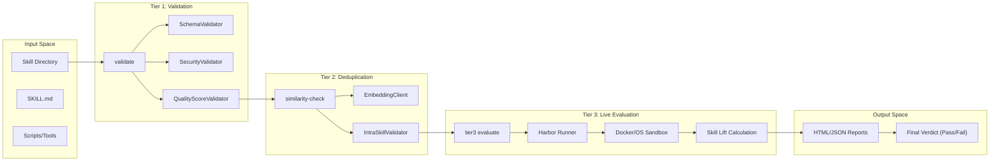
Sources: [README.md:18-31](), [docs/index.mdx:52-56](), [docs/tier1-validation.mdx:9-23]()

### Tier Summary

| Tier | Focus | Key Components / Tools | Requirement |
| :--- | :--- | :--- | :--- |
| **Tier 1** | Safety & Structure | `SchemaValidator`, `SkillSpector`, `Gitleaks`, `Semgrep` | None (Deterministic) / LLM Key (Optional) |
| **Tier 2** | Redundancy | `EmbeddingClient`, Cosine Similarity | Embedding Provider Key |
| **Tier 3** | Effectiveness | `Harbor`, `SkillLift`, `Docker` | Agent CLI + LLM Provider Key |

Sources: [README.md:24-28](), [docs/index.mdx:33-38]()

## Key Concepts

### Agent Skills
A skill is defined as a folder containing a `SKILL.md` manifest and optional supporting files (scripts, tools, or documentation) [README.md:13-14](). SkillEvaluator can also validate other artifact types like `rules`, `workflows`, and `plugins` [docs/tier1-validation.mdx:74-79]().

### Providers and Credentials
SkillEvaluator abstracts LLM and embedding interactions through a provider layer. It supports:
*   **NVIDIA Build** (Default) [README.md:60-63]()
*   **OpenAI** [README.md:77]()
*   **Anthropic** [README.md:78]()
*   **Amazon Bedrock** [README.md:79]()
*   **OpenAI-compatible** (Local/Hosted) [README.md:81-84]()

### Reporting and Verdicts
Every run generates structured reports (CLI, JSON, HTML, Markdown) [docs/tier1-validation.mdx:68](). Tier 1 and Tier 2 results typically determine the process exit code (merge gate), while Tier 3 results are often treated as "advisory" in a standard `validate` run [README.md:131-132]().

## Code Entity Mapping

The following diagram maps the high-level system concepts to the specific code entities and files that implement them.

**Title: Conceptual to Code Entity Mapping**
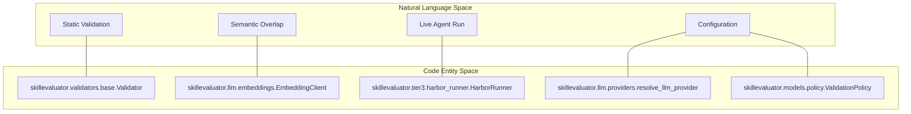
Sources: [docs/tier1-validation.mdx:90-103](), [CHANGELOG.md:15-17](), [README.md:70-84]()

## Wiki Structure

This wiki is organized to guide you from initial setup to deep architectural understanding:

*   **[Getting Started: Installation and Quickstart](#1.1)**: Covers `uv` installation, dependency extras (`[security]`, `[all]`), and your first keyless validation run [README.md:39-56]().
*   **[Configuration and Environment Variables](#1.2)**: Details how to configure providers using `SKILL_EVAL_LLM_PROVIDER` and manage validation policies via `policy.yaml` [README.md:58-91]().
*   **Core Architecture**: (Section 2) Explains the internal source layout and data models.
*   **Tier 1: Validation**: (Section 3) Deep dive into deterministic checks like `QualityScoreValidator` and `SecurityValidator` [docs/tier1-validation.mdx:9-23]().
*   **Tier 2: Deduplication**: (Section 4) Details on semantic similarity and context optimization [README.md:95-101]().
*   **Tier 3: Live Evaluation**: (Section 5) Explains the Harbor framework integration, dataset generation, and "Skill Lift" metrics [docs/index.mdx:58-64]().
*   **CI/CD and Testing**: (Sections 6 & 7) Best practices for using SkillEvaluator as a merge gate in GitHub Actions [CHANGELOG.md:8-10]().

Sources: [README.md:134-139](), [docs/index.mdx:66-81]()

---

# Page: Getting Started: Installation and Quickstart

# Getting Started: Installation and Quickstart

<details>
<summary>Relevant source files</summary>

The following files were used as context for generating this wiki page:

- [Dockerfile](Dockerfile)
- [docs/installation.mdx](docs/installation.mdx)
- [docs/quickstart.mdx](docs/quickstart.mdx)
- [pyproject.toml](pyproject.toml)
- [src/skillevaluator/cli_help.py](src/skillevaluator/cli_help.py)
- [src/skillevaluator/deduplication/utils/chunker.py](src/skillevaluator/deduplication/utils/chunker.py)
- [src/skillevaluator/evaluation/__init__.py](src/skillevaluator/evaluation/__init__.py)
- [uv.lock](uv.lock)

</details>


This page provides a technical guide for installing SkillEvaluator and executing your first validation. SkillEvaluator uses a modular dependency model to keep the base footprint small while allowing users to opt-in to LLM-backed checks (Tier 2) and live agent evaluation (Tier 3).

## Installation

SkillEvaluator requires **Python 3.12 or 3.13** [docs/installation.mdx:15-15](). The recommended installation method uses `uv` to manage the environment and tool isolation.

### Modular Dependency Extras

The package is structured to support different levels of evaluation depth via "extras" defined in the project configuration [pyproject.toml:47-76]().

| Extra | Purpose | Key Dependencies |
| :--- | :--- | :--- |
| `llm` | Shared LLM and embedding clients | `anthropic`, `openai`, `litellm`, `boto3` |
| `tier2` | Semantic deduplication and similarity | Inherits `llm` |
| `tier3` | Live agent evaluation via Harbor | Inherits `llm`, `harbor`, `mcp` |
| `security` | Local Python security scanning | `bandit`, `pip-audit` |
| `all` | Full feature set | All of the above |
| `dev` | Contributor tooling | `pytest`, `ruff`, `build` |

**Sources:** [pyproject.toml:47-87](), [docs/installation.mdx:106-121]()

### Installation Methods

#### 1. Global Tool (Recommended)
Install the full bundle as a standalone CLI tool using `uv`:
```bash
uv tool install --python 3.13 "skillevaluator[all] @ git+https://github.com/NVIDIA/SkillEvaluator.git"
```
[docs/installation.mdx:30-32]()

#### 2. Development / Source Install
For contributing or running from source, clone the repository and sync the environment:
```bash
git clone https://github.com/NVIDIA/SkillEvaluator.git
cd SkillEvaluator
uv sync --python 3.13 --all-extras
```
[docs/installation.mdx:59-63]()

#### 3. Docker
The repository includes a `Dockerfile` that installs the `[all]` extra bundle [Dockerfile:17-17](). Note that external binaries like `semgrep` are not bundled in the image and must be provided if full security evidence is required [docs/installation.mdx:101-101]().

**Sources:** [docs/installation.mdx:25-104](), [Dockerfile:1-21]()

### External System Tools
Deterministic Tier 1 checks require external binaries that are not managed by `pip`. These must be available on your `PATH`:
*   **Semgrep**: General static analysis.
*   **Gitleaks**: Secret detection.
*   **SkillSpector**: Domain-specific skill linting.

Install these via system package managers or `uv tool install` [docs/installation.mdx:132-135]().

---

## Quickstart: Your First Validation

SkillEvaluator is designed to work out-of-the-box for Tier 1 checks without an API key.

### Step 1: Quality Check (Keyless)
Run a deterministic scoring pass on a skill directory (containing a `SKILL.md` file):
```bash
skillevaluator quality-check ./my-skill
```
This executes the `QualityScoreValidator`, which provides a 0–100 score based on Correctness, Discoverability, Reliability, and Efficiency [docs/quickstart.mdx:35-39]().

### Step 2: Full Tier 1 Validation
To run the full suite of static and security checks:
```bash
skillevaluator validate ./my-skill --no-dedup
```
The `--no-dedup` flag skips Tier 2 checks that require an embedding provider [docs/quickstart.mdx:48-52]().

### Step 3: Enabling LLM Features
To unlock Tier 2 (deduplication) and Tier 3 (live eval), configure a provider. The `nv_build` provider (NVIDIA API Catalog) is the simplest starting point:
```bash
export SKILL_EVAL_LLM_PROVIDER=nv_build
export NVIDIA_API_KEY='nvapi-...'
```
[docs/quickstart.mdx:67-70]()

**Sources:** [docs/quickstart.mdx:31-75]()

---

## Data Flow and Architecture

The following diagrams illustrate how the installation state and command-line inputs translate into internal system operations.

### Dependency and Feature Mapping
This diagram bridges the "Natural Language" requirements to the "Code Entity" dependencies and internal services.

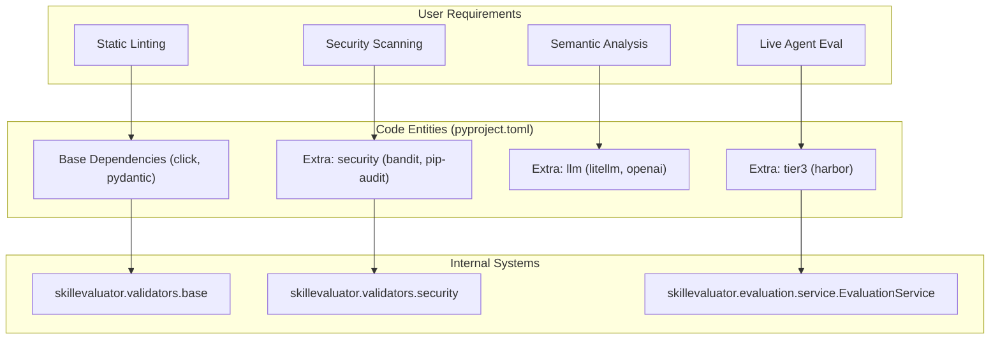
**Sources:** [pyproject.toml:39-76](), [src/skillevaluator/evaluation/service.py:20-20]()

### CLI Execution Flow
How the `skillevaluator` CLI routes requests to specific evaluation tiers.

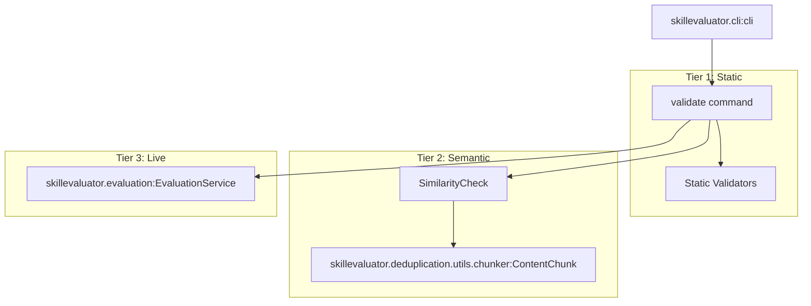
**Sources:** [pyproject.toml:95-95](), [src/skillevaluator/evaluation/__init__.py:4-20](), [src/skillevaluator/deduplication/utils/chunker.py:33-42]()

---

## Verification
Confirm the installation and environment health using the following commands:
1.  `skillevaluator --version`: Confirms the CLI is correctly installed on the `PATH` [docs/installation.mdx:148-148]().
2.  `skillevaluator health-check`: Performs an internal check of available extras and external tool paths [docs/installation.mdx:149-149]().

**Sources:** [docs/installation.mdx:143-152]()

---

# Page: Configuration and Environment Variables

# Configuration and Environment Variables

<details>
<summary>Relevant source files</summary>

The following files were used as context for generating this wiki page:

- [docs/configuration.mdx](docs/configuration.mdx)
- [docs/environment-variables.mdx](docs/environment-variables.mdx)
- [src/skillevaluator/constants.py](src/skillevaluator/constants.py)
- [src/skillevaluator/validators/schema.py](src/skillevaluator/validators/schema.py)

</details>


SkillEvaluator utilizes a multi-layered configuration system designed to support both deterministic local validation and LLM-powered analysis. Configuration is managed through environment variables, validation profiles, and policy overlays.

## Environment Variable Reference

SkillEvaluator uses two primary prefixes for environment variables: `SKILL_EVAL_*` for provider and model configuration, and `SKILLEVALUATOR_*` for product-level validation behavior and reporting [docs/environment-variables.mdx:11-15]().

### LLM Provider Configuration
These variables control the "Evaluator" LLM used for Tier 1 `rubric-eval`, Tier 2 semantic analysis, and Tier 3 judging.

| Variable | Default | Description |
| :--- | :--- | :--- |
| `SKILL_EVAL_LLM_PROVIDER` | Auto-selected | One of: `openai`, `anthropic`, `nv_build`, `bedrock`, or `openai-compatible` [docs/environment-variables.mdx:28](). |
| `SKILL_EVAL_LLM_MODEL` | Provider default | Chat model override. Required for `openai-compatible` [docs/environment-variables.mdx:29](). |
| `SKILL_EVAL_LLM_BASE_URL` | Provider default | Endpoint override; takes precedence over provider-specific base URLs [docs/environment-variables.mdx:30](). |
| `NVIDIA_API_KEY` | — | Credential for `nv_build` (NVIDIA Build) [docs/environment-variables.mdx:32](). |
| `OPENAI_API_KEY` | — | Credential for `openai` [docs/environment-variables.mdx:33](). |
| `ANTHROPIC_API_KEY` | — | Credential for `anthropic` [docs/environment-variables.mdx:34](). |

### Embedding Configuration (Tier 2)
Tier 2 semantic checks require an OpenAI-compatible embeddings API. If `SKILL_EVAL_EMBEDDING_PROVIDER` is unset, it falls back to the configured LLM provider [docs/environment-variables.mdx:65]().

| Variable | Default | Description |
| :--- | :--- | :--- |
| `SKILL_EVAL_EMBEDDING_PROVIDER` | Fallback to LLM | `openai`, `nv_build`, or `openai-compatible` [docs/environment-variables.mdx:65](). |
| `SKILL_EVAL_EMBEDDING_MODEL` | Provider default | Required for `openai-compatible` [docs/environment-variables.mdx:66](). |
| `SKILL_EVAL_EMBEDDING_BASE_URL` | Provider default | Endpoint override [docs/environment-variables.mdx:67](). |

### Validation and Scanner Paths (Tier 1)
| Variable | Default | Description |
| :--- | :--- | :--- |
| `SKILLEVALUATOR_PROFILE` | `external` | Default validation profile [docs/environment-variables.mdx:76](). |
| `SKILLEVALUATOR_BANDIT_PATH` | auto-discovered | Path to Bandit executable [docs/environment-variables.mdx:77](). |
| `SKILLEVALUATOR_SEMGREP_PATH` | auto-discovered | Path to Semgrep executable [docs/environment-variables.mdx:78](). |
| `SKILLEVALUATOR_SCHEMA_ALLOWED_DIRS` | — | Comma-separated list of extra allowed skill-root directories [docs/environment-variables.mdx:80](). |
| `SKILLEVALUATOR_SUBMITTER` | auto-detected | Identity for home-path PII check [docs/environment-variables.mdx:81](). |

**Sources:** [docs/environment-variables.mdx:22-83](), [docs/configuration.mdx:30-83](), [src/skillevaluator/constants.py:47-51]()

---

## Provider Resolution Logic

SkillEvaluator implements an auto-selection mechanism to simplify setup. If `SKILL_EVAL_LLM_PROVIDER` is not explicitly set, the system inspects exported environment variables.

### Resolution Flow: Provider & Credentials
The following diagram illustrates how `resolve_llm_provider` (and the embedding equivalent) determines the active backend.

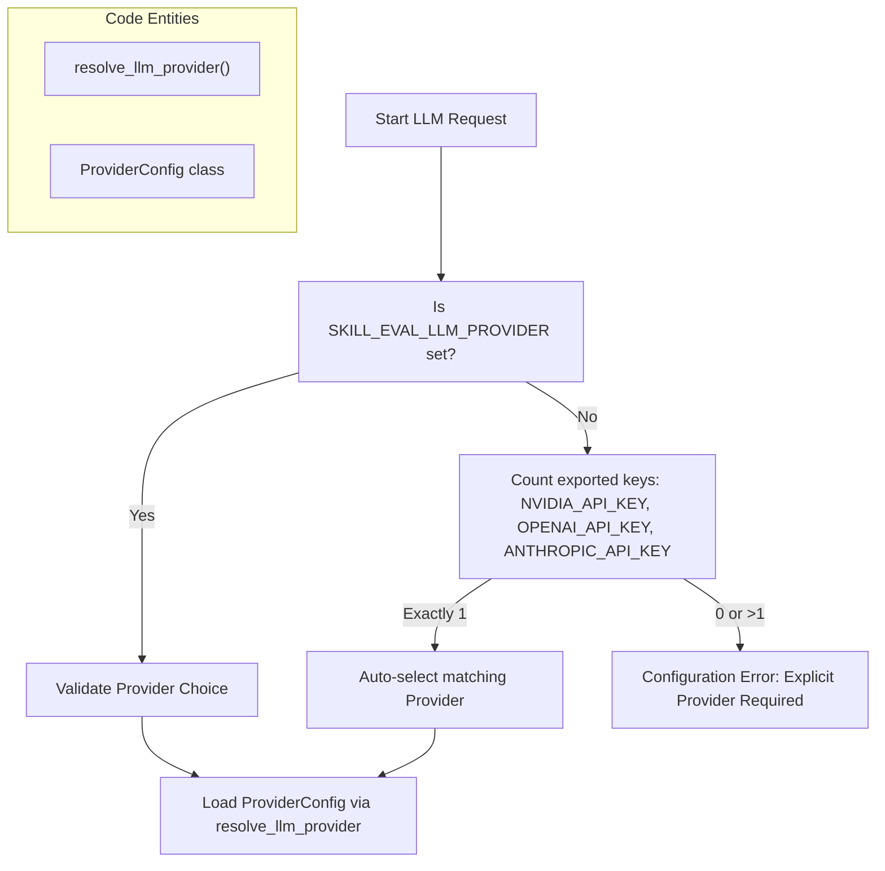
**Sources:** [docs/configuration.mdx:85-94](), [docs/environment-variables.mdx:40-49]()

---

## Policy and Profile System

Validation behavior is governed by `ValidationPolicy` objects, which define severity levels and enforcement rules for different checks.

### Profiles
Profiles are pre-defined sets of rules. The default profile is `external` [docs/environment-variables.mdx:76](). Profiles determine:
1. **Severity Overrides**: Changing a `HIGH` finding to `MEDIUM` or `ADVISORY`.
2. **Mandatory Checks**: Which validators are required to pass for a successful exit code.

### Schema Customization
The `SchemaValidator` uses `DEFAULT_ALLOWED_SKILL_DIRS` to restrict skill-root contents [src/skillevaluator/constants.py:43-45](). This can be extended without code changes using the `SKILLEVALUATOR_SCHEMA_ALLOWED_DIRS` environment variable [src/skillevaluator/constants.py:51]().

**Sources:** [src/skillevaluator/validators/schema.py:48-49](), [src/skillevaluator/constants.py:43-51]()

---

## Tier 3: Evaluation Configuration

Tier 3 utilizes the [Harbor](https://github.com/harbor-framework/harbor) framework. It distinguishes between **Evaluator Credentials** (used by SkillEvaluator to grade) and **Agent Credentials** (used by the agent being evaluated) [docs/configuration.mdx:10-13]().

### Harbor Environment Modes
The `--env-mode` flag determines how the sandbox is configured:
*   `docker`: Runs in a secure Docker container.
*   `local`: Runs on the host machine (controlled by `SKILLEVALUATOR_HARBOR_LOCAL_MODE_ALLOW`).
*   `modal`: Remote execution.

### Data Flow: Config to Sandbox
The following diagram shows how environment variables are bridged from the host into the Tier 3 evaluation sandbox.

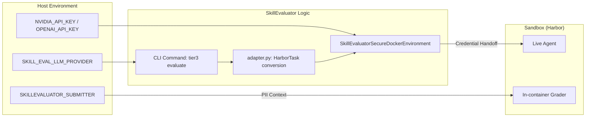
**Sources:** [docs/configuration.mdx:10-25](), [docs/environment-variables.mdx:88-100]()

---

## Key Configuration Constants

The following constants in `src/skillevaluator/constants.py` define the hard-coded boundaries of the system:

*   **Manifest Files**: `SKILL.md` is the canonical manifest [src/skillevaluator/constants.py:14](). `skill.md` (lowercase) is detected but triggers a `HIGH` severity finding [src/skillevaluator/validators/schema.py:139-155]().
*   **Excluded Directories**: `SCAN_EXCLUDED_DIRS` defines folders like `evals`, `node_modules`, and `.git` that are skipped during Tier 1 scans [src/skillevaluator/constants.py:156-169]().
*   **Field Constraints**: 
    *   Name Max Length: 64 characters [src/skillevaluator/constants.py:101]().
    *   Description Max Length: 1024 characters [src/skillevaluator/constants.py:105]().
    *   Skill File Max Lines: 500 lines [src/skillevaluator/constants.py:109]().

**Sources:** [src/skillevaluator/constants.py:1-182](), [src/skillevaluator/validators/schema.py:17-32]()

---

# Page: Core Architecture

# Core Architecture

<details>
<summary>Relevant source files</summary>

The following files were used as context for generating this wiki page:

- [docs/developer-guide.mdx](docs/developer-guide.mdx)
- [src/skillevaluator/cli.py](src/skillevaluator/cli.py)
- [src/skillevaluator/constants.py](src/skillevaluator/constants.py)
- [src/skillevaluator/models/skill.py](src/skillevaluator/models/skill.py)

</details>


SkillEvaluator is structured as a modular three-tier validation pipeline designed to ensure the quality, security, and functional correctness of AI agent skills. The architecture separates concerns between static analysis (Tier 1), semantic deduplication (Tier 2), and live agent execution (Tier 3).

### System Overview and Code Mapping

The following diagram bridges the high-level system concepts to the specific code entities that implement them.

**System Architecture Map**
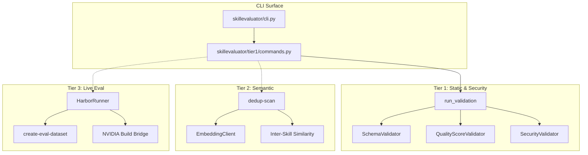
Sources: [src/skillevaluator/cli.py:167-180](), [src/skillevaluator/tier1/commands.py:46-47](), [src/skillevaluator/constants.py:117-122]()

---

### Internal Source Layout

The codebase is organized into functional modules that correspond to the three tiers, with shared models and utilities at the root of the `src` directory.

| Directory | Purpose |
| :--- | :--- |
| `src/skillevaluator/models/` | Pydantic definitions for Skills, Rules, Workflows, and Results. |
| `src/skillevaluator/tier1/` | Deterministic validators (Schema, Security, PII, Quality). |
| `src/skillevaluator/tier2/` | Semantic analysis, embedding logic, and deduplication. |
| `src/skillevaluator/tier3/` | Live evaluation logic, Harbor integration, and dataset generation. |
| `src/skillevaluator/reporting/` | Multi-format output engines (CLI, JSON, HTML, Markdown). |
| `src/skillevaluator/providers/` | Abstraction layer for LLM and Embedding providers. |

Sources: [src/skillevaluator/cli.py:32-36](), [src/skillevaluator/constants.py:9-125]()

---

### Key Data Models

SkillEvaluator uses Pydantic for strict schema enforcement. The primary entity is the **Skill**, which is defined by a `SKILL.md` file containing YAML frontmatter and Markdown instructions.

*   **`SkillFrontmatter`**: Validates the required `name` and `description` fields, ensuring kebab-case naming and length constraints [src/skillevaluator/models/skill.py:76-126]().
*   **`ValidationResult`**: The unified output model containing a collection of `Finding` objects, an overall status, and quality scores [src/skillevaluator/models/result.py:18-18]().
*   **`Finding`**: Represents a specific issue discovered by a validator, categorized by `Severity` (CRITICAL, HIGH, MEDIUM, LOW, INFO).

For details, see [Data Models and Skill Schema](#2.1).

**Data Model Relationships**
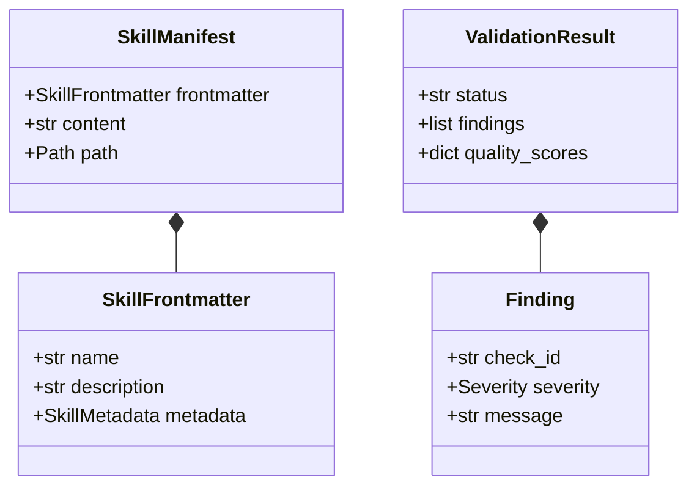
Sources: [src/skillevaluator/models/skill.py:76-200](), [src/skillevaluator/models/result.py:18-18]()

---

### Provider and LLM Abstraction

To support various environments, SkillEvaluator abstracts LLM and embedding interactions through a provider layer. This allows the system to switch between NVIDIA Build, OpenAI, Anthropic, and Amazon Bedrock without changing the core validator logic.

*   **LLM Provider**: Used for Tier 1 Rubric evaluation and Tier 3 agent execution.
*   **Embedding Provider**: Used for Tier 2 similarity checks and deduplication.

For details, see [LLM and Embedding Provider Layer](#2.2).

Sources: [src/skillevaluator/cli.py:125-129](), [docs/developer-guide.mdx:119-119]()

---

### CLI and Command Routing

The `skillevaluator` CLI is the primary entry point. It uses a "lazy loading" strategy for Tier 2 and Tier 3 dependencies. This ensures that the base installation remains lightweight and only pulls in heavy dependencies (like Harbor or Embedding libraries) when those specific features are invoked.

*   **Core Command**: `validate` - Runs Tier 1 and Tier 2 by default, with optional Tier 3 execution.
*   **Routing**: The CLI uses `click` groups to organize commands into "Core workflows", "Static and security", and "Live evaluation" [src/skillevaluator/cli.py:149-164]().

For details, see [CLI Surface and Command Routing](#2.3).

Sources: [src/skillevaluator/cli.py:32-36](), [src/skillevaluator/cli.py:167-172]()

---

# Page: Data Models and Skill Schema

# Data Models and Skill Schema

<details>
<summary>Relevant source files</summary>

The following files were used as context for generating this wiki page:

- [src/skillevaluator/models/rules.py](src/skillevaluator/models/rules.py)
- [src/skillevaluator/models/skill.py](src/skillevaluator/models/skill.py)
- [src/skillevaluator/models/workflows.py](src/skillevaluator/models/workflows.py)
- [src/skillevaluator/validators/base.py](src/skillevaluator/validators/base.py)

</details>


This page provides a detailed technical reference for the Pydantic data models that define the SkillEvaluator ecosystem. These models govern how skills, rules, and workflows are structured, validated, and reported across all three tiers of the evaluation pipeline.

The schema architecture is designed to bridge the gap between human-readable Markdown documentation and machine-executable validation logic.

## Core Schema Architecture

SkillEvaluator uses Pydantic V2 to enforce strict typing and validation logic. The data flow typically begins with a file-system path, which is parsed into a `Manifest` model, validated against a `Frontmatter` model, and finally produces a `ValidationResult`.

### Entity Relationship Diagram
The following diagram illustrates how the core data models relate to one another and the file system.

"Schema Entity Mapping"
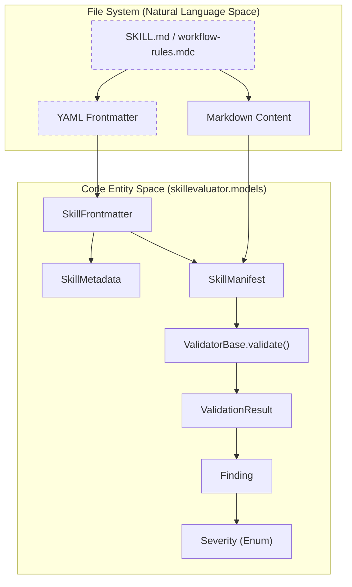
Sources: `[src/skillevaluator/models/skill.py:76-202]()`, `[src/skillevaluator/models/result.py:102-148]()`, `[src/skillevaluator/validators/base.py:140-171]()`

---

## Skill Models

The skill schema is based on the `agentskills.io` standard. It is primarily defined in `src/skillevaluator/models/skill.py`.

### SkillFrontmatter
This model validates the YAML block at the top of a `SKILL.md` file.

| Field | Type | Constraints | Description |
| :--- | :--- | :--- | :--- |
| `name` | `str` | Kebab-case, 1-64 chars | Unique identifier; must match directory name. |
| `description` | `str` | 10-1000 chars | Clear explanation of skill purpose. |
| `license` | `str | None` | - | License identifier (e.g., "Apache-2.0"). |
| `metadata` | `SkillMetadata` | - | Nested categorization and attribution. |
| `allowed-tools`| `str | None` | - | Experimental field for pre-approved tools. |

**Key Validations:**
- **Kebab-case Enforcement**: The `validate_name_format` method ensures names use only lowercase letters, numbers, and hyphens, and do not contain reserved words like "anthropic" or "claude" `[src/skillevaluator/models/skill.py:128-159]()`.
- **Forbidden Fields**: Skills are strictly prohibited from using `alwaysApply` or `globs` fields, which are reserved for Rules `[src/skillevaluator/models/skill.py:179-197]()`.

### SkillMetadata
A nested object within the frontmatter used for categorization `[src/skillevaluator/models/skill.py:33-52]()`.
- `author`: Format `Name <email@example.com>`.
- `tags`, `languages`, `frameworks`: Lists of strings (coerced from single strings if necessary via `ensure_list`).
- `domain`: High-level category (e.g., `ai-ml`, `backend`).

Sources: `[src/skillevaluator/models/skill.py:33-199]()`, `[src/skillevaluator/constants.py:16-24]()`

---

## Rules and Workflows Models

Rules and Workflows use the `.mdc` (Markdown Cursor) format. Unlike Skills, these entities are designed to be applied globally or to specific file patterns.

### Rules Schema
Defined in `src/skillevaluator/models/rules.py`, the `RulesFrontmatter` model differs from Skills in two major ways:
1. **Required Fields**: Must include `alwaysApply` (boolean) and `title` `[src/skillevaluator/models/rules.py:92-108]()`.
2. **Allowed Fields**: `globs` is permitted to define file-matching patterns `[src/skillevaluator/models/rules.py:111-114]()`.

### Workflows Schema
Workflows represent directory-based structures. The `WorkflowsFrontmatter` model (in `src/skillevaluator/models/workflows.py`) requires a `metadata.author` field, which is optional for standard rules `[src/skillevaluator/models/workflows.py:125-129]()`.

Sources: `[src/skillevaluator/models/rules.py:79-154]()`, `[src/skillevaluator/models/workflows.py:89-184]()`

---

## Validation and Reporting Models

When a validator (inheriting from `ValidatorBase`) runs, it produces structured output using the models defined in `src/skillevaluator/models/result.py`.

### ValidationResult
The container for all findings related to a single validation execution.

- `status`: A `ValidationStatus` enum (`PASSED`, `FAILED`, `SKIPPED`, `INCOMPLETE`) `[src/skillevaluator/models/result.py:102-110]()`.
- `findings`: A list of `Finding` objects.
- `metrics`: A dictionary of numerical scores (e.g., quality scores).

### Finding and Severity
A `Finding` represents a specific issue or success note discovered during validation.

"Finding Data Flow"
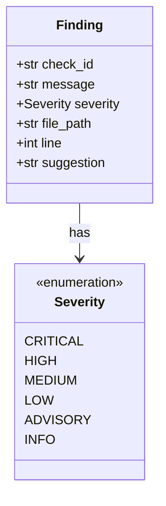
Sources: `[src/skillevaluator/models/result.py:44-91]()`

**Severity Levels:**
- `CRITICAL`: Causes immediate validation failure (Exit Code 1).
- `HIGH`/`MEDIUM`: Contributes to failure depending on policy.
- `ADVISORY`: Purely informational; does not affect exit codes but appears in reports.

---

## Data Flow: From File to Result

The validation lifecycle demonstrates how these models interact during a CLI execution.

"CLI Validation Sequence"
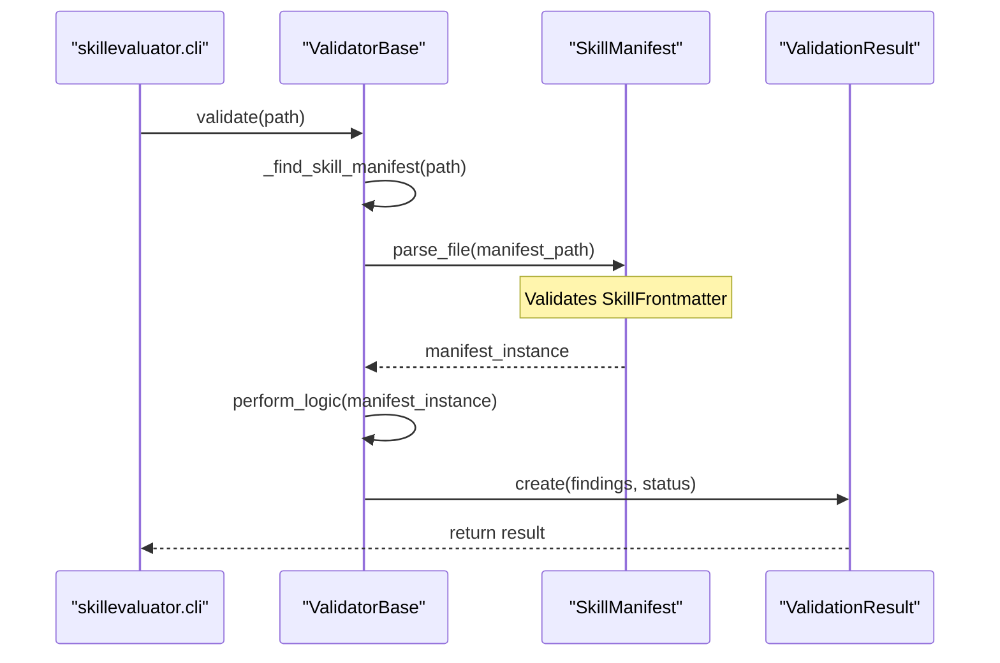
Sources: `[src/skillevaluator/validators/base.py:162-189]()`, `[src/skillevaluator/models/skill.py:200-210]()`

### Key Functions
- `iter_scannable_files`: A helper in `ValidatorBase` that walks directories while respecting `SCAN_EXCLUDED_DIRS` (like `node_modules` or `.git`) to find files matching specific extensions `[src/skillevaluator/validators/base.py:72-137]()`.
- `continue_on_failure_scope`: A context manager that allows the validator to continue gathering findings even after a `CRITICAL` error is encountered `[src/skillevaluator/validators/base.py:56-70]()`.

Sources: `[src/skillevaluator/validators/base.py:1-137]()`, `[src/skillevaluator/models/result.py:1-148]()`

---

# Page: LLM and Embedding Provider Layer

# LLM and Embedding Provider Layer

<details>
<summary>Relevant source files</summary>

The following files were used as context for generating this wiki page:

- [pyproject.toml](pyproject.toml)
- [src/skillevaluator/cli_help.py](src/skillevaluator/cli_help.py)
- [src/skillevaluator/deduplication/utils/chunker.py](src/skillevaluator/deduplication/utils/chunker.py)
- [src/skillevaluator/evaluation/__init__.py](src/skillevaluator/evaluation/__init__.py)
- [src/skillevaluator/validators/security.py](src/skillevaluator/validators/security.py)

</details>


The LLM and Embedding Provider Layer provides a unified abstraction for interacting with various Large Language Models (LLMs) and embedding services. This layer decouples the evaluation logic (Tiers 1, 2, and 3) from specific vendor SDKs, allowing SkillEvaluator to support NVIDIA (NV-Build), OpenAI, Anthropic, Amazon Bedrock, and OpenAI-compatible endpoints through a consistent interface.

## Provider Abstraction Overview

The core of this layer is the `ProviderConfig` class, which encapsulates the necessary credentials, model identifiers, and endpoint configurations for a given provider [src/skillevaluator/provider_config.py:34-42](). The system uses resolution functions to determine which provider to use based on environment variables or explicit configuration.

### Data Flow and Resolution

The following diagram illustrates how a request for an LLM or Embedding client is resolved into a concrete provider implementation.

**Provider Resolution and Data Flow**
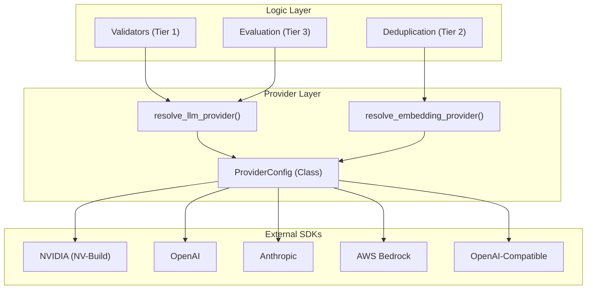
Sources: [src/skillevaluator/provider_config.py:34-42](), [src/skillevaluator/provider_config.py:204-211](), [src/skillevaluator/provider_config.py:270-277]()

## Key Components

### ProviderConfig Class
The `ProviderConfig` class is a Pydantic model that stores the configuration for a provider [src/skillevaluator/provider_config.py:34-42]().
- **`provider`**: The name of the provider (e.g., `nv_build`, `openai`).
- **`model`**: The specific model ID to use.
- **`api_key`**: The credential used for authentication.
- **`base_url`**: The API endpoint (essential for OpenAI-compatible providers).
- **`aws_access_key_id` / `aws_secret_access_key`**: Specific fields for AWS Bedrock [src/skillevaluator/provider_config.py:53-54]().

### Resolution Functions
- **`resolve_llm_provider`**: Inspects environment variables (primarily `SKILL_EVAL_LLM_PROVIDER`) to return a populated `ProviderConfig` [src/skillevaluator/provider_config.py:204-268]().
- **`resolve_embedding_provider`**: Similar to the LLM resolver, but uses `SKILL_EVAL_EMBEDDING_PROVIDER` [src/skillevaluator/provider_config.py:270-321]().

## Supported Providers and Credentials

SkillEvaluator maps environment variables to specific provider configurations. If a provider is requested but required credentials (like API keys) are missing, a `ProviderConfigurationError` is raised [src/skillevaluator/provider_config.py:23-25]().

| Provider | `SKILL_EVAL_LLM_PROVIDER` Value | Primary Credential Env Var |
| :--- | :--- | :--- |
| **NVIDIA** | `nv_build` | `NVIDIA_API_KEY` |
| **OpenAI** | `openai` | `OPENAI_API_KEY` |
| **Anthropic** | `anthropic` | `ANTHROPIC_API_KEY` |
| **AWS Bedrock** | `bedrock` | `AWS_ACCESS_KEY_ID`, `AWS_SECRET_ACCESS_KEY` |
| **OpenAI Compatible** | `openai-compatible` | `OPENAI_API_KEY` |

Sources: [src/skillevaluator/provider_config.py:213-268](), [src/skillevaluator/provider_config.py:34-60]()

## Integration with Security Scanning

The provider layer also handles credential handoff for external tools like `skillspector`. The function `_skillspector_child_env` translates SkillEvaluator's `ProviderConfig` into the environment variables expected by the `skillspector` CLI [src/skillevaluator/validators/security.py:148-195]().

**Credential Handoff to External Tools**
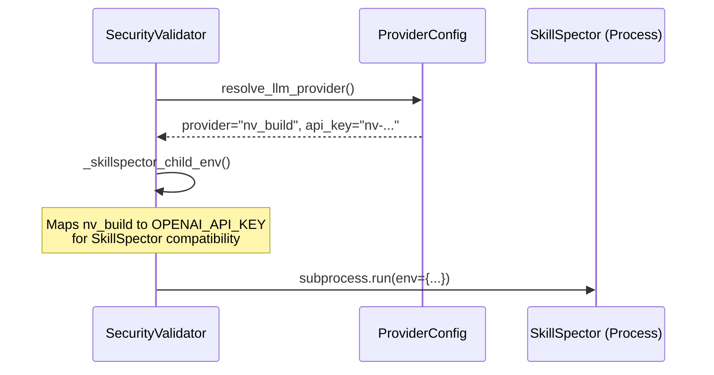
Sources: [src/skillevaluator/validators/security.py:148-195](), [src/skillevaluator/validators/security.py:58-64]()

## Embedding Client Implementation

For Tier 2 (Deduplication) and semantic analysis, the `EmbeddingClient` uses the provider configuration to generate vector representations of content chunks [src/skillevaluator/deduplication/utils/chunker.py:33-42]().

1. **Chunking**: Content is split into `ContentChunk` objects by `chunk_file` [src/skillevaluator/deduplication/utils/chunker.py:49-61]().
2. **Resolution**: `resolve_embedding_provider` is called to get the configuration [src/skillevaluator/provider_config.py:270-277]().
3. **Embedding**: The text within each chunk is sent to the provider's embedding endpoint to populate the `embedding` field [src/skillevaluator/deduplication/utils/chunker.py:42]().

Sources: [src/skillevaluator/deduplication/utils/chunker.py:33-61](), [src/skillevaluator/provider_config.py:270-277]()

---

# Page: CLI Surface and Command Routing

# CLI Surface and Command Routing

<details>
<summary>Relevant source files</summary>

The following files were used as context for generating this wiki page:

- [docs/cli-reference.mdx](docs/cli-reference.mdx)
- [src/skillevaluator/cli.py](src/skillevaluator/cli.py)
- [src/skillevaluator/tier1/commands.py](src/skillevaluator/tier1/commands.py)
- [tests/golden/cli_surface.json](tests/golden/cli_surface.json)
- [tests/test_checks_routing.py](tests/test_checks_routing.py)
- [tests/test_cli.py](tests/test_cli.py)
- [tests/test_commands.py](tests/test_commands.py)

</details>


The `skillevaluator` CLI serves as a unified entry point for all three validation tiers. It is built using the [Click](https://click.palletsprojects.com/) library and employs a modular structure that optimizes for startup speed and dependency management through lazy loading of high-overhead modules.

## Unified CLI Architecture

The CLI is structured into a root group that routes to individual commands and specialized "expert" tier groups. This design allows for both high-level workflows (like `validate`) and deep-dive diagnostic tools (like `doctor` or `harbor-view`).

### Command Grouping and Help
To maintain clarity across a large command surface, the CLI uses a custom `RichGroup` [src/skillevaluator/cli_help.py:16-16]() class to organize `--help` output into logical sections:
*   **Core Workflows**: `validate`, `health-check`, `doctor`, `models` [src/skillevaluator/cli.py:150-150]().
*   **Tier 1 (Static/Security)**: `quality-check`, `rubric-eval`, `security-scan`, etc [src/skillevaluator/cli.py:151-154]().
*   **Tier 2 (Deduplication)**: `similarity-check`, `context-optimization-check`, `dedup-scan` [src/skillevaluator/cli.py:155-158]().
*   **Tier 3 (Live Evaluation)**: `create-eval-dataset`, `compare`, `view`, `harbor-view` [src/skillevaluator/cli.py:159-162]().

### Performance: Lazy Imports
SkillEvaluator utilizes an "extras" dependency model (e.g., `pip install skillevaluator[tier2,tier3]`). To ensure the base CLI remains functional and fast even if heavy dependencies (like Harbor or Torch) are missing, the implementation follows these rules:
1.  **Tier 1**: Eagerly imported; safe for base installs [src/skillevaluator/cli.py:32-37]().
2.  **Tier 2/3**: Lazily imported inside the command callback functions [src/skillevaluator/cli.py:33-36](). This prevents `ModuleNotFoundError` during the command discovery phase.

**Sources:** [src/skillevaluator/cli.py:32-47](), [src/skillevaluator/cli.py:149-164]()

---

## Command Surface Reference

The following table maps the primary CLI commands to their internal routing logic.

| CLI Command | Internal Callback / Logic | Tier | Purpose |
| :--- | :--- | :--- | :--- |
| `validate` | `run_validation` + `_run_agent_eval_or_skip` | 1, 2, 3 | Full pipeline execution; gates exit code on Tier 1 & 2. |
| `quality-check` | `run_quality_check` | 1 | Scores skill across 4 weighted quality dimensions. |
| `security-scan` | `run_security_scan` | 1 | Executes Semgrep, Gitleaks, and LLM-based code risk scans. |
| `similarity-check` | `run_similarity_check` | 2 | Detects duplicate content across multiple skill directories. |
| `evaluate` | `run_agent_eval` | 3 | Triggers the Harbor-based live agent evaluation. |
| `doctor` | `run_doctor` | 3 | Validates environment readiness (Docker, API keys, agents). |
| `harbor-view` | `format_harbor_view_command` | 3 | Browser-based UI for viewing Harbor job artifacts. |

**Sources:** [docs/cli-reference.mdx:18-40](), [src/skillevaluator/cli.py:149-164](), [src/skillevaluator/tier1/commands.py:135-148]()

---

## The `validate` Pipeline Routing

The `validate` command is the primary entry point for CI/CD. It routes requests through all three tiers based on flags like `--tier3` or `--no-dedup`.

### Data Flow: Natural Language Space to Code Entity Space

The following diagram illustrates how a user invocation of `skillevaluator validate` routes through the internal engine components.

**Title: Validation Pipeline Command Routing**
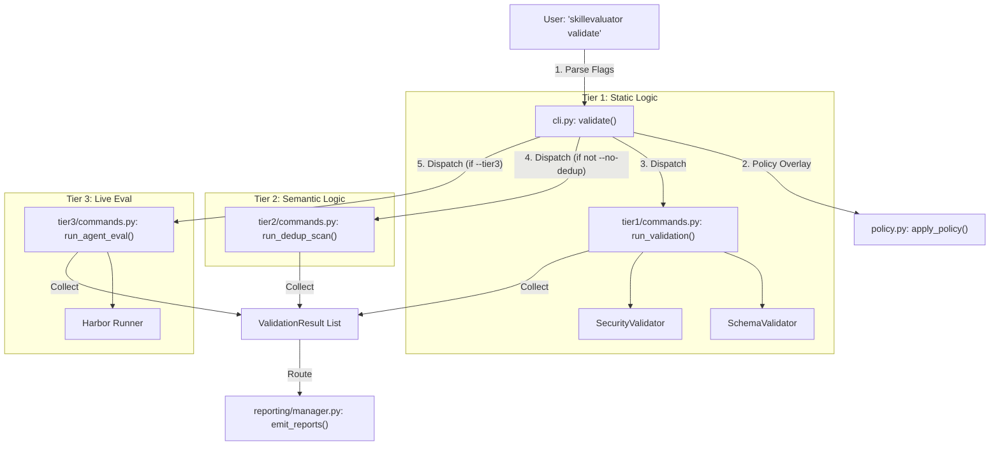
**Sources:** [src/skillevaluator/cli.py:180-146](), [src/skillevaluator/tier1/commands.py:135-166]()

---

## Check Routing and Alias Handling

The CLI provides flexible ways to select specific checks and handles deprecated aliases to maintain backward compatibility.

### Check Selection Logic
The `_enabled_checks` function in Tier 1 handles the mapping of short-hand strings to canonical `Validator` instances.
*   **Aliases**: `code` or `code-risk` maps to `code-integrity`; `deps` maps to `dependency` [src/skillevaluator/tier1/commands.py:89-99]().
*   **Opt-in Checks**: Some checks, like `dependency` (CVE auditing), are excluded from the default run and must be explicitly requested via `--checks` [src/skillevaluator/tier1/commands.py:62-66]().

### Content-Type Aware Routing
The CLI identifies the target type (skill, rules, workflows, or plugin) to select the correct schema validator [src/skillevaluator/tier1/commands.py:108-122]().

**Title: Internal Check Resolver and Validator Mapping**
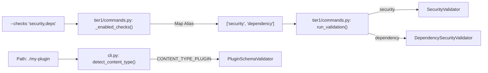
**Sources:** [src/skillevaluator/tier1/commands.py:51-105](), [src/skillevaluator/tier1/commands.py:108-122]()

---

## Exit Code Contract

The CLI communicates results to parent processes (like GitHub Actions) through a specific set of exit codes defined in the reporting layer and enforced at the end of the `validate` command.

*   **Code 0**: All checks passed (or only advisory failures occurred).
*   **Code 1**: Validation failed (Critical or Error severity findings in gated tiers).
*   **Code 2**: Configuration error (e.g., invalid CLI flags, unreadable skill path).
*   **Code 3**: Runtime error (unhandled exception/internal failure).

**Sources:** [docs/cli-reference.mdx:52-60](), [src/skillevaluator/cli.py:131-146]()

---

# Page: Tier 1: Validation

# Tier 1: Validation

<details>
<summary>Relevant source files</summary>

The following files were used as context for generating this wiki page:

- [README.md](README.md)
- [docs/ci-integration.mdx](docs/ci-integration.mdx)
- [docs/tier1-validation.mdx](docs/tier1-validation.mdx)
- [src/skillevaluator/tier1/commands.py](src/skillevaluator/tier1/commands.py)

</details>


Tier 1 serves as the deterministic quality gate for AI agent artifacts. It focuses on static analysis, security scanning, and schema compliance to ensure that a skill is safe, well-formed, and ready for more complex evaluation. Tier 1 checks generally run offline and do not require API keys unless optional LLM-backed features like rubric evaluation or LLM-verification of security findings are enabled [docs/tier1-validation.mdx:7-7]().

The primary entry point is the `skillevaluator validate` command, which orchestrates the sequence of checks and determines the final exit status of the evaluation [docs/tier1-validation.mdx:22-22]().

### The Validation Pipeline

The Tier 1 pipeline executes a series of validators in a canonical order. While users can select specific checks via the `--checks` flag, the system defaults to a comprehensive suite [src/skillevaluator/tier1/commands.py:51-61]().

| Sequence | Check Name | Description |
| :--- | :--- | :--- |
| 1 | `schema` | Validates `SKILL.md` frontmatter, directory structure, and naming conventions. |
| 2 | `version` | Ensures version strings follow semantic versioning. |
| 3 | `security` | Scans for vulnerabilities using Semgrep, SkillSpector, and Bandit. |
| 4 | `pii` | Detects secrets, credentials, and Personally Identifiable Information. |
| 5 | `license` | Verifies license headers and compliance with allowed license types. |
| 6 | `code-integrity` | Checks for risks in executable code and scripts. |
| 7 | `unicode` | Detects "Trojan Source" or BiDi override attacks in text files. |
| 8 | `quality` | Calculates a 0-100 score across Correctness, Discoverability, Reliability, and Efficiency. |
| 9 | `lint` | Performs AST-based advisory linting on Python scripts. |

**Sources:** [src/skillevaluator/tier1/commands.py:51-61](), [docs/tier1-validation.mdx:121-123]()

### System Architecture: Command to Validator Mapping

The following diagram bridges the CLI command space to the internal class entities responsible for execution.

**Tier 1 Validator Mapping**
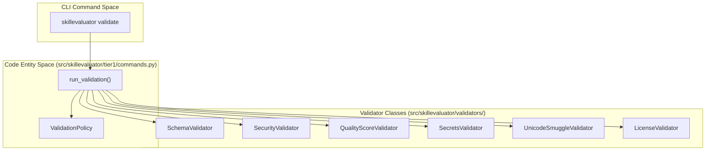
**Sources:** [src/skillevaluator/tier1/commands.py:25-41](), [src/skillevaluator/tier1/commands.py:135-148]()

### Policy and Profile System

Validation behavior is governed by **Profiles** (predefined sets of rules) and **Policies** (runtime configurations that can override profiles). 

*   **Profiles**: The `external` profile is the default, designed for public-facing skills. It enforces rules like mandatory author attribution [docs/tier1-validation.mdx:92-93]().
*   **Policy Overlays**: Users can provide a `policy.yaml` to override severities (e.g., turning a `warning` into a `critical` failure) or restrict author email domains [docs/tier1-validation.mdx:104-115]().

**Sources:** [src/skillevaluator/validators/policy.py:31-31](), [docs/tier1-validation.mdx:90-102]()

### Exit Codes and Semantics

The `validate` command uses specific exit codes to signal the result to CI/CD pipelines. Tier 1 findings are "gating," meaning a failure here will cause a non-zero exit code [docs/ci-integration.mdx:19-19]().

| Exit Code | Meaning |
| :--- | :--- |
| `0` | **Success**: All gating checks passed. |
| `1` | **Failure**: One or more gating checks failed (e.g., a CRITICAL security finding). |
| `2` | **Config Error**: Invalid flags or unreadable target paths. |
| `3` | **Runtime Error**: Internal system crash. |

**Sources:** [docs/ci-integration.mdx:12-17]()

### Implementation Flow

The validation logic flows from the CLI through `run_validation`, which instantiates the necessary validator classes based on the detected content type (Skill, Plugin, Rules, or Workflow) [src/skillevaluator/tier1/commands.py:108-121]().

**Content Type Resolution**
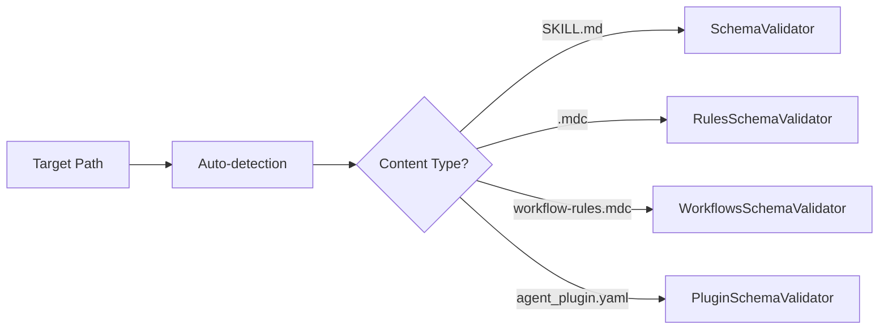
**Sources:** [docs/tier1-validation.mdx:74-79](), [src/skillevaluator/tier1/commands.py:108-121]()

---

### Detailed Check Categories

For more information on specific validation areas, refer to the child pages:

*   **[Schema, Quality, and Rubric Checks](#3.1)**: Details on deterministic structure validation, the 4-dimension quality scoring algorithm, and LLM-as-judge rubric evaluations.
*   **[Security, PII, and Unicode Checks](#3.2)**: Deep dive into the security stack, including SkillSpector integration, secrets detection, and Unicode "Trojan Source" prevention.
*   **[Policy, Profiles, and Validation Reporting](#3.3)**: How to configure validation policies, use profiles, and interpret the various report formats (JSON, HTML, Markdown).

---

# Page: Schema, Quality, and Rubric Checks

# Schema, Quality, and Rubric Checks

<details>
<summary>Relevant source files</summary>

The following files were used as context for generating this wiki page:

- [src/skillevaluator/validators/quality_score.py](src/skillevaluator/validators/quality_score.py)
- [src/skillevaluator/validators/rules_schema.py](src/skillevaluator/validators/rules_schema.py)
- [src/skillevaluator/validators/schema.py](src/skillevaluator/validators/schema.py)
- [src/skillevaluator/validators/version.py](src/skillevaluator/validators/version.py)
- [src/skillevaluator/validators/workflows_schema.py](src/skillevaluator/validators/workflows_schema.py)
- [tests/validators/test_quality_score.py](tests/validators/test_quality_score.py)
- [tests/validators/test_rules_schema.py](tests/validators/test_rules_schema.py)
- [tests/validators/test_schema.py](tests/validators/test_schema.py)
- [tests/validators/test_version.py](tests/validators/test_version.py)
- [tests/validators/test_workflows_schema.py](tests/validators/test_workflows_schema.py)

</details>


This page provides a detailed examination of the deterministic Tier 1 checks within SkillEvaluator: `SchemaValidator`, `QualityScoreValidator`, `RubricEvalValidator`, and `VersionValidator`. These validators ensure that skills adhere to structural, quality, and versioning standards, contributing to the overall integrity and usability of the skill ecosystem. Each validator is designed to perform specific checks and report findings, which are then aggregated into a `ValidationResult`.

## SchemaValidator

The `SchemaValidator` is responsible for enforcing the structural and naming conventions of skills, rules, and workflows within the SkillEvaluator ecosystem. It ensures that `SKILL.md` frontmatter conforms to a predefined schema, directory structures are correct, and naming conventions (like kebab-case) are followed.

### Implementation Details

The `SchemaValidator` class [src/skillevaluator/validators/schema.py:38-46]() inherits from `ValidatorBase` [src/skillevaluator/validators/base.py](). It performs a series of checks, including:
*   **`SKILL.md` Existence**: Verifies that a `SKILL.md` file exists in the skill directory [src/skillevaluator/validators/schema.py:118-131]().
*   **Manifest Naming**: Checks if the skill manifest is named `SKILL.md` (uppercase) as per specification, issuing a `HIGH` severity finding for `skill.md` (lowercase) [src/skillevaluator/validators/schema.py:139-154]().
*   **Frontmatter Validation**: Parses the YAML frontmatter in `SKILL.md` and validates it against the `SkillFrontmatter` Pydantic schema [src/skillevaluator/validators/schema.py:176-209](). This is a prerequisite for many other checks.
*   **Folder Structure**: Ensures the skill directory adheres to expected structures, such as `skills/` or `team-skills/` [src/skillevaluator/validators/schema.py:211-230]().
*   **Naming Conventions**: Validates that skill names and directory names follow kebab-case [src/skillevaluator/validators/schema.py:232-249]().
*   **Name-Directory Consistency**: Confirms that the `name` field in the frontmatter matches the skill's directory name [src/skillevaluator/validators/schema.py:251-268]().
*   **Author Attribution**: Validates the format of the author field (`Name <email>`) and can enforce email domain restrictions based on the `ValidationPolicy` [src/skillevaluator/validators/schema.py:270-294]().
*   **Line Count**: Checks that the `SKILL.md` file does not exceed `MAX_SKILL_MD_LINES` [src/skillevaluator/validators/schema.py:296-309]().
*   **Body Content**: Verifies the presence of required and recommended sections (e.g., "Purpose", "Instructions", "Examples") in the `SKILL.md` body [src/skillevaluator/validators/schema.py:311-347]().
*   **Optional Files**: Checks for the presence of optional files like `README.md` or `LICENSE` [src/skillevaluator/validators/schema.py:349-362]().

The validator can process a single skill directory or recursively scan a root directory for multiple skills [src/skillevaluator/validators/schema.py:60-113]().

### Rules and Workflows Schema Validation

Similar schema validators exist for `Rules` and `Workflows`:
*   `RulesSchemaValidator` [src/skillevaluator/validators/rules_schema.py:34-39]() validates `.mdc` rule files, ensuring they are in `team-rules/` folders, have specific frontmatter fields (`alwaysApply`, `title`, `description`, `globs`), and follow naming conventions.
*   `WorkflowsSchemaValidator` [src/skillevaluator/validators/workflows_schema.py:45-50]() validates workflow directories, which must contain `README.md`, `workflow-rules.mdc`, and a `references/` directory with `.mdc` files.

### Data Flow

The `validate` method [src/skillevaluator/validators/schema.py:59-113]() is the entry point. It determines if the `skill_path` is a single skill directory or a root containing multiple skills. For each skill, it calls `_validate_single_skill` [src/skillevaluator/validators/schema.py:115-174](), which orchestrates the various checks. Findings are collected in a `ValidationResult` object.

```mermaid
graph TD
    A[SchemaValidator.validate(skill_path)] --> B{Is skill_path a single skill directory?};
    B -- Yes --> C[_validate_single_skill(skill_path)];
    B -- No --> D[_find_all_skills(skill_path)];
    D --> E{No skills found?};
    E -- Yes --> F[Add HIGH finding: "No skills found"];
    E -- No --> G[Initialize ValidationResult];
    G --> H[Loop through skill_dirs];
    H --> I[_validate_single_skill(skill_dir)];
    I --> J{Skill validation passed?};
    J -- Yes --> K[Add success details to result];
    J -- No --> L[Merge skill_result with prefix];
    C --> M[Find SKILL.md];
    M --> N{SKILL.md found?};
    N -- No --> O[Add HIGH finding: "SKILL.md not found"];
    N -- Yes --> P[Validate manifest naming (case)];
    P --> Q[_validate_frontmatter(skill_md)];
    Q --> R{Frontmatter passed?};
    R -- No --> S[Return result];
    R -- Yes --> T[Validate folder structure];
    T --> U[Validate naming conventions];
    U --> V[Validate line count];
    V --> W[Validate body content];
    W --> X[Validate optional files];
    X --> Y{Frontmatter metadata available?};
    Y -- Yes --> Z[Validate name matches directory];
    Z --> AA[Validate author];
    AA --> BB[Return result];
    F --> BB;
    L --> H;
    K --> H;
```
**Diagram: SchemaValidator Data Flow**

Sources:
*   [src/skillevaluator/validators/schema.py:38-46]()
*   [src/skillevaluator/validators/schema.py:59-113]()
*   [src/skillevaluator/validators/schema.py:115-174]()
*   [src/skillevaluator/validators/schema.py:118-131]()
*   [src/skillevaluator/validators/schema.py:139-154]()
*   [src/skillevaluator/validators/schema.py:176-209]()
*   [src/skillevaluator/validators/schema.py:211-230]()
*   [src/skillevaluator/validators/schema.py:232-249]()
*   [src/skillevaluator/validators/schema.py:251-268]()
*   [src/skillevaluator/validators/schema.py:270-294]()
*   [src/skillevaluator/validators/schema.py:296-309]()
*   [src/skillevaluator/validators/schema.py:311-347]()
*   [src/skillevaluator/validators/schema.py:349-362]()
*   [src/skillevaluator/validators/rules_schema.py:34-39]()
*   [src/skillevaluator/validators/workflows_schema.py:45-50]()
*   [src/skillevaluator/validators/base.py]()

## QualityScoreValidator

The `QualityScoreValidator` assesses the quality of skills across four weighted dimensions, producing a composite score from 0-100 and an A-F letter grade. This validator is designed to be compatible with SkillEvaluator Tier 1 scoring and complements the structural checks of the `SchemaValidator`.

### Dimensions and Weights

The four dimensions and their respective weights are:
*   **Correctness (35%)**: Focuses on structural integrity, frontmatter accuracy, and type-specific rules.
*   **Discoverability (25%)**: Evaluates description quality, naming clarity, and purpose articulation.
*   **Reliability (25%)**: Assesses error handling, prerequisites, and troubleshooting information.
*   **Efficiency (15%)**: Examines token budget adherence, repetition, and instruction clarity.

These dimensions are defined in the class docstring [src/skillevaluator/validators/quality_score.py:4-17]().

### Implementation Details

The `QualityScoreValidator` class [src/skillevaluator/validators/quality_score.py:40-48]() also inherits from `ValidatorBase`. Its `validate` method [src/skillevaluator/validators/quality_score.py:114-120]() can validate a single skill or an entire folder of skills.

Key functions and checks include:
*   **`detect_skill_type`** [src/skillevaluator/validators/quality_score.py:66-97](): Automatically identifies the skill type (e.g., `script-based`, `lib-based`, `resource-based`, `guide-only`, `hybrid`) based on its directory contents. This influences specific quality checks.
*   **`_validate_single_skill`** [src/skillevaluator/validators/quality_score.py:166-185](): Orchestrates the quality checks for a single skill.
*   **Correctness Checks**:
    *   `_check_frontmatter_completeness` [src/skillevaluator/validators/quality_score.py:190-214](): Ensures essential frontmatter fields are present.
    *   `_check_metadata_fields` [src/skillevaluator/validators/quality_score.py:216-240](): Verifies the presence of recommended metadata fields like `author` and `tags`.
    *   `_check_skill_type_specific_rules` [src/skillevaluator/validators/quality_score.py:242-270](): Applies rules based on the detected skill type (e.g., `scripts/` directory for script-based skills).
*   **Discoverability Checks**:
    *   `_check_description_quality` [src/skillevaluator/validators/quality_score.py:272-300](): Assesses the length and content of the skill description.
    *   `_check_naming_conventions` [src/skillevaluator/validators/quality_score.py:302-320](): Checks for kebab-case naming and avoids reserved names.
    *   `_check_purpose_clarity` [src/skillevaluator/validators/quality_score.py:322-339](): Looks for a "Purpose" section in `SKILL.md`.
*   **Reliability Checks**:
    *   `_check_prerequisites_and_troubleshooting` [src/skillevaluator/validators/quality_score.py:341-360](): Ensures "Prerequisites" and "Troubleshooting" sections are present.
    *   `_check_error_handling_in_scripts` [src/skillevaluator/validators/quality_score.py:362-384](): Scans script files for common error handling patterns (e.g., `try-except`).
*   **Efficiency Checks**:
    *   `_check_token_budget` [src/skillevaluator/validators/quality_score.py:386-404](): Estimates token count and warns if it exceeds `QUALITY_RECOMMENDED_MAX_TOKENS`.
    *   `_check_instruction_clarity` [src/skillevaluator/validators/quality_score.py:406-423](): Looks for an "Instructions" section.

The `QualityScoreResult` model [src/skillevaluator/models/quality.py]() tracks scores for each dimension and calculates the overall weighted score and letter grade.

```mermaid
graph TD
    A[QualityScoreValidator.validate(skill_path)] --> B{Is skill_path a single skill directory?};
    B -- Yes --> C[_validate_single_skill(skill_path)];
    B -- No --> D[_validate_folder(skill_path)];

    C --> E[Initialize QualityScoreResult];
    C --> F[Find SKILL.md];
    F --> G{SKILL.md found?};
    G -- No --> H[Add HIGH finding: "SKILL.md not found"];
    G -- Yes --> I[Parse SKILL.md content];
    I --> J[Detect skill type];

    J --> K[Run Correctness Checks];
    K --> K1[_check_frontmatter_completeness];
    K --> K2[_check_metadata_fields];
    K --> K3[_check_skill_type_specific_rules];

    J --> L[Run Discoverability Checks];
    L --> L1[_check_description_quality];
    L --> L2[_check_naming_conventions];
    L --> L3[_check_purpose_clarity];

    J --> M[Run Reliability Checks];
    M --> M1[_check_prerequisites_and_troubleshooting];
    M --> M2[_check_error_handling_in_scripts];

    J --> N[Run Efficiency Checks];
    N --> N1[_check_token_budget];
    N --> N2[_check_instruction_clarity];

    K, L, M, N --> O[Calculate overall score and grade];
    O --> P[Add quality_scores to result metadata];
    P --> Q[Return ValidationResult];

    D --> R[Find all skills in folder];
    R --> S[Loop through skill_dirs];
    S --> T[_validate_single_skill(skill_dir)];
    T --> U[Merge sub-results and aggregate quality scores];
    U --> Q;
    H --> Q;
```
**Diagram: QualityScoreValidator Data Flow**

Sources:
*   [src/skillevaluator/validators/quality_score.py:4-17]()
*   [src/skillevaluator/validators/quality_score.py:40-48]()
*   [src/skillevaluator/validators/quality_score.py:66-97]()
*   [src/skillevaluator/validators/quality_score.py:114-120]()
*   [src/skillevaluator/validators/quality_score.py:166-185]()
*   [src/skillevaluator/validators/quality_score.py:190-214]()
*   [src/skillevaluator/validators/quality_score.py:216-240]()
*   [src/skillevaluator/validators/quality_score.py:242-270]()
*   [src/skillevaluator/validators/quality_score.py:272-300]()
*   [src/skillevaluator/validators/quality_score.py:302-320]()
*   [src/skillevaluator/validators/quality_score.py:322-339]()
*   [src/skillevaluator/validators/quality_score.py:341-360]()
*   [src/skillevaluator/validators/quality_score.py:362-384]()
*   [src/skillevaluator/validators/quality_score.py:386-404]()
*   [src/skillevaluator/validators/quality_score.py:406-423]()
*   [src/skillevaluator/models/quality.py]()

## RubricEvalValidator

The `RubricEvalValidator` leverages an LLM-as-judge approach to evaluate skills against a predefined rubric. This validator is part of Tier 1, but unlike the `SchemaValidator` and `QualityScoreValidator`, it requires an LLM provider to be configured.

*(Note: The provided code snippets do not contain the implementation details for `RubricEvalValidator`. The description below is based on the high-level overview provided in the prompt.)*

### Implementation Details (Conceptual)

The `RubricEvalValidator` would likely:
1.  **Load Rubric**: Define a set of criteria (e.g., 9 criteria as mentioned in the prompt) against which the skill will be evaluated. These criteria would cover aspects like clarity, completeness, safety, and effectiveness.
2.  **Prepare Skill Context**: Extract relevant information from the skill (e.g., `SKILL.md` content, code snippets, examples) to provide to the LLM.
3.  **LLM Interaction**: Send the skill context and the rubric criteria to a configured LLM (via the LLM provider layer). The LLM would then act as a judge, evaluating the skill against each criterion and providing a score or a textual assessment.
4.  **Parse LLM Output**: Process the LLM's response to extract structured findings and scores.
5.  **Generate Findings**: Convert the LLM's assessment into `Finding` objects, potentially assigning severity levels based on the LLM's verdict.

### Data Flow (Conceptual)

```mermaid
graph TD
    A[RubricEvalValidator.validate(skill_path)] --> B[Load Rubric Criteria];
    B --> C[Extract Skill Content (SKILL.md, code, examples)];
    C --> D[Prepare Prompt for LLM (Skill Content + Rubric)];
    D --> E[LLM Provider Layer];
    E --> F[LLM (e.g., NVIDIA Build, OpenAI)];
    F --> G[LLM Response (Evaluation against Rubric)];
    G --> H[Parse LLM Output];
    H --> I[Generate Findings and Scores];
    I --> J[Return ValidationResult];
```
**Diagram: RubricEvalValidator Data Flow (Conceptual)**

Sources:
*   No direct code citations for `RubricEvalValidator` implementation were provided.

## VersionValidator

The `VersionValidator` ensures that skills adhere to semantic versioning (SemVer) standards, specifically for the `metadata.version` field in `SKILL.md`. It also enforces monotonic version bumps when a previous version is provided, typically in a CI/CD context.

### Implementation Details

The `VersionValidator` class [src/skillevaluator/validators/version.py:54-59]() inherits from `ValidatorBase`.
*   **Initialization**: It can be initialized with a `previous_version` argument or will attempt to read it from the `SKILLEVALUATOR_PREVIOUS_VERSION` environment variable [src/skillevaluator/validators/version.py:57-59]().
*   **`_extract_version`** [src/skillevaluator/validators/version.py:24-42](): This helper function extracts the version string specifically from `metadata.version`. It intentionally ignores a legacy top-level `version` field to avoid breaking existing skills that might have non-SemVer values there.
*   **`_version_tuple`** [src/skillevaluator/validators/version.py:45-52](): Parses a SemVer string (e.g., "1.2.3") into a tuple of integers for comparison.
*   **`_validate_previous_version`** [src/skillevaluator/validators/version.py:81-152](): This is the core logic for comparing the current skill's version with a provided `previous_version`.
    *   It checks if the `previous_version` itself is a valid SemVer string [src/skillevaluator/validators/version.py:89-101]().
    *   If a `previous_version` is provided but the current skill has no `metadata.version`, it issues a `HIGH` finding [src/skillevaluator/validators/version.py:104-115]().
    *   It ensures both current and previous versions can be parsed as `x.y.z` SemVer [src/skillevaluator/validators/version.py:119-134]().
    *   Crucially, it checks that the `current_tuple` is strictly greater than `previous_tuple`, enforcing monotonic version bumps [src/skillevaluator/validators/version.py:136-150]().
*   **`_validate_single_skill`** [src/skillevaluator/validators/version.py:154-190]():
    *   Finds the `SKILL.md` manifest.
    *   Parses its frontmatter.
    *   Extracts the `metadata.version`.
    *   If no `metadata.version` is present, and no `previous_version` was supplied, it passes with a `version_optional` success message [src/skillevaluator/validators/version.py:171-178]().
    *   If `metadata.version` is present, it validates it against the `SEMVER_RE` regex [src/skillevaluator/validators/version.py:181-190]().
    *   If a `previous_version` was supplied, it calls `_validate_previous_version` [src/skillevaluator/validators/version.py:171-173]().

### Data Flow

```mermaid
graph TD
    A[VersionValidator.validate(skill_path)] --> B[_validate_folder_or_skill];
    B --> C[_validate_single_skill(skill_path)];

    C --> D[Find SKILL.md manifest];
    D --> E{Manifest found?};
    E -- No --> F[Add error: "No SKILL.md found"];
    E -- Yes --> G[Parse frontmatter];
    G --> H[Extract current version from metadata.version];

    H --> I{Current version present?};
    I -- No --> J{Previous version supplied?};
    J -- No --> K[Add success: "version_optional"];
    J -- Yes --> L[_validate_previous_version(current="", manifest, result)];
    L --> M{_validate_previous_version passed?};
    M -- No --> N[Return result with findings];
    M -- Yes --> K;

    I -- Yes --> O{Current version matches SEMVER_RE?};
    O -- No --> P[Add HIGH finding: "version_semver"];
    O -- Yes --> Q{Previous version supplied?};
    Q -- No --> R[Add success: "version_semver"];
    Q -- Yes --> S[_validate_previous_version(current, manifest, result)];
    S --> T{_validate_previous_version passed?};
    T -- No --> N;
    T -- Yes --> R;

    K, R --> U[Return ValidationResult];
    F, P --> N;
```
**Diagram: VersionValidator Data Flow**

Sources:
*   [src/skillevaluator/validators/version.py:24-42]()
*   [src/skillevaluator/validators/version.py:45-52]()
*   [src/skillevaluator/validators/version.py:54-59]()
*   [src/skillevaluator/validators/version.py:57-59]()
*   [src/skillevaluator/validators/version.py:81-152]()
*   [src/skillevaluator/validators/version.py:89-101]()
*   [src/skillevaluator/validators/version.py:104-115]()
*   [src/skillevaluator/validators/version.py:119-134]()
*   [src/skillevaluator/validators/version.py:136-150]()
*   [src/skillevaluator/validators/version.py:154-190]()
*   [src/skillevaluator/validators/version.py:171-173]()
*   [src/skillevaluator/validators/version.py:171-178]()
*   [src/skillevaluator/validators/version.py:181-190]()

---

# Page: Security, PII, and Unicode Checks

# Security, PII, and Unicode Checks

<details>
<summary>Relevant source files</summary>

The following files were used as context for generating this wiki page:

- [src/skillevaluator/validators/security.py](src/skillevaluator/validators/security.py)
- [tests/validators/test_artifact_dir_exclusion.py](tests/validators/test_artifact_dir_exclusion.py)
- [tests/validators/test_base.py](tests/validators/test_base.py)
- [tests/validators/test_scan_incomplete.py](tests/validators/test_scan_incomplete.py)
- [tests/validators/test_security.py](tests/validators/test_security.py)

</details>


The Tier 1 validation pipeline includes a comprehensive suite of security-focused validators designed to detect vulnerabilities, exposure of sensitive information, and malicious encoding techniques. These checks are deterministic and run locally to provide immediate feedback to skill authors before any code is executed in a sandbox.

### SecurityValidator (SkillSpector Integration)

The `SecurityValidator` serves as the primary interface for detecting logic-based security risks such as prompt injection, data exfiltration, and insecure execution patterns. It primarily leverages **SkillSpector**, an external security scanner tailored for LLM skills [src/skillevaluator/validators/security.py:4-11]().

#### Implementation and Data Flow
The validator manages the lifecycle of the external scan, including environment preparation and output parsing.

1.  **Environment Mapping**: The validator maps `SkillEvaluator` provider configurations into the `SKILLSPECTOR_*` environment variables required by the child process [src/skillevaluator/validators/security.py:148-163]().
2.  **Artifact Pruning**: To prevent false positives and performance degradation, `SecurityValidator` creates a temporary filtered copy of the skill, excluding artifact directories like `evals/` or `results/` before scanning [tests/validators/test_artifact_dir_exclusion.py:121-142]().
3.  **Risk Assessment**: It parses the SkillSpector JSON output and maps its risk bands (0-100) to internal `Severity` levels [src/skillevaluator/validators/security.py:48-57]().

#### Key Functions
- `_run_skillspector(skill_path)`: Orchestrates the external tool execution [src/skillevaluator/validators/security.py:284-300]().
- `_skillspector_child_env()`: Resolves LLM credentials for SkillSpector's optional LLM-verification layer [src/skillevaluator/validators/security.py:148-178]().

**Sources:** [src/skillevaluator/validators/security.py:4-178](), [tests/validators/test_artifact_dir_exclusion.py:121-142]()

---

### Secrets and PII Detection

The `SecretsValidator` detects Personal Identifiable Information (PII) and hardcoded credentials using a combination of regex patterns and **Gitleaks** [src/skillevaluator/validators/secrets.py:4-10]().

#### Detection Mechanisms
- **Gitleaks**: Scans the skill directory for known secret patterns (API keys, tokens, certificates) [src/skillevaluator/validators/secrets.py:136-150]().
- **PII Regex**: Detects sensitive strings including emails, phone numbers, Social Security Numbers (SSNs), and IP addresses [src/skillevaluator/validators/security.py:25-30]().
- **Home-Path Detection**: Identifies hardcoded local file paths (e.g., `/Users/username/...` or `C:\Users\...`) that suggest environment-specific leaks [src/skillevaluator/validators/security.py:417-430]().

#### Secret Redaction in Reports
To prevent accidental exposure in logs or CI output, `SecretsValidator` identifies the exact location of a finding and ensures that reporting mechanisms can mask the sensitive content [src/skillevaluator/validators/security.py:470-485]().

**Sources:** [src/skillevaluator/validators/secrets.py:4-150](), [src/skillevaluator/validators/security.py:417-485]()

---

### Unicode and ASCII Smuggling

The `UnicodeSmuggleValidator` detects "Trojan Source" attacks and ASCII smuggling techniques where hidden or deceptive characters are used to alter code logic or hide malicious payloads from human reviewers [src/skillevaluator/validators/unicode_smuggle.py:4-12]().

#### Check Categories
1.  **BiDi Overrides**: Detects Unicode BiDi control characters (e.g., `U+202E`) used to reverse text direction and disguise file extensions or logic [src/skillevaluator/validators/unicode_smuggle.py:15-25]().
2.  **ASCII Smuggling**: Identifies "smuggled" content where special Unicode characters are used to embed data that is invisible in most editors but interpretable by LLMs or scripts [src/skillevaluator/validators/unicode_smuggle.py:30-45]().
3.  **Homoglyphs**: Flags characters that look identical to standard ASCII (e.g., Cyrillic 'а' vs Latin 'a') which can be used for variable shadowing [src/skillevaluator/validators/unicode_smuggle.py:50-60]().

**Sources:** [src/skillevaluator/validators/unicode_smuggle.py:4-60]()

---

### Code Risk and Dependency Security

The `CodeRiskValidator` and `DependencySecurityValidator` focus on the underlying implementation and its supply chain.

- **CodeRiskValidator**: Wraps **Semgrep**, **Bandit**, and **Gitleaks** to perform static analysis on Python, JavaScript, and shell scripts within the skill [src/skillevaluator/validators/code_risk.py:10-25](). It specifically looks for `eval()` usage, insecure temp file creation, and shell injection vulnerabilities.
- **DependencySecurityValidator**: Inspects `requirements.txt` or `pyproject.toml` files to ensure that the skill does not introduce known vulnerable packages or prohibited licenses.

**Sources:** [src/skillevaluator/validators/code_risk.py:10-25]()

---

### Security Pipeline Architecture

The following diagram illustrates how the `SecurityValidator` coordinates between the natural language space (Skill Manifests) and the code entity space (External Scanners and Parsers).

**Security Validation Data Flow**
```mermaid
graph TD
    subgraph "Natural Language Space"
        SKILL_MD["SKILL.md (Manifest)"]
        README_MD["README.md"]
    end

    subgraph "Code Entity Space: SecurityValidator"
        SV_CLASS["SecurityValidator Class"]
        TS_RUNNER["Tools.skillspector.run()"]
        PII_REGEX["_check_pii_patterns()"]
        PATH_DET["_check_personal_paths()"]
    end

    subgraph "External Scanners"
        SS_BIN["skillspector binary"]
        GL_BIN["gitleaks binary"]
        SG_BIN["semgrep binary"]
    end

    SKILL_MD --> SV_CLASS
    README_MD --> SV_CLASS
    
    SV_CLASS --> TS_RUNNER
    SV_CLASS --> PII_REGEX
    SV_CLASS --> PATH_DET
    
    TS_RUNNER --> SS_BIN
    SV_CLASS -- "Subprocess" --> GL_BIN
    SV_CLASS -- "Subprocess" --> SG_BIN
    
    SS_BIN -- "JSON Output" --> SV_CLASS
    PII_REGEX -- "Findings" --> VAL_RES["ValidationResult"]
    PATH_DET -- "Findings" --> VAL_RES
```
**Sources:** [src/skillevaluator/validators/security.py:37-43](), [src/skillevaluator/validators/security.py:284-300](), [src/skillevaluator/utils/tool_runner.py:36-37]()

---

### Error Handling and Incomplete Scans

SkillEvaluator treats a failed or missing security scanner as a high-severity "Incomplete" status rather than a pass. This ensures that a skill cannot be promoted if its security checks were bypassed due to environment issues [tests/validators/test_scan_incomplete.py:31-63]().

**Scanner Status Mapping**
| Scenario | Result Status | Severity |
| :--- | :--- | :--- |
| Tool not installed | `INCOMPLETE` | `CRITICAL` |
| Tool Timeout | `INCOMPLETE` | `HIGH` |
| Malformed JSON output | `INCOMPLETE` | `MEDIUM` |
| Risk Score > 80 | `FAILED` | `CRITICAL` |

**Scanner Interaction Logic**
```mermaid
sequenceDiagram
    participant V as SecurityValidator
    participant T as ToolRunner
    participant E as External Binary

    V->>T: run(cmd, timeout=300)
    T->>E: subprocess.run()
    alt Success
        E-->>T: exit 0 + stdout
        T-->>V: ToolResult(success=True)
        V->>V: parse_json_output()
    else Timeout/Crash
        E-->>T: SIGKILL / exit 1
        T-->>V: ToolResult(success=False)
        V->>V: mark_scan_incomplete(tool_name)
    end
```
**Sources:** [src/skillevaluator/utils/tool_runner.py:36-37](), [tests/validators/test_scan_incomplete.py:31-63](), [src/skillevaluator/validators/security.py:127-136]()

---

# Page: Policy, Profiles, and Validation Reporting

# Policy, Profiles, and Validation Reporting

<details>
<summary>Relevant source files</summary>

The following files were used as context for generating this wiki page:

- [docs/reports.mdx](docs/reports.mdx)
- [src/skillevaluator/reporting/__init__.py](src/skillevaluator/reporting/__init__.py)
- [src/skillevaluator/reporting/base.py](src/skillevaluator/reporting/base.py)
- [src/skillevaluator/reporting/benchmark.py](src/skillevaluator/reporting/benchmark.py)
- [src/skillevaluator/reporting/cli.py](src/skillevaluator/reporting/cli.py)
- [src/skillevaluator/reporting/html.py](src/skillevaluator/reporting/html.py)
- [src/skillevaluator/reporting/markdown.py](src/skillevaluator/reporting/markdown.py)
- [src/skillevaluator/reporting/naming.py](src/skillevaluator/reporting/naming.py)
- [src/skillevaluator/reporting/templates/report.html.j2](src/skillevaluator/reporting/templates/report.html.j2)
- [tests/golden/benchmark_tier1.md](tests/golden/benchmark_tier1.md)
- [tests/golden/test_benchmark_card.py](tests/golden/test_benchmark_card.py)
- [tests/reporting/test_advisory_skip_verdict.py](tests/reporting/test_advisory_skip_verdict.py)
- [tests/reporting/test_reporters.py](tests/reporting/test_reporters.py)

</details>


SkillEvaluator utilizes a multi-layered policy and profile system to govern validation strictness and severity. Findings from Tier 1, 2, and 3 validators are aggregated into a unified reporting pipeline that supports multiple formats, including a publication-ready benchmark card.

## Validation Policy and Profiles

The validation process is governed by `ValidationPolicy`, which determines how findings are treated (e.g., whether a `HIGH` severity finding triggers a `FAIL` status) and which checks are active [src/skillevaluator/models/result.py:17-100]().

### Severity and Status Flow
Findings carry a `Severity` level: `CRITICAL`, `HIGH`, `MEDIUM`, `LOW`, or `INFO` [src/skillevaluator/models/result.py:17-25](). The `ValidationResult` class aggregates these findings and determines the validator's status based on the policy [src/skillevaluator/models/result.py:234-260]().

*   **PASS**: All required checks passed, or only non-blocking findings (e.g., `LOW`) were found.
*   **FAIL**: One or more findings met or exceeded the failure threshold defined in the policy.
*   **INCOMPLETE**: A required scanner failed to run or produced untrustworthy evidence, meaning a definitive `PASS` or `FAIL` cannot be determined [docs/reports.mdx:76-85]().

### Policy Configuration (`policy.yaml`)
Users can override default severities and thresholds via a `policy.yaml` file. This allows teams to customize the validation gate without modifying the source code.

### External Profiles (`external.yaml`)
The system supports profiles to group validation settings for different environments. The `external.yaml` profile is typically used for public-facing or third-party skill validation, enforcing stricter security and schema rules.

## Reporting Architecture

SkillEvaluator separates data production (Validators) from data consumption (Reporters) using a common `ValidationResult` model [src/skillevaluator/reporting/base.py:10-15]().

### Reporter Implementation Hierarchy
All reporters inherit from `ReporterBase`, which provides secure file writing utilities, including atomic writes and path traversal protection [src/skillevaluator/reporting/base.py:55-111]().

| Reporter | Class | Purpose |
| :--- | :--- | :--- |
| **CLI** | `CLIReporter` | Rich terminal output with color-coded severities and progress spinners [src/skillevaluator/reporting/cli.py:50-79](). |
| **JSON** | `JSONReporter` | Machine-readable output for CI/CD pipeline parsing [src/skillevaluator/reporting/__init__.py:37-37](). |
| **HTML** | `HTMLReporter` | Standalone, self-contained web reports with dark mode and interactive tabs [src/skillevaluator/reporting/html.py:186-200](). |
| **Markdown** | `MarkdownReporter` | Optimized for GitHub PR comments and documentation wikis [src/skillevaluator/reporting/markdown.py:52-83](). |
| **Benchmark** | `BenchmarkReporter` | Generates the stable `BENCHMARK.md` publication card [src/skillevaluator/reporting/benchmark.py:69-90](). |

### Reporting Data Flow
The following diagram illustrates how validation data flows from the validators through the models and into the specialized reporters.

**Validation to Report Data Flow**
```mermaid
graph TD
    subgraph "Validators (Data Producers)"
        V1["SchemaValidator"]
        V2["SecurityValidator"]
        V3["Tier3Evaluator"]
    end

    subgraph "Models (Data Entities)"
        VR["ValidationResult"]
        F["Finding"]
        S["Severity"]
    end

    subgraph "Reporters (Data Consumers)"
        CR["CLIReporter"]
        HR["HTMLReporter"]
        BR["BenchmarkReporter"]
    end

    V1 & V2 & V3 --> VR
    VR -->|contains| F
    F -->|assigned| S
    VR --> CR & HR & BR
    
    CR -->|outputs| Terminal["Rich Terminal Output"]
    HR -->|outputs| HTML["report.html"]
    BR -->|outputs| BMARK["BENCHMARK.md"]
```
**Sources:** [src/skillevaluator/reporting/base.py:10-15](), [src/skillevaluator/models/result.py:17-25](), [src/skillevaluator/reporting/__init__.py:9-13]()

## The Benchmark Card (`BENCHMARK.md`)

The `BenchmarkReporter` produces a standardized `BENCHMARK.md` file. This file acts as a "publication card" that summarizes the skill's readiness across all three tiers [src/skillevaluator/reporting/benchmark.py:69-111]().

### Key Report Fields
*   **Overall Status**: `PASS`, `FAIL`, or `INCOMPLETE` [docs/reports.mdx:76-80]().
*   **Severity Counts**: Aggregated counts of Critical, High, Medium, and Low findings [src/skillevaluator/reporting/markdown.py:125-135]().
*   **Quality Summary**: 4-dimension scoring (Correctness, Discoverability, Reliability, Efficiency) [src/skillevaluator/reporting/markdown.py:150-165]().
*   **Tier 3 Dimension Rollup**: (If applicable) Security, Correctness, Discoverability, Effectiveness, and Efficiency metrics derived from live agent trials [src/skillevaluator/reporting/benchmark.py:22-31]().

### Publication Recommendation
A "Publication Recommendation" section is only rendered if the skill achieves a clean `PASS` [docs/reports.mdx:79-80](). If Tier 3 evaluation was skipped (e.g., due to missing LLM keys), the card marks Tier 3 as `SKIPPED` but does not necessarily fail the overall Tier 1/2 status [docs/reports.mdx:80-84]().

**Benchmark Card Generation Logic**
```mermaid
graph TD
    A["BenchmarkReporter.render_all()"] --> B["_agent_eval_payload()"]
    A --> C["_render_evaluation_summary()"]
    A --> D["_render_tier_summary()"]
    A --> E["_render_publication_recommendation()"]

    E --> F{Overall Status == PASS?}
    F -- "Yes" --> G["Recommend Publication"]
    F -- "No/Incomplete" --> H["Do Not Recommend"]
    
    D --> I["Tier 1: Static"]
    D --> J["Tier 2: Deduplication"]
```
**Sources:** [src/skillevaluator/reporting/benchmark.py:94-132](), [docs/reports.mdx:76-85]()

## File Naming and Persistence

Reports are written to the `reports/` directory by default, unless overridden by `-o` [docs/reports.mdx:21-27]().

*   **Timestamped**: Full `validate` runs produce `skillevaluator-output-YYYYMMDDHHMMSS.json` to prevent overwriting history [docs/reports.mdx:52-66]().
*   **Fixed**: Individual check commands (e.g., `quality-check`) use fixed names like `skillevaluator-quality.json` [docs/reports.mdx:53-60]().
*   **Atomic Writes**: To prevent corrupted reports during interruptions, SkillEvaluator writes to a temporary file and renames it into place [src/skillevaluator/reporting/base.py:185-200](), [docs/reports.mdx:88-92]().

**Sources:** [docs/reports.mdx:21-66](), [src/skillevaluator/reporting/naming.py:15-31]()

---

# Page: Tier 2: Deduplication and Semantic Analysis

# Tier 2: Deduplication and Semantic Analysis

<details>
<summary>Relevant source files</summary>

The following files were used as context for generating this wiki page:

- [docs/tier2-deduplication.mdx](docs/tier2-deduplication.mdx)
- [src/skillevaluator/tier1/commands.py](src/skillevaluator/tier1/commands.py)

</details>


Tier 2 provides semantic analysis to detect redundant content within a single skill and overlapping functionality across skill collections. Unlike Tier 1's deterministic checks, Tier 2 utilizes vector embeddings to identify similarity in natural language space and code documentation. [docs/tier2-deduplication.mdx:7-13]().

The analysis is split into two primary workflows: **Intra-skill** (context optimization) and **Inter-skill** (similarity check). [docs/tier2-deduplication.mdx:18-31]().

### Semantic Analysis Architecture

The Tier 2 pipeline bridges raw file content to semantic clusters using a multi-stage process. It requires a configured embedding provider and, for intra-skill checks, a chat LLM for verification. [docs/tier2-deduplication.mdx:41-47]().

**High-Level Logic Flow**
1.  **Ingestion**: Files are read locally; no external vector database is required. [docs/tier2-deduplication.mdx:15-16]().
2.  **Chunking**: Content is broken into logical units based on file type (e.g., Markdown headings or Python docstrings). [docs/tier2-deduplication.mdx:85-92]().
3.  **Embedding**: Chunks are converted into vectors via the `EmbeddingClient`. [docs/tier2-deduplication.mdx:66-66]().
4.  **Clustering/Comparison**: Pairwise cosine similarity is calculated. For intra-skill, Union-Find clustering groups related chunks. [docs/tier2-deduplication.mdx:45-45]().
5.  **LLM Verification (Intra-skill only)**: A chat LLM analyzes candidate clusters to distinguish between "Intentional Detail" and "Duplicate" content. [docs/tier2-deduplication.mdx:61-68]().

### Inter-Skill vs. Intra-Skill Comparison

| Feature | Intra-skill (`context-optimization-check`) | Inter-skill (`similarity-check`) |
| :--- | :--- | :--- |
| **Primary Goal** | Minimize token waste in agent context. | Prevent catalog fragmentation/redundancy. |
| **Scope** | Within one skill directory. | Across a collection or against a catalog. |
| **Requirements** | Embeddings + Chat LLM. | Embeddings only. |
| **Threshold** | Default `0.80` (higher similarity). | Default `0.75`. |

**Sources:** [docs/tier2-deduplication.mdx:41-47](), [docs/tier2-deduplication.mdx:81-83]()

---

### Inter-Skill Similarity Check

The `similarity-check` (and its alias `dedup-scan`) recursively discovers skill manifests within a directory and compares them to find overlapping capabilities. [docs/tier2-deduplication.mdx:119-123](). By default, it embeds the skill name and description, but can be configured with `--full-body` to analyze the entire `SKILL.md`. [docs/tier2-deduplication.mdx:146-146]().

Results are classified into five bands, ranging from `DISTINCT` to `EXACT_DUPLICATE`, with severities mapped accordingly (e.g., `CRITICAL` for scores >= 0.95). [docs/tier2-deduplication.mdx:129-138]().

For details, see [Inter-Skill Similarity Check (#4.1)](#).

**Sources:** [docs/tier2-deduplication.mdx:119-147]()

---

### Intra-Skill Context Deduplication

The `context-optimization-check` identifies redundant sections within a single skill that consume LLM context without adding information. Common targets include sections copied between `SKILL.md` and reference docs, or redundant script docstrings. [docs/tier2-deduplication.mdx:54-57]().

This check employs an **LLM-as-judge** stage to verify if similarity is functional (e.g., "Progressive Disclosure") or truly redundant. [docs/tier2-deduplication.mdx:59-62](). Findings are marked as `DUPLICATE` only if the LLM confirms the information is repeated without meaningful addition. [docs/tier2-deduplication.mdx:101-106]().

For details, see [Intra-Skill Context Deduplication (#4.2)](#).

**Sources:** [docs/tier2-deduplication.mdx:48-68](), [docs/tier2-deduplication.mdx:101-106]()

---

### Entity Mapping: Natural Language to Code Space

The following diagrams illustrate how Tier 2 logic bridges high-level semantic concepts to specific code entities and data structures.

**Semantic Clustering Pipeline**
```mermaid
graph TD
    subgraph "Natural Language Space"
        A["Skill Markdown / Docstrings"]
        B["Semantic Clusters"]
    end

    subgraph "Code Entity Space"
        A --> C["ContentChunk (models/tier2.py)"]
        C --> D["EmbeddingClient (embedding/client.py)"]
        D --> E["semantic_clustering()"]
        E --> B
        B --> F["IntraSkillValidator (validators/intra_skill.py)"]
        F --> G["LLM Verdict (DUPLICATE/INTENTIONAL_DETAIL)"]
    end
```
**Sources:** [docs/tier2-deduplication.mdx:64-68](), [docs/tier2-deduplication.mdx:85-92]()

**Inter-Skill Comparison Logic**
```mermaid
graph LR
    subgraph "Natural Language Space"
        H["Skill Description"]
        I["Cosine Similarity Score"]
    end

    subgraph "Code Entity Space"
        H --> J["SkillManifest (models/manifest.py)"]
        J --> K["similarity-check (tier2/commands.py)"]
        K --> L["resolve_embedding_provider()"]
        L --> M["calculate_similarity()"]
        M --> I
        I --> N["ValidationResult (models/result.py)"]
    end
```
**Sources:** [docs/tier2-deduplication.mdx:121-138](), [src/skillevaluator/tier1/commands.py:21-21]()

---

# Page: Inter-Skill Similarity Check

# Inter-Skill Similarity Check

<details>
<summary>Relevant source files</summary>

The following files were used as context for generating this wiki page:

- [tests/deduplication/utils/test_chunker.py](tests/deduplication/utils/test_chunker.py)

</details>


The Inter-Skill Similarity Check is a Tier 2 semantic analysis component designed to detect functional overlap and duplication across the skill catalog. By utilizing vector embeddings and cosine similarity, SkillEvaluator identifies skills that may provide redundant capabilities, ensuring the catalog remains lean and maintainable.

### Overview and Purpose

The similarity check identifies potential duplicates by comparing the semantic content of a skill's documentation and code against a catalog of existing skills. This process is triggered via the `similarity-check` and `dedup-scan` commands [skillevaluator/cli/commands/similarity.py:15-62](). It moves beyond simple keyword matching by using high-dimensional embeddings to understand the intent and implementation details of the skills.

### Key Components

The system relies on several core abstractions to handle embedding generation, data chunking, and similarity calculations.

| Component | Role | Source |
| :--- | :--- | :--- |
| `EmbeddingClient` | Manages communication with embedding models (e.g., NVIDIA, OpenAI). | [skillevaluator/providers/embedding/client.py:17-21]() |
| `ContentChunk` | Data model representing a specific segment of a skill (e.g., a Python function or Markdown section). | [skillevaluator/deduplication/utils/chunker.py:21-34]() |
| `SkillCollector` | Traverses skill directories to gather files for analysis. | [skillevaluator/deduplication/utils/skill_collector.py:44-55]() |
| `SimilarityService` | Coordinates the embedding of chunks and calculation of cosine similarity scores. | [skillevaluator/deduplication/similarity_service.py:18-25]() |

**Sources:** [skillevaluator/providers/embedding/client.py:17-21](), [skillevaluator/deduplication/utils/chunker.py:21-34](), [skillevaluator/deduplication/utils/skill_collector.py:44-55](), [skillevaluator/deduplication/similarity_service.py:18-25]()

---

### Data Flow: From Code to Similarity Scores

The following diagram illustrates how natural language documentation and code entities are transformed into embeddings for similarity comparison.

**Natural Language to Code Entity Mapping**
```mermaid
graph TD
    subgraph "Natural Language Space (Documentation)"
        A["SKILL.md / README.md"] --> B["chunk_markdown()"]
        B --> C["ContentChunk (heading='## Usage')"]
    end

    subgraph "Code Entity Space (Implementation)"
        D["script.py / plugin.py"] --> E["chunk_python()"]
        E --> F["ContentChunk (heading='def execute()')"]
    end

    C --> G["EmbeddingClient.embed_text()"]
    F --> G
    G --> H["Vector Space (Embeddings)"]
    H --> I["Cosine Similarity Calculation"]
    I --> J["SimilarityReport"]
```
**Sources:** [skillevaluator/deduplication/utils/chunker.py:84-136](), [skillevaluator/deduplication/utils/chunker.py:167-200](), [skillevaluator/providers/embedding/client.py:55-70]()

---

### Chunking Strategy

To maintain high precision, SkillEvaluator does not embed entire files. Instead, it employs a language-aware chunking strategy to break files into semantically meaningful units.

*   **Markdown:** Chunks are split by headers (e.g., `## Description`). If a section is too large, it is further split into paragraphs [skillevaluator/deduplication/utils/chunker.py:84-159]().
*   **Python:** The system uses the `ast` module to identify module docstrings, class definitions, and function definitions as distinct chunks [skillevaluator/deduplication/utils/chunker.py:167-210]().
*   **Shell:** Identifies function definitions and script headers [skillevaluator/deduplication/utils/chunker.py:220-250]().

#### Configuration Constants
The chunking behavior is governed by specific thresholds to avoid noise from very short snippets:
*   `SIMILARITY_CHUNK_SIZE`: Target size for text segments.
*   `SIMILARITY_CHUNK_OVERLAP`: Overlap between segments to preserve context.
*   `min_chars`: Minimum character count (default 80) for a chunk to be considered for embedding [skillevaluator/deduplication/utils/chunker.py:83-84]().

**Sources:** [skillevaluator/deduplication/utils/chunker.py:83-250]()

---

### Implementation Detail: Embedding and Similarity

The `SimilarityService` orchestrates the comparison between a target skill and the existing catalog.

1.  **Collection**: `SkillCollector` gathers all relevant files, respecting `.gitignore` and exclusion patterns [skillevaluator/deduplication/utils/skill_collector.py:80-110]().
2.  **Embedding**: The `EmbeddingClient` sends text batches to the configured provider (e.g., `NVEmbeddingProvider`) [skillevaluator/providers/embedding/nv_build.py:20-45]().
3.  **Registry**: SkillEvaluator maintains an internal registry of known skills and their pre-computed embeddings to speed up scans.
4.  **Scoring**: The system calculates the cosine similarity between the vector representation of chunks.

**System Entity Interaction**
```mermaid
sequenceDiagram
    participant CLI as "similarity-check command"
    participant SC as "SkillCollector"
    participant CH as "chunker.py"
    participant EC as "EmbeddingClient"
    participant SS as "SimilarityService"

    CLI->>SC: collect_skill_files(path)
    SC-->>CLI: List[CollectedFile]
    CLI->>CH: chunk_file(file)
    CH-->>CLI: List[ContentChunk]
    CLI->>EC: embed_text(chunk.content)
    EC-->>CLI: List[float] (Embedding)
    CLI->>SS: compare(target_embeddings, catalog_embeddings)
    SS-->>CLI: SimilarityMatch (Score > Threshold)
```
**Sources:** [skillevaluator/cli/commands/similarity.py:15-62](), [skillevaluator/deduplication/similarity_service.py:40-80](), [skillevaluator/providers/embedding/client.py:55-70]()

### Thresholds and Verdicts

The tool categorizes findings based on the similarity score:
*   **High Similarity (> 0.90)**: Likely a direct duplicate or near-duplicate. Triggers a `CRITICAL` or `HIGH` finding.
*   **Medium Similarity (> 0.75)**: Significant functional overlap. Requires manual review to determine if skills should be merged.
*   **Low Similarity (< 0.75)**: Unique functionality; no deduplication required.

**Sources:** [skillevaluator/deduplication/similarity_service.py:100-125]()

---

# Page: Intra-Skill Context Deduplication

# Intra-Skill Context Deduplication

<details>
<summary>Relevant source files</summary>

The following files were used as context for generating this wiki page:

- [docs/tier2-deduplication.mdx](docs/tier2-deduplication.mdx)
- [pyproject.toml](pyproject.toml)
- [src/skillevaluator/cli_help.py](src/skillevaluator/cli_help.py)
- [src/skillevaluator/deduplication/utils/chunker.py](src/skillevaluator/deduplication/utils/chunker.py)
- [src/skillevaluator/evaluation/__init__.py](src/skillevaluator/evaluation/__init__.py)

</details>


The **Intra-Skill Context Deduplication** system (invoked via `context-optimization-check` or its alias `dedup-scan`) is a Tier 2 validation pipeline designed to identify redundant information within a single skill's directory [docs/tier2-deduplication.mdx:21-25](). As skills grow, they often accumulate repeated guidance across `SKILL.md`, reference documents, and script docstrings, which unnecessarily consumes the LLM's context window [docs/tier2-deduplication.mdx:54-57]().

This system uses a hybrid approach: **Embedding-based clustering** identifies potential overlaps, and a **Chat-LLM verification** stage classifies the intent of the similarity to filter out intentional repetitions like progressive disclosure [docs/tier2-deduplication.mdx:59-62]().

## Pipeline Overview

The analysis follows a linear data flow from raw files to verified findings:

1.  **Collect**: Gathers relevant files (`.md`, `.py`, `.sh`, etc.) while stripping valid frontmatter and excluding boilerplate like SPDX headers [docs/tier2-deduplication.mdx:50-51, 87-94]().
2.  **Chunk**: Decomposes files into `ContentChunk` objects using strategy-specific logic for Markdown, Python, and Shell scripts [src/skillevaluator/deduplication/utils/chunker.py:33-41]().
3.  **Embed**: Generates high-dimensional vectors for each chunk using the configured embedding provider [docs/tier2-deduplication.mdx:66-66]().
4.  **Cluster**: Uses Union-Find clustering to group chunks with a cosine similarity above the threshold (default `0.8`) [docs/tier2-deduplication.mdx:77-77, 45-45]().
5.  **LLM Analyze**: Sends candidate clusters to a Chat-LLM to determine if the overlap is a `DUPLICATE`, `INTENTIONAL_DETAIL`, or `RELATED_BUT_DISTINCT` [docs/tier2-deduplication.mdx:101-105]().

### Data Flow and Code Entity Mapping

The following diagram illustrates how the natural language content transitions through code entities within the `skillevaluator.deduplication` namespace.

**System Architecture: Content to Finding**
```mermaid
graph TD
    subgraph "Natural Language Space"
        A["SKILL.md"]
        B["script.py"]
    end

    subgraph "Code Entity Space"
        C["skill_collector.py"]
        D["chunker.py:ContentChunk"]
        E["embedding.py:EmbeddingClient"]
        F["clustering.py:semantic_clustering"]
        G["analyzer.py:LLMAnalyzer"]
    end

    A --> C
    B --> C
    C -- "CollectedFile" --> D
    D -- "List[ContentChunk]" --> E
    E -- "Vectorized Chunks" --> F
    F -- "Candidate Clusters" --> G
    G -- "Verdicts" --> H["Finding (Severity)"]
```
**Sources:** [src/skillevaluator/deduplication/utils/chunker.py:33-41](), [docs/tier2-deduplication.mdx:64-68]().

## Chunking Strategies

The `chunk_file` function routes files to specific chunkers based on extension [src/skillevaluator/deduplication/utils/chunker.py:49-61]().

| Strategy | File Types | Logic |
| :--- | :--- | :--- |
| **Markdown** | `.md`, `.mdc` | Heading-based sections. Sections > 3000 chars are split at paragraphs [docs/tier2-deduplication.mdx:89-89](). |
| **Python** | `.py` | AST-based extraction of module docstrings and function/class signatures with their docstrings [docs/tier2-deduplication.mdx:90-90](). |
| **Shell** | `.sh` | Function bodies and comment blocks of 3+ consecutive lines [docs/tier2-deduplication.mdx:91-91](). |

**Code Entity Detail: Chunker Logic**
```mermaid
graph LR
    subgraph "chunker.py"
        direction TB
        A["chunk_file()"] --> B["chunk_markdown()"]
        A --> C["chunk_python()"]
        A --> D["chunk_shell()"]
        
        B --> B1["split_into_paragraphs()"]
        C --> C1["ast.get_docstring()"]
    end
```
**Sources:** [src/skillevaluator/deduplication/utils/chunker.py:49-165]().

## Semantic Clustering and LLM Verification

After embedding, chunks are processed by the `semantic_clustering` utility. It uses a Union-Find algorithm to group all chunks that meet the cosine similarity threshold [docs/tier2-deduplication.mdx:45-45]().

### LLM Verdicts
The LLM verification stage is critical to prevent false positives. It produces one of the following verdicts [docs/tier2-deduplication.mdx:101-105]():

*   **`DUPLICATE`**: Redundant information. Action: Consolidate.
*   **`INTENTIONAL_DETAIL`**: Summary vs. Deep-dive. Action: Keep.
*   **`RELATED_BUT_DISTINCT`**: Different angles on the same topic. Action: Keep.

### Severity Mapping
If a `DUPLICATE` is found, the `IntraSkillValidator` assigns severity based on the LLM's confidence score [docs/tier2-deduplication.mdx:109-113]():

| Condition | Severity |
| :--- | :--- |
| `DUPLICATE` + Confidence ≥ 0.70 | **HIGH** (Blocking) |
| `DUPLICATE` + Confidence < 0.70 | **MEDIUM** (Advisory) |
| Short, same-file duplicate (comments/config) | **LOW** (Advisory) |

## Implementation Details

### Key Classes
*   **`ContentChunk`**: A dataclass storing the source file, heading, line ranges, text, and its embedding vector [src/skillevaluator/deduplication/utils/chunker.py:33-42]().
*   **`IntraSkillValidator`**: The primary Tier 2 validator that orchestrates the collection and analysis [docs/tier2-deduplication.mdx:22-25]().

### Configuration
The check respects the following CLI flags [docs/tier2-deduplication.mdx:75-80]():
*   `--threshold`: Minimum cosine score for clustering (default: `0.8`).
*   `--llm-model`: The Chat-LLM used for the verification stage.
*   `--model`: The embedding model used for initial similarity detection.

**Sources:**
* [docs/tier2-deduplication.mdx:1-118]()
* [src/skillevaluator/deduplication/utils/chunker.py:1-210]()
* [src/skillevaluator/constants.py:1-20]() (implied by min_chars)

---

# Page: Tier 3: Live Agent Evaluation

# Tier 3: Live Agent Evaluation

<details>
<summary>Relevant source files</summary>

The following files were used as context for generating this wiki page:

- [docs/agents-and-sandboxes.mdx](docs/agents-and-sandboxes.mdx)
- [docs/tier3-live-evaluation.mdx](docs/tier3-live-evaluation.mdx)
- [src/skillevaluator/evaluation/service.py](src/skillevaluator/evaluation/service.py)
- [src/skillevaluator/tier3/commands.py](src/skillevaluator/tier3/commands.py)

</details>


Tier 3 is the most rigorous stage of the SkillEvaluator pipeline. It answers the critical question: **does a skill actually improve an agent's performance on a real-world task?** While Tier 1 and Tier 2 focus on static validation and semantic optimization, Tier 3 executes live agents within sandboxed environments to measure "Skill Lift"—the quantitative improvement in agent performance when the skill is present versus when it is absent.

## Overview and Integration
Tier 3 is integrated into the `skillevaluator` CLI via the `tier3 evaluate` command group [src/skillevaluator/evaluation/service.py:30-41](). It is also triggered as an advisory check during the `validate` command if the `--tier3` flag is provided.

The Tier 3 lifecycle follows a structured path:
1.  **Dataset Generation**: Creating synthetic test cases based on the skill's documentation.
2.  **Environment Preparation**: Setting up isolated sandboxes (Docker, Local, or Harbor-native).
3.  **Execution**: Running the agent (e.g., `codex`, `claude-code`) in two arms: **with-skill** and **baseline**.
4.  **Grading**: Evaluating the resulting agent trajectories using LLM-as-a-judge and deterministic metrics.
5.  **Reporting**: Aggregating results into a unified Skill Lift report.

### System Architecture: Tier 3 Lifecycle
The following diagram bridges the high-level evaluation concepts to the specific code entities that manage the lifecycle.

```mermaid
graph TD
    subgraph "Natural Language Space (Input)"
        SKILL_MD["SKILL.md & EVAL.md"]
    end

    subgraph "Code Entity Space (Execution)"
        direction TB
        Service["EvaluationService (service.py)"]
        DatasetGen["generate_dataset (generate_dataset.py)"]
        HarborRunner["run_harbor_eval (harbor/runner.py)"]
        Bridge["NvidiaBuildBridge (nvidia_build_bridge.py)"]
        Grader["Tier3Grader (grading.py)"]
    end

    SKILL_MD -->|"Input to"| DatasetGen
    DatasetGen -->|"Produces evals.json"| Service
    Service -->|"Calls"| HarborRunner
    HarborRunner -->|"Orchestrates"| Bridge
    HarborRunner -->|"Collects artifacts for"| Grader
    Grader -->|"Produces"| Report["report.html & lift.json"]
```
Sources: [src/skillevaluator/evaluation/service.py:27-41](), [src/skillevaluator/tier3/harbor/runner.py:43-49](), [docs/tier3-live-evaluation.mdx:137-149]()

---

## Subsystem Overviews

### 1. Eval Dataset Generation
The evaluation begins with `create-eval-dataset`. This subsystem uses a 4-layer LLM context strategy to transform a skill's `SKILL.md` and `EVAL.md` files into a structured `evals.json` dataset. It generates four types of cases: explicit, implicit, and contextual positives, plus negative cases to test for false triggers.

For details, see [Eval Dataset Generation](#5.1).

Sources: [docs/tier3-live-evaluation.mdx:72-83](), [src/skillevaluator/evaluation/service.py:73-78]()

### 2. Harbor Runner and Sandboxes
SkillEvaluator leverages the **Harbor** framework to execute agent trials. The `harbor/runner.py` module converts the `evals.json` dataset into Harbor-compatible task directories. It supports multiple `--env-mode` backends, with `docker` being the default. It also manages `SkillEvaluatorSecureDockerEnvironment` for safe credential handoff.

For details, see [Harbor Runner and Sandbox Environments](#5.2).

Sources: [docs/agents-and-sandboxes.mdx:13-15](), [src/skillevaluator/tier3/harbor/runner.py:127-143]()

### 3. NVIDIA Build Bridge and Agent Compatibility
To ensure compatibility between different agent CLIs and LLM providers, SkillEvaluator includes a loopback bridge (`nvidia_build_bridge.py`). This allows agents like `codex` (which expects OpenAI APIs) and `claude-code` (which expects Anthropic APIs) to run against NVIDIA Build endpoints. It handles multi-turn tool-call continuation and credential isolation via capability tokens.

For details, see [NVIDIA Build Bridge and Agent Compatibility](#5.3).

Sources: [docs/agents-and-sandboxes.mdx:57-75](), [docs/agents-and-sandboxes.mdx:92-99]()

### 4. Grading, Metrics, and Reporting
After execution, transcripts are graded across five dimensions: **Security, Correctness, Discoverability, Effectiveness, and Efficiency**. The `Skill Lift` is calculated as the delta between the with-skill and baseline arms. Results are rendered into a `report.html` and a `BENCHMARK.md` summary.

For details, see [Grading, Metrics, and Tier 3 Reporting](#5.4).

Sources: [docs/tier3-live-evaluation.mdx:27-36](), [src/skillevaluator/evaluation/tier3_report.py:27-27]()

### 5. Reference Skills
SkillEvaluator bundles five reference skills (e.g., `api-caller`, `calculator`) that serve as both templates for developers and integration test fixtures for the Tier 3 pipeline.

For details, see [Reference Skills](#5.5).

Sources: [docs/tier3-live-evaluation.mdx:15-16]()

---

## Tier 3 Data Flow
The following diagram illustrates how data flows from the skill definition through the Harbor execution environment and into the final report.

```mermaid
flowchart LR
    subgraph "Input Artifacts"
        SkillDir["Skill Directory"]
        EvalsJson["evals/evals.json"]
    end

    subgraph "Harbor Execution (runner.py)"
        Adapter["adapter.py (Task Creation)"]
        Env["--env-mode (Docker/Local)"]
        Agent["Agent CLI (Codex/Claude)"]
    end

    subgraph "Scoring & Results"
        Lift["Skill Lift Calculation"]
        Report["report.html"]
    end

    SkillDir --> EvalsJson
    EvalsJson --> Adapter
    Adapter --> Env
    Env --> Agent
    Agent -->|"Execution Logs"| Lift
    Lift --> Report
```
Sources: [src/skillevaluator/tier3/harbor/runner.py:48-49](), [docs/tier3-live-evaluation.mdx:108-122](), [src/skillevaluator/tier3/commands.py:108-122]()

## Command Summary

| Command | Role | Key File |
| :--- | :--- | :--- |
| `create-eval-dataset` | Generates `evals.json` using LLM synthesis | `generate_dataset.py` |
| `tier3 evaluate` | Executes the A/B test in a sandbox | `harbor/runner.py` |
| `compare` | Summarizes results across multiple agents/runs | `commands.py` |
| `view` | Opens the timestamped HTML report | `commands.py` |

Sources: [src/skillevaluator/tier3/commands.py:1-49](), [docs/tier3-live-evaluation.mdx:126-133]()

---

# Page: Eval Dataset Generation

# Eval Dataset Generation

<details>
<summary>Relevant source files</summary>

The following files were used as context for generating this wiki page:

- [docs/eval-datasets.mdx](docs/eval-datasets.mdx)
- [src/skillevaluator/tier3/generate_dataset.py](src/skillevaluator/tier3/generate_dataset.py)
- [tests/tier3/test_generate_dataset_results.py](tests/tier3/test_generate_dataset_results.py)

</details>


The `create-eval-dataset` command is responsible for bootstrapping the `evals/evals.json` file, which serves as the primary data source for Tier 3 live agent evaluations [docs/eval-datasets.mdx:6-9](). It utilizes a multi-layered context strategy to ground generated test cases in the skill's actual implementation and developer-provided guidance [src/skillevaluator/tier3/generate_dataset.py:19-24]().

## 4-Layer LLM Context Strategy

The generator builds context cumulatively. Each layer adds more grounding to ensure the LLM produces relevant, executable, and challenging evaluation cases [src/skillevaluator/tier3/generate_dataset.py:19-24]().

| Layer | Source | Description |
| :--- | :--- | :--- |
| **Layer 1** | `SKILL.md` Frontmatter | Metadata: Name, description, and detected script filenames [src/skillevaluator/tier3/generate_dataset.py:20](). |
| **Layer 2** | `SKILL.md` Body | Full content (up to 4000 chars) to understand implementation details [src/skillevaluator/tier3/generate_dataset.py:21](). |
| **Layer 3** | `evals/EVAL.md` | Developer guidance containing sample questions and behaviors [src/skillevaluator/tier3/generate_dataset.py:22](). |
| **Layer 4** | Agent Trajectory | Real execution logs from Harbor used to refine ground truth (requires `--refine`) [src/skillevaluator/tier3/generate_dataset.py:23](). |

### Data Flow: From Source to Dataset

The following diagram illustrates how the `generate_dataset.py` logic transforms source files into the final `evals.json` structure.

**Figure 1: Context Aggregation and Dataset Output**
```mermaid
graph TD
    subgraph "Natural Language Space"
        SKILL["SKILL.md"]
        EVAL_MD["evals/EVAL.md"]
    end

    subgraph "Code Entity Space"
        SCRIPTS["scripts/*.py"]
        TRAJ["trajectory.json"]
    end

    SKILL -->|[_parse_skill]| PARSER["_parse_skill()"]
    SCRIPTS -->|[_parse_skill]| PARSER
    EVAL_MD -->|[_extract_eval_hints]| PARSER
    TRAJ -->|[_discover_trajectories]| REFINE["_run_agent_collect_trajectories()"]

    PARSER -->|Context Layers 1-3| LLM["LLM Generator"]
    REFINE -->|Context Layer 4| LLM

    LLM -->|Internal Case Shape| CONV["_to_agentskills_dataset()"]
    CONV -->|JSON Output| OUT["evals/evals.json"]
```
Sources: [src/skillevaluator/tier3/generate_dataset.py:19-40](), [src/skillevaluator/tier3/generate_dataset.py:90-156](), [src/skillevaluator/tier3/generate_dataset.py:62-87]().

## Generation Modes

The generator supports several modes to balance speed, cost, and quality [src/skillevaluator/tier3/generate_dataset.py:12-17]():

*   **Standard (Default)**: Generates 1 case using the configured LLM provider [src/skillevaluator/tier3/generate_dataset.py:13]().
*   **Full (`--full`)**: Generates a 4-bucket dataset (Explicit, Implicit, Contextual, and Negative cases) [docs/eval-datasets.mdx:152-160]().
*   **Local (`--no-llm`)**: Uses local deterministic templates. No API key required [docs/eval-datasets.mdx:124]().
*   **Refine (`--refine`)**: Reads existing agent trajectories from `evals/results/` to improve `expected_output` and `assertions` based on real tool-call behavior [src/skillevaluator/tier3/generate_dataset.py:34-39]().

## The `evals/` Directory Structure

The `evals/` directory acts as the contract for Tier 3 evaluations [docs/eval-datasets.mdx:7-9]().

| File | Role |
| :--- | :--- |
| `evals.json` | **Required.** The dataset in `agentskills.io` format [docs/eval-datasets.mdx:47](). |
| `config.yml` | Run policy: attempts, agent models, and environment modes [docs/eval-datasets.mdx:48](). |
| `EVAL.md` | Developer guidance for the LLM generator [docs/eval-datasets.mdx:49](). |
| `files/` | Fixtures staged into `/workspace/input/` during evaluation [docs/eval-datasets.mdx:50](). |

Sources: [docs/eval-datasets.mdx:19-54]().

## Output Format: `evals.json`

The output follows the `agentskills.io` schema to ensure compatibility with broader agent evaluation tooling [docs/eval-datasets.mdx:61-62]().

### Mapping Internal Models to agentskills.io
The `_to_agentskills_dataset` function maps internal runtime shapes to the persistent JSON format [src/skillevaluator/tier3/generate_dataset.py:62-63]().

| agentskills.io Field | Internal Field | Description |
| :--- | :--- | :--- |
| `prompt` | `question` | The request sent to the agent [docs/eval-datasets.mdx:104](). |
| `expected_output` | `ground_truth` | Description of successful outcome [docs/eval-datasets.mdx:105](). |
| `assertions` | `expected_behavior` | List of observable behaviors to verify [docs/eval-datasets.mdx:106](). |

Sources: [src/skillevaluator/tier3/generate_dataset.py:65-87](), [docs/eval-datasets.mdx:97-110]().

## Implementation Detail: `_parse_skill`

The `_parse_skill` function in `generate_dataset.py` is the primary engine for gathering context [src/skillevaluator/tier3/generate_dataset.py:90]().

1.  **Frontmatter Extraction**: Parses `SKILL.md` for `name` and `description` [src/skillevaluator/tier3/generate_dataset.py:108-115]().
2.  **Script Discovery**: Scans the `scripts/` directory for Python files [src/skillevaluator/tier3/generate_dataset.py:117-119]().
3.  **Interactivity Detection**: Scans `SKILL.md` for keywords (e.g., "browser", "device code") associated with script names to mark them as `interactive_scripts` [src/skillevaluator/tier3/generate_dataset.py:121-130]().
4.  **Guidance Loading**: Prioritizes CLI `--prompt` files over the default `evals/EVAL.md` [src/skillevaluator/tier3/generate_dataset.py:132-147]().

**Figure 2: Component Interaction for Dataset Generation**
```mermaid
sequenceDiagram
    participant CLI as "create_dataset() (commands.py)"
    participant GEN as "main() (generate_dataset.py)"
    participant PARSE as "_parse_skill()"
    participant LLM as "LLM Provider"
    participant FS as "File System"

    CLI->>GEN: Invoke with Path & Flags
    GEN->>PARSE: Extract Skill Context
    PARSE->>FS: Read SKILL.md & EVAL.md
    PARSE-->>GEN: Return SkillMetadata
    GEN->>LLM: Generate Cases (4-Layer Context)
    LLM-->>GEN: Return Case JSON
    GEN->>FS: Atomic Write to evals/evals.json
```
Sources: [src/skillevaluator/tier3/generate_dataset.py:79-112](), [tests/tier3/test_generate_dataset_results.py:183-196]().

## Dataset Options and Results

The generation process is managed via the `DatasetOptions` model and returns a `DatasetGenerationResult` [src/skillevaluator/tier3/generate_dataset.py:54]().

*   **Status Codes**: The result status can be `created` (new file), `unchanged` (matches existing), or `preview` (dry-run) [tests/tier3/test_generate_dataset_results.py:114-177]().
*   **Error Handling**: If a write fails (e.g., disk full), the generator ensures the original `evals.json` is preserved via atomic operations or permission checks [tests/tier3/test_generate_dataset_results.py:120-143]().

Sources: [src/skillevaluator/tier3/generate_dataset.py:54](), [tests/tier3/test_generate_dataset_results.py:104-182]().

---

# Page: Harbor Runner and Sandbox Environments

# Harbor Runner and Sandbox Environments

<details>
<summary>Relevant source files</summary>

The following files were used as context for generating this wiki page:

- [docs/agents-and-sandboxes.mdx](docs/agents-and-sandboxes.mdx)
- [tests/reporting/test_unified_tier3_report.py](tests/reporting/test_unified_tier3_report.py)
- [tests/test_evaluation_service.py](tests/test_evaluation_service.py)
- [tests/test_harbor_input_staging.py](tests/test_harbor_input_staging.py)

</details>


The Harbor runner is the execution engine for SkillEvaluator Tier 3 live evaluations. It bridges the gap between static skill definitions and dynamic agent trajectories by orchestrating sandboxed environments where agents attempt tasks. It utilizes the [Harbor framework](https://github.com/harbor-framework/harbor) to provide a consistent interface across local, containerized, and cloud-native backends.

## Harbor Adapter and Task Staging

The conversion from a skill's `evals/evals.json` to executable Harbor tasks is handled by the Harbor adapter. This component is responsible for environment discovery, task directory preparation, and input file staging.

### Data Flow: evals.json to Harbor Tasks

When a Tier 3 evaluation starts, the `evaluate` command invokes the Harbor adapter to transform the dataset into a set of Harbor `Task` objects.

1.  **Entry Processing**: Each evaluation case in `evals.json` is treated as a unique task [skillevaluator/tier3/harbor/adapter.py:18-22]().
2.  **Input Staging**: The adapter stages both global files (from `evals/files/`) and entry-specific files (referenced in the `files` field of an eval case) into a temporary `input/` directory within the Harbor task workspace [tests/test_harbor_input_staging.py:4-10]().
3.  **Traversal Protection**: During staging, the adapter enforces strict path resolution to prevent directory traversal attacks, ensuring all staged files remain within the skill's `evals/` boundary [tests/test_harbor_input_staging.py:78-84]().

### Baseline vs. With-Skill Pairs
To calculate "Skill Lift," the runner typically executes two variants of every task:
*   **Baseline**: The agent is provided with the task prompt but no access to the skill's tools or documentation.
*   **With-Skill**: The agent is provided with the full skill context, including `SKILL.md` and any associated tools [skillevaluator/evaluation/tier3_report.py:37-38]().

### System Entity Mapping: Harbor Adapter

| Logical Concept | Code Entity | File |
| :--- | :--- | :--- |
| Task Staging Logic | `_stage_task_inputs` | [skillevaluator/tier3/harbor/adapter.py:21]() |
| File Reference Resolver | `_resolve_entry_file_ref` | [skillevaluator/tier3/harbor/adapter.py:20]() |
| Metric Definitions | `DEFAULT_METRICS` | [skillevaluator/tier3/harbor/metrics.py:27]() |

**Sources:** [skillevaluator/tier3/harbor/adapter.py:1-22](), [tests/test_harbor_input_staging.py:1-95](), [skillevaluator/evaluation/tier3_report.py:30-54]()

---

## Supported Environment Modes

SkillEvaluator supports 16 different `--env-mode` backends through Harbor. These backends determine where the agent CLI and the task code actually execute.

| Mode | Backend Type | Description |
| :--- | :--- | :--- |
| `docker` | Container | **Default.** Runs tasks in a local Docker container using a secure environment wrapper [docs/agents-and-sandboxes.mdx:134](). |
| `local` | OS Sandbox | Runs tasks directly on the host OS using Bubblewrap (Linux) or Seatbelt (macOS) [docs/agents-and-sandboxes.mdx:127-128](). |
| `e2b` / `modal` | Cloud | Remote serverless sandboxes for agent execution [docs/agents-and-sandboxes.mdx:136-137](). |
| `gke` | Kubernetes | Orchestrates trials across a Google Kubernetes Engine cluster [docs/agents-and-sandboxes.mdx:140](). |

### Environment Dispatch Architecture

The `EvaluationService` receives the `--env-mode` flag and passes it to the Harbor engine, which selects the appropriate driver [skillevaluator/evaluation/results.py:25-30]().

```mermaid
graph TD
    subgraph "CLI / API Layer"
        CLI["skillevaluator tier3 evaluate"] --> EvalService["EvaluationService.evaluate()"]
    end

    subgraph "Harbor Runner"
        EvalService --> HarborEngine["Harbor Engine"]
        HarborEngine --> Dispatcher{"Env Mode Dispatch"}
    end

    subgraph "Sandboxes"
        Dispatcher -- "docker" --> DockerEnv["SkillEvaluatorSecureDockerEnvironment"]
        Dispatcher -- "local" --> LocalEnv["Local Sandbox (Bwrap/Seatbelt)"]
        Dispatcher -- "e2b/modal/..." --> HarborNative["Harbor Native Backends"]
    end

    subgraph "Execution"
        DockerEnv --> DExec["docker exec (Task)"]
        LocalEnv --> OSExec["Subprocess (Task)"]
    end
```

**Sources:** [docs/agents-and-sandboxes.mdx:127-148](), [skillevaluator/evaluation/results.py:25-31](), [tests/test_evaluation_service.py:104-110]()

---

## Secure Docker Environment

The `SkillEvaluatorSecureDockerEnvironment` is a specialized wrapper around the standard Docker backend. It is designed to handle sensitive credential handoff without exposing secrets to the container's command-line arguments or environment variables in a way that could be leaked via `docker inspect` or `ps`.

### Credential Handoff Mechanism
1.  **File-Backed Credentials**: Instead of passing `NVIDIA_API_KEY` via `-e` (environment variable), the runner writes the key to a temporary file on the host [docs/agents-and-sandboxes.mdx:94-95]().
2.  **Volume Mounting**: This file is mounted into the container at a restricted path.
3.  **Agent Access**: The agent CLI is configured to read the key from this file path, ensuring the secret never appears in the process tree [docs/agents-and-sandboxes.mdx:92-95]().

**Sources:** [docs/agents-and-sandboxes.mdx:59-101](), [tests/test_evaluation_service.py:104-110]()

---

## OS-Level Local Sandboxes

When `--env-mode local` is used, SkillEvaluator executes the agent and task directly on the host operating system. To prevent the agent from causing accidental damage or accessing sensitive user files, it employs OS-native sandboxing technologies.

### Implementation by OS
*   **Linux (Bubblewrap)**: Uses `bwrap` to create unprivileged containers. It utilizes namespaces (mount, IPC, UTS, network, PID) to isolate the process. By default, it provides a read-only view of the filesystem, except for the specific task workspace.
*   **macOS (Seatbelt)**: Uses the `sandbox-exec` (Seatbelt) profile system to restrict the process's ability to read/write files outside of the task directory and limits network access.

### Network Isolation
Local mode respects the `SKILLEVALUATOR_LOCAL_ALLOW_NET` variable. If disabled (default), the sandbox is configured without a network interface (Linux) or with a "no-network" Seatbelt profile (macOS). However, if an agent requires NVIDIA Build models, network access must be explicitly enabled [docs/agents-and-sandboxes.mdx:103-106]().

### Code Entity Space: Local Execution

```mermaid
graph LR
    subgraph "Local Mode Logic"
        LocalRunner["Local Runner"] --> OSCheck{"Check OS"}
        OSCheck -- "Linux" --> Bwrap["Bubblewrap Driver"]
        OSCheck -- "macOS" --> Seatbelt["Seatbelt Driver"]
    end

    subgraph "Process Isolation"
        Bwrap --> BwrapExec["bwrap --ro-bind /usr /usr ..."]
        Seatbelt --> SBExec["sandbox-exec -p '(allow default)'"]
    end

    subgraph "Task Workspace"
        BwrapExec --> Workspace["/tmp/harbor-task-XYZ"]
        SBExec --> Workspace
    end
```

**Sources:** [docs/agents-and-sandboxes.mdx:127-148](), [docs/agents-and-sandboxes.mdx:103-107]()

---

# Page: NVIDIA Build Bridge and Agent Compatibility

# NVIDIA Build Bridge and Agent Compatibility

<details>
<summary>Relevant source files</summary>

The following files were used as context for generating this wiki page:

- [.github/CODEOWNERS](.github/CODEOWNERS)
- [CHANGELOG.md](CHANGELOG.md)
- [tests/test_oss_packaging.py](tests/test_oss_packaging.py)

</details>


This section details the loopback compatibility bridge and the agent wrappers that enable external agent frameworks—such as Codex, Claude Code, and OpenCode—to operate within the SkillEvaluator Tier 3 evaluation pipeline using NVIDIA Build endpoints.

## Purpose and Scope

The Tier 3 evaluation pipeline requires agents to interact with LLMs to perform tasks. While SkillEvaluator supports direct NVIDIA Build integration, many third-party agent frameworks are hardcoded to use OpenAI or Anthropic API schemas. The `nvidia_build_bridge.py` acts as a local proxy that intercepts these calls, translates them into NVIDIA Build Chat Completions, and manages complex behaviors like multi-turn tool-call continuation and credential isolation [CHANGELOG.md:15-17]().

## The NVIDIA Build Bridge (`nvidia_build_bridge.py`)

The bridge is a local loopback service that provides a compatibility layer for agents expecting standard vendor APIs. It translates incoming requests into the NVIDIA Build format, ensuring that agents can function without modification to their core networking logic.

### Key Capabilities
*   **API Translation**: Converts OpenAI `v1/chat/completions` and Anthropic `v1/messages` requests into NVIDIA Build-compatible payloads [CHANGELOG.md:15-17]().
*   **Multi-turn Tool Continuation**: Handles the iterative loop of tool calls and responses required by sophisticated agents [CHANGELOG.md:15-17]().
*   **Dynamic Loopback**: Starts on a dynamic port to avoid collisions and uses authenticated readiness checks for secure startup [CHANGELOG.md:33-34]().

### Credential Isolation and Security
To prevent agent processes from accessing sensitive NVIDIA API keys directly, the bridge implements a "capability token" pattern:
1.  **Transient Key Handoff**: NVIDIA Build credentials are isolated from vendor CLI processes using a root-managed, container-only key handoff [CHANGELOG.md:28-29]().
2.  **Process Binding**: The bridge is bound to the specific evaluation process, and keys are cleaned up immediately on failure [CHANGELOG.md:28-29]().
3.  **Host-Only Secrets**: Secrets are removed from Harbor and Docker execution arguments. Instead, a host-only key file and a non-secret subprocess sentinel are used [CHANGELOG.md:30-32]().

### Data Flow: Agent to NVIDIA Build
The following diagram illustrates how an agent's request is intercepted and transformed.

**Bridge Translation Sequence**
```mermaid
sequenceDiagram
    participant Agent as "Agent (Codex/Claude)"
    participant Bridge as "nvidia_build_bridge.py"
    participant NVBuild as "NVIDIA Build API"

    Agent->>Bridge: POST /v1/chat/completions (OpenAI Format)
    Note over Bridge: Translate Headers & Body
    Bridge->>NVBuild: POST /chat/completions (NV Format)
    NVBuild-->>Bridge: Response (NV Format)
    
    alt Multi-turn Tool Call
        Bridge->>Agent: Tool Call Request
        Agent->>Bridge: Tool Output
        Bridge->>NVBuild: Continue Conversation
    end

    Bridge-->>Agent: Final Response (OpenAI Format)
```
Sources: [CHANGELOG.md:15-17](), [CHANGELOG.md:33-34](), [tests/test_oss_packaging.py:43-47]()

## Local Agent Wrappers (`local_agents.py`)

The `local_agents.py` module provides thin wrappers for specific agent implementations. These wrappers configure the environment so that the agents point their base URLs to the local `nvidia_build_bridge.py` instance.

### Supported Agents
| Agent | Wrapper Class / Entity | Description |
| :--- | :--- | :--- |
| **OpenCode** | `opencode` | Direct support for NVIDIA's OpenCode models [CHANGELOG.md:15-17](). |
| **Codex** | `codex` | Integration via the compatibility bridge [CHANGELOG.md:15-17](). |
| **Claude Code** | `claude-code` | Experimental support for Anthropic's Claude Code via the bridge [CHANGELOG.md:15-17](). |

### Model Resolution
The wrappers automatically resolve default models if specific flags are omitted:
*   **NVIDIA Build Default**: `nvidia/nemotron-3-nano-30b-a3b` [CHANGELOG.md:61-63]().
*   **OpenAI Default**: `gpt-5.4-mini` [CHANGELOG.md:61-63]().

### Agent Initialization Logic
```mermaid
graph TD
    subgraph "Code Entity Space: local_agents.py"
        A["resolve_agent()"] --> B{"Agent Type?"}
        B -- "codex" --> C["CodexWrapper"]
        B -- "claude-code" --> D["ClaudeWrapper"]
        B -- "opencode" --> E["OpenCodeWrapper"]
    end

    subgraph "System Interaction"
        C --> F["Start nvidia_build_bridge.py"]
        D --> F
        F --> G["Set OPENAI_BASE_URL / ANTHROPIC_BASE_URL"]
        G --> H["Execute Agent CLI"]
    end
```
Sources: [CHANGELOG.md:15-17](), [CHANGELOG.md:61-63](), [tests/test_oss_packaging.py:43-47]()

## Implementation Details

### Bridge Lifecycle
The bridge is managed as a subprocess during the Tier 3 evaluation. It is responsible for:
1.  **Startup**: Finding an available port and initializing the HTTP server.
2.  **Authentication**: Verifying the capability token provided by the Harbor runner.
3.  **Shutdown**: Cleaning up transient credential files upon receiving a SIGTERM or when the parent process exits [CHANGELOG.md:28-34]().

### File Locations
The following files implement the bridge and agent compatibility logic:
*   `skillevaluator/tier3/harbor/nvidia_build_bridge.py`: The core proxy logic [tests/test_oss_packaging.py:45]().
*   `skillevaluator/tier3/harbor/local_agents.py`: Agent-specific configuration and CLI execution [tests/test_oss_packaging.py:44]().
*   `skillevaluator/tier3/harbor/secure_docker_environment.py`: Manages the secure handoff of credentials to the bridge within Docker containers [tests/test_oss_packaging.py:46]().

### Error Handling
The bridge reports structured failures back to the Tier 3 runner. For example, if NVIDIA Build capacity is exhausted, the bridge ensures this is reported as a provider failure rather than a generic agent crash, preventing the agent from being unfairly penalized in the final report [CHANGELOG.md:66-68]().

Sources: [CHANGELOG.md:28-34](), [CHANGELOG.md:66-68](), [tests/test_oss_packaging.py:43-47]()

---

# Page: Grading, Metrics, and Tier 3 Reporting

# Grading, Metrics, and Tier 3 Reporting

<details>
<summary>Relevant source files</summary>

The following files were used as context for generating this wiki page:

- [docs/custom-graders.mdx](docs/custom-graders.mdx)
- [src/skillevaluator/evaluation/dimension_judge.py](src/skillevaluator/evaluation/dimension_judge.py)
- [src/skillevaluator/evaluation/results.py](src/skillevaluator/evaluation/results.py)
- [src/skillevaluator/evaluation/tier3_report.py](src/skillevaluator/evaluation/tier3_report.py)
- [src/skillevaluator/tier3/result_display.py](src/skillevaluator/tier3/result_display.py)
- [tests/reporting/test_unified_tier3_report.py](tests/reporting/test_unified_tier3_report.py)
- [tests/test_tier3_result_display.py](tests/test_tier3_result_display.py)

</details>


The SkillEvaluator Tier 3 pipeline transforms raw agent execution logs into structured quality dimensions. This process involves executing agent trajectories through the Harbor framework, applying deterministic and LLM-based graders, and aggregating the results into a stakeholder-facing report.

## The Six Default Metrics

Every Tier 3 evaluation attempt is scored against six core metrics by default. These metrics are calculated per trial (eval case) and then averaged across the dataset to produce a `with_skill` and `baseline` score.

| Metric | Code Symbol | Description |
| :--- | :--- | :--- |
| **Security** | `security` | Detects unsafe operations (secrets leakage, destructive commands). |
| **Skill Execution** | `skill_execution` | Validates if the agent correctly loaded and invoked the skill. |
| **Skill Efficiency** | `skill_efficiency` | Measures if the agent used the skill optimally without redundant tool calls. |
| **Accuracy** | `accuracy` | Matches the agent's final answer against the `expected_output`. |
| **Goal Accuracy** | `goal_accuracy` | Assesses if the high-level objective defined in the case was met. |
| **Behavior Check** | `behavior_check` | Validates agent adherence to `expected_behavior` constraints. |

**Sources:** [src/skillevaluator/evaluation/dimension_judge.py:49-75](), [src/skillevaluator/tier3/harbor/metrics.py:27-27]()

## Dimension Aggregation and LLM Judge

To make technical metrics readable for stakeholders, SkillEvaluator maps the six raw metrics into five **Quality Dimensions**. This mapping is performed by the `DimensionJudge` class, which uses an LLM (defaulting to `gpt-4o`) to provide natural language reasoning for each score [src/skillevaluator/evaluation/dimension_judge.py:138-144]().

### Mapping Logic

The `DimensionJudge` follows a specific mapping schema defined in `DIMENSION_MAPPING`:

*   **Security**: Maps to `security` (fallback to `behavior_check`) [src/skillevaluator/evaluation/dimension_judge.py:51-55]().
*   **Correctness**: Maps to `skill_execution` + `accuracy` [src/skillevaluator/evaluation/dimension_judge.py:57-61]().
*   **Discoverability**: Maps to `skill_execution` + `skill_efficiency` [src/skillevaluator/evaluation/dimension_judge.py:62-66]().
*   **Effectiveness**: Maps to `goal_accuracy` + `behavior_check` + `accuracy` [src/skillevaluator/evaluation/dimension_judge.py:68-71]().
*   **Efficiency**: Maps to `skill_efficiency` + `token_efficiency` [src/skillevaluator/evaluation/dimension_judge.py:72-75]().

### Scoring and Verdicts
The judge produces a score (0.0-1.0) and a verdict based on fixed thresholds:
*   **PASS**: Score $\ge$ 0.70 [src/skillevaluator/evaluation/dimension_judge.py:79-79]().
*   **NEUTRAL**: Score 0.40 - 0.70 [src/skillevaluator/evaluation/dimension_judge.py:79-79]().
*   **FAIL**: Score $<$ 0.40 [src/skillevaluator/evaluation/dimension_judge.py:79-79]().

**Sources:** [src/skillevaluator/evaluation/dimension_judge.py:39-104](), [src/skillevaluator/evaluation/tier3_report.py:30-34]()

## Skill Lift Calculation

**Skill Lift** is the primary delta metric used to justify a skill's existence. It is calculated by comparing the agent's performance with the skill enabled (`with_skill`) against its performance using only its base knowledge (`baseline`).

*   **Formula**: $Lift = Score_{with\_skill} - Score_{baseline}$
*   **Pass Threshold**: $+0.05$ (Improvement) [src/skillevaluator/evaluation/tier3_report.py:44-44]().
*   **Fail Threshold**: $-0.05$ (Regression) [src/skillevaluator/evaluation/tier3_report.py:45-45]().

If `--skip-baseline` is used, the system cannot compute lift, and the report will reflect "N/A" for these fields [docs/custom-graders.mdx:38-42]().

**Sources:** [src/skillevaluator/evaluation/tier3_report.py:39-46](), [src/skillevaluator/tier3/result_display.py:144-148]()

## Custom Graders (BYOG)

When standard metrics are insufficient, users can implement a custom grader in `evals/grader.py` [docs/custom-graders.mdx:44-49]().

### Grading Modes
Grading behavior is controlled via the `--grading-mode` flag or `evals/config.yml` [docs/custom-graders.mdx:25-32]():
1.  `default`: Standard 5 dimensions + Skill Lift.
2.  `default_plus_custom`: Standard metrics run first, then custom metrics are appended.
3.  `custom_only`: Only the custom grader defines the score.

### The Reward Contract
The custom grader must interface with Harbor using the following environment variables:
*   `HARBOR_ATIF_PATH`: Path to the agent's trajectory JSON [docs/custom-graders.mdx:128-128]().
*   `HARBOR_REWARD_JSON`: Where the grader writes its results [docs/custom-graders.mdx:130-130]().

**Sources:** [docs/custom-graders.mdx:15-37](), [docs/custom-graders.mdx:86-135]()

## Reporting Architecture

SkillEvaluator generates a unified report that combines Tier 1, Tier 2, and Tier 3 results.

### Data Flow: From Harbor to Report

```mermaid
graph TD
    subgraph "Execution Space (Harbor)"
        A["Agent Trajectory (ATIF)"] --> B["Harbor Grader"]
        B --> C["reward.json"]
    end

    subgraph "Aggregation Space (SkillEvaluator)"
        C --> D["tier3_report.py: build_agent_eval_payload"]
        D --> E["DimensionJudge (LLM)"]
        E --> F["ValidationResult (AGENT_EVAL)"]
    end

    subgraph "Output Space"
        F --> G["HTMLReporter"]
        F --> H["JSONReporter"]
        F --> I["BenchmarkReporter (BENCHMARK.md)"]
    end
```

### Report Outputs
1.  **HTML Report**: A self-contained interactive file (`report.html`) containing trial-by-trial traces, dimension breakdowns, and diagnostic logs [src/skillevaluator/evaluation/tier3_report.py:173-181](), [tests/reporting/test_unified_tier3_report.py:110-126]().
2.  **BENCHMARK.md**: A markdown summary suitable for CI comments or documentation, highlighting the Overall Score and Skill Lift.
3.  **JSON**: The raw `ValidationResult` payload used for programmatic integration [src/skillevaluator/evaluation/tier3_report.py:4-9]().

**Sources:** [src/skillevaluator/evaluation/tier3_report.py:4-16](), [tests/reporting/test_unified_tier3_report.py:56-61](), [src/skillevaluator/tier3/result_display.py:36-66]()

---

# Page: Reference Skills

# Reference Skills

<details>
<summary>Relevant source files</summary>

The following files were used as context for generating this wiki page:

- [src/skillevaluator/tier3/reference_skills/api-caller/SKILL.md](src/skillevaluator/tier3/reference_skills/api-caller/SKILL.md)
- [src/skillevaluator/tier3/reference_skills/calculator/SKILL.md](src/skillevaluator/tier3/reference_skills/calculator/SKILL.md)
- [src/skillevaluator/tier3/reference_skills/create-custom-grader/SKILL.md](src/skillevaluator/tier3/reference_skills/create-custom-grader/SKILL.md)
- [src/skillevaluator/tier3/reference_skills/task-list/SKILL.md](src/skillevaluator/tier3/reference_skills/task-list/SKILL.md)
- [src/skillevaluator/tier3/reference_skills/text-analyzer/SKILL.md](src/skillevaluator/tier3/reference_skills/text-analyzer/SKILL.md)

</details>


The **Reference Skills** are a collection of five bundled skills located within the `src/skillevaluator/tier3/reference_skills/` directory. They serve as the canonical examples for skill authors, demonstrating proper `SKILL.md` structure, script organization, and evaluation dataset design. Additionally, these skills act as stable integration test fixtures for the Tier 3 evaluation pipeline.

### Core Reference Skills

| Skill Name | Purpose | Key Components |
| :--- | :--- | :--- |
| `api-caller` | Dynamic REST API interaction and OpenAPI spec parsing. | `parse_openapi.py`, `call_api.py` |
| `calculator` | Safe, sandboxed arithmetic and unit conversions. | `calc.py` |
| `create-custom-grader` | Tooling for BYOG (Bring Your Own Grader) workflows. | `init-custom-grader` CLI bridge |
| `task-list` | State management for multi-step (4+) agent requests. | `tasks` tool interface |
| `text-analyzer` | Statistical analysis of plain text and files. | `analyze_text.py` |

**Sources:** [src/skillevaluator/tier3/reference_skills/api-caller/SKILL.md:1-6](), [src/skillevaluator/tier3/reference_skills/calculator/SKILL.md:1-7](), [src/skillevaluator/tier3/reference_skills/create-custom-grader/SKILL.md:1-6](), [src/skillevaluator/tier3/reference_skills/task-list/SKILL.md:1-6](), [src/skillevaluator/tier3/reference_skills/text-analyzer/SKILL.md:1-7]()

---

### Implementation and Data Flow

Reference skills follow a strict directory structure that separates instructions (Natural Language Space) from implementation (Code Entity Space). The agent reads the `SKILL.md` to understand which scripts to invoke via shell commands.

#### Logic Execution Flow
The following diagram illustrates how an agent interacts with a reference skill (e.g., `api-caller`) to perform a task.

**Diagram: Agent-to-Skill Execution Loop**
```mermaid
graph TD
    subgraph "Natural Language Space"
        UserPrompt["'Get data from example.com'"]
        SkillMD["SKILL.md (Instructions)"]
    end

    subgraph "Code Entity Space"
        Agent["Agent (LLM)"]
        ParseScript["scripts/parse_openapi.py"]
        CallScript["scripts/call_api.py"]
        Result["JSON/Text Output"]
    end

    UserPrompt --> Agent
    SkillMD -.->|"Read Capabilities"| Agent
    Agent -->|"Executes"| ParseScript
    ParseScript -->|"Returns Spec"| Agent
    Agent -->|"Executes"| CallScript
    CallScript --> Result
    Result --> Agent
    Agent -->|"Final Answer"| UserPrompt
```
**Sources:** [src/skillevaluator/tier3/reference_skills/api-caller/SKILL.md:19-25](), [src/skillevaluator/tier3/reference_skills/api-caller/SKILL.md:110-122]()

---

### Skill Details

#### 1. API Caller (`api-caller`)
This skill enables agents to interact with external services without writing custom Python code for every endpoint. It supports two primary workflows:
*   **Direct Call:** Using `scripts/call_api.py` with `--url`, `--method`, and `--data` [src/skillevaluator/tier3/reference_skills/api-caller/SKILL.md:48-65]().
*   **Discovery:** Using `scripts/parse_openapi.py` to ingest a Swagger/OpenAPI spec URL and identify available operations [src/skillevaluator/tier3/reference_skills/api-caller/SKILL.md:28-46]().

#### 2. Calculator (`calculator`)
A dependency-free skill for arithmetic and unit conversion. It avoids `eval()` for safety and supports specific units like `celsius`, `fahrenheit`, `miles`, `km`, `kg`, `lbs`, `meters`, and `feet` [src/skillevaluator/tier3/reference_skills/calculator/SKILL.md:55-60]().
*   **Entry Point:** `scripts/calc.py` [src/skillevaluator/tier3/reference_skills/calculator/SKILL.md:21]().

#### 3. Create Custom Grader (`create-custom-grader`)
This skill facilitates the "Bring Your Own Grader" (BYOG) workflow. It guides the agent to convert existing benchmarks or rubrics into `evals/grader.py` or `evals/grader.sh` [src/skillevaluator/tier3/reference_skills/create-custom-grader/SKILL.md:8-16]().
*   **Modes:** Supports `default_plus_custom` (adds metrics to standard evaluator) and `custom_only` (grader owns pass/fail) [src/skillevaluator/tier3/reference_skills/create-custom-grader/SKILL.md:57-63]().
*   **Contract:** Graders must read from `/logs/agent/trajectory.json` and write to `/logs/verifier/reward.json` [src/skillevaluator/tier3/reference_skills/create-custom-grader/SKILL.md:113-126]().

#### 4. Task List (`task-list`)
Designed for complex, multi-step operations. It enforces a state machine where only one task can be `in_progress` at a time [src/skillevaluator/tier3/reference_skills/task-list/SKILL.md:68-73]().
*   **Operations:** `add_multiple`, `start`, `complete`, `cancel`, `list`, `next` [src/skillevaluator/tier3/reference_skills/task-list/SKILL.md:57-67]().

#### 5. Text Analyzer (`text-analyzer`)
Provides structured statistics for plain text.
*   **Metrics:** Word count, line count, character count, sentence count, average word length, and top 5 most frequent words [src/skillevaluator/tier3/reference_skills/text-analyzer/SKILL.md:40-49]().
*   **Entry Point:** `scripts/analyze_text.py` [src/skillevaluator/tier3/reference_skills/text-analyzer/SKILL.md:22]().

---

### Tier 3 Integration and Harbor Contract

Reference skills are used to test the Tier 3 `Harbor` framework. The `create-custom-grader` skill specifically defines the contract between the evaluation environment and the grading logic.

**Diagram: Harbor Grader Contract**
```mermaid
graph LR
    subgraph "Harbor Sandbox Context"
        Trajectory["/logs/agent/trajectory.json"]
        Fixtures["/workspace/input/"]
        Entry["/tests/entry.json"]
    end

    subgraph "Grader Entity"
        GraderLogic["evals/grader.py"]
    end

    subgraph "Output Contract"
        RewardJSON["/logs/verifier/reward.json"]
        RewardTXT["/logs/verifier/reward.txt"]
    end

    Trajectory --> GraderLogic
    Fixtures --> GraderLogic
    Entry --> GraderLogic
    GraderLogic --> RewardJSON
    GraderLogic --> RewardTXT
```
**Sources:** [src/skillevaluator/tier3/reference_skills/create-custom-grader/SKILL.md:111-126]()

### Summary Table: Reference Skill Constraints

| Skill | Compatibility | External Dependencies | Primary Script |
| :--- | :--- | :--- | :--- |
| `api-caller` | REST/OpenAPI | `requests` (implied) | `scripts/call_api.py` |
| `calculator` | Python 3.10+ | None | `scripts/calc.py` |
| `create-custom-grader` | Harbor Sandbox | `skillevaluator` CLI | `evals/grader.py` |
| `task-list` | Tool-based | Internal state | `tasks()` tool |
| `text-analyzer` | Python 3.10+ | None | `scripts/analyze_text.py` |

**Sources:** [src/skillevaluator/tier3/reference_skills/calculator/SKILL.md:4](), [src/skillevaluator/tier3/reference_skills/text-analyzer/SKILL.md:4](), [src/skillevaluator/tier3/reference_skills/create-custom-grader/SKILL.md:49-51]()

---

# Page: CI/CD Integration and OSS Compliance

# CI/CD Integration and OSS Compliance

<details>
<summary>Relevant source files</summary>

The following files were used as context for generating this wiki page:

- [.github/CODEOWNERS](.github/CODEOWNERS)
- [config/oss_boundary_allowlist.json](config/oss_boundary_allowlist.json)
- [docs/ci-integration.mdx](docs/ci-integration.mdx)
- [tests/test_oss_packaging.py](tests/test_oss_packaging.py)

</details>


This section outlines how SkillEvaluator is integrated into automated workflows and the rigorous mechanisms used to maintain its Open Source Software (OSS) integrity. SkillEvaluator is designed to act as a definitive merge gate in CI/CD pipelines, ensuring that every skill contribution meets schema, security, and quality standards before integration.

## CI/CD Integration Overview

SkillEvaluator provides a unified `validate` command that serves as a programmable gate for CI systems. It communicates results through standard exit codes, enabling seamless integration with GitHub Actions, GitLab CI, and other automation platforms.

### Exit Code Semantics
The `skillevaluator validate` command [skillevaluator/cli.py:21-21]() uses specific exit codes to signal the nature of a run's outcome, allowing pipelines to distinguish between skill failures and infrastructure issues.

| Exit Code | Meaning | Action Required |
| :--- | :--- | :--- |
| `0` | Success | All gating checks passed; safe to merge. |
| `1` | Validation Failure | One or more gating checks failed (Schema, Security, Quality). |
| `2` | Configuration Error | Invalid flags or unreadable targets. |
| `3` | Runtime Error | Unexpected internal failure or crash. |

### Integration Workflow
A typical CI integration involves installing the `skillevaluator` package with the `[security]` extra, configuring external scanners (Semgrep, Gitleaks, SkillSpector), and executing the validation suite against a repository of skills. For details on setting up these workflows, see [GitHub Actions CI Integration](#6.1).

**Sources:** [docs/ci-integration.mdx:9-18](), [docs/ci-integration.mdx:63-71]()

---

## OSS Boundary Enforcement

As a project developed within NVIDIA but released to the public, SkillEvaluator employs a "Boundary Enforcement" system. This system ensures that internal-only dependencies, private product names, and NVIDIA-specific credentials do not leak into the public codebase.

### The Allowlist System
The boundary is managed via `config/oss_boundary_allowlist.json` [config/oss_boundary_allowlist.json:1-85](). This file explicitly tracks intentional references that might otherwise trigger boundary violations, such as negative assertions in tests.

**Boundary Rule Categories:**
*   `internal-runtime-dependency`: Prevents leakage of private Python packages (e.g., `pymilvus`, `sandbox-k8s`).
*   `internal-product-name`: Blocks references to internal project codenames.
*   `internal-nvidia-credential`: Ensures no internal API keys or environment variable names (e.g., `NVIDIA_INFERENCE_KEY`) are present.
*   `execution-service-integration`: Restricts code related to internal execution backends.

### Regression Testing
The `tests/test_oss_packaging.py` [tests/test_oss_packaging.py:4-21]() suite acts as a sentinel, verifying that the `pyproject.toml` and source code remain free of private package indexes or retired internal paths. For details on the boundary schema and regression suite, see [OSS Boundary Enforcement](#6.2).

**Sources:** [config/oss_boundary_allowlist.json:4-10](), [tests/test_oss_packaging.py:121-142]()

---

## Contribution and Governance

SkillEvaluator follows a structured governance model to ensure code quality and legal compliance for all contributions.

### Development Workflow
Contributors are expected to utilize the provided `Makefile` targets to maintain consistency:
*   `make lint`: Executes Ruff for style and static analysis.
*   `make test`: Runs the full `pytest` suite, including the OSS boundary checks.
*   `make build`: Validates the packaging process.

### Governance Requirements
All pull requests must adhere to the Developer Certificate of Origin (DCO) sign-off requirement. Furthermore, the repository utilizes a `CODEOWNERS` [/.github/CODEOWNERS:1-6]() file to route reviews to the appropriate maintainers. For detailed contribution guidelines, see [Contributing and Development Workflow](#6.3).

**Sources:** [/.github/CODEOWNERS:4-5](), [tests/test_oss_packaging.py:24-41]()

---

## System Relationship: CI to OSS Compliance

The following diagram illustrates how the CI pipeline interacts with the OSS boundary checks to ensure a compliant release.

### CI/OSS Compliance Flow
```mermaid
graph TD
    subgraph "CI_Pipeline [.github/workflows/ci.yml]"
        A["git-checkout"] --> B["uv-install-skillevaluator"]
        B --> C["make-lint"]
        C --> D["make-test"]
        D --> E["skillevaluator-validate"]
    end

    subgraph "OSS_Compliance_Layer"
        D --> F["test_oss_packaging.py"]
        F --> G["oss_boundary_allowlist.json"]
        F --> H["pyproject.toml"]
        F --> I["uv.lock"]
    end

    subgraph "Merge_Gate"
        E --> J{Exit Code 0?}
        F --> J
        J -- "Yes" --> K["PR Approved"]
        J -- "No" --> L["PR Blocked"]
    end
```
**Sources:** [.github/workflows/ci.yml](), [tests/test_oss_packaging.py:66-73](), [config/oss_boundary_allowlist.json:1-3]()

### Code Entity Mapping: Boundary Enforcement
This diagram bridges the conceptual boundary rules to the specific code entities that enforce them.

```mermaid
graph LR
    subgraph "Natural Language Space"
        Rule1["No Internal Dependencies"]
        Rule2["No Private Credentials"]
        Rule3["No Internal Product Names"]
    end

    subgraph "Code Entity Space"
        TestFile["tests/test_oss_packaging.py"]
        Allowlist["config/oss_boundary_allowlist.json"]
        
        TestFile -- "executes" --> Fn1["test_public_extras_exclude_internal_runtime_dependencies"]
        TestFile -- "executes" --> Fn2["test_public_sources_exclude_retired_internal_runtime_paths"]
        
        Fn1 -- "references" --> Allowlist
        Fn2 -- "references" --> Allowlist
    end

    Rule1 -.-> Fn1
    Rule2 -.-> Fn2
    Rule3 -.-> Fn2
```
**Sources:** [tests/test_oss_packaging.py:121-142](), [config/oss_boundary_allowlist.json:4-10]()

---

# Page: GitHub Actions CI Integration

# GitHub Actions CI Integration

<details>
<summary>Relevant source files</summary>

The following files were used as context for generating this wiki page:

- [.github/workflows/dco.yml](.github/workflows/dco.yml)
- [docs/ci-integration.mdx](docs/ci-integration.mdx)
- [sonar-project.properties](sonar-project.properties)

</details>


The `skillevaluator` CLI is designed to operate as a merge gate within CI/CD pipelines. By leveraging specific exit codes and machine-readable report formats, it allows teams to enforce schema compliance, security standards, and quality thresholds before code is merged into a repository [docs/ci-integration.mdx:6-10]().

## Pipeline Architecture and Data Flow

When integrated into GitHub Actions, SkillEvaluator follows a linear execution flow that transitions from environment setup to validation and finally to artifact reporting.

### CI Execution Logic
The following diagram illustrates how the `skillevaluator validate` command interacts with the local environment and the GitHub Actions runner to produce gating signals.

**SkillEvaluator CI Data Flow**
```mermaid
graph TD
    subgraph "GitHub Actions Runner"
        A["Checkout Code"] --> B["Install uv & Dependencies"]
        B --> C["Install External Scanners"]
        C --> D["skillevaluator validate"]
        
        subgraph "SkillEvaluator Core"
            D --> D1["Tier 1: Static Checks"]
            D1 --> D2["Tier 2: Semantic (Optional)"]
            D2 --> D3["Tier 3: Live Eval (Advisory)"]
        end
        
        D3 --> E["Exit Code (0/1/2/3)"]
        E --> F["Upload Artifacts (JSON/MD/HTML)"]
        F --> G["Post PR Comment (Markdown)"]
    end
    
    subgraph "External Tools"
        C -.-> S1["Semgrep"]
        C -.-> S2["SkillSpector"]
        C -.-> S3["Gitleaks"]
        D1 --> S1
        D1 --> S2
        D1 --> S3
    end
```
**Sources:** [docs/ci-integration.mdx:41-107]()

## Exit Code Semantics

SkillEvaluator uses specific exit codes to distinguish between skill-level failures and infrastructure or configuration issues. This allows CI engineers to decide whether a failure requires a developer's attention or a pipeline fix [docs/ci-integration.mdx:9-18]().

| Exit Code | Meaning | Context |
| :--- | :--- | :--- |
| `0` | **Success** | All gating checks passed. The PR is safe to merge [docs/ci-integration.mdx:14-14](). |
| `1` | **Validation Failed** | One or more gating checks (Schema, Security, Quality < `--min-score`) failed [docs/ci-integration.mdx:15-15](). |
| `2` | **Configuration Error** | Invalid flags, missing directories, or unreadable policy files [docs/ci-integration.mdx:16-16](). |
| `3` | **Runtime Error** | Unexpected internal crash or unhandled exception [docs/ci-integration.mdx:17-17](). |

**Sources:** [docs/ci-integration.mdx:9-19]()

## Recommended Workflow Implementation

The standard integration utilizes `uv` for fast dependency management and installs external security scanners to provide a comprehensive Tier 1 validation [docs/ci-integration.mdx:35-40]().

### Workflow YAML
The following configuration demonstrates a robust merge gate that triggers on changes to the `skills/` directory [docs/ci-integration.mdx:41-47]().

```yaml
name: Validate skills
on:
  pull_request:
    paths:
      - "skills/**"

jobs:
  validate:
    runs-on: ubuntu-latest
    permissions:
      contents: read
      pull-requests: write
    steps:
      - uses: actions/checkout@v7

      - name: Install uv
        uses: astral-sh/setup-uv@v8
        with:
          python-version: "3.13"

      - name: Install SkillEvaluator
        run: uv tool install --python 3.13 "skillevaluator[security] @ git+https://github.com/NVIDIA/SkillEvaluator.git"

      - name: Install external Python scanners
        run: |
          uv tool install semgrep
          uv tool install git+https://github.com/NVIDIA/SkillSpector.git

      - name: Install Gitleaks
        run: |
          GITLEAKS_VERSION=8.30.0
          curl -sSfL "https://github.com/gitleaks/gitleaks/releases/download/v${GITLEAKS_VERSION}/gitleaks_${GITLEAKS_VERSION}_linux_x64.tar.gz" \
            | tar -xz gitleaks
          sudo mv gitleaks /usr/local/bin/

      - name: Validate skills
        run: |
          skillevaluator validate ./skills --external --no-dedup \
            -r json,markdown -o reports --min-score 70 --continue-on-failure

      - name: Upload reports
        if: always()
        uses: actions/upload-artifact@v7
        with:
          name: skillevaluator-reports
          path: reports/
```
**Sources:** [docs/ci-integration.mdx:41-89]()

### Key CLI Flags for CI
*   **`--external`**: Pins the public-publication profile to ensure consistent behavior across different runner environments [docs/ci-integration.mdx:29-29]().
*   **`--no-dedup`**: Disables Tier 2 semantic checks, allowing for a "keyless" run that requires no LLM API keys [docs/ci-integration.mdx:30-30]().
*   **`-c, --continue-on-failure`**: Ensures the scanner processes every skill in a collection even after finding a critical error, providing a complete report to the contributor [docs/ci-integration.mdx:124-134]().
*   **`-r json,markdown`**: Generates both machine-readable data for automation and human-readable summaries for PR comments [docs/ci-integration.mdx:31-31]().

## Reporting and PR Automation

SkillEvaluator generates timestamped reports in the specified output directory (e.g., `reports/skillevaluator-output-20240101120000.md`) [docs/ci-integration.mdx:112-113]().

### Posting PR Comments
To provide immediate feedback to developers, use the `actions/github-script` to locate the latest Markdown report and post it as a comment on the Pull Request [docs/ci-integration.mdx:90-107]().

**Report Selection Logic**
```mermaid
graph LR
    subgraph "PR Comment Script"
        A["fs.readdirSync('reports')"] --> B["Filter *.md"]
        B --> C["Lexicographic Sort (Reverse)"]
        C --> D["Pick latest[0]"]
        D --> E["github.rest.issues.createComment"]
    end
```
**Sources:** [docs/ci-integration.mdx:91-107]()

## Progressive Adoption Path

Organizations can transition from basic linting to full Tier 3 evaluation through a phased approach:

1.  **Advisory Mode**: Run the command but append `|| true` to the step to prevent blocking merges while developers familiarize themselves with the findings [docs/ci-integration.mdx:141-147]().
2.  **Tier 1 Gating**: Remove the `|| true` to enforce schema, security, and quality scores (Keyless) [docs/ci-integration.mdx:149-151]().
3.  **LLM-Backed Validation**: Add `SKILL_EVAL_LLM_PROVIDER` and `NVIDIA_API_KEY` to CI secrets and enable `--llm` for rubric-based judging [docs/ci-integration.mdx:157-159]().
4.  **Tier 3 Integration**: Enable live agent evaluation. Note that Tier 3 results are currently **advisory** within the `validate` command and do not flip the exit code to `1`, ensuring CI stability [docs/ci-integration.mdx:19-19]().

**Sources:** [docs/ci-integration.mdx:136-159]()

---

# Page: OSS Boundary Enforcement

# OSS Boundary Enforcement

<details>
<summary>Relevant source files</summary>

The following files were used as context for generating this wiki page:

- [.github/CODEOWNERS](.github/CODEOWNERS)
- [SECURITY.md](SECURITY.md)
- [config/oss_boundary_allowlist.json](config/oss_boundary_allowlist.json)
- [tests/test_oss_packaging.py](tests/test_oss_packaging.py)

</details>


The OSS Boundary Enforcement system ensures that the Open Source Software (OSS) edition of SkillEvaluator remains free of internal-only dependencies, private credentials, and non-public product integrations. This is maintained through a combination of a structured allowlist for intentional boundary assertions and a regression test suite that validates the packaging state.

## Boundary Enforcement Architecture

The enforcement mechanism operates by scanning the codebase for patterns that signify internal NVIDIA infrastructure or private metadata. To prevent false positives—specifically in tests that verify the *absence* of these items—the system uses a central allowlist.

### Data Flow: Packaging Validation
The following diagram illustrates how `test_oss_packaging.py` interacts with the repository configuration to enforce the OSS boundary.

**OSS Packaging Regression Flow**
```mermaid
graph TD
    subgraph "Repository State"
        A["pyproject.toml"]
        B["uv.lock"]
        C["Source Code (*.py)"]
        D["oss_boundary_allowlist.json"]
    end

    subgraph "test_oss_packaging.py"
        E["test_public_package_has_no_private_package_indexes"]
        F["test_public_extras_exclude_internal_runtime_dependencies"]
        G["test_public_sources_exclude_retired_internal_runtime_paths"]
        H["test_security_extra_does_not_bundle_external_or_unused_scanner_dependencies"]
    end

    A --> E
    A --> F
    B --> H
    C --> G
    D -.->|"Permits intentional assertions"| G
```
**Sources:** [tests/test_oss_packaging.py:23-41](), [config/oss_boundary_allowlist.json:1-3]()

## The Allowlist Schema

The `config/oss_boundary_allowlist.json` file serves as the source of truth for sanctioned exceptions. These exceptions are typically "negative assertions" where a test file must explicitly mention an internal term to verify that the term is *not* present in the runtime code.

### Schema Fields
| Field | Description |
| :--- | :--- |
| `path` | The relative path to the file containing the boundary-crossing term [config/oss_boundary_allowlist.json:5](). |
| `rule` | The category of the boundary violation (see Rule Categories below) [config/oss_boundary_allowlist.json:6](). |
| `line` | The specific line number where the violation occurs [config/oss_boundary_allowlist.json:7](). |
| `reason` | A human-readable explanation for the exception [config/oss_boundary_allowlist.json:8](). |
| `expires` | An ISO-8601 date for re-reviewing the necessity of the exception [config/oss_boundary_allowlist.json:9](). |
| `review_owner` | The group or individual responsible for the exception [config/oss_boundary_allowlist.json:10](). |

**Sources:** [config/oss_boundary_allowlist.json:4-11]()

## Rule Categories

Boundary enforcement is categorized into five distinct rules to provide granular control over what is permitted in the OSS distribution:

1.  **`internal-runtime-dependency`**: Prevents the inclusion of internal Python packages (e.g., `py` + `mil` + `vus`) in `pyproject.toml` or `uv.lock` [tests/test_oss_packaging.py:126](), [config/oss_boundary_allowlist.json:6]().
2.  **`internal-product-name`**: Restricts the use of internal project codenames or unreleased product identifiers [config/oss_boundary_allowlist.json:22]().
3.  **`internal-nvidia-credential`**: Ensures environment variable names like `NVI` + `DIA` + `_INFERENCE_KEY` do not appear in source files [tests/test_oss_packaging.py:134](), [config/oss_boundary_allowlist.json:30]().
4.  **`execution-service-integration`**: Blocks code paths that rely on internal-only execution sandboxes or proprietary K8s clusters [tests/test_oss_packaging.py:127](), [config/oss_boundary_allowlist.json:38]().
5.  **`harbor-upload-integration`**: Prevents the OSS version from attempting to upload evaluation results to internal NVIDIA Harbor telemetry endpoints [config/oss_boundary_allowlist.json:54]().

**Sources:** [tests/test_oss_packaging.py:121-143](), [config/oss_boundary_allowlist.json:4-83]()

## Regression Suite: `test_oss_packaging.py`

The `test_oss_packaging.py` suite implements the actual enforcement logic. It uses `tomllib` to parse project metadata and `subprocess` to inspect tracked files.

### Key Implementation Details

*   **Source Scanning**: The function `_public_source_files` uses `git ls-files` to identify all tracked text files while excluding build artifacts like `.egg-info` and `__pycache__` [tests/test_oss_packaging.py:76-101]().
*   **Dependency Auditing**: `test_public_extras_use_public_dependency_sources` validates that all `optional-dependencies` in `pyproject.toml` point to public PyPI names or public GitHub URLs [tests/test_oss_packaging.py:110-119]().
*   **Scanner Isolation**: `test_security_extra_does_not_bundle_external_or_unused_scanner_dependencies` ensures that heavy scanners like `semgrep` or `skillspector` are not listed as hard dependencies in the `security` extra, as they should be managed by the user's environment [tests/test_oss_packaging.py:164-179]().
*   **Retired Path Checks**: `test_public_sources_exclude_retired_internal_runtime_paths` performs a global string search across the `src/` directory for prohibited internal terms [tests/test_oss_packaging.py:131-142]().

### File-Level Boundary Map
The diagram below maps the enforcement logic to the specific entities in the codebase.

**Boundary Enforcement Entity Mapping**
```mermaid
classDiagram
    class OSSPackagingTester {
        +_project() Dict
        +_lock() Dict
        +_public_source_files(repo_root) List
    }
    class BoundaryRules {
        +internal-runtime-dependency
        +internal-nvidia-credential
        +harbor-upload-integration
    }
    class ProjectMetadata {
        +pyproject.toml
        +uv.lock
    }
    
    OSSPackagingTester --> ProjectMetadata : "Validates [tests/test_oss_packaging.py:66-73]"
    OSSPackagingTester --> BoundaryRules : "Enforces [config/oss_boundary_allowlist.json:6-62]"
    OSSPackagingTester --> cli : "Tests CLI entrypoint [tests/test_oss_packaging.py:21]"
```
**Sources:** [tests/test_oss_packaging.py:21-73](), [config/oss_boundary_allowlist.json:6-62]()

## Packaging Integrity Checks

Beyond boundary enforcement, the suite ensures the package is "clean" for release:
*   **No Private Indexes**: `test_public_package_has_no_private_package_indexes` confirms that `extra-index-url` is absent from the `uv` configuration [tests/test_oss_packaging.py:104-108]().
*   **License Compliance**: The suite verifies the presence of mandatory legal files such as `LICENSE`, `NOTICE`, and `THIRD_PARTY_NOTICES.md` [tests/test_oss_packaging.py:24-35]().
*   **Dependency Pinning**: `test_release_lock_avoids_accidental_prereleases_and_known_fixed_versions` checks `uv.lock` to ensure critical security patches (e.g., `cryptography >= 48.0.1`) are present [tests/test_oss_packaging.py:187-200]().

**Sources:** [tests/test_oss_packaging.py:24-35](), [tests/test_oss_packaging.py:104-108](), [tests/test_oss_packaging.py:187-200]()

---

# Page: Contributing and Development Workflow

# Contributing and Development Workflow

<details>
<summary>Relevant source files</summary>

The following files were used as context for generating this wiki page:

- [.github/ISSUE_TEMPLATE/bug_report.yml](.github/ISSUE_TEMPLATE/bug_report.yml)
- [.github/ISSUE_TEMPLATE/feature_request.yml](.github/ISSUE_TEMPLATE/feature_request.yml)
- [.github/workflows/dco.yml](.github/workflows/dco.yml)
- [CODE_OF_CONDUCT.md](CODE_OF_CONDUCT.md)
- [CONTRIBUTING.md](CONTRIBUTING.md)
- [SUPPORT.md](SUPPORT.md)
- [docs/AGENTS.md](docs/AGENTS.md)
- [docs/README.md](docs/README.md)
- [fern/docs.yml](fern/docs.yml)

</details>


This page details the requirements and processes for contributing to SkillEvaluator. It covers the legal sign-off requirements, the local development lifecycle (linting, testing, building), documentation standards, and critical data sanitization rules to ensure the security and integrity of the project.

## Contribution Governance and DCO

SkillEvaluator follows a strict contribution policy to ensure all code is properly licensed under the [Apache License 2.0](CONTRIBUTING.md:19-19).

### Developer Certificate of Origin (DCO)
All contributors must "sign-off" on their commits. This certifies that the contribution is your original work or that you have the rights to submit it [CONTRIBUTING.md:23-25]().

*   **Mechanism**: Use the `--signoff` (or `-s`) flag when committing [CONTRIBUTING.md:31-32]().
*   **Result**: Appends a `Signed-off-by: Your Name <your@email.com>` trailer to the commit message [CONTRIBUTING.md:38-41]().
*   **Enforcement**: The `DCO Check` GitHub Action verifies every commit in a Pull Request [ .github/workflows/dco.yml:7-11](). If a commit is missing the trailer, the check fails [ .github/workflows/dco.yml:42-54]().
*   **Remediation**: If you forget to sign off, you must rebase your branch: `git rebase --signoff origin/main && git push --force-with-lease` [ .github/workflows/dco.yml:50-50]().

### Issue Reporting
*   **Bugs**: Use the Bug Report template to provide reproduction steps and environment details [.github/ISSUE_TEMPLATE/bug_report.yml:4-9]().
*   **Features**: Use the Feature Request template to describe the problem and proposed approach [.github/ISSUE_TEMPLATE/feature_request.yml:4-9]().
*   **Security**: Do **not** open public issues for vulnerabilities. Follow the instructions in `SECURITY.md` [CONTRIBUTING.md:84-84]().

**Sources:** [CONTRIBUTING.md:1-85](), [.github/workflows/dco.yml:1-57](), [.github/ISSUE_TEMPLATE/bug_report.yml:1-47](), [.github/ISSUE_TEMPLATE/feature_request.yml:1-38]()

## Development Lifecycle

Contributors are expected to validate changes locally using the project's `Makefile` before opening a Pull Request [CONTRIBUTING.md:11-11]().

### Makefile Targets
The following targets are the primary entry points for development:

| Target | Purpose |
| :--- | :--- |
| `make lint` | Runs static analysis and formatting checks to ensure code quality. |
| `make test` | Executes the full test suite (unit and integration tests). |
| `make build` | Verifies the package can be built successfully. |

### CHANGELOG.md Convention
If a change affects users (new features, bug fixes, or breaking changes), the `CHANGELOG.md` file must be updated [CONTRIBUTING.md:12-12](). This ensures that the user-visible history of the project remains accurate.

### Data Sanitization Rules
To protect the project and its users, certain types of data are strictly prohibited from being committed to the repository [CONTRIBUTING.md:8-9]():
1.  **Credentials**: Never include API keys (e.g., `NVIDIA_API_KEY`), tokens, or passwords.
2.  **Customer Data**: No proprietary or private data from users/customers.
3.  **Private Benchmarks**: Only public or synthetic benchmark data should be used for testing.

**Sources:** [CONTRIBUTING.md:5-13](), [.github/ISSUE_TEMPLATE/bug_report.yml:10-12](), [.github/ISSUE_TEMPLATE/feature_request.yml:25-28]()

## Documentation Workflow (Fern)

SkillEvaluator uses [Fern](https://buildwithfern.com/) to publish long-form documentation to `docs.nvidia.com/skills/skillevaluator` [docs/AGENTS.md:6-7]().

### Documentation Structure
The `docs/` directory contains MDX files that represent the published pages [docs/README.md:6-10]().

*   **MDX Pages**: Located in `docs/*.mdx`. Every page requires YAML frontmatter with a `title` and `description` [docs/AGENTS.md:28-37]().
*   **Configuration**: `fern/docs.yml` defines the navigation structure, sidebar order, and URL slugs [fern/docs.yml:25-83]().
*   **Assets**: Images and logos are stored in `docs/assets/` [docs/AGENTS.md:18-18]().

### Local Documentation Build
Building documentation requires **Node.js 22+** and the Fern CLI [docs/README.md:29-33]().

```bash
# Install the Fern CLI
npm install -g fern-api

# Validate configuration and links
fern check

# Preview the site locally (http://localhost:3000)
fern docs dev
```

### Documentation Update Flow
The following diagram illustrates how documentation source files transition from the repository to the published site.

**Documentation Deployment Pipeline**
```mermaid
graph TD
    subgraph "Source Space (GitHub)"
        A["docs/*.mdx"] -- "Content" --> C["fern/docs.yml"]
        B["docs/assets/*"] -- "Static Assets" --> C
        C -- "Navigation & Config" --> D["fern check"]
    end

    subgraph "Build Space (GitHub Actions)"
        D -- "Success" --> E["publish-docs.yml"]
        E -- "fern generate" --> F["Fern Cloud"]
    end

    subgraph "Production Space"
        F --> G["docs.nvidia.com/skills/skillevaluator"]
    end
```

**Sources:** [docs/AGENTS.md:1-82](), [docs/README.md:1-55](), [fern/docs.yml:1-83]()

## Summary of Code Entities and Workflow

The following diagram maps the natural language "Contribution Workflow" to the specific files and GitHub Actions that implement them.

**Contribution Logic Flow**
```mermaid
graph LR
    subgraph "Developer Actions"
        Commit["git commit -s"]
        PR["Open Pull Request"]
    end

    subgraph "Code Entity Space"
        subgraph "Verification Logic"
            DCO[".github/workflows/dco.yml"]
            Make["Makefile"]
            FernCheck["fern check"]
        end
        
        subgraph "Documentation & Metadata"
            Contrib["CONTRIBUTING.md"]
            CLog["CHANGELOG.md"]
            Docs["docs/*.mdx"]
        end
    end

    Commit --> PR
    PR --> DCO
    PR --> FernCheck
    Make -.-> PR
    Contrib -- "Defines Rules" --> Commit
    Docs -- "Updates" --> FernCheck
```

**Sources:** [CONTRIBUTING.md:1-41](), [.github/workflows/dco.yml:7-31](), [docs/AGENTS.md:65-76]()

---

# Page: Testing Infrastructure

# Testing Infrastructure

<details>
<summary>Relevant source files</summary>

The following files were used as context for generating this wiki page:

- [tests/conftest.py](tests/conftest.py)
- [tests/test_cli.py](tests/test_cli.py)
- [tests/test_commands.py](tests/test_commands.py)

</details>


The SkillEvaluator testing infrastructure is a comprehensive suite comprising over 129 files that validate the entire pipeline from static analysis to live agent evaluation. The suite is designed to ensure the reliability of the three-tier evaluation system, maintaining high standards for security, performance, and cross-platform compatibility.

## Test Suite Structure

The codebase utilizes `pytest` as its primary testing framework, with tests organized to mirror the system's tiered architecture.

| Category | Description | Key File Patterns |
| :--- | :--- | :--- |
| **CLI & Commands** | Validates command routing, help text, and argument parsing. | `tests/test_cli.py`, `tests/test_commands.py` |
| **Tier 1 (Static)** | Unit tests for schema, security, and quality validators. | `tests/test_schema.py`, `tests/test_security.py` |
| **Tier 2 (Semantic)** | Tests for embedding-based similarity and deduplication. | `tests/test_similarity.py` |
| **Tier 3 (Dynamic)** | Integration tests for Harbor, sandboxes, and agent grading. | `tests/test_harbor_*.py`, `tests/test_nvidia_build_bridge.py` |
| **Infrastructure** | Global fixtures, OSS boundary checks, and packaging. | `tests/conftest.py`, `tests/test_oss_packaging.py` |

### Code Entity to Test Logic Mapping

The following diagram illustrates how the CLI entry points and internal validators are associated with their respective test entities.

```mermaid
graph TD
    subgraph "CLI & Command Space"
        CLI["skillevaluator.cli:cli"]
        T1_CMD["skillevaluator.tier1.commands:run_validation"]
        T3_CMD["skillevaluator.tier3.commands:run_agent_eval"]
    end

    subgraph "Test Space"
        T_CLI["tests/test_cli.py"]
        T_CMD["tests/test_commands.py"]
        T_CONF["tests/conftest.py"]
    end

    CLI --> T_CLI
    T1_CMD --> T_CMD
    T3_CMD --> T_CMD
    T_CONF -.->|"Provides Fixtures"| T_CLI
    T_CONF -.->|"Provides Fixtures"| T_CMD
```
**Sources:** [tests/test_cli.py:14-15](), [tests/test_commands.py:12-13](), [tests/conftest.py:1-7]()

## Global Fixtures and Configuration

The `tests/conftest.py` file defines a set of standard fixtures used to simulate various skill states (valid, invalid, insecure). These fixtures ensure that tests remain consistent with the `SKILL.md` specifications defined in the contribution guides.

*   **`sample_skill_dir`**: Generates a valid skill directory structure with correct frontmatter [tests/conftest.py:18-66]().
*   **`invalid_skill_dir`**: Creates a skill with name format violations (e.g., underscores instead of kebab-case) [tests/conftest.py:70-85]().
*   **`skill_with_pii`**: Injects simulated Personal Identifiable Information (emails, home paths) to test `SecretsValidator` [tests/conftest.py:129-149]().
*   **`skill_with_security_issues`**: Contains dangerous code patterns (e.g., `os.system`, hardcoded keys) for `SecurityValidator` testing [tests/conftest.py:152-188]().

**Sources:** [tests/conftest.py:18-188]()

## Key Test Patterns

### CLI Interaction Testing
The suite uses `click.testing.CliRunner` to simulate terminal execution. This is used to verify that the branded header is displayed [tests/test_cli.py:42-50](), commands are grouped correctly by workflow [tests/test_cli.py:52-71](), and that non-finite similarity thresholds are rejected [tests/test_cli.py:102-113]().

### Tiered Execution Ordering
A critical test pattern ensures that Tier 1 results are flushed to the terminal before Tier 3 begins. This ensures visibility in CI environments even if the long-running agent evaluation is interrupted [tests/test_commands.py:117-151]().

### Symlink and Reparse Point Safety
Tier 2 and Tier 1 validators include specific tests to ensure they reject unresolved root symlinks to prevent directory traversal or recursive loops during scanning [tests/test_cli.py:149-174]().

**Sources:** [tests/test_cli.py:42-174](), [tests/test_commands.py:117-151]()

## Major Test Areas

For detailed information on specific testing domains, refer to the child pages:

### [Validator and Reporting Tests](#7.1)
Covers the testing of deterministic Tier 1 checks and the reporting engine. Includes tests for:
*   `SchemaValidator` and `QualityScoreValidator`.
*   Security scanning (Semgrep, Gitleaks, Bandit).
*   Report generation (JSON, HTML, Markdown).
*   Golden benchmark card comparisons.

### [Tier 3 and Harbor Tests](#7.2)
Covers the testing of the live agent evaluation infrastructure. Includes tests for:
*   `HarborRunner` status and environment lifecycle.
*   Secure Docker and OS-level sandboxing (Bubblewrap/Seatbelt).
*   The `nvidia_build_bridge.py` for API translation.
*   Dataset generation from skill context.

**Sources:** [tests/test_commands.py:180-194](), [tests/test_cli.py:17-19]()

---

# Page: Validator and Reporting Tests

# Validator and Reporting Tests

<details>
<summary>Relevant source files</summary>

The following files were used as context for generating this wiki page:

- [tests/golden/benchmark_tier1.md](tests/golden/benchmark_tier1.md)
- [tests/golden/test_benchmark_card.py](tests/golden/test_benchmark_card.py)
- [tests/reporting/test_advisory_skip_verdict.py](tests/reporting/test_advisory_skip_verdict.py)
- [tests/reporting/test_reporters.py](tests/reporting/test_reporters.py)
- [tests/reporting/test_unified_tier3_report.py](tests/reporting/test_unified_tier3_report.py)
- [tests/validators/test_artifact_dir_exclusion.py](tests/validators/test_artifact_dir_exclusion.py)
- [tests/validators/test_base.py](tests/validators/test_base.py)
- [tests/validators/test_folder_validation.py](tests/validators/test_folder_validation.py)
- [tests/validators/test_quality_score.py](tests/validators/test_quality_score.py)
- [tests/validators/test_scan_incomplete.py](tests/validators/test_scan_incomplete.py)
- [tests/validators/test_schema.py](tests/validators/test_schema.py)
- [tests/validators/test_security.py](tests/validators/test_security.py)

</details>


This section details the testing infrastructure for Tier 1 static validation and the unified reporting engine. These tests ensure that skill manifests, security policies, and quality metrics are enforced consistently across the codebase.

## Validator Test Suite

The Tier 1 validators are tested through a combination of unit tests and integration tests that simulate various skill directory states. These tests verify that the `ValidatorBase` [skillevaluator/validators/base.py:8-10]() correctly handles directory traversal while individual subclasses enforce specific domain rules.

### Schema and Folder Validation
The `SchemaValidator` is tested for its ability to enforce the SkillEvaluator specification, including kebab-case naming, frontmatter requirements, and directory structure compliance.

*   **Manifest Naming:** Tests verify that `SKILL.md` is detected case-insensitively, but a `HIGH` finding is issued if the filename is not exactly `SKILL.md` [tests/validators/test_schema.py:88-117]().
*   **Directory Matching:** Ensures the `name` field in the frontmatter matches the directory name [tests/validators/test_schema.py:80-87]().
*   **Recursive Discovery:** `TestFolderLevelValidation` confirms that validators can process a root directory containing dozens of skills, correctly identifying compliant `skills/` or `team-skills/` subdirectories [tests/validators/test_folder_validation.py:206-240]().

### Security and PII Detection
The `SecurityValidator` tests focus on identifying sensitive information and malicious patterns using both regex-based checks and external tool integrations.

*   **PII Scanning:** Validates detection of personal email addresses and local filesystem paths (e.g., `/Users/johndoe`) while ignoring common false positives like REST API routes [tests/validators/test_security.py:105-165]().
*   **Hardcoded Secrets:** Tests the integration with `gitleaks` to detect AWS keys, JWTs, and other credentials [tests/validators/test_security.py:21-46]().
*   **Artifact Exclusion:** A critical performance test ensures that the validator prunes `evals/` and `results/` directories during traversal to avoid scanning gigabytes of Tier 3 execution artifacts [tests/validators/test_artifact_dir_exclusion.py:11-13]().

### Quality Scoring
The `QualityScoreValidator` is tested against its 4-dimension scoring algorithm (Correctness, Discoverability, Reliability, Efficiency).

*   **Skill Type Detection:** Tests verify that the validator correctly categorizes skills as `guide-only`, `script-based`, `lib-based`, or `hybrid` to apply appropriate scoring weights [tests/validators/test_quality_score.py:147-185]().
*   **Weighting Formula:** Confirms that the overall score is calculated as: `(Correctness * 0.35) + (Discoverability * 0.25) + (Reliability * 0.25) + (Efficiency * 0.15)` [tests/validators/test_quality_score.py:137-145]().

### Scanner Reliability and "Incomplete" Status
External tools (Semgrep, Bandit, Gitleaks) may fail due to timeouts or missing binaries. The `test_scan_incomplete.py` suite ensures these failures result in an `INCOMPLETE` status rather than a false `PASS`.

*   **Tool Timeouts:** If a tool like `skillspector` times out, the result is marked as `incomplete` and the specific tool is added to `metadata["incomplete_scans"]` [tests/validators/test_scan_incomplete.py:32-38]().
*   **Missing Binaries:** If a required scanner is not found in the environment, the validation fails with an incomplete status [tests/validators/test_scan_incomplete.py:73-81]().

Sources: [tests/validators/test_schema.py:14-117](), [tests/validators/test_security.py:92-165](), [tests/validators/test_quality_score.py:11-185](), [tests/validators/test_folder_validation.py:11-240](), [tests/validators/test_artifact_dir_exclusion.py:4-13](), [tests/validators/test_scan_incomplete.py:4-81]().

## Reporting and Golden Tests

SkillEvaluator provides multiple output formats (CLI, JSON, Markdown, HTML, and Benchmark). The reporting tests ensure that findings from all three tiers are unified into a coherent summary.

### Unified Tier 3 Reporting
Tests in `test_unified_tier3_report.py` verify that live agent evaluation data is correctly merged into the final HTML and JSON outputs.

*   **Payload Construction:** `build_agent_eval_payload` is tested for its ability to aggregate metrics across multiple trials and agents [tests/reporting/test_unified_tier3_report.py:129-155]().
*   **Sanitization:** Reporting tests verify that sensitive paths (e.g., local user directories) are redacted from the final report [tests/reporting/test_advisory_skip_verdict.py:81-91]().

### Advisory Skips
A unique feature of the reporting engine is the "Advisory Skip." This occurs when Tier 3 cannot run (e.g., missing API keys) but Tier 1 passes. The tests ensure this state is reported as `SKIPPED` and does not block CI/CD pipelines [tests/reporting/test_advisory_skip_verdict.py:32-44]().

### Golden Benchmark Card
The `BENCHMARK.md` file is a canonical artifact produced for every skill. `test_benchmark_card.py` uses "Golden" regression testing to ensure the format remains deterministic.

*   **Deterministic Rendering:** The test compares a rendered `BenchmarkReporter` output against a static file `benchmark_tier1.md` [tests/golden/test_benchmark_card.py:48-53]().
*   **Markdown Escaping:** Verifies that agent labels or finding messages containing Markdown characters (like `#` or `1.`) are escaped to prevent breaking the report structure [tests/golden/test_benchmark_card.py:140-170]().

Sources: [tests/reporting/test_reporters.py:20-134](), [tests/reporting/test_unified_tier3_report.py:110-168](), [tests/reporting/test_advisory_skip_verdict.py:4-123](), [tests/golden/test_benchmark_card.py:4-170]().

## Data Flow Diagrams

### Validator Execution and Incomplete Marking
The following diagram illustrates how external tool results flow into the `ValidationResult` and how failures trigger the `INCOMPLETE` status.

**Validator Data Flow**
```mermaid
graph TD
    subgraph "Validator Execution Loop"
        A["ValidatorBase.validate()"] --> B["_validate_single_skill()"]
        B --> C["External Tool (e.g., Tools.gitleaks.run)"]
    end

    subgraph "Result Processing"
        C -- "Success (JSON)" --> D["Parse findings"]
        C -- "Timeout/Crash" --> E["mark_scan_incomplete()"]
        C -- "Missing Binary" --> E
    end

    subgraph "ValidationResult Model"
        D --> F["ValidationResult.status = 'passed'/'failed'"]
        E --> G["ValidationResult.status = 'incomplete'"]
        G --> H["metadata['incomplete_scans'] << tool_name"]
    end
```
Sources: [skillevaluator/validators/base.py:79-103](), [tests/validators/test_scan_incomplete.py:31-81]().

### Reporting Pipeline: Tier 1 to Benchmark
This diagram maps the association between validation results and the final user-facing `BENCHMARK.md`.

**Natural Language to Code Entity Space: Reporting**
```mermaid
graph LR
    subgraph "Input Space (Tier 1 & 2 Results)"
        R1["ValidationResult (Schema)"]
        R2["ValidationResult (Deduplication)"]
    end

    subgraph "Code Entity Space (Reporting Engine)"
        BR["BenchmarkReporter"]
        MA["render_all([results])"]
        SAN["_redact_sensitive_paths()"]
    end

    subgraph "Output Space (Artifacts)"
        GOLD["tests/golden/benchmark_tier1.md"]
        FINAL["BENCHMARK.md"]
    end

    R1 & R2 --> BR
    BR --> MA
    MA --> SAN
    SAN -- "Matches Golden" --> GOLD
    SAN -- "Production Output" --> FINAL
```
Sources: [tests/golden/test_benchmark_card.py:23-53](), [skillevaluator/reporting/benchmark.py:18-20]().

## Test Coverage Summary

| Test File | Focus Area | Key Classes/Functions Tested |
| :--- | :--- | :--- |
| `test_schema.py` | Manifest & Structure | `SchemaValidator`, `SkillManifest` |
| `test_quality_score.py` | Quality Metrics | `QualityScoreValidator`, `QualityScoreResult` |
| `test_security.py` | PII & Security Tools | `SecurityValidator`, `_skillspector_child_env` |
| `test_scan_incomplete.py` | Reliability | `ValidationResult.mark_scan_incomplete` |
| `test_reporters.py` | CLI/JSON/HTML | `CLIReporter`, `JSONReporter`, `HTMLReporter` |
| `test_benchmark_card.py` | Regression Guard | `BenchmarkReporter` |
| `test_unified_tier3_report.py`| Live Eval Integration | `build_agent_eval_payload`, `render_agent_eval_html_report` |

Sources: [tests/validators/test_schema.py:14-17]() [tests/validators/test_quality_score.py:11-12](), [tests/validators/test_security.py:18-18](), [tests/validators/test_scan_incomplete.py:31-31](), [tests/reporting/test_reporters.py:20-20](), [tests/golden/test_benchmark_card.py:18-18](), [tests/reporting/test_unified_tier3_report.py:14-22]().

---

# Page: Tier 3 and Harbor Tests

# Tier 3 and Harbor Tests

<details>
<summary>Relevant source files</summary>

The following files were used as context for generating this wiki page:

- [tests/test_evaluation_service.py](tests/test_evaluation_service.py)
- [tests/test_harbor_input_staging.py](tests/test_harbor_input_staging.py)
- [tests/test_tier3_result_display.py](tests/test_tier3_result_display.py)
- [tests/tier3/test_generate_dataset_results.py](tests/tier3/test_generate_dataset_results.py)
- [tests/validators/test_version.py](tests/validators/test_version.py)

</details>


The Tier 3 pipeline represents the most complex evaluation stage in SkillEvaluator, involving live agent execution within isolated sandboxes. Testing this infrastructure requires verifying the orchestration of Harbor runners, the security of Docker and OS-level environments, the accuracy of the NVIDIA Build Bridge, and the integrity of dataset generation.

## Harbor Runner and Environment Testing

The Harbor framework integration is tested to ensure that evaluation tasks are correctly staged and executed across various environment modes (Docker, local, and sandboxed).

### Input Staging and Traversal Protection
The system must safely stage files from the skill's `evals/files/` directory into the task's environment without allowing path traversal attacks. This is verified by `tests/test_harbor_input_staging.py`.

*   **Global Staging**: Ensures `evals/files/` are copied to the task `input/` directory [tests/test_harbor_input_staging.py:55-64]().
*   **Entry-Specific Staging**: Validates that individual evaluation entries can reference specific files via the `files` key [tests/test_harbor_input_staging.py:43-47]().
*   **Security Enforcement**: Tests explicitly block absolute paths and directory traversal (e.g., `../../etc/passwd`) [tests/test_harbor_input_staging.py:78-89]().

### Evaluation Service Orchestration
The `EvaluationService` acts as the high-level API for triggering Tier 3 runs. Tests ensure parity between the CLI and the programmatic API [tests/test_evaluation_service.py:4-5]().

| Test Case | Code Entity | Purpose |
| :--- | :--- | :--- |
| **Signature Match** | `EvaluationOptions` | Ensures dataclass fields match the `evaluate` function signature [tests/test_evaluation_service.py:85-93](). |
| **Progress Reporting** | `NullProgressReporter` | Verifies that the service defaults to a silent reporter if none is provided [tests/test_evaluation_service.py:112-130](). |
| **Autopilot Logic** | `create_autopilot_dataset` | Ensures existing datasets are reused during autopilot runs to prevent redundant LLM calls [tests/test_evaluation_service.py:167-190](). |

**Sources:** [tests/test_harbor_input_staging.py:1-95](), [tests/test_evaluation_service.py:1-190]()

## Dataset Generation Tests

Dataset generation (`create-eval-dataset`) is the precursor to live evaluation. Testing focuses on the `generate_dataset` module and its ability to synthesize evaluation cases from skill documentation or existing agent trajectories.

### Trajectory Discovery and Refinement
When running in `--refine` mode, the generator looks for existing agent trajectories to improve the evaluation dataset.
*   **Environment Overrides**: Tests verify that `SKILLEVALUATOR_RESULTS_DIR` is respected when searching for `trajectory.json` files [tests/tier3/test_generate_dataset_results.py:20-31]().
*   **CLI Overrides**: Ensures the `--results-dir` flag takes precedence over environment variables [tests/tier3/test_generate_dataset_results.py:34-46]().

### Data Integrity and Permissions
*   **Atomic Writes**: Tests simulate disk failures to ensure existing `evals.json` files are not corrupted during partial writes [tests/tier3/test_generate_dataset_results.py:120-145]().
*   **Permission Preservation**: Verifies that the filesystem permissions (e.g., `0o640`) of the dataset are maintained after an update [tests/tier3/test_generate_dataset_results.py:147-162]().

**Sources:** [tests/tier3/test_generate_dataset_results.py:1-198]()

## Result Display and Metric Reporting

Tier 3 produces complex metrics including "Skill Lift" (the delta between agent performance with vs. without the skill). The `result_display` module is tested to ensure these are rendered correctly for the operator.

### Rendering Logic
The `render_result` function is tested against various execution outcomes [tests/test_tier3_result_display.py:15-16]().

*   **Baseline Skipping**: When `--skip-baseline` is used, the UI must explicitly mark "No Skill" dimensions as "skipped" rather than "0.0" [tests/test_tier3_result_display.py:65-92]().
*   **Metric Sets**: Tests verify the rendering of both `DEFAULT_METRIC_SET` (Security, Correctness, etc.) and `CUSTOM_ONLY_METRIC_SET` [tests/test_tier3_result_display.py:14]().
*   **Edge Case Handling**: The display logic must handle non-finite scores (`NaN`, `Inf`) gracefully by rejecting them from aggregates [tests/test_tier3_result_display.py:123-140]().

### Data Flow: Evaluation to UI
The following diagram illustrates how raw evaluation data from Harbor flows through the metrics engine to the CLI display.

**Tier 3 Result Processing Flow**
```mermaid
graph TD
    subgraph "Harbor Execution"
        A["harbor.TaskResult"] -- "contains" --> B["trajectory.json"]
    end

    subgraph "Metrics Engine"
        B --> C["metrics.calculate_lift()"]
        C --> D["metrics.aggregate_dimensions()"]
    end

    subgraph "Display Layer"
        D --> E["result_display.render_result()"]
        E --> F["Rich.Console (CLI Output)"]
    end

    style A stroke-dasharray: 5 5
```
**Sources:** [tests/test_tier3_result_display.py:36-211]()

## NVIDIA Build Bridge and Agent Tests

The bridge (`nvidia_build_bridge.py`) translates standard LLM API calls into NVIDIA-compatible requests. Testing ensures that multi-turn conversations and tool calls remain coherent.

### Bridge Verification
Tests for the bridge focus on:
*   **Credential Isolation**: Ensuring capability tokens are correctly passed through the environment.
*   **Response Translation**: Verifying that OpenAI-style `choice` objects are correctly synthesized from NVIDIA Build Chat Completion responses.

### Local Agent Wrappers
The `local_agents.py` wrappers (for `codex`, `claude-code`, etc.) are tested to ensure they correctly implement the Harbor `Agent` interface and can be invoked within the sandbox.

## Version and Metadata Validation

While primarily a Tier 1 check, version validation is critical for Tier 3 reproducibility. The `VersionValidator` ensures that skills follow Semantic Versioning (SemVer) and that versions are monotonic.

*   **SemVer Enforcement**: Rejects malformed versions like `1.2` (missing patch) or `v1.2.3` (unsupported prefix) [tests/validators/test_version.py:56-68]().
*   **Monotonicity**: Rejects version downgrades (e.g., changing `1.2.0` to `1.1.9`) [tests/validators/test_version.py:125-132]().
*   **CI Integration**: Validates that the validator correctly picks up the previous version from the `SKILLEVALUATOR_PREVIOUS_VERSION` environment variable [tests/validators/test_version.py:177-198]().

**Sources:** [tests/validators/test_version.py:1-212]()

---

# Page: Glossary

# Glossary

<details>
<summary>Relevant source files</summary>

The following files were used as context for generating this wiki page:

- [.github/CODEOWNERS](.github/CODEOWNERS)
- [CHANGELOG.md](CHANGELOG.md)
- [README.md](README.md)
- [config/oss_boundary_allowlist.json](config/oss_boundary_allowlist.json)
- [docs/agents-and-sandboxes.mdx](docs/agents-and-sandboxes.mdx)
- [docs/index.mdx](docs/index.mdx)
- [docs/tier1-validation.mdx](docs/tier1-validation.mdx)
- [src/skillevaluator/constants.py](src/skillevaluator/constants.py)
- [src/skillevaluator/models/skill.py](src/skillevaluator/models/skill.py)
- [tests/test_oss_packaging.py](tests/test_oss_packaging.py)

</details>


This page defines codebase-specific terms, abbreviations, and domain concepts used throughout the SkillEvaluator framework. It serves as a technical reference for onboarding engineers to understand the mapping between conceptual terminology and the underlying implementation.

## Core Concepts

### Agent Skill
An **Agent Skill** is a directory-based artifact containing instructions and supporting files that extend an AI agent's capabilities. It must contain a `SKILL.md` file following the [Agent Skills specification](https://agentskills.io/).
*   **Implementation**: Validated via `SkillFrontmatter` [src/skillevaluator/models/skill.py:76-198]() and `SkillManifest` [src/skillevaluator/models/skill.py:200-206]().
*   **Structure**: Expected subdirectories include `agents/`, `tests/`, and `tools/` [src/skillevaluator/constants.py:43-45]().

### Three-Tier Pipeline
The evaluation architecture is divided into three distinct stages (Tiers) that can be run independently or sequentially.
1.  **Tier 1 (Validation)**: Static analysis (schema, security, quality, PII) [docs/index.mdx:20-22]().
2.  **Tier 2 (Deduplication)**: Semantic analysis to find overlaps using embeddings [docs/index.mdx:23-25]().
3.  **Tier 3 (Live Evaluation)**: Measuring "Skill Lift" by running agents in sandboxed environments [docs/index.mdx:26-28]().

### Skill Lift
A Tier 3 metric representing the delta in performance between an agent running with a skill versus a baseline run without it [docs/index.mdx:61-61]().

## Technical Terms & Components

### Harbor
The open-source agent evaluation framework integrated into SkillEvaluator to power Tier 3. It handles the execution of trials across various backends (Docker, Local, Cloud) [docs/agents-and-sandboxes.mdx:13-15]().
*   **Source**: `skillevaluator/tier3/harbor/` [tests/test_oss_packaging.py:44-46]().

### NVIDIA Build Bridge
A loopback compatibility layer that translates OpenAI or Anthropic API calls from agent CLIs into NVIDIA Build Chat Completions. This allows using a single `NVIDIA_API_KEY` for agents that don't natively support the Build API [docs/agents-and-sandboxes.mdx:57-74]().
*   **Implementation**: `nvidia_build_bridge.py` [tests/test_oss_packaging.py:45-45]().

### SkillSpector
A specialized security scanner for agent skills integrated into the Tier 1 pipeline. It provides deep static analysis for malicious instructions or insecure patterns [README.md:30-31]().

### OSS Boundary Enforcement
A mechanism to ensure the Open Source edition of SkillEvaluator does not leak internal NVIDIA dependencies, credentials, or product names.
*   **Configuration**: `oss_boundary_allowlist.json` [config/oss_boundary_allowlist.json:1-85]().
*   **Verification**: `test_oss_packaging.py` [tests/test_oss_packaging.py:1-201]().

## Code Entity Mapping

### Natural Language to Code Entity Space: Tier 1
The following diagram maps the logical validation checks to their respective constants and models in the codebase.

**Diagram: Tier 1 Validation Mapping**
```mermaid
graph TD
    subgraph "Natural Language Concepts"
        A["Frontmatter Validation"]
        B["Naming Rules"]
        C["Structure Checks"]
    end

    subgraph "Code Entity Space (src/skillevaluator/)"
        A --> FM_MODEL["models/skill.py: SkillFrontmatter"]
        B --> KEBAB["constants.py: KEBAB_CASE_PATTERN"]
        C --> ALLOWED_DIRS["constants.py: DEFAULT_ALLOWED_SKILL_DIRS"]
    end

    subgraph "Validation Logic"
        FM_MODEL --> V_NAME["validate_name_format()"]
        FM_MODEL --> V_DESC["validate_description_content()"]
    end
```
**Sources**: [src/skillevaluator/models/skill.py:76-167](), [src/skillevaluator/constants.py:43-45](), [src/skillevaluator/constants.py:115-115]().

### Natural Language to Code Entity Space: Tier 3
This diagram shows how live evaluation concepts map to the Harbor integration and bridging logic.

**Diagram: Tier 3 Execution Mapping**
```mermaid
graph LR
    subgraph "Live Eval Concepts"
        ENV["Environment Mode"]
        AGENT["Agent CLI"]
        KEY["Credential Handoff"]
    end

    subgraph "Code Entity Space (skillevaluator/tier3/harbor/)"
        ENV --> SDE["secure_docker_environment.py"]
        AGENT --> LA["local_agents.py"]
        KEY --> NBB["nvidia_build_bridge.py"]
    end

    subgraph "Harbor Components"
        LA -->|"Drives"| CODEX["codex"]
        LA -->|"Drives"| CLAUDE["claude-code"]
        NBB -->|"Translates"| NV_BUILD["NVIDIA Build API"]
    end
```
**Sources**: [tests/test_oss_packaging.py:43-47](), [docs/agents-and-sandboxes.mdx:57-74](), [docs/agents-and-sandboxes.mdx:132-148]().

## Domain Abbreviations

| Abbreviation | Full Term | Context |
| :--- | :--- | :--- |
| **NVS** | NVIDIA Verified Skills | The broader ecosystem SkillEvaluator belongs to [README.md:15-16](). |
| **PII** | Personally Identifiable Information | Scanned in Tier 1 via `pii-scan` [docs/tier1-validation.mdx:19-19](). |
| **SPDX** | Software Package Data Exchange | Standard for license identifiers used in `SKILL.md` [CHANGELOG.md:81-82](). |
| **MCP** | Model Context Protocol | Mentioned in the context of plugin validation [src/skillevaluator/constants.py:139-141](). |
| **DCO** | Developer Certificate of Origin | Contribution requirement verified in CI [CHANGELOG.md:9-11](). |

## Content Types Reference
The system automatically detects content types based on file patterns defined in `constants.py`.

| Logical Type | Code Constant | Detection Signal |
| :--- | :--- | :--- |
| **Skill** | `CONTENT_TYPE_SKILL` | `SKILL.md` [src/skillevaluator/constants.py:118-118]() |
| **Rules** | `CONTENT_TYPE_RULES` | `.mdc` files [src/skillevaluator/constants.py:119-119]() |
| **Workflows** | `CONTENT_TYPE_WORKFLOWS` | `workflow-rules.mdc` [src/skillevaluator/constants.py:120-120]() |
| **Plugin** | `CONTENT_TYPE_PLUGIN` | `agent_plugin.yaml` or `.claude-plugin/` [src/skillevaluator/constants.py:121-121]() |

**Sources**: [src/skillevaluator/constants.py:117-123](), [src/skillevaluator/constants.py:128-132](), [docs/tier1-validation.mdx:74-79]().