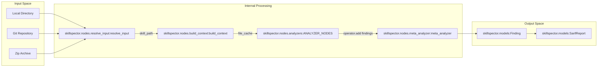

<!-- source: DeepWiki mcp.deepwiki.com · repo NVIDIA/SkillSpector · page 1 SkillSpector Overview · fetched 2026-10-26 -->

# SkillSpector Overview

Relevant source files

The following files were used as context for generating this wiki page:

- [CHANGELOG.md](CHANGELOG.md)
- [README.md](README.md)
- [docs/DEVELOPMENT.md](docs/DEVELOPMENT.md)
- [docs/release/skillspector-2.11.0.md](docs/release/skillspector-2.11.0.md)
- [docs/release/skillspector-2.11.1.md](docs/release/skillspector-2.11.1.md)
- [docs/release/skillspector-2.9.4.md](docs/release/skillspector-2.9.4.md)
- [pyproject.toml](pyproject.toml)
- [src/skillspector/graph.py](src/skillspector/graph.py)
- [tests/integration/test_graph_scanner.py](tests/integration/test_graph_scanner.py)
- [uv.lock](uv.lock)

SkillSpector is a security scanner designed specifically for AI agent skills [README.md:1-3](). As AI agents (such as Claude Code, Codex CLI, or Gemini CLI) execute with implicit trust and minimal vetting [README.md:11](), SkillSpector provides a critical vetting layer to detect vulnerabilities, malicious intent, and security risks before installation [README.md:3](). It is part of the NVIDIA Verified Skills pipeline, scanning, evaluating, and signing agent skills before publication [README.md:15]().

The system identifies **71 vulnerability patterns** across 17 categories, ranging from prompt injection and data exfiltration to complex Model Context Protocol (MCP) privilege mismatches [README.md:27]().

## Key Capabilities

SkillSpector provides a multi-stage analysis pipeline that combines high-speed static analysis with deep semantic evaluation:

*   **Multi-format Input Resolution**: Supports scanning local directories, single `SKILL.md` files, Git repositories, and ZIP archives [README.md:26]().
*   **Hybrid Analysis Engine**: Executes fast pattern-matching (Regex, AST, YARA) alongside optional LLM-powered semantic analysis for developer intent and complex security discovery [README.md:28]().
*   **Live Vulnerability Intelligence**: Performs real-time dependency lookups against [OSV.dev](https://osv.dev) to identify known CVEs in skill dependencies (Rule SC4) [README.md:29]().
*   **Standardized Reporting**: Generates reports in Terminal (pretty-print), JSON, Markdown, and SARIF 2.1.0 formats for CI/CD integration [README.md:30]().
*   **Risk Scoring**: Computes a 0-100 risk score based on finding severity and category to provide clear recommendations [README.md:31]().
*   **Baseline and Suppression**: Allows users to "baseline" known findings via glob-rules or fingerprints to surface only new issues in subsequent scans [README.md:32]().
*   **MCP Integration**: Can be deployed as a Model Context Protocol (MCP) server or a Pi coding-agent extension [README.md:21-22](), [docs/DEVELOPMENT.md:47-51]().

**Sources:** [README.md:1-33](), [docs/DEVELOPMENT.md:47-51]()

## System Architecture

The core of SkillSpector is built on a **LangGraph** pipeline (`StateGraph`), which orchestrates the flow of data from input resolution to final report generation [docs/DEVELOPMENT.md:9-10](). The architecture bridges the gap between raw file contents and structured security findings.

### Code-to-Logic Mapping

The following diagram illustrates how the logical scanning phases map to specific code entities and subsystems, bridging Natural Language Space to Code Entity Space.

**Pipeline Component Mapping**

```mermaid
graph TD
    subgraph "Natural Language Space"
        A["CLI Entry Point"] --> B["Python Script Entry"]
        C["LangGraph Workflow"] --> D["Analyzer Nodes"]
    end

    subgraph "Code Entity Space"
        B1["skillspector.cli:app"] -- "invokes" --> C1["skillspector.graph:create_graph"]
        C1 -- "uses state" --> D1["skillspector.state:SkillspectorState"]
        D1 --> E1["skillspector.nodes.resolve_input:resolve_input"]
        E1 --> F1["skillspector.nodes.build_context:build_context"]
        F1 --> G1["skillspector.nodes.analyzers:ANALYZER_NODES"]
        G1 --> H1["skillspector.nodes.meta_analyzer:meta_analyzer"]
        H1 --> I1["skillspector.nodes.finalize_inspection_ledger:finalize_inspection_ledger"]
        I1 --> J1["skillspector.nodes.report:report"]
    end
```

**Sources:** [src/skillspector/graph.py:40-88](), [src/skillspector/state.py:1-40](), [docs/DEVELOPMENT.md:72-123]()

## Subsystems and Relationships

SkillSpector is organized into several distinct subsystems that interact through a shared state object defined in `SkillspectorState` [docs/DEVELOPMENT.md:72-100]().

| Subsystem | Primary Responsibility | Key Code Entities |
| :--- | :--- | :--- |
| **Orchestration** | Manages the LangGraph `StateGraph` and node execution order. | `langgraph.graph.StateGraph`, `src/skillspector/graph.py:create_graph()` [src/skillspector/graph.py:40-88]() |
| **Analyzers** | Contains the logic for identifying risks (Static, Semantic, Behavioral). | `AnalyzerPlugin`, `src/skillspector/nodes/analyzers/`, `ANALYZER_NODE_IDS` [src/skillspector/graph.py:29-35]() |
| **Providers** | Abstraction layer for LLM interactions (OpenAI, Anthropic, NVIDIA Build). | `ModelMetadataProvider`, `CredentialsProvider`, `src/skillspector/llm_utils.py` [docs/DEVELOPMENT.md:37-41]() |
| **Data Models** | Defines the `Finding`, `Location`, and `SARIF` schemas. | `Finding`, `AnalyzerFinding`, `SarifReport`, `src/skillspector/models.py` [docs/DEVELOPMENT.md:72-100]() |
| **CLI** | Handles user input, flags, and terminal output formatting. | `typer.Typer`, `skillspector.cli:app`, `src/skillspector/cli.py` [pyproject.toml:34-35](), [pyproject.toml:74-75]() |

### Functional Flow

The system transforms raw source code into a security report through the following flow:

**Data Flow: Source to Finding**

**Sources:** [README.md:131-143](), [docs/DEVELOPMENT.md:17-18](), [src/skillspector/graph.py:40-88]()

## Detailed Documentation and Child Pages

For more in-depth information on specific components, refer to the following child pages:

*   **[Getting Started](#1.1)** — Installation, environment setup (`.env`, provider selection), running the CLI, Makefile targets, Docker image, and launching the LangGraph dev server. For details, see [Getting Started](#1.1).
*   **[CLI Reference](#1.2)** — Complete reference for the `skillspector` CLI: `scan` (all flags including `--format`, `--output`, `--no-llm`, `--recursive`, `--transitive`, `--baseline`, `--use-shipped-baseline`, `--fail-on-incomplete`, `--show-suppressed`), `baseline`, and `mcp` subcommands, exit codes, and stream separation rules. For details, see [CLI Reference](#1.2).
*   **[Baseline and Suppression](#1.3)** — How baseline/false-positive suppression works: generating baselines, YAML/JSON format (rules vs fingerprints), glob and fingerprint suppression, author-shipped baselines, and SARIF suppression preservation. For details, see [Baseline and Suppression](#1.3).
*   **[Release History and Versioning](#1.4)** — How releases are cut and documented: `CHANGELOG.md`, `docs/release/*` notes, the release GitHub Actions workflow and `scripts/release` tooling, and notable feature evolution across 2.x versions. For details, see [Release History and Versioning](#1.4).

**Sources:** [README.md:17-23](), [pyproject.toml:32-75](), [docs/DEVELOPMENT.md:11-15]()

---

