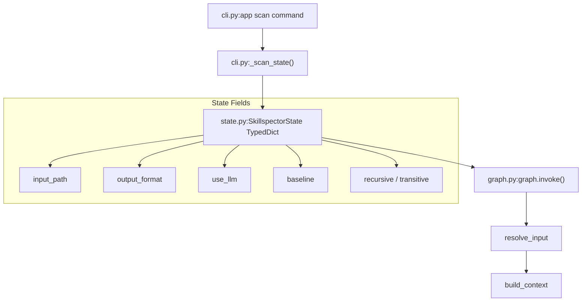
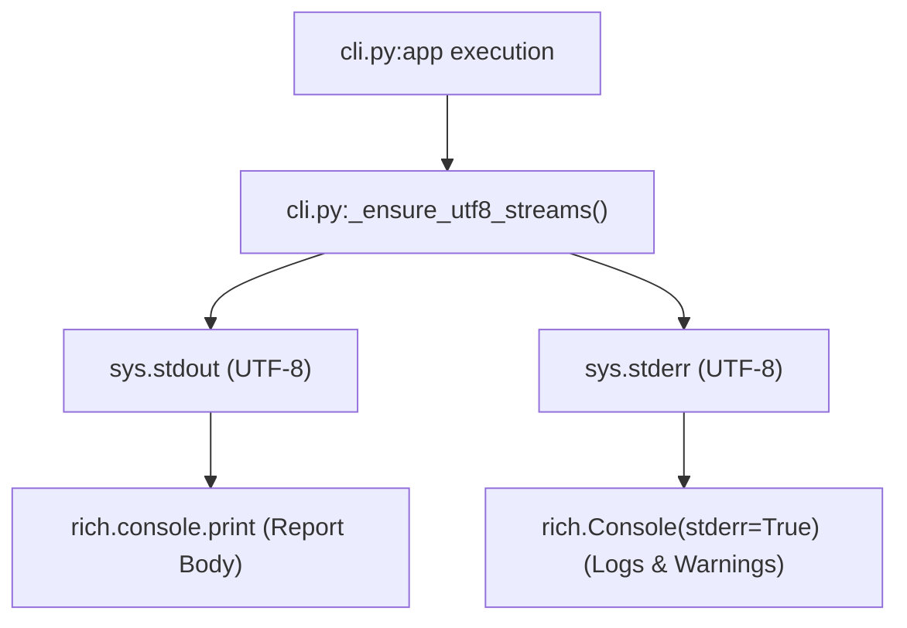

<!-- source: DeepWiki mcp.deepwiki.com · repo NVIDIA/SkillSpector · page 1.2 CLI Reference · fetched 2026-10-26 -->

# CLI Reference

<details>
<summary>Relevant source files</summary>

The following files were used as context for generating this wiki page:

- [README.md](README.md)
- [docs/DEVELOPMENT.md](docs/DEVELOPMENT.md)
- [src/skillspector/cli.py](src/skillspector/cli.py)
- [tests/unit/test_cli.py](tests/unit/test_cli.py)

</details>


The SkillSpector Command-Line Interface (CLI) serves as the primary operational entry point for interacting with the security scanner [src/skillspector/cli.py:16-20](). Implemented as a thin Typer-based wrapper [src/skillspector/cli.py:31-96](), it translates user-supplied flags and target identifiers into a structured LangGraph state, invokes the underlying analysis pipeline, and renders terminal, JSON, Markdown, or SARIF output while enforcing stream separation and precise exit codes.

## Overview and Command Structure

The CLI is rooted in the Typer application instance `app` defined in `src/skillspector/cli.py` [src/skillspector/cli.py:91-96](). It configures standard output streams to ensure robust UTF-8 handling across platforms [src/skillspector/cli.py:72-89]() and separates standard operational logging from user reports via dual Rich console instances (`console` for reports and `err_console` for logging/warnings) [src/skillspector/cli.py:98-99]().

### Data Flow: CLI to Graph State

The CLI maps command arguments into initial workflow inputs, orchestrating multi-skill detection or transitive traversal if requested before handing execution over to the compiled LangGraph workflow.

**CLI State Mapping Diagram**


Sources: [src/skillspector/cli.py:121-142](), [src/skillspector/cli.py:255-259](), [src/skillspector/graph.py:38-38]()

---

## The `scan` Subcommand

The `scan` subcommand runs the core inspection pipeline against a local directory, ZIP file, Git repository URL, or single file.

### Usage
```bash
skillspector scan [INPUT_PATH] [FLAGS]
```

### Supported Flags and Options

| Flag / Option | Short | Default | Description |
| :--- | :--- | :--- | :--- |
| `--format` | `-f` | `terminal` | Output format selection (`terminal`, `json`, `markdown`, `sarif`) [src/skillspector/cli.py:114-121]() |
| `--output` | `-o` | `None` | File path to write the generated report; prints to stdout if omitted [src/skillspector/cli.py:187-210]() |
| `--no-llm` | | `False` | Disables semantic analysis, relying purely on static patterns and YARA |
| `--yara-rules-dir` | | `None` | Directory containing custom `.yar` or `.yara` rule files |
| `--recursive` | `-r` | `False` | Scans immediate subdirectories containing a `SKILL.md` file as separate skills |
| `--transitive` | | `False` | Enables bounded traversal of external references found within the skill |
| `--baseline` | `-b` | `None` | Path to a YAML/JSON baseline file for suppressing known findings |
| `--use-shipped-baseline`| | `False` | Automatically discovers and applies any author-shipped baseline inside the skill |
| `--fail-on-incomplete` | | `False` | Exits with a non-zero code if the analysis ledger records incomplete coverage |
| `--show-suppressed` | | `False` | Includes baseline-suppressed findings in the rendered report output |
| `--verbose` | `-V` | `False` | Increases logging verbosity to `DEBUG` level |

Sources: [src/skillspector/cli.py:187-253]()

---

## The `baseline` Subcommand

The `baseline` command automates the generation of suppression files containing cryptographic fingerprints or glob rules for all current findings in a target skill.

### Usage
```bash
skillspector baseline [PATH] [OPTIONS]
```

| Option | Default | Description |
| :--- | :--- | :--- |
| `--output`, `-o` | `.skillspector-baseline.yaml` | Target file path to write the baseline rules |
| `--reason` | `None` | Default justification string embedded into generated suppression entries |

Sources: [src/skillspector/cli.py:318-345]()

---

## The `mcp` Subcommand

The `mcp` subcommand hosts SkillSpector as a Model Context Protocol server, enabling AI coding agents to execute security scans directly during their workflows.

### Usage
```bash
skillspector mcp [OPTIONS]
```

| Option | Default | Description |
| :--- | :--- | :--- |
| `--transport` | `stdio` | Transport protocol layer (`stdio` or `http`) [src/skillspector/cli.py:123-128]() |
| `--port` | `8000` | Port binding when using HTTP transport |

Sources: [src/skillspector/cli.py:364-385]()

---

## Stream Separation and I/O Rules

To ensure seamless integration into automated CI/CD pipelines and programmatic wrappers, SkillSpector strictly separates data output from diagnostics:

1. **Standard Output (`stdout`)**: Reserved exclusively for the generated report content (Terminal text, JSON, Markdown, or SARIF) when printing to the console.
2. **Standard Error (`stderr`)**: Handled by `err_console` [src/skillspector/cli.py:99-99](), dedicated to logging, progress indicators, warnings, and error messages.
3. **Stream Encoding**: `_ensure_utf8_streams()` automatically reconfigures `sys.stdout` and `sys.stderr` to use UTF-8 with character replacement (`errors="replace"`) on startup, preventing `UnicodeEncodeError` exceptions on restricted host platforms (e.g., Windows cp1252 consoles) when rendering Unicode boxes and symbols [src/skillspector/cli.py:72-89]().

**Stream Separation Architecture**


Sources: [src/skillspector/cli.py:72-99]()

---

## Exit Codes and Evaluation Logic

SkillSpector maps scan execution results and security thresholds to explicit process exit codes:

* **`0` (Success)**: The inspection completed successfully, and no unsuppressed findings met or exceeded the risk threshold (`RISK_THRESHOLD`) [src/skillspector/cli.py:41-41]().
* **`1` (Risk Threshold Exceeded)**: The scan finished successfully, but one or more active findings equal or exceed the `RISK_THRESHOLD`, indicating high/critical risk.
* **`2` (Execution / Configuration Error)**: An unhandled exception, resource ingest limit breach (`IngestLimitExceededError`), invalid path, or missing baseline occurred, or `--fail-on-incomplete` triggered due to incomplete ledger coverage.

Sources: [src/skillspector/cli.py:41-41](), [src/skillspector/cli.py:261-288]()

---

