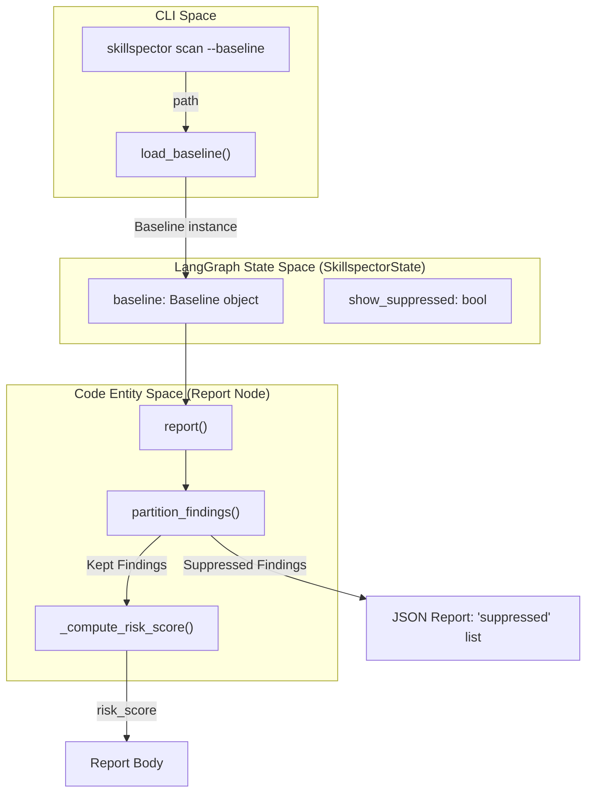
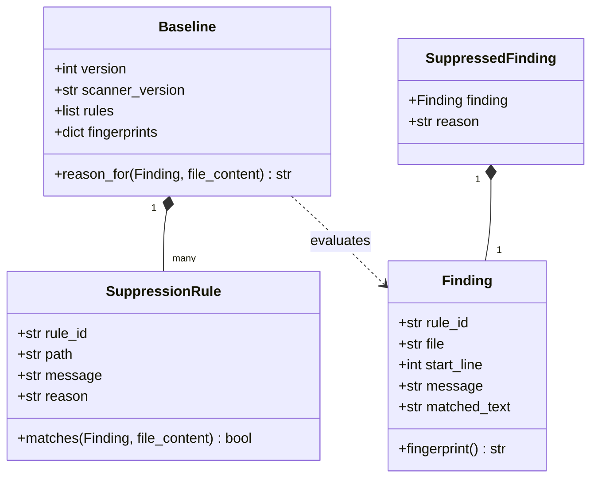

<!-- source: DeepWiki mcp.deepwiki.com · repo NVIDIA/SkillSpector · page 1.3 Baseline and Suppression · fetched 2026-10-26 -->

# Baseline and Suppression

<details>
<summary>Relevant source files</summary>

The following files were used as context for generating this wiki page:

- [.skillspector-baseline.example.yaml](.skillspector-baseline.example.yaml)
- [docs/SUPPRESSION.md](docs/SUPPRESSION.md)
- [src/skillspector/nodes/report.py](src/skillspector/nodes/report.py)
- [src/skillspector/sarif_models.py](src/skillspector/sarif_models.py)
- [src/skillspector/suppression.py](src/skillspector/suppression.py)
- [tests/nodes/analyzers/test_sc8_shipped_bytecode.py](tests/nodes/analyzers/test_sc8_shipped_bytecode.py)
- [tests/nodes/test_report.py](tests/nodes/test_report.py)
- [tests/nodes/test_sarif_rules_and_empty_findings.py](tests/nodes/test_sarif_rules_and_empty_findings.py)
- [tests/unit/test_suppression.py](tests/unit/test_suppression.py)

</details>


The SkillSpector baseline system allows users to manage false positives and known security risks by suppressing findings. This system ensures that the risk score reflects only un-triaged issues and allows for incremental security scanning in CI/CD pipelines [docs/SUPPRESSION.md:3-10]().

### Overview of Suppression Logic

Suppression occurs at the final stage of the analysis pipeline. While analyzers generate findings regardless of previous states, the reporting engine filters these findings against a baseline before computing the final risk score and generating the report [docs/SUPPRESSION.md:128-136]().

There are two primary mechanisms for suppression:
1.  **Rules (Glob-based):** Human-authored, drift-tolerant patterns that match findings based on rule IDs, file paths, or message content [src/skillspector/suppression.py:21-27]().
2.  **Fingerprints (Hash-based):** Machine-generated, exact matches derived from a specific finding's unique attributes, including source content and scanner version [src/skillspector/suppression.py:29-31]().

---

## Suppression Data Flow

The following diagram illustrates how a baseline file moves from the CLI into the LangGraph state and influences the final report.

**Figure 1: Suppression Logic Data Flow**

Sources: [src/skillspector/cli.py:121-142](), [docs/SUPPRESSION.md:128-136](), [src/skillspector/suppression.py:265-275]()

---

## Baseline File Format

SkillSpector supports both YAML and JSON formats for baseline files. The format is determined by the file extension [docs/SUPPRESSION.md:48-50]().

### 1. Suppression Rules (`rules`)
Rules use glob matching (via `fnmatch`) and are "drift-tolerant," meaning they continue to work even if line numbers change or minor wording shifts occur [src/skillspector/suppression.py:50-54]().

| Field | Matches Against | Notes |
| :--- | :--- | :--- |
| `id` / `rule_id` | `Finding.rule_id` | Supports globs like `SQP-*` [src/skillspector/suppression.py:86]() |
| `path` / `file` | `Finding.file` | Supports `*` and `**` (as alias for `*`) [src/skillspector/suppression.py:87-90]() |
| `message` | `Finding.message` | Case-insensitive substring matching against description and evidence [src/skillspector/suppression.py:88]() |
| `reason` | N/A | **Required** for auditability [src/skillspector/suppression.py:169]() |

### 2. Fingerprints (`fingerprints`)
Version 2 fingerprints are 64-character SHA-256 hashes. They bind to the complete scanned component, scanner version, finding identity, severity, location, and emitted evidence [src/skillspector/suppression.py:118-124]().

**Fingerprint Calculation:**
A canonical JSON payload is constructed including `scanner_version`, `component.sha256`, and all finding fields (rule_id, severity, confidence, line numbers, matched_text, context, etc.) [src/skillspector/suppression.py:131-156](). The final hash is prefixed with `sha256:` [src/skillspector/suppression.py:159]().

Sources: [docs/SUPPRESSION.md:53-70](), [src/skillspector/suppression.py:112-160](), [.skillspector-baseline.example.yaml:10-38]()

---

## Implementation Details

The core logic resides in `src/skillspector/suppression.py`.

### Key Classes and Functions

*   **`Baseline` Class**: Holds the collection of `SuppressionRule` objects and a dictionary of fingerprints [src/skillspector/suppression.py:202-211]().
*   **`finding_fingerprint()`**: Generates the stable hash used for exact matching. It requires `file_content` and `scanner_version` to ensure integrity [src/skillspector/suppression.py:112-160]().
*   **`partition_findings()`**: The primary filter function. It splits a list of `Finding` objects into `kept` (not suppressed) and `suppressed` (paired with a reason) [src/skillspector/suppression.py:265-283]().
*   **`SuppressionRule.matches()`**: Evaluates if a specific finding satisfies all criteria defined in a glob rule [src/skillspector/suppression.py:171-182]().

**Figure 2: Suppression Logic Internal Entities**

Sources: [src/skillspector/suppression.py:163-228](), [src/skillspector/models.py:53-85]()

---

## CLI Usage

### Generating a Baseline
To create a baseline of all current findings in a skill:
```bash
skillspector baseline ./path/to/skill -o .skillspector-baseline.yaml
```
This command performs a scan and writes a baseline that fingerprint-suppresses every current finding [docs/SUPPRESSION.md:37]().

### Scanning with a Baseline
To exclude known issues from the risk score:
```bash
skillspector scan ./path/to/skill --baseline .skillspector-baseline.yaml
```
Findings matching the baseline are:
*   **Excluded** from the final risk score calculation [docs/SUPPRESSION.md:12]().
*   **Hidden** from terminal/markdown output unless `--show-suppressed` is used [docs/SUPPRESSION.md:13-14]().
*   **Preserved** in SARIF output but marked with an external suppression [docs/SUPPRESSION.md:13]().
*   **Included** in JSON output under the `suppressed` key for machine consumption [docs/SUPPRESSION.md:15-16]().

### Exit Codes
If a `--baseline` file is specified but is missing, malformed, or an unsupported version (e.g., v1 fingerprints), the CLI exits with **code 2** [docs/SUPPRESSION.md:41](), [src/skillspector/suppression.py:245-255]().

Sources: [src/skillspector/cli.py:121-142](), [docs/SUPPRESSION.md:22-47](), [src/skillspector/suppression.py:231-262]()

---

