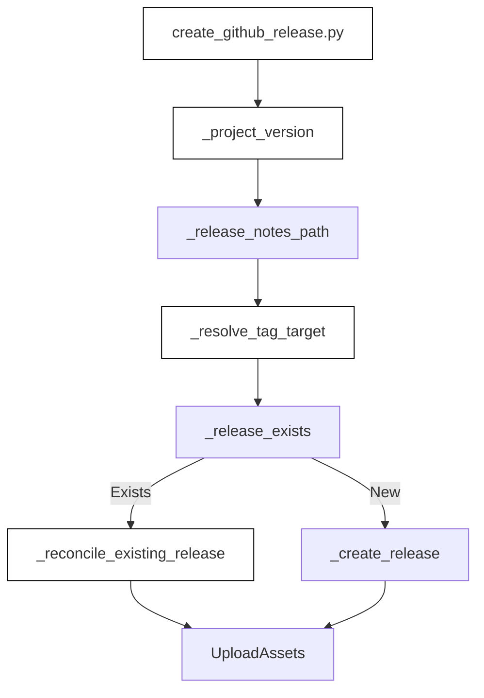

<!-- source: DeepWiki mcp.deepwiki.com · repo NVIDIA/SkillSpector · page 1.4 Release History and Versioning · fetched 2026-10-26 -->

# Release History and Versioning

<details>
<summary>Relevant source files</summary>

The following files were used as context for generating this wiki page:

- [.github/workflows/release.yml](.github/workflows/release.yml)
- [CHANGELOG.md](CHANGELOG.md)
- [docs/release/skillspector-2.11.0.md](docs/release/skillspector-2.11.0.md)
- [docs/release/skillspector-2.11.1.md](docs/release/skillspector-2.11.1.md)
- [docs/release/skillspector-2.5.1.md](docs/release/skillspector-2.5.1.md)
- [docs/release/skillspector-2.9.6.md](docs/release/skillspector-2.9.6.md)
- [pyproject.toml](pyproject.toml)
- [scripts/release/public/create_github_release.py](scripts/release/public/create_github_release.py)
- [tests/unit/test_create_github_release.py](tests/unit/test_create_github_release.py)
- [tests/unit/test_github_release_workflow.py](tests/unit/test_github_release_workflow.py)
- [uv.lock](uv.lock)

</details>


## Purpose and Scope

This page details how releases are cut, versioned, and documented within the SkillSpector codebase. It covers the structure of `CHANGELOG.md`, versioned release notes under `docs/release/`, the label-gated GitHub Actions release workflow (`.github/workflows/release.yml`), the release tooling script (`scripts/release/public/create_github_release.py`), and a summary of notable feature evolution across the 2.x version history.

Sources: [pyproject.toml:1-12](), [CHANGELOG.md:1-8](), [.github/workflows/release.yml:1-15](), [scripts/release/public/create_github_release.py:1-35]()

---

## Version Identification and Metadata

SkillSpector adheres to Semantic Versioning (SemVer) and manages project identity, dependency boundaries, and build configurations in `pyproject.toml`. The active project version is declared under the `[project]` table and is read programmatically by release scripts and distribution tools.

```toml
[project]
name = "skillspector"
version = "2.11.1"
description = "SkillSpector: Security scanner for AI agent skills..."
requires-python = ">=3.12,<3.15"
```

Sources: [pyproject.toml:5-11]()

---

## Release Documentation Architecture

SkillSpector maintains a dual release documentation strategy consisting of an aggregated changelog and granular, version-specific release notes.

### `CHANGELOG.md`
The root `CHANGELOG.md` records all version updates, categorized by features, bug fixes, supply chain improvements, and security hardening [CHANGELOG.md:1-8](). Each entry specifies the exact date and key pull requests associated with the release [CHANGELOG.md:1-8]().

### Versioned Release Notes (`docs/release/*`)
For every major, minor, or significant patch release, a detailed Markdown file is maintained under `docs/release/` (e.g., `docs/release/skillspector-2.11.1.md`) [scripts/release/public/create_github_release.py:35-38](). These notes contain:
- **Summary & Highlights**: High-level overview of changes [docs/release/skillspector-2.11.1.md:5-14]()
- **Added / Changed / Fixed / Security**: Granular breakdown of code modifications [docs/release/skillspector-2.11.1.md:15-37]()
- **Breaking Changes and Migration**: Guidance on environment variables or configuration adjustments [docs/release/skillspector-2.11.1.md:38-42]()
- **Validation**: Exact verification commands (`uv lock --check`, `pytest`, `ruff check`) and validation counts [docs/release/skillspector-2.11.1.md:48-56]()
- **Known Limitations & References**: Associated GitHub PR links [docs/release/skillspector-2.11.1.md:58-70]()

Sources: [CHANGELOG.md:1-8](), [docs/release/skillspector-2.11.1.md:1-70](), [scripts/release/public/create_github_release.py:35-38]()

---

## Release Automation: GitHub Actions Workflow

Releases are fully automated via a label-gated GitHub Actions workflow defined in `[.github/workflows/release.yml]()`. The workflow is triggered when a pull request targeting `main` is closed and merged with the `release:publish` label.

```mermaid
graph TD
    PR[PullRequestClosed] --> Check[GitHubActionsWorkflow]
    Check -->|Merged & Labeled release:publish| Checkout[actions/checkout@v4]
    Checkout --> SetupUV[astral-sh/setup-uv@v5]
    SetupUV --> Sync[uv sync --locked --extra dev]
    Sync --> Build[python -m build --no-isolation]
    Build --> Twine[twine check dist/*]
    Twine --> ReleaseScript[create_github_release.py]
    ReleaseScript --> GitHubAPI[GitHubReleasesAPI]

    style PR fill:none,stroke:#000,stroke-width:1px
    style Check fill:none,stroke:#000,stroke-width:1px
    style ReleaseScript fill:none,stroke:#000,stroke-width:1px
    style GitHubAPI fill:none,stroke:#000,stroke-width:1px
```

### Workflow Mechanics
1. **Trigger Condition**: `.github/workflows/release.yml` listens to `pull_request` events with types `[closed]` restricted to the `main` branch [/.github/workflows/release.yml:6-10]().
2. **Job Gate**: The `publish` job evaluates `github.event.pull_request.merged == true` and verifies the presence of the `release:publish` label [/.github/workflows/release.yml:25-29]().
3. **Environment Setup**: Uses pinned actions (`actions/checkout@v4` [/.github/workflows/release.yml:33](), `astral-sh/setup-uv` [/.github/workflows/release.yml:38]()) with locked dependencies (`uv.lock`) [/.github/workflows/release.yml:42]() and Python 3.12 [/.github/workflows/release.yml:20]().
4. **Artifact Compilation**: Builds source and wheel distributions using `python -m build --no-isolation` and verifies them with `twine check dist/*` [/.github/workflows/release.yml:46-49]().
5. **Release Publication**: Invokes `scripts/release/public/create_github_release.py` targeting the merge commit SHA [/.github/workflows/release.yml:54-58]().

Sources: [.github/workflows/release.yml:1-58]()

---

## Release Tooling Script (`create_github_release.py`)

The script `[scripts/release/public/create_github_release.py]()` manages interaction with the GitHub API via the `gh` CLI and Python standard libraries. It reads project metadata, verifies git tags, and attaches build artifacts to GitHub releases.



### Key Functions and Classes
- `_project_version(path: Path) -> str`: Opens `pyproject.toml`, parses TOML using `tomllib`, and extracts the `version` string from the `project` table [scripts/release/public/create_github_release.py:29-33]().
- `_release_notes_path(version: str) -> Path`: Constructs the filesystem path to version-specific release notes (`docs/release/skillspector-{version}.md`) [scripts/release/public/create_github_release.py:35-38]().
- `_resolve_tag_target(repository: str, tag: str) -> str | None`: Queries the GitHub API for tag references, recursively peeling annotated tag objects until resolving to a commit SHA [scripts/release/public/create_github_release.py:75-97]().
- `_ensure_tag_at_target(repository: str, tag: str, target: str) -> None`: Validates that a git tag exists and points to the correct target commit before publishing [scripts/release/public/create_github_release.py:127-141]().
- `_reconcile_existing_release(...)`: Handles draft release recovery, asset upload retries, and publication updates if a release pipeline reruns [scripts/release/public/create_github_release.py:175-190]().

Sources: [scripts/release/public/create_github_release.py:29-190]()

---

## Notable Feature Evolution Across 2.x Versions

SkillSpector's 2.x release cycle has introduced critical architectural and security capabilities:

| Version | Release Date | Key Features & Enhancements |
| :--- | :--- | :--- |
| **2.11.1** | Sep 7, 2026 | Increased default aggregate workflow deadline to 600s (`SKILLSPECTOR_MAX_WORKFLOW_SECONDS`), fixed finding classification preservation during deduplication, and bounded total in-flight LLM requests [CHANGELOG.md:1-8](). |
| **2.11.0** | Aug 28, 2026 | Expanded supply-chain coverage to npm lockfiles (`package-lock.json`, `npm-shrinkwrap.json`), added bundled lifecycle hook analysis (BH1–BH3), and introduced LLM sampling controls (`SKILLSPECTOR_TEMPERATURE`, `SKILLSPECTOR_SEED`) [CHANGELOG.md:9-18](). |
| **2.10.0** | Aug 26, 2026 | Added opt-in transitive reference scanning (`--transitive`), phase-1 structured skill summaries, external model provider selection detection (EA5), and strengthened resource bounds [CHANGELOG.md:19-44](). |
| **2.9.5** | Aug 14, 2026 | Added Ollama, Azure OpenAI, and generic OpenAI-compatible providers, opt-in author-shipped baseline discovery, and insecure deserialization analyzers (AST10, TT6, DS1–DS4) [CHANGELOG.md:49-58](). |
| **2.5.1** | Jul 30, 2026 | Introduced `SKILLSPECTOR_MAX_LLM_CONCURRENCY` to tune asynchronous LLM analyzer batch concurrency and prevent rate limit exhaustion [docs/release/skillspector-2.5.1.md:1-15](). |

Sources: [CHANGELOG.md:1-58](), [docs/release/skillspector-2.11.1.md:1-25](), [docs/release/skillspector-2.5.1.md:1-20]()

---

