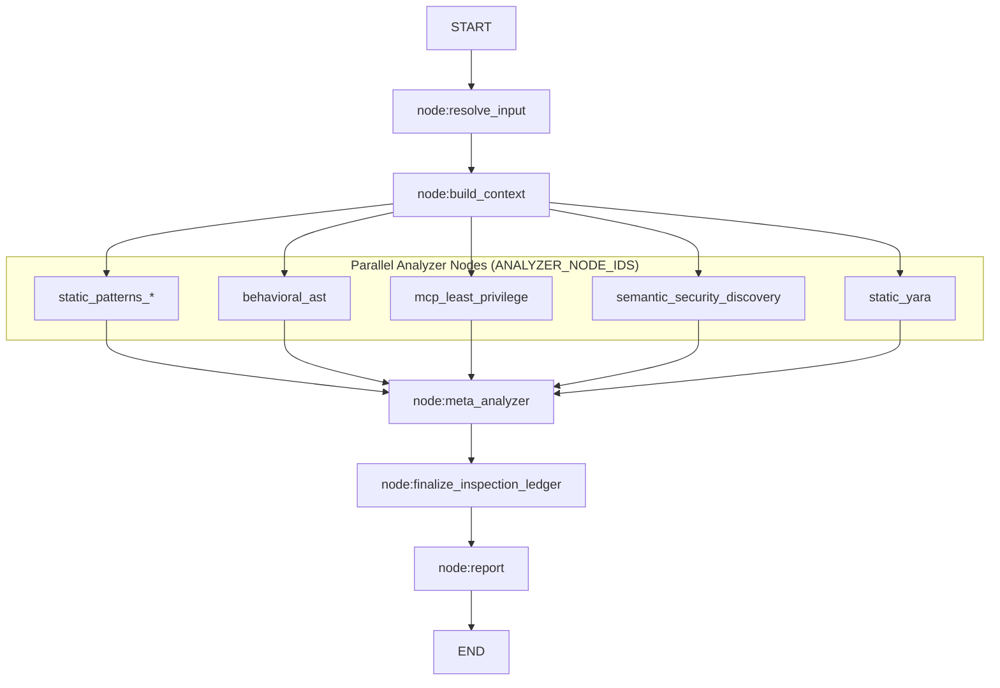
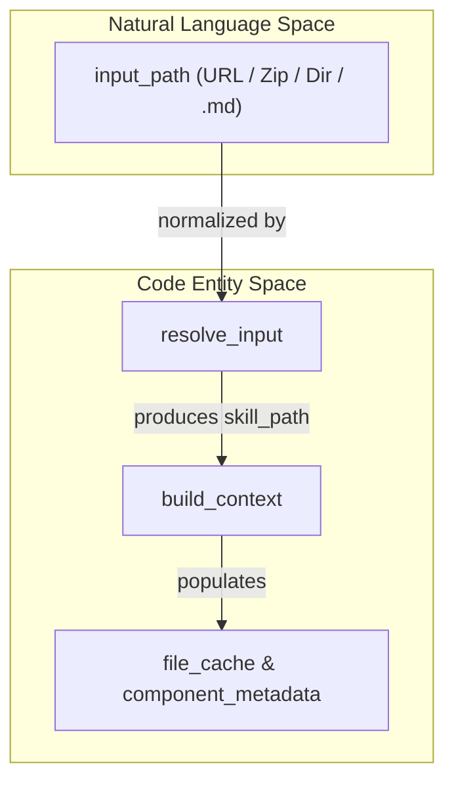

<!-- source: DeepWiki mcp.deepwiki.com · repo NVIDIA/SkillSpector · page 2 Core Architecture · fetched 2026-10-26 -->

# Core Architecture

Relevant source files

The following files were used as context for generating this wiki page:

- [README.md](README.md)
- [docs/DEVELOPMENT.md](docs/DEVELOPMENT.md)
- [docs/release/skillspector-2.9.4.md](docs/release/skillspector-2.9.4.md)
- [src/skillspector/graph.py](src/skillspector/graph.py)
- [src/skillspector/state.py](src/skillspector/state.py)
- [tests/integration/test_graph_scanner.py](tests/integration/test_graph_scanner.py)

This page provides a high-level overview of the SkillSpector pipeline, built on the **LangGraph** orchestration framework. SkillSpector treats security analysis as a stateful graph execution where a skill's source code and metadata flow through a series of specialized nodes to produce a risk-scored SARIF report. 

For deep technical details on individual subsystems, refer to the child pages linked throughout this document.

---

## The LangGraph Pipeline and Topology

SkillSpector utilizes a `StateGraph` defined in `src/skillspector/graph.py` to manage the lifecycle of a scan [src/skillspector/graph.py:36-59](). The architecture follows a linear-parallel-linear topology:
1.  **Preparation**: Input normalization and context extraction.
2.  **Analysis (Fan-out)**: Parallel execution of registered analyzer nodes.
3.  **Synthesis (Fan-in)**: LLM-powered filtering, inspection ledger finalization, risk scoring, and report generation.

### System Workflow Topology

**Sources:** [src/skillspector/graph.py:36-88](), [docs/DEVELOPMENT.md:107-123]()

For details on the `StateGraph` mechanics, reducers (`operator.add`), and execution deadlines, see **[Graph Workflow and State](#2.1)**.

---

## Shared State Schema and Resource Budgets

The `SkillspectorState` is a `TypedDict` that serves as the single source of truth flowing through the graph [src/skillspector/state.py:48-134](). It maintains the file cache, parsed manifests, and the growing list of security findings. Additionally, aggregate resource consumption is governed by `WorkflowResourceBudget`.

| Category | Key Fields | Purpose |
| :--- | :--- | :--- |
| **Inputs** | `input_path`, `skill_path` | Tracks raw input vs. the normalized local directory [src/skillspector/state.py:52-53](). |
| **Context** | `file_cache`, `manifest`, `component_metadata` | Stores file contents and parsed `SKILL.md` metadata for analyzers [src/skillspector/state.py:61-67](). |
| **Findings** | `findings`, `filtered_findings` | `findings` uses `merge_findings_by_id` to accumulate parallel results [src/skillspector/state.py:71](). |
| **Audit & Budget** | `inspection_ledger`, `workflow_resource_budget` | Tracks skipped/failed files and runtime/byte limits [src/skillspector/state.py:80-99](). |
| **Output** | `sarif_report`, `risk_score`, `report_body` | Final structured and formatted results [src/skillspector/state.py:118-130](). |

**Sources:** [src/skillspector/state.py:48-145](), [docs/DEVELOPMENT.md:72-100]()

---

## Input Resolution and Context Building

Before analysis begins, the graph resolves target inputs through `resolve_input` [src/skillspector/graph.py:44](). This node handles diverse sources like Git URLs, file URLs, ZIP archives, single `.md` files, or directories while enforcing safety boundaries (SSRF guards, zip-slip checks, and ingest caps). Once resolved, `build_context` crawls the directory to populate `file_cache`, `manifest`, and `component_metadata` [src/skillspector/graph.py:45]().

### Input to Context Mapping

**Sources:** [src/skillspector/graph.py:44-45](), [src/skillspector/state.py:52-67]()

For a comprehensive explanation of input normalization and multi-skill detection for `--recursive`, see **[Input Resolution and Context Building](#2.2)**.

---

## Data Models and SARIF Output

SkillSpector models findings using core types such as `Finding`, `AnalyzerFinding`, `Location`, and `Severity`. These are transformed into SARIF 2.1.0 Pydantic models during reporting. Risk scores are computed using a diminishing returns formula that maps raw severities to numeric scores and categories (LOW, MEDIUM, HIGH, CRITICAL).

For reference on core data types, the `AnalyzerPlugin` protocol, and risk scoring algorithms, see **[Data Models and SARIF Output](#2.3)**.

**Sources:** [src/skillspector/models.py:1-120](), [docs/DEVELOPMENT.md:98-102]()

---

## Artifact Classification and Text Normalization

The analysis pipeline inspects raw bytes using modules in `artifacts.py`. It classifies content via `ContentKind` and `ArtifactDisposition`, builds multi-view security text projections to defeat obfuscation, handles unicode confusables, manages nested artifacts, and extracts source references.

For details on artifact handling and obfuscation resistance, see **[Artifact Classification and Text Normalization](#2.4)**.

**Sources:** [src/skillspector/artifacts.py:1-100]()

---

## Inspection Ledger, Completeness and Resource Bounds

The audit subsystem tracks execution reliability via `InspectionLedgerEvent`, `LedgerOutcome`, and `LedgerReason`. The `finalize_inspection_ledger` node evaluates analysis completeness and coverage percentages. Resource enforcement follows a fail-closed model bounding time, memory, and finding counts.

For details on the audit ledger and resource bounds, see **[Inspection Ledger, Completeness and Resource Bounds](#2.5)**.

**Sources:** [src/skillspector/inspection_ledger.py:1-150](), [docs/ANALYSIS_RESOURCE_BOUNDS.md:1-50]()

---

## Transitive Reference Traversal

When scanning repositories with external dependencies or referenced agent skills, SkillSpector supports bounded transitive traversal via `--transitive`. This mechanism uses `transitive.py` and `references.py`, managed under a `_TransitiveTraversalState` budget that tracks targets, bytes, artifacts, time, and prefix filters.

For implementation details on recursive reference traversal, see **[Transitive Reference Traversal](#2.6)**.

**Sources:** [src/skillspector/transitive.py:1-80](), [src/skillspector/references.py:1-60]()

---

