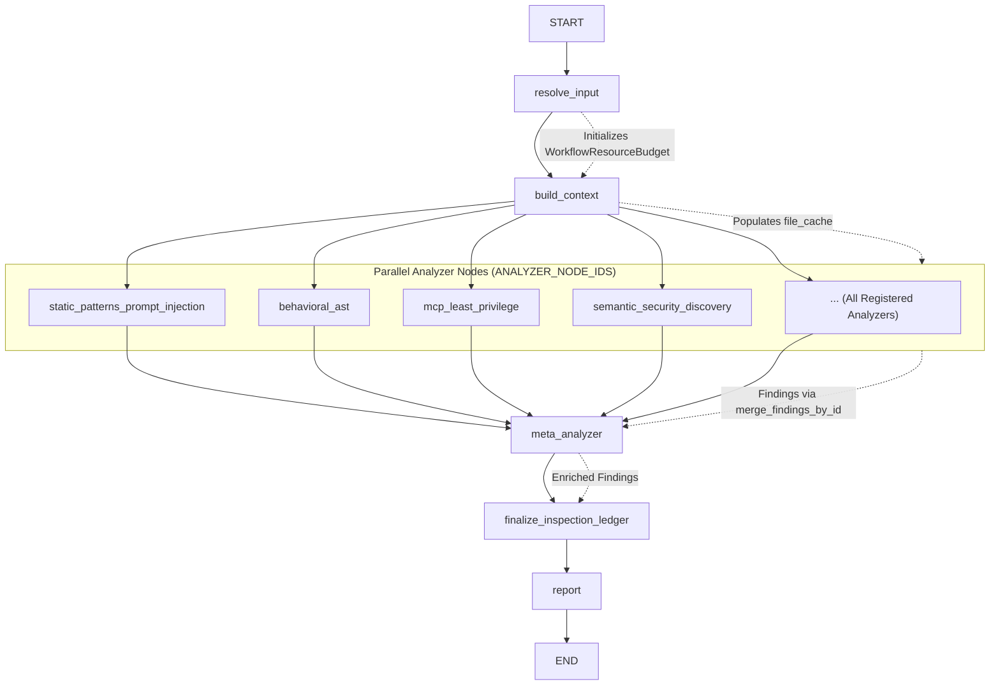
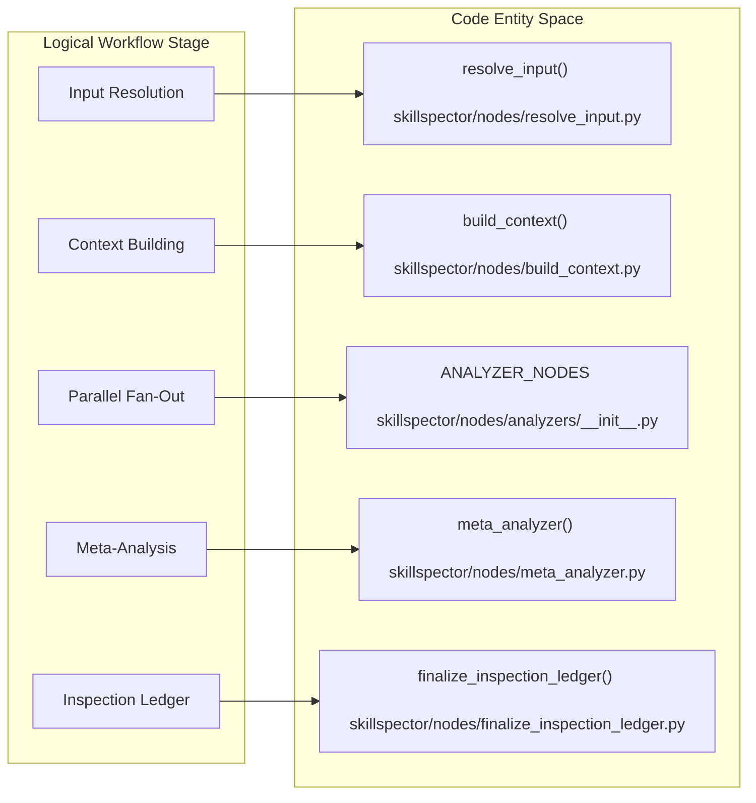

<!-- source: DeepWiki mcp.deepwiki.com · repo NVIDIA/SkillSpector · page 2.1 Graph Workflow and State · fetched 2026-10-26 -->

# Graph Workflow and State

Relevant source files

The following files were used as context for generating this wiki page:

- [docs/release/skillspector-2.9.4.md](docs/release/skillspector-2.9.4.md)
- [src/skillspector/cleanup.py](src/skillspector/cleanup.py)
- [src/skillspector/constants.py](src/skillspector/constants.py)
- [src/skillspector/graph.py](src/skillspector/graph.py)
- [src/skillspector/nodes/resolve_input.py](src/skillspector/nodes/resolve_input.py)
- [src/skillspector/providers/__init__.py](src/skillspector/providers/__init__.py)
- [src/skillspector/state.py](src/skillspector/state.py)
- [tests/integration/test_graph.py](tests/integration/test_graph.py)
- [tests/integration/test_graph_scanner.py](tests/integration/test_graph_scanner.py)
- [tests/nodes/test_resolve_input.py](tests/nodes/test_resolve_input.py)
- [tests/unit/test_constants.py](tests/unit/test_constants.py)

SkillSpector utilizes a LangGraph-based `StateGraph` to orchestrate its security analysis pipeline [src/skillspector/graph.py:40-42](). The workflow transitions from input normalization and context building to a parallel fan-out of specialized analyzer nodes, converging through meta-analysis, ledger finalization, and reporting [src/skillspector/graph.py:78-87](). This architecture ensures that findings from diverse sources (static patterns, behavioral analysis, supply-chain checks, and LLM-based discovery) are unified into a single state structure with strict resource bounds.

Sources: [src/skillspector/graph.py:40-88]()

## SkillspectorState Schema and Reducers

The core of the workflow is `SkillspectorState`, a `TypedDict` that acts as the shared memory across all graph nodes [src/skillspector/state.py:16-43](). It manages the scan lifecycle from input ingestion to finalized reports.

| Key | Type | Description |
| :--- | :--- | :--- |
| `input_path` | `str \| None` | Raw input specified by the user (URL, Git repository, archive, or local path). |
| `skill_path` | `str \| None` | Resolved local directory containing the skill source code [src/skillspector/nodes/resolve_input.py:16-21](). |
| `temp_dir_for_cleanup` | `str \| None` | Path to any temporary directory created during input resolution, targeted for cleanup [src/skillspector/nodes/resolve_input.py:19-20](). |
| `file_cache` | `dict[str, str]` | Mapping of canonical relative filenames to their full UTF-8 text contents. |
| `findings` | `Annotated[list[Finding], merge_findings_by_id]` | Primary accumulator for security findings, merged by opaque identifier [src/skillspector/state.py:175-176](). |
| `llm_call_log` | `Annotated[list[LLMCallRecord], operator.add]` | Telemetry logging LLM executions, accumulated via `operator.add`. |
| `use_llm` | `bool` | Global toggle enabling or disabling LLM-powered analyzer nodes. |
| `workflow_resource_budget` | `WorkflowResourceBudget \| None` | Aggregate execution timeout, byte, and artifact bounds shared across nodes [src/skillspector/state.py:80-99](). |
| `transitive_traversal_state` | `object \| None` | Bounded traversal state for external references when `--transitive` is active. |

### Finding Accumulator and Reducer Implementation
Unlike standard list concatenation, the `findings` list uses the custom reducer `merge_findings_by_id` [src/skillspector/state.py:175-176](). This function consolidates findings from parallel analyzer nodes by their opaque `finding_id`. When a finding with an existing ID is re-emitted (such as during meta-analyzer enrichment), the existing instance is updated in place [src/skillspector/state.py:175-176]().

Sources: [src/skillspector/state.py:16-176]()

## Workflow Resource Budgets and Deadlines

Graph execution is governed by `WorkflowResourceBudget`, a dataclass that enforces aggregate limits across all workflow nodes [src/skillspector/state.py:80-99](). 

### Resource Constraints and Enforcement
- **Aggregate Timeouts:** Controlled by `SKILLSPECTOR_MAX_WORKFLOW_SECONDS` (defaulting to `600.0` seconds) [src/skillspector/state.py:46-74](). The clock is initialized at the start of `resolve_input` and checked across all nodes [src/skillspector/nodes/resolve_input.py:52-55]().
- **Byte Ceilings:** `MAX_WORKFLOW_BYTES` bounds total processed content to `64 * 1024 * 1024` bytes (64 MiB) [src/skillspector/state.py:75]().
- **Artifact Bounds:** `MAX_WORKFLOW_ARTIFACTS` caps discovered files at `10,000` [src/skillspector/state.py:76]().

The helper function `ensure_workflow_resource_budget()` retrieves or initializes this budget, ensuring child scans and parallel nodes share a single source of truth for remaining time and byte allowances [src/skillspector/state.py:147-164]().

Sources: [src/skillspector/state.py:46-173](), [src/skillspector/nodes/resolve_input.py:52-55]()

## Graph Topology and Fan-Out/Fan-In Flow

The workflow graph is constructed in `create_graph()` [src/skillspector/graph.py:40-88]() and executes in distinct sequential and parallel phases.

### Execution Phases
1. **Input Resolution (`resolve_input`)**: Normalizes `input_path` or `skill_path` into a local directory and starts the workflow budget timer [src/skillspector/nodes/resolve_input.py:41-55]().
2. **Context Building (`build_context`)**: Reads local files into `file_cache`, parses the manifest, and detects structural components.
3. **Parallel Analysis Fan-Out**: Dynamically iterates over registered identifiers in `ANALYZER_NODE_IDS`, checking availability and API key requirements before adding nodes [src/skillspector/graph.py:55-73](). All enabled analyzer nodes execute in parallel [src/skillspector/graph.py:81-82]().
4. **Meta-Analysis Consolidation (`meta_analyzer`)**: Acts as the fan-in convergence point, waiting for all parallel analyzers to finish before performing enrichment and contextual filtering [src/skillspector/graph.py:83]().
5. **Ledger Finalization & Reporting (`finalize_inspection_ledger` → `report`)**: Records audit outcomes, computes final risk scoring, and formats the output [src/skillspector/graph.py:85-87]().

### Diagram: Graph State Transition and Topology

Sources: [src/skillspector/graph.py:40-88](), [src/skillspector/state.py:80-164]()

## Code Entity Space Mapping

The following diagram bridges the logical workflow concepts to their concrete Python implementations across modules.

### Diagram: Logical Architecture to Code Entities

Sources: [src/skillspector/graph.py:40-88](), [src/skillspector/nodes/resolve_input.py:41-42](), [src/skillspector/nodes/build_context.py:1-30]()

---

