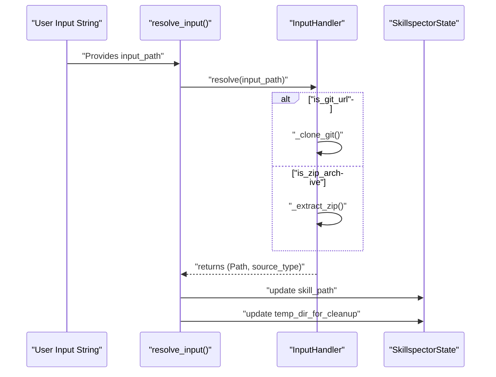
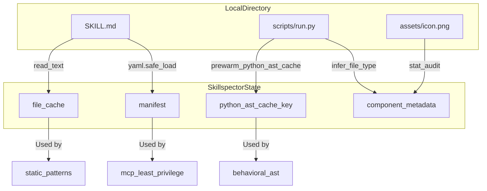

<!-- source: DeepWiki mcp.deepwiki.com · repo NVIDIA/SkillSpector · page 2.2 Input Resolution and Context Building · fetched 2026-10-26 -->

# Input Resolution and Context Building

Relevant source files

The following files were used as context for generating this wiki page:

- [src/skillspector/input_handler.py](src/skillspector/input_handler.py)
- [src/skillspector/mcp_registry.py](src/skillspector/mcp_registry.py)
- [src/skillspector/multi_skill.py](src/skillspector/multi_skill.py)
- [src/skillspector/nodes/build_context.py](src/skillspector/nodes/build_context.py)
- [src/skillspector/nodes/resolve_input.py](src/skillspector/nodes/resolve_input.py)
- [src/skillspector/structured_skill.py](src/skillspector/structured_skill.py)
- [tests/fixtures/mcp_registry/malformed.json](tests/fixtures/mcp_registry/malformed.json)
- [tests/fixtures/mcp_registry/mcp_registry.json](tests/fixtures/mcp_registry/mcp_registry.json)
- [tests/integration/test_graph.py](tests/integration/test_graph.py)
- [tests/nodes/test_build_context.py](tests/nodes/test_build_context.py)
- [tests/nodes/test_resolve_input.py](tests/nodes/test_resolve_input.py)
- [tests/test_multi_skill.py](tests/test_multi_skill.py)
- [tests/unit/test_input_handler.py](tests/unit/test_input_handler.py)
- [tests/unit/test_input_handler_bounds.py](tests/unit/test_input_handler_bounds.py)
- [tests/unit/test_input_handler_ssrf.py](tests/unit/test_input_handler_ssrf.py)
- [tests/unit/test_mcp_registry.py](tests/unit/test_mcp_registry.py)

The Input Resolution and Context Building phase is the initial stage of the SkillSpector pipeline. It is responsible for transforming diverse input sources—ranging from remote Git repositories and raw file URLs to local ZIP archives, single markdown files, and directories—into a standardized, in-memory representation suitable for parallel analysis. This process ensures that subsequent analyzer nodes operate on a uniform data structure regardless of the original source format.

Sources: [src/skillspector/nodes/resolve_input.py:41-105](), [src/skillspector/nodes/build_context.py:37-124]()

## Input Resolution Workflow

The `resolve_input` node [src/skillspector/nodes/resolve_input.py:41-105]() acts as the entry point for the LangGraph workflow. It utilizes the `InputHandler` [src/skillspector/input_handler.py:115-120]() to normalize inputs into a local directory path.

### Input Normalization Logic
The `InputHandler.resolve` method identifies the input type and applies the corresponding resolution strategy:

| Input Type | Detection Logic | Resolution Strategy |
| :--- | :--- | :--- |
| **Git URL** | Starts with `https://` or `git@` and matches known hosts or ends in `.git` [src/skillspector/input_handler.py:64-70](). | Clones the repository to a temporary directory using `git clone --depth 1` [src/skillspector/input_handler.py:218-245](). |
| **File URL** | Starts with `https://` but is not identified as a Git repo. | Downloads the file using `httpx`. If it is a ZIP, it extracts it; otherwise, it wraps the file in a temporary directory. |
| **ZIP Archive** | Local path ending in `.zip`. | Extracts the archive to a temporary directory while preventing "zip-slip" path traversal. |
| **Markdown File** | Local path ending in `.md`. | Moves the file into a temporary directory to create a valid "skill directory" structure. |
| **Directory** | Local path that is an existing directory. | Resolves to the absolute path of the directory. |

### Ingest Budget and Security
The `InputHandler` implements several security controls and resource bounds to protect the scanning environment:
* **Ingest Limits:** Remote and archive ingest is bounded by `INGEST_MAX_BYTES` (100 MiB) [src/skillspector/input_handler.py:91](), `INGEST_MAX_ZIP_MEMBERS` (10,000) [src/skillspector/input_handler.py:96](), and `INGEST_MAX_ZIP_CENTRAL_DIRECTORY_BYTES` (16 MiB) [src/skillspector/input_handler.py:101]() to prevent DoS attacks and zip bombs [src/skillspector/input_handler.py:26-30]().
* **SSRF Protection:** The `_is_private_ip` [src/skillspector/input_handler.py:196-209]() function blocks requests to internal network addresses, loopback, link-local, and reserved IP ranges.
* **Host Allowlisting:** Remote downloads and clones are restricted to `ALLOWED_GIT_HOSTS` [src/skillspector/input_handler.py:64-70]() and `ALLOWED_DOWNLOAD_HOSTS` [src/skillspector/input_handler.py:72-80]().
* **Zip-Slip Prevention:** During extraction, the handler verifies that all member paths remain within the target temporary directory.

### Data Flow: Natural Language to Code Entity Space
This diagram illustrates how user-provided input strings are transformed into the `skill_path` entity used by the graph state.

Title: "Input Resolution Sequence"

Sources: [src/skillspector/nodes/resolve_input.py:41-105](), [src/skillspector/input_handler.py:64-112](), [src/skillspector/state.py:40-48]()

## Multi-Skill Detection

When scanning a directory with `--recursive`, SkillSpector can detect if it contains multiple independent skills rather than a single project. This is managed by `detect_skills` [src/skillspector/multi_skill.py:26]().

### Detection Criteria
A directory is flagged as "multi-skill" if:
1. It contains **no** `SKILL.md` or `skill.md` at the root level.
2. At least two immediate subdirectories contain their own `SKILL.md`, `skill.md`, or structured AISOP/AISP bundles [src/skillspector/multi_skill.py:112-156]().

If a root `SKILL.md` exists, the entire directory is treated as a single skill regardless of nested files. The results are encapsulated in a `MultiSkillDetectionResult` dataclass [src/skillspector/multi_skill.py:122-132](). Discovery is bounded by `MAX_MULTI_SKILL_DISCOVERY_ENTRIES` (10,000) and `MAX_MULTI_SKILL_RUNTIME_SECONDS` (2.0) [src/skillspector/multi_skill.py:54-59]().

Sources: [src/skillspector/multi_skill.py:26-156]()

## Context Building

Once the input is resolved to a local directory, the `build_context` node [src/skillspector/nodes/build_context.py:36]() populates the `SkillspectorState` with metadata, manifests, and file contents.

### Component Discovery and Metadata
The system performs a recursive walk of the resolved directory, skipping noise directories such as `__pycache__`, `node_modules`, `.venv`, and `.git` [src/skillspector/nodes/build_context.py:87](). 

For every discovered file, component metadata is extracted:
* **Type:** Inferred from file extension via `_FILE_TYPES` (e.g., `.py` as `python`, `.md` as `markdown`) [src/skillspector/nodes/build_context.py:107-124]().
* **Lines & Size:** Line counts and file sizes via `os.stat`.
* **Executable Status:** Flags executable scripts based on extension and permissions.

### Python AST Prewarming
To optimize parallel analysis, `build_context` prewarms a process-local Python AST cache via `prewarm_python_ast_cache` [src/skillspector/python_ast.py:179-209]().
* **Cache Key:** A UUID string stored in `python_ast_cache_key` in the graph state [src/skillspector/nodes/build_context.py:108]().
* **Memory Bounds:** Respects `MAX_PYTHON_AST_SOURCE_CHARS` to avoid parsing oversized files.

### Manifest Parsing
SkillSpector parses `SKILL.md` or `skill.md` YAML frontmatter [src/skillspector/nodes/build_context.py:211-235]() to populate:
* `name` and `description` [src/skillspector/nodes/build_context.py:100-107]()
* `triggers`: Activation phrases [src/skillspector/nodes/build_context.py:103]()
* `permissions`: Declared capabilities [src/skillspector/nodes/build_context.py:104]()

### Context Data Mapping
This diagram bridges the physical file system to the internal state variables.

Title: "Context Extraction Mapping"

Sources: [src/skillspector/nodes/build_context.py:36-130](), [src/skillspector/python_ast.py:179-209](), [src/skillspector/state.py:40-48]()

---

