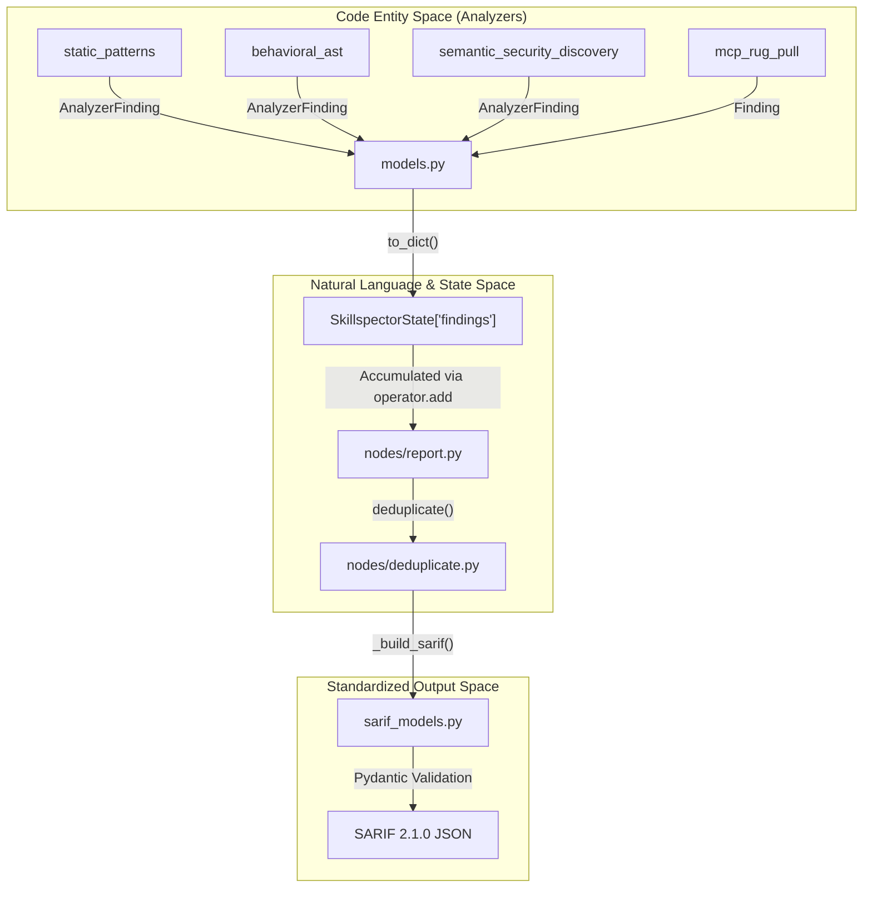
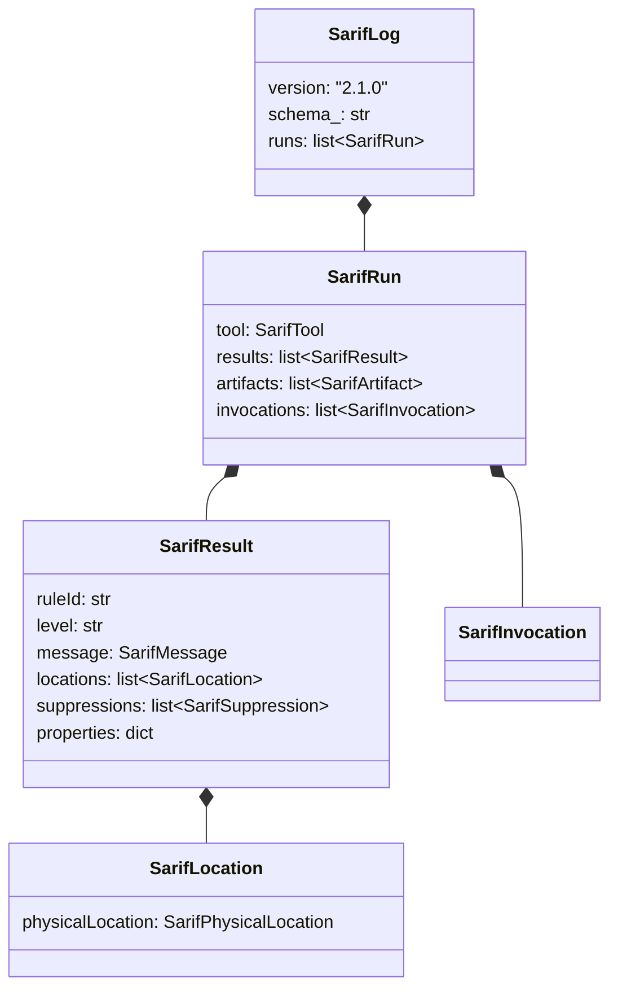

<!-- source: DeepWiki mcp.deepwiki.com · repo NVIDIA/SkillSpector · page 2.3 Data Models and SARIF Output · fetched 2026-10-26 -->

# Data Models and SARIF Output

Relevant source files

The following files were used as context for generating this wiki page:

- [src/skillspector/models.py](src/skillspector/models.py)
- [src/skillspector/nodes/analyzers/mcp_rug_pull.py](src/skillspector/nodes/analyzers/mcp_rug_pull.py)
- [src/skillspector/nodes/report.py](src/skillspector/nodes/report.py)
- [src/skillspector/sarif_models.py](src/skillspector/sarif_models.py)
- [tests/nodes/analyzers/test_mcp_rug_pull.py](tests/nodes/analyzers/test_mcp_rug_pull.py)
- [tests/nodes/analyzers/test_sc8_shipped_bytecode.py](tests/nodes/analyzers/test_sc8_shipped_bytecode.py)
- [tests/nodes/test_report.py](tests/nodes/test_report.py)
- [tests/nodes/test_report_sanitizer.py](tests/nodes/test_report_sanitizer.py)
- [tests/nodes/test_sarif_rules_and_empty_findings.py](tests/nodes/test_sarif_rules_and_empty_findings.py)
- [tests/test_mcp_rug_pull.py](tests/test_mcp_rug_pull.py)
- [tests/test_models.py](tests/test_models.py)

This page provides a comprehensive technical reference for the core data structures used in SkillSpector to represent security findings, the protocols for analyzer plugins, and the implementation of the SARIF 2.1.0 export format. It also covers finding sanitization, deduplication, and the risk scoring algorithm used to generate the final security posture assessment.

## Core Data Models

SkillSpector uses structured Python classes and dataclasses to manage the lifecycle of a security issue from discovery to report generation.

### Severity, Location, and Finding Classes

The `AnalyzerFinding` class is the lightweight structure produced by individual analyzers (`src/skillspector/models.py:59-74]()). It is converted into the `Finding` class (`src/skillspector/models.py:108-140]()), which serves as the unified model for the LangGraph state and final reporting.

| Class | Purpose | Source |
| :--- | :--- | :--- |
| `Severity` | StrEnum defining `LOW`, `MEDIUM`, `HIGH`, `CRITICAL`. | `[src/skillspector/models.py:34-41]()` |
| `Location` | Dataclass for file path and line ranges (`file`, `start_line`, `end_line`). | `[src/skillspector/models.py:44-50]()` |
| `AnalyzerFinding` | Raw finding produced by analyzer nodes before normalization. | `[src/skillspector/models.py:58-75]()` |
| `Finding` | Enriched finding used in `SkillspectorState` and reporting. | `[src/skillspector/models.py:107-140]()` |

### AnalyzerPlugin Protocol

All analyzers in the system adhere to or implement patterns consistent with the analyzer architecture, emitting structured findings through runner utilities (`[src/skillspector/models.py:58-100]()`).

**Sources:** `[src/skillspector/models.py:34-140]()`

---

## Data Flow: Finding to Output

The following diagram illustrates how raw detections from code-level entities (Analyzers) are transformed into structured data and eventually into a standardized SARIF report.

**Finding Transformation and Export Flow**

**Sources:** `[src/skillspector/models.py:58-140]()`, `[src/skillspector/nodes/report.py:42-63]()`, `[src/skillspector/nodes/deduplicate.py:1-104]()`, `[src/skillspector/sarif_models.py:160-181]()`, `[src/skillspector/nodes/analyzers/mcp_rug_pull.py:38-44]()`

---

## Finding Sanitization and Deduplication

Before findings are reported, they undergo sanitization and deduplication to ensure report quality and readability.

### Sanitization
Scanned content and LLM outputs can carry ANSI escape sequences and control bytes (such as NUL or ESC) into finding text. The `_sanitize_finding` function strips these characters from all text fields (`message`, `explanation`, `remediation`, `finding`, `context`, `matched_text`, `code_snippet`) using regex patterns `_ANSI_RE` and `_CONTROL_RE` (`[src/skillspector/nodes/report.py:81-125]()`). This ensures that terminal output and exported reports remain clean UTF-8 (`[src/skillspector/nodes/report.py:101-124]()`).

### Deduplication Logic
The deduplication mechanism eliminates redundant findings across files or within the same file based on rule ID and matched content, keeping the highest confidence representative (`[src/skillspector/nodes/deduplicate.py:1-104]()`).

**Sources:** `[src/skillspector/nodes/report.py:81-125]()`, `[src/skillspector/nodes/deduplicate.py:1-104]()`

---

## SARIF 2.1.0 Implementation

SkillSpector implements the OASIS SARIF (Static Analysis Results Interchange Format) 2.1.0 specification using Pydantic models for strict validation (`[src/skillspector/sarif_models.py:16-181]()`).

### SARIF Model Mapping
The `_build_sarif` function maps internal `Finding` attributes to SARIF entities (`[src/skillspector/nodes/report.py:46-63]()`):

*   **Rule ID:** Mapped to `ruleId` (`[src/skillspector/sarif_models.py:80-82]()`).
*   **Severity / Level:** Mapped to SARIF `level` (`error`, `warning`, `note`) (`[src/skillspector/sarif_models.py:83-83]()`).
*   **Location:** Mapped to `physicalLocation` using `artifactLocation` (file path) and `region` (line numbers) (`[src/skillspector/sarif_models.py:27-61]()`).
*   **Suppression:** Suppressed findings include a `suppressions` object (`[src/skillspector/sarif_models.py:69-74]()`).

**SARIF Model Hierarchy**

**Sources:** `[src/skillspector/sarif_models.py:27-181]()`, `[src/skillspector/nodes/report.py:46-63]()`

---

## Risk Score Computation

The `report` node calculates a cumulative risk score (0-100) based on discovered findings via `_compute_risk_score` (`[src/skillspector/nodes/report.py:70-76]()`, `[tests/nodes/test_report.py:28-30]()`).

### Scoring Algorithm
1.  **Diminishing Returns:** A per-rule diminishing weight is applied: 1.0 for the first occurrence, 0.5 for the second, and 0.25 for the third (`[tests/nodes/test_report.py:182-204]()`). Subsequent occurrences beyond the rule cap contribute zero points.
2.  **Confidence Scaling:** Each finding's contribution is scaled by its `confidence` value (`[tests/nodes/test_report.py:104-107]()`).
3.  **Base Points (`_SEVERITY_POINTS`):**
    *   **CRITICAL:** 50 points (`[tests/nodes/test_report.py:90-90]()`)
    *   **HIGH:** 25 points (`[tests/nodes/test_report.py:91-91]()`)
    *   **MEDIUM:** 10 points (`[tests/nodes/test_report.py:92-92]()`)
    *   **LOW:** 5 points (`[tests/nodes/test_report.py:93-93]()`)

### Risk Bands and Recommendations
The final score is mapped to a severity band and recommendation (`[src/skillspector/nodes/report.py:70-76]()`):

| Score Range | Severity Band | Recommendation |
| :--- | :--- | :--- |
| 81 - 100 | `CRITICAL` | `DO_NOT_INSTALL` |
| 51 - 80 | `HIGH` | `DO_NOT_INSTALL` |
| 21 - 50 | `MEDIUM` | `CAUTION` |
| 0 - 20 | `LOW` | `SAFE` |

**Sources:** `[src/skillspector/nodes/report.py:70-76]()`, `[tests/nodes/test_report.py:28-204]()`

---

