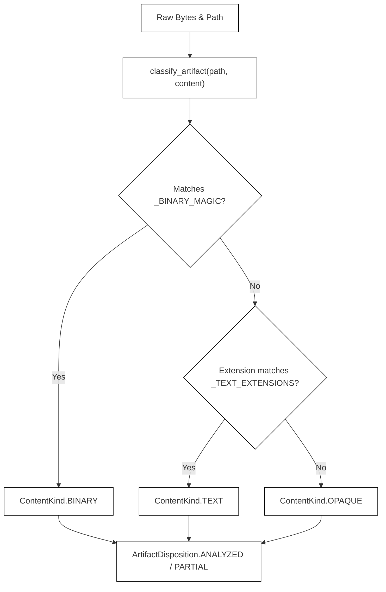
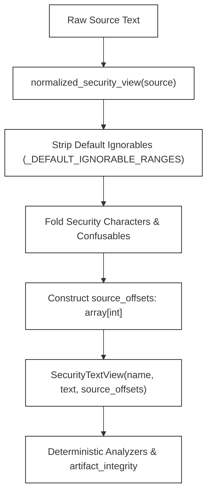
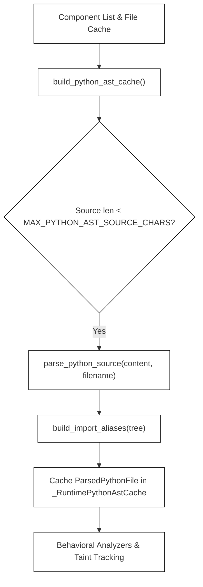

<!-- source: DeepWiki mcp.deepwiki.com · repo NVIDIA/SkillSpector · page 2.4 Artifact Classification and Text Normalization · fetched 2026-10-26 -->

# Artifact Classification and Text Normalization

<details>
<summary>Relevant source files</summary>

The following files were used as context for generating this wiki page:

- [docs/NESTED_ARTIFACT_INSPECTION.md](docs/NESTED_ARTIFACT_INSPECTION.md)
- [src/skillspector/artifacts.py](src/skillspector/artifacts.py)
- [src/skillspector/nested_artifacts.py](src/skillspector/nested_artifacts.py)
- [src/skillspector/nodes/analyzers/artifact_integrity.py](src/skillspector/nodes/analyzers/artifact_integrity.py)
- [src/skillspector/nodes/deduplicate.py](src/skillspector/nodes/deduplicate.py)
- [src/skillspector/python_ast.py](src/skillspector/python_ast.py)
- [src/skillspector/references.py](src/skillspector/references.py)
- [src/skillspector/unicode_confusables.py](src/skillspector/unicode_confusables.py)
- [tests/nodes/analyzers/test_artifact_integrity_bounds.py](tests/nodes/analyzers/test_artifact_integrity_bounds.py)
- [tests/nodes/test_deduplicate.py](tests/nodes/test_deduplicate.py)
- [tests/nodes/test_nested_artifacts.py](tests/nodes/test_nested_artifacts.py)
- [tests/nodes/test_security_end_to_end.py](tests/nodes/test_security_end_to_end.py)
- [tests/nodes/test_security_remediation.py](tests/nodes/test_security_remediation.py)

</details>


## Purpose and Scope

This page documents the subsystem responsible for raw byte classification, security-oriented text normalization, unicode confusable handling, nested artifact extraction, Python AST caching, and reference extraction. Governed primarily by `src/skillspector/artifacts.py`, `src/skillspector/nested_artifacts.py`, `src/skillspector/python_ast.py`, and `src/skillspector/references.py`, this subsystem ensures that scans operate on robust derived views of raw files without creating untracked gaps between supplied bytes and inspected text.

Sources:
- `src/skillspector/artifacts.py:1-10`
- `src/skillspector/nested_artifacts.py:1-12`
- `src/skillspector/python_ast.py:1-22`
- `src/skillspector/references.py:1-6`

---

## Byte-Level Artifact Classification

SkillSpector maintains raw bytes as the source of truth for all bundle artifacts. The function `classify_artifact` [src/skillspector/artifacts.py:45-57]() evaluates raw byte signatures (`_BINARY_MAGIC`) and file extensions to assign a content classification (`ContentKind`) and a normative disposition (`ArtifactDisposition`).


*Figure 1: Artifact classification flow bridging raw byte inputs to `ContentKind` and `ArtifactDisposition` code entities.*

Sources:
- `src/skillspector/artifacts.py:28-57`
- `src/skillspector/artifacts.py:142-192`
- `tests/nodes/test_security_remediation.py:48-61`

---

## Multi-View Security Text Projections and Obfuscation Defeat

To defeat prompt injection obfuscation techniques such as zero-width space injection, letter spacing, and character substitution, text artifacts undergo multi-view security projections via `security_text_views` and `normalized_security_view` [src/skillspector/artifacts.py:71-87](). 

Each `SecurityTextView` wraps derived text along with an array-based source offset map (`source_offsets: array[int]`), enabling exact source coordinate mapping even after stripping default ignorable code points (`_DEFAULT_IGNORABLE_CODEPOINTS`) or collapsing spacing gaps.


*Figure 2: Text normalization pipeline mapping raw source text to bounded `SecurityTextView` instances.*

Sources:
- `src/skillspector/artifacts.py:71-87`
- `src/skillspector/artifacts.py:206-240`
- `tests/nodes/test_security_remediation.py:155-185`

---

## Unicode Confusables and Anomaly Detection

The scanner incorporates Unicode confusable mappings (`ASCII_CONFUSABLE_SKELETON`) and anomaly detectors to catch mixed-script spoofing and hidden control characters [src/skillspector/nodes/analyzers/artifact_integrity.py:4-39](). The `artifact_integrity` analyzer emits deterministic findings (AE1 through AE6) for:
- Unresolved or missing references (`AE1`)
- Misleading extensions (`AE2`)
- NUL byte content anomalies (`AE3`)
- Unicode and mixed-script anomalies (`AE4`)
- Oversized artifacts (`AE5`)
- Inter-character obfuscation (`AE6`)

Sources:
- `src/skillspector/nodes/analyzers/artifact_integrity.py:1-41`
- `tests/nodes/test_security_remediation.py:63-154`

---

## Nested Artifact Inspection

Zip-compatible containers (including DOCX, XLSX, PPTX, and generic `.zip` archives) are inspected locally without writing to disk or executing contents (`src/skillspector/nested_artifacts.py`) [src/skillspector/nested_artifacts.py:4-10](). 

Before invoking Python's `zipfile` module, `inspect_nested_artifacts` performs structural preflight checks on EOCD and ZIP64 records, central directory bounds, and compression ratios. Members are assigned stable virtual paths preserving their full provenance:

```text
outer-file!/nested.zip!/scripts/setup.sh
```

Cumulative resource limits (depth 3, 1,000 members, 25 MiB uncompressed bytes, 5-second wall time) are strictly enforced against a shared budget [docs/NESTED_ARTIFACT_INSPECTION.md:24-43]().

Sources:
- `src/skillspector/nested_artifacts.py:41-144`
- `docs/NESTED_ARTIFACT_INSPECTION.md:1-52`
- `tests/nodes/test_nested_artifacts.py:94-114`

---

## Python AST Caching and Parsing

Python source parsing is centralized in `src/skillspector/python_ast.py` [src/skillspector/python_ast.py:16-22](). To avoid redundant parsing across parallel analyzer branches, the graph prewarms an LRU cache of `ParsedPythonFile` objects (`_RuntimePythonAstCache`) bounded by aggregate source character limits (`MAX_PYTHON_AST_CACHE_SOURCE_CHARS = 8_000_000`) [src/skillspector/python_ast.py:40-82]().


*Figure 3: Python AST prewarming and caching workflow across parallel analyzer branches.*

Sources:
- `src/skillspector/python_ast.py:34-82`
- `src/skillspector/python_ast.py:114-165`

---

## Reference Extraction and Validation

The reference extraction subsystem (`src/skillspector/references.py`) parses the primary skill files to discover intra-bundle file references (`BundleReference`) [src/skillspector/references.py:4-19](). Candidate strings are extracted via regex patterns and priority-queue merge iterators to prevent memory exhaustion on malicious inputs [src/skillspector/references.py:59-71](). Extracted paths are normalized and checked for parent traversal (`../`) or absolute path violations (`_normalize_candidate`) [src/skillspector/references.py:122-138]().

Sources:
- `src/skillspector/references.py:20-45`
- `src/skillspector/references.py:59-138`

---

