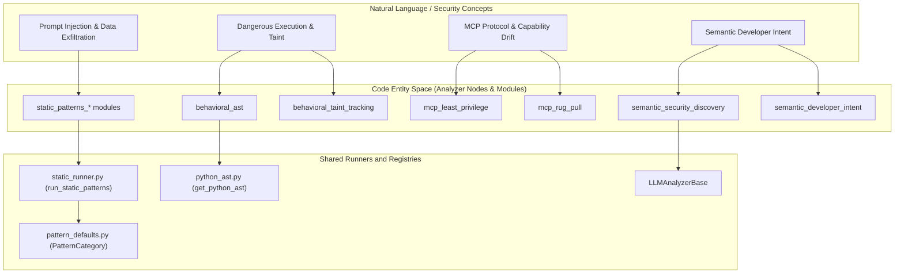
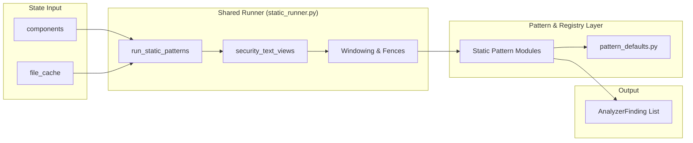

<!-- source: DeepWiki mcp.deepwiki.com · repo NVIDIA/SkillSpector · page 3 Analyzer Nodes · fetched 2026-10-26 -->

# Analyzer Nodes

Relevant source files

The following files were used as context for generating this wiki page:

- [src/skillspector/nodes/analyzers/__init__.py](src/skillspector/nodes/analyzers/__init__.py)
- [src/skillspector/nodes/analyzers/common.py](src/skillspector/nodes/analyzers/common.py)
- [src/skillspector/nodes/analyzers/pattern_defaults.py](src/skillspector/nodes/analyzers/pattern_defaults.py)
- [src/skillspector/nodes/analyzers/static_runner.py](src/skillspector/nodes/analyzers/static_runner.py)
- [tests/fixtures/pe3_bare_keyring/SKILL.md](tests/fixtures/pe3_bare_keyring/SKILL.md)
- [tests/fixtures/pe3_bare_keyring/issue-396-keyring.md](tests/fixtures/pe3_bare_keyring/issue-396-keyring.md)
- [tests/nodes/analyzers/test_registry.py](tests/nodes/analyzers/test_registry.py)
- [tests/nodes/analyzers/test_static_runner_filtering.py](tests/nodes/analyzers/test_static_runner_filtering.py)
- [tests/unit/test_reviewer_nits.py](tests/unit/test_reviewer_nits.py)

The SkillSpector analysis engine comprises 27 specialized analyzer nodes registered centrally in `ANALYZER_NODE_IDS` [src/skillspector/nodes/analyzers/__init__.py:28-61](). These nodes operate in parallel within the LangGraph workflow to inspect skill components (code, manifests, documentation, and metadata) for security vulnerabilities, behavioral risks, policy violations, supply chain issues, and artifact integrity flaws.

Each analyzer is dynamically discovered and registered via `_discover_analyzers()` [src/skillspector/nodes/analyzers/__init__.py:33-61](), mapping string identifiers to executable node entry points in `ANALYZER_NODES` [src/skillspector/nodes/analyzers/__init__.py:29]() and their underlying modules in `ANALYZER_MODULES` [src/skillspector/nodes/analyzers/__init__.py:30](). Findings generated by these analyzers are normalized into `AnalyzerFinding` and `Finding` structures before deduplication and report generation.

### Analyzer Registry and Architecture Overview

The following diagrams illustrate how analyzer nodes bridge high-level security domains to concrete code modules and runner frameworks.

**Analyzer Node Mapping: Concepts to Code**

**Sources:** [src/skillspector/nodes/analyzers/__init__.py:28-61](), [src/skillspector/nodes/analyzers/static_runner.py:33-51](), [src/skillspector/nodes/analyzers/pattern_defaults.py:24-45]()

---

### Analyzer Categories

The 27 registered nodes are categorized into five core detection methodologies, supported by the shared static runner and pattern registry framework.

#### 3.1. Static Pattern Analyzers
These lexical and regular-expression analyzers detect known vulnerability signatures across code, configuration, and markdown artifacts. They cover prompt injection (P1-P4, P6, P9), data exfiltration (E1-E5), privilege escalation (PE1-PE5), agent snooping (AS1-AS3), SSRF, harmful content, excessive agency (EA1-EA4), output handling (OH1-OH3), system prompt leakage, memory poisoning, tool misuse, anti-refusal, rogue agent, deserialization, whitespace padding, structured skill roles, and supply chain threats (SC1-SC9).
*   **For details, see [Static Pattern Analyzers](#3.1)**

#### 3.2. Behavioral Analyzers (AST and Taint Tracking)
Behavioral analyzers inspect code semantics beyond simple pattern matching. `behavioral_ast` uses Python's native `ast` module to detect dangerous execution structures (AST1-AST9), while `behavioral_taint_tracking` performs source-to-sink data-flow analysis (TT1-TT5), alongside bundled execution surface and deserialization checks.
*   **For details, see [Behavioral Analyzers (AST and Taint Tracking)](#3.2)**

#### 3.3. MCP Security Analyzers
Designed specifically for Model Context Protocol architectures, these analyzers validate `SKILL.md` manifests and server implementations against least-privilege principles (`mcp_least_privilege`, LP1-LP4), tool poisoning vectors (`mcp_tool_poisoning`, TP1-TP4), and manifest drift/rug-pull indicators (`mcp_rug_pull`).
*   **For details, see [MCP Security Analyzers](#3.3)**

#### 3.4. Semantic (LLM-Powered) Analyzers
Leveraging large language models via `LLMAnalyzerBase`, these analyzers execute complex, open-ended evaluations including security discovery (`semantic_security_discovery`), developer intent divergence checks (`semantic_developer_intent`, SDI-1..SDI-4), and quality/policy compliance (`semantic_quality_policy`).
*   **For details, see [Semantic (LLM-Powered) Analyzers](#3.4)**

#### 3.5. YARA-Based Malware Detection and Integrity
The `static_yara` analyzer applies compiled YARA rule sets (covering malware, cryptominers, hacktools, webshells, and agent skills) against binary and text artifacts. Additionally, the `artifact_integrity` analyzer enforces AE1-AE6 rules (unresolved references, misleading extensions, NUL bytes, unicode/mixed-script anomalies, oversized artifacts, and inter-character obfuscation).
*   **For details, see [YARA-Based Malware Detection](#3.5) and [Artifact Integrity and Evasion Detection (AE Rules)](#3.6)**

---

### Shared Static Runner and Pattern Framework

The shared static runner (`src/skillspector/nodes/analyzers/static_runner.py`) provides windowed security text projections, markdown fence context awareness, continuity views, finding budgets, deduplication, and false-positive filtering [src/skillspector/nodes/analyzers/static_runner.py:16-176](). It normalizes inputs, gates files exceeding `MAX_FILE_CHARS` [src/skillspector/nodes/analyzers/static_runner.py:89](), and routes text through pattern modules using `pattern_defaults.py` metadata mappings [src/skillspector/nodes/analyzers/static_runner.py:65]().

**Static Analysis Pipeline Data Flow**

**Sources:** [src/skillspector/nodes/analyzers/static_runner.py:29-176](), [src/skillspector/nodes/analyzers/pattern_defaults.py:24-45]()

**Sources:**
* [src/skillspector/nodes/analyzers/__init__.py:28-61]()
* [src/skillspector/nodes/analyzers/static_runner.py:16-176]()
* [src/skillspector/nodes/analyzers/pattern_defaults.py:24-45]()
* [tests/nodes/analyzers/test_registry.py:20-53]()

---

