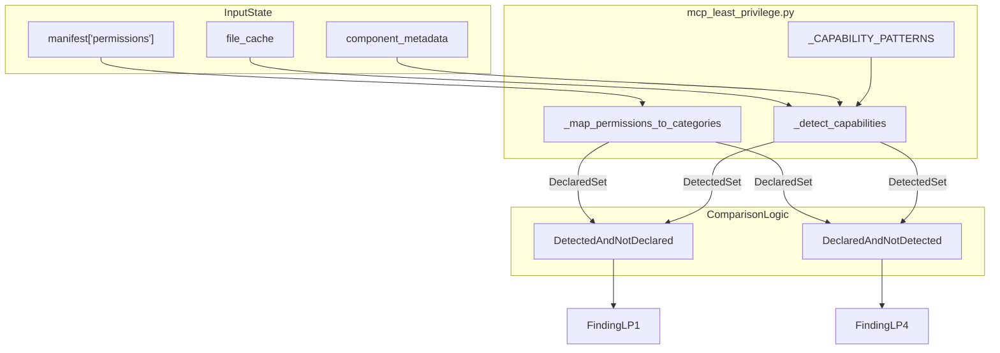
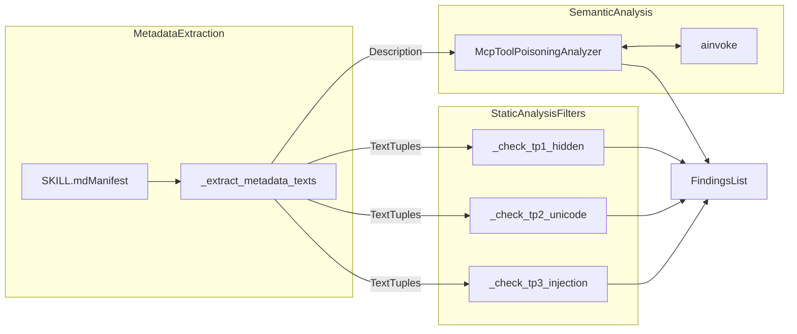
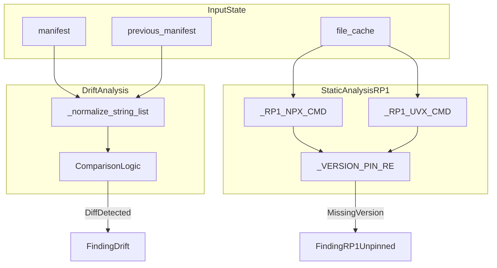

<!-- source: DeepWiki mcp.deepwiki.com · repo NVIDIA/SkillSpector · page 3.3 MCP Security Analyzers · fetched 2026-10-26 -->

# MCP Security Analyzers

Relevant source files

The following files were used as context for generating this wiki page:

- [docs/B.3.1-mcp-least-privilege.md](docs/B.3.1-mcp-least-privilege.md)
- [src/skillspector/mcp_registry.py](src/skillspector/mcp_registry.py)
- [src/skillspector/models.py](src/skillspector/models.py)
- [src/skillspector/nodes/analyzers/mcp_least_privilege.py](src/skillspector/nodes/analyzers/mcp_least_privilege.py)
- [src/skillspector/nodes/analyzers/mcp_rug_pull.py](src/skillspector/nodes/analyzers/mcp_rug_pull.py)
- [src/skillspector/nodes/analyzers/mcp_tool_poisoning.py](src/skillspector/nodes/analyzers/mcp_tool_poisoning.py)
- [tests/fixtures/mcp_registry/malformed.json](tests/fixtures/mcp_registry/malformed.json)
- [tests/fixtures/mcp_registry/mcp_registry.json](tests/fixtures/mcp_registry/mcp_registry.json)
- [tests/nodes/analyzers/test_mcp_rug_pull.py](tests/nodes/analyzers/test_mcp_rug_pull.py)
- [tests/test_mcp_least_privilege.py](tests/test_mcp_least_privilege.py)
- [tests/test_mcp_rug_pull.py](tests/test_mcp_rug_pull.py)
- [tests/test_mcp_tool_poisoning.py](tests/test_mcp_tool_poisoning.py)
- [tests/unit/test_mcp_registry.py](tests/unit/test_mcp_registry.py)

The Model Context Protocol (MCP) defines how AI agents interact with tools and skills. Because MCP manifests (`SKILL.md`) and server registries are consumed directly by LLMs and agent orchestration systems to determine tool selection, permissions, and execution parameters, they represent a high-priority attack surface. SkillSpector implements specialized analyzer nodes and posture scanners to detect MCP-specific vulnerabilities: `mcp_least_privilege`, `mcp_tool_poisoning`, `mcp_rug_pull`, and MCP registry posture checks.

---

## 1. MCP Least-Privilege Analysis (`mcp_least_privilege`)

The `mcp_least_privilege` analyzer implements rules **LP1 through LP4** [docs/B.3.1-mcp-least-privilege.md:1-4](). It enforces the principle of least privilege by cross-referencing the permissions declared in the `SKILL.md` manifest against the actual capabilities detected in the skill's source code [docs/B.3.1-mcp-least-privilege.md:10-22]().

### Implementation and Data Flow
The analyzer is implemented as a pure static analysis node that operates on the `SkillspectorState` [src/skillspector/nodes/analyzers/mcp_least_privilege.py:35-39](). It requires the `manifest`, `file_cache`, and `component_metadata` to function [docs/B.3.1-mcp-least-privilege.md:49-56]().

**Capability Detection Logic:**
1.  **Code Scanning:** The node iterates through executable files identified in `component_metadata` [src/skillspector/nodes/analyzers/mcp_least_privilege.py:115-118]().
2.  **Pattern Matching:** It uses regex patterns defined in `_CAPABILITY_PATTERNS` to identify sensitive operations like `shell` access, `network` requests, file read/write, environment access, and MCP client sessions [src/skillspector/nodes/analyzers/mcp_least_privilege.py:63-114]().
3.  **Permission Mapping:** Declared strings in the manifest's `permissions` field are normalized and mapped to capability categories using the `_PERM_TO_CAPABILITY` lookup table [src/skillspector/nodes/analyzers/mcp_least_privilege.py:121-148]().

### Detection Rules (LP1-LP4)

| Rule ID | Name | Description | Severity |
| :--- | :--- | :--- | :--- |
| **LP1** | Underdeclared Capability | Code uses a capability (e.g., `network`) not listed in the manifest [docs/B.3.1-mcp-least-privilege.md:104-118]() | HIGH |
| **LP2** | Wildcard Permission | Manifest uses `*`, `all`, `full`, or `any`, bypassing security boundaries [src/skillspector/nodes/analyzers/mcp_least_privilege.py:59-60]() | MEDIUM |
| **LP3** | Missing Declaration | No `permissions` field exists, but the code performs sensitive operations [docs/B.3.1-mcp-least-privilege.md:155-168]() | MEDIUM |
| **LP4** | Overdeclared Permission | A permission is requested but no corresponding code is found (scope creep) [docs/B.3.1-mcp-least-privilege.md:183-195]() | LOW |

### Logic Diagram: Permission Cross-Referencing

"MCP Least-Privilege Data Flow"

Sources: [src/skillspector/nodes/analyzers/mcp_least_privilege.py:43-148](), [docs/B.3.1-mcp-least-privilege.md:28-47]()

---

## 2. MCP Tool-Poisoning Detection (`mcp_tool_poisoning`)

The `mcp_tool_poisoning` analyzer (rules **TP1 through TP4**) targets "Tool Poisoning" (MITRE ATLAS AML.T0080), where an attacker manipulates tool metadata to deceive AI agents or users [src/skillspector/nodes/analyzers/mcp_tool_poisoning.py:16-17]().

### Metadata Extraction
The analyzer normalizes the manifest into a list of tuples using `_extract_metadata_texts`. This extracts text from the skill `name`, `description`, `triggers`, and `parameters` [src/skillspector/nodes/analyzers/mcp_tool_poisoning.py:168-202]().

### Implementation Details

#### TP1: Hidden Instructions
Detects non-visible content that might contain prompt injection or malicious payloads [src/skillspector/nodes/analyzers/mcp_tool_poisoning.py:16-17]().
- **HTML/Markdown Comments:** Identifies commented out sections within tool descriptions.
- **Steganography:** Detects zero-width characters (`ZERO_WIDTH_CHARS`) embedded within identifiers.
- **Encoded Payloads:** Identifies Base64 blobs and Data URIs designed to bypass textual filters.

#### TP2: Unicode Deception
Detects homoglyph attacks where characters from different scripts (Cyrillic, Greek) are used to shadow legitimate tools [src/skillspector/nodes/analyzers/mcp_tool_poisoning.py:133-161]().
- **Confusables Map:** The `_CONFUSABLES` dictionary maps characters like Cyrillic `а` (U+0430) to Latin `a` [src/skillspector/nodes/analyzers/mcp_tool_poisoning.py:136-161]().
- **RTL Overrides:** Checks for Right-to-Left override characters that manipulate visual display order.

#### TP3: Parameter Injection
Detects attempts to steer the agent via parameter descriptions, such as instructions like "always set this to true" [src/skillspector/nodes/analyzers/mcp_tool_poisoning.py:16-17](). It also flags excessively long parameter descriptions via `TP3_MAX_PARAM_DESC_LENGTH` [src/skillspector/nodes/analyzers/mcp_tool_poisoning.py:72]().

#### TP4: Description-Behavior Mismatch
An LLM-powered check extending `LLMAnalyzerBase` that compares the tool's natural language `description` against its actual code implementation [src/skillspector/nodes/analyzers/mcp_tool_poisoning.py:41-47](). This runs when `use_llm` is enabled [src/skillspector/nodes/analyzers/mcp_tool_poisoning.py:56-62]().

### Logic Diagram: Metadata Analysis

"MCP Tool-Poisoning Analysis Pipeline"

Sources: [src/skillspector/nodes/analyzers/mcp_tool_poisoning.py:41-62](), [src/skillspector/nodes/analyzers/mcp_tool_poisoning.py:133-202]()

---

## 3. MCP Rug-Pull Detection (`mcp_rug_pull`)

The `mcp_rug_pull` analyzer detects supply-chain risks such as version-unpinned references and significant manifest drift between versions [src/skillspector/nodes/analyzers/mcp_rug_pull.py:16-21]().

### RP1: Unpinned References
The analyzer scans the `file_cache` for package manager commands (`npx`, `uvx`, `pip install`) and `docker` commands that lack explicit version pins [src/skillspector/nodes/analyzers/mcp_rug_pull.py:123-141](). 
- **Detection Logic:** It identifies command strings and verifies if a version suffix (e.g., `@1.2.3`, `==1.2.3`, `@sha256:`) is present using `_VERSION_PIN_RE` [src/skillspector/nodes/analyzers/mcp_rug_pull.py:141]().

### RP2 & RP3: Manifest Drift
When a `previous_manifest` is provided in the state, the analyzer compares the current manifest against it to detect "rug pull" behavior [src/skillspector/nodes/analyzers/mcp_rug_pull.py:16-21]().

| Rule ID | Name | Description | Severity |
| :--- | :--- | :--- | :--- |
| **RP1** | Unpinned Server | MCP server or tool referenced without a pinned version (`npx`, `uvx`, `pip`) [src/skillspector/nodes/analyzers/mcp_rug_pull.py:123-141]() | MEDIUM |
| **RP1 (Drift)** | Permission Expansion | New permissions added compared to previous version [tests/nodes/analyzers/test_mcp_rug_pull.py:75-99]() | HIGH |
| **RP2 (Drift)** | Trigger Change | Trigger phrases added or removed, changing the activation surface [tests/nodes/analyzers/test_mcp_rug_pull.py:113-148]() | MEDIUM |
| **RP3 (Drift)** | Parameter Change | Parameters added, removed, or types modified [tests/nodes/analyzers/test_mcp_rug_pull.py:149-192]() | MEDIUM |

### Logic Diagram: Rug-Pull Comparison Logic

"MCP Rug-Pull Detection Flow"

Sources: [src/skillspector/nodes/analyzers/mcp_rug_pull.py:123-196](), [tests/nodes/analyzers/test_mcp_rug_pull.py:75-192]()

---

## 4. MCP Registry Posture Scanning (`src/skillspector/mcp_registry.py`)

In addition to individual skill analysis, SkillSpector includes registry posture scanning capabilities (`src/skillspector/mcp_registry.py`) to audit centralized or local MCP server registry catalogs (e.g., `registry.modelcontextprotocol.io`) [src/skillspector/mcp_registry.py:4-19]().

### Key Data Structures and Normalization
- **`RegistryServerSnapshot`**: Captures normalized server metadata including source, name, title, description, version, repository reference, packages, remotes, and official registry status metadata (`_meta`) [src/skillspector/mcp_registry.py:82-98]().
- **`record_hash`**: Generates a deterministic SHA-256 hash of canonicalized JSON registry records independently of object key ordering [src/skillspector/mcp_registry.py:110-112]().
- **Version Pinning Checks**: The helper `_is_specific_package_version` flags mutable version tags (`latest`, `next`, `beta`, range operators `^`, `~`, or wildcard segments like `1.x`) to ensure server dependencies are strictly pinned [src/skillspector/mcp_registry.py:127-139]().
- **File SHA-256 Validation**: Validates package cryptographic integrity hashes against `FILE_SHA256_RE` [src/skillspector/mcp_registry.py:141-142]().

### Registry Posture Rules
The registry scanner evaluates registry payloads for structural and security posture anomalies:
1. **Unpinned Package Versions**: Flags packages using mutable release tags or ranges instead of exact immutable versions.
2. **Missing Integrity Hashes**: Flags packages lacking explicit `fileSha256` declarations.
3. **Deprecated or Inactive Status**: Flags servers marked as deprecated or inactive in official metadata (`_meta`).
4. **Invalid Schema/Payloads**: Raises validation errors on malformed server entries or missing mandatory identifiers [src/skillspector/mcp_registry.py:171-179]().

Sources: [src/skillspector/mcp_registry.py:4-198](), [tests/fixtures/mcp_registry/mcp_registry.json:1-52]()

---

