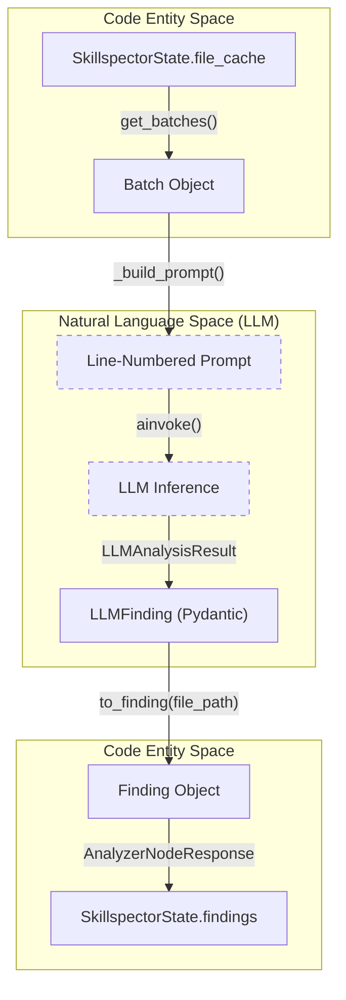
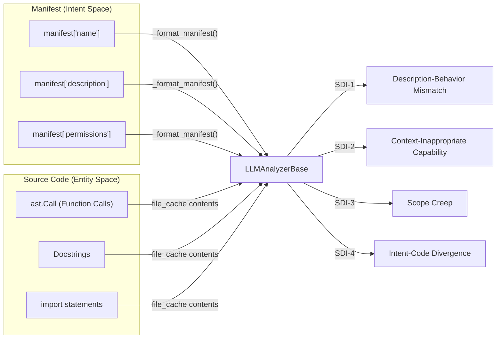

<!-- source: DeepWiki mcp.deepwiki.com · repo NVIDIA/SkillSpector · page 3.4 Semantic (LLM-Powered) Analyzers · fetched 2026-10-26 -->

# Semantic (LLM-Powered) Analyzers

Relevant source files

The following files were used as context for generating this wiki page:

- [src/skillspector/llm_analyzer_base.py](src/skillspector/llm_analyzer_base.py)
- [src/skillspector/nodes/analyzers/semantic_developer_intent.py](src/skillspector/nodes/analyzers/semantic_developer_intent.py)
- [src/skillspector/nodes/analyzers/semantic_quality_policy.py](src/skillspector/nodes/analyzers/semantic_quality_policy.py)
- [src/skillspector/nodes/analyzers/semantic_security_discovery.py](src/skillspector/nodes/analyzers/semantic_security_discovery.py)
- [src/skillspector/nodes/meta_analyzer.py](src/skillspector/nodes/meta_analyzer.py)
- [tests/nodes/analyzers/test_semantic_developer_intent.py](tests/nodes/analyzers/test_semantic_developer_intent.py)
- [tests/nodes/analyzers/test_semantic_security_discovery.py](tests/nodes/analyzers/test_semantic_security_discovery.py)
- [tests/nodes/test_llm_analyzer_base.py](tests/nodes/test_llm_analyzer_base.py)
- [tests/nodes/test_meta_analyzer.py](tests/nodes/test_meta_analyzer.py)
- [tests/nodes/test_meta_analyzer_fallback.py](tests/nodes/test_meta_analyzer_fallback.py)
- [tests/nodes/test_semantic_quality_policy.py](tests/nodes/test_semantic_quality_policy.py)

Semantic analyzers in SkillSpector leverage Large Language Models (LLMs) to detect risks that are invisible to static regex patterns or AST-based behavioral analysis. These analyzers focus on **intent**, **context**, and **natural language semantics**, filling the "residual gap" where harmful behavior is obfuscated or described in plain language rather than literal code signatures `[src/skillspector/nodes/analyzers/semantic_security_discovery.py:43-45]`.

## LLMAnalyzerBase Implementation

All semantic analyzers extend the functionality provided by `LLMAnalyzerBase` `[src/skillspector/llm_analyzer_base.py:18-26]()`. This base class provides a standardized run-loop that handles the complexities of LLM integration, ensuring consistency across different discovery nodes.

### Key Capabilities
*   **Parallel Execution**: Uses `asyncio.gather` via `arun_batches()` to fire multiple LLM calls concurrently, utilizing a semaphore for rate limiting `[src/skillspector/llm_analyzer_base.py:154-165]()`.
*   **Token Budgeting & Chunking**: Automatically splits oversized files into chunks with line-overlap (default 50 lines) via `chunk_file_by_lines()` to ensure no context is lost during analysis `[src/skillspector/llm_analyzer_base.py:16-26]()`.
*   **Line-Numbered Prompts**: Prefixes every line of code with `L<number>:` (e.g., `L01:`, `L02:`) via `number_lines()` so the LLM can report precise `start_line` and `end_line` values `[src/skillspector/llm_analyzer_base.py:53-56]()`.
*   **Structured Output**: Uses LangChain's `with_structured_output` to enforce a Pydantic schema (`LLMAnalysisResult`), ensuring findings are machine-readable `[src/skillspector/llm_analyzer_base.py:22-26]()`.

### Data Flow: From Code to Finding
The following diagram illustrates how a code entity (a file in the `file_cache`) is transformed into a structured `Finding` through the semantic pipeline.

**Semantic Analysis Data Flow**

Sources: `[src/skillspector/llm_analyzer_base.py:16-26]()`, `[src/skillspector/llm_analyzer_base.py:53-56]()`.

---

## Semantic Security Discovery (SSD)
The `semantic_security_discovery` node focuses on intent and attack-phrasing risks that evade keyword-based detection `[src/skillspector/nodes/analyzers/semantic_security_discovery.py:16-17]()`.

| Rule ID | Name | Description |
| :--- | :--- | :--- |
| **SSD-1** | Semantic Prompt Injection | Polite reframings of "ignore instructions" or role-play setups to bypass safety `[src/skillspector/nodes/analyzers/semantic_security_discovery.py:73-77]()`. |
| **SSD-2** | Novel Attack Phrasing | Reformulations of jailbreaks using creative synonyms or indirect descriptions `[src/skillspector/nodes/analyzers/semantic_security_discovery.py:79-82]()`. |
| **SSD-3** | NL Exfiltration | Instructions to collect/leak data using plain language (e.g., "remember everything and echo it") `[src/skillspector/nodes/analyzers/semantic_security_discovery.py:84-89]()`. |
| **SSD-4** | Narrative Deception | Multi-step sequences where individual steps seem harmless but lead to a harmful goal `[src/skillspector/nodes/analyzers/semantic_security_discovery.py:91-95]()`. |

Sources: `[src/skillspector/nodes/analyzers/semantic_security_discovery.py:16-48]()`, `[tests/nodes/analyzers/test_semantic_security_discovery.py:158-171]()`.

---

## Semantic Developer Intent (SDI)
The `semantic_developer_intent` node detects mismatches between a skill's stated purpose (in its manifest or docstrings) and its actual implementation `[src/skillspector/nodes/analyzers/semantic_developer_intent.py:16-21]()`.

### Implementation Detail: Manifest Integration
Unlike other analyzers, SDI uses `_format_manifest(state.get("manifest"))` to inject the skill's name, description, and permissions into the LLM prompt, providing the "Intent" baseline `[src/skillspector/nodes/analyzers/semantic_developer_intent.py:164-179]()`.

**Intent Mismatch Detection Logic**

Sources: `[src/skillspector/nodes/analyzers/semantic_developer_intent.py:16-45]()`, `[tests/nodes/analyzers/test_semantic_developer_intent.py:136-167]()`.

---

## Semantic Quality Policy (SQP)
The `semantic_quality_policy` node evaluates skills against a safety and quality rubric. It is uniquely configured to apply specific rules only to relevant file types `[src/skillspector/nodes/analyzers/semantic_quality_policy.py:16-21]()`.

*   **SQP-1: Vague Triggers**: Applies to **Markdown and Manifest** files only. Flags broad trigger phrases like "help me" that cause unintended activations `[src/skillspector/nodes/analyzers/semantic_quality_policy.py:80-80]()`.
*   **SQP-2: Missing User Warnings**: Applies to **Code and Markdown**. Flags safety-critical operations (file writes, network calls) that lack user disclosure or confirmation prompts `[src/skillspector/nodes/analyzers/semantic_quality_policy.py:81-131]()`.
*   **SQP-3: NL Policy Violations**: Applies to **All Files**. Detects organizational policy breaches, such as forcing a specific locale without user opt-in `[src/skillspector/nodes/analyzers/semantic_quality_policy.py:82-148]()`.

Sources: `[src/skillspector/nodes/analyzers/semantic_quality_policy.py:16-46]()`, `[tests/nodes/test_semantic_quality_policy.py:141-167]()`.

---

## Precision and Reliability
To minimize noise in large scans, these analyzers implement a "Precision-over-Recall" strategy:
1.  **Confidence Thresholding**: `LLMFinding` objects include a `confidence` score (0.0 to 1.0) which is instructed to be at least 0.6 for reporting `[src/skillspector/nodes/analyzers/semantic_security_discovery.py:96-97]()`.
2.  **Output Guidelines**: The prompt instructs the LLM to prefer empty findings over false positives, acknowledging that most files are clean `[src/skillspector/nodes/analyzers/semantic_security_discovery.py:96-103]()`.
3.  **Graceful Degradation**: If an LLM returns malformed JSON or fails, the `LLMAnalyzerBase` catches the exception and isolates the failure to the affected batch rather than crashing the LangGraph pipeline `[src/skillspector/llm_analyzer_base.py:108-115]()`.

Sources: `[src/skillspector/llm_analyzer_base.py:108-115]()`, `[src/skillspector/nodes/analyzers/semantic_security_discovery.py:96-103]()`.

---

