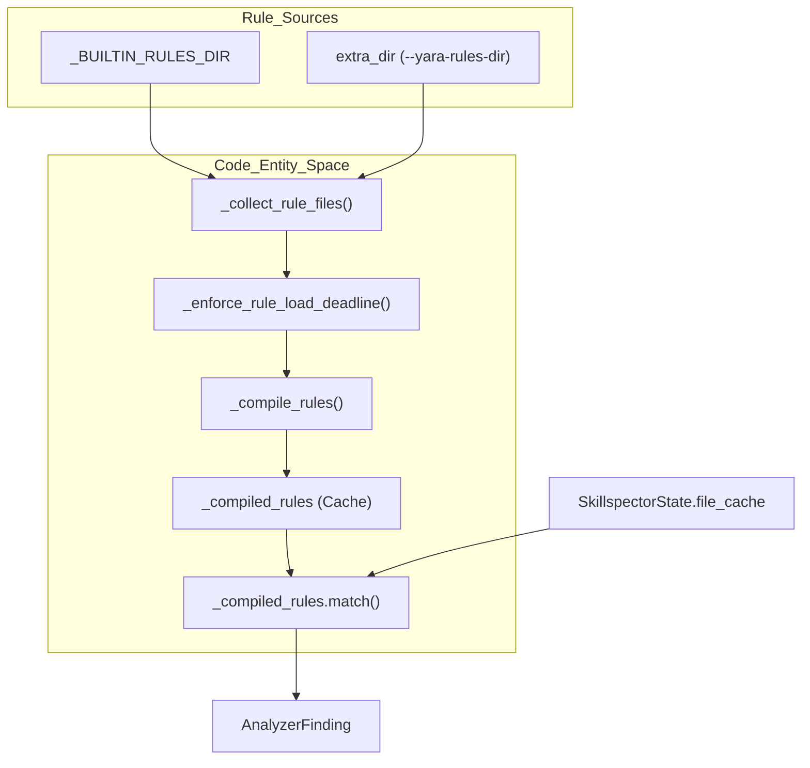
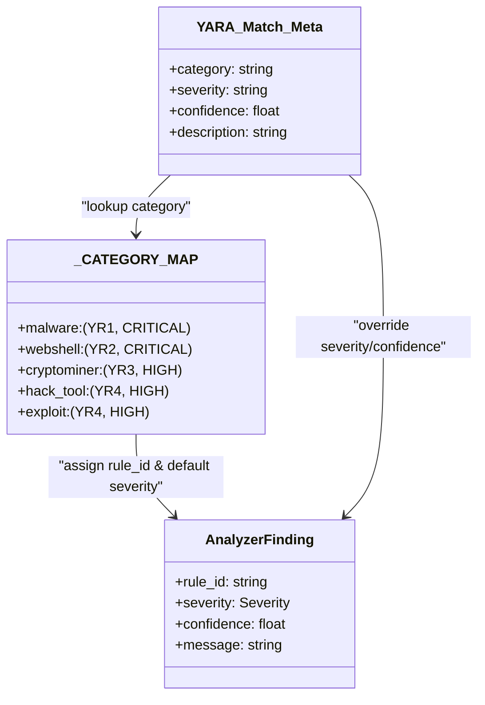

<!-- source: DeepWiki mcp.deepwiki.com · repo NVIDIA/SkillSpector · page 3.5 YARA-Based Malware Detection · fetched 2026-10-26 -->

# YARA-Based Malware Detection

Relevant source files

The following files were used as context for generating this wiki page:

- [src/skillspector/nodes/analyzers/static_yara.py](src/skillspector/nodes/analyzers/static_yara.py)
- [src/skillspector/yara_rules/agent_skills.yar](src/skillspector/yara_rules/agent_skills.yar)
- [src/skillspector/yara_rules/malware.yar.b64](src/skillspector/yara_rules/malware.yar.b64)
- [tests/nodes/analyzers/test_static_yara.py](tests/nodes/analyzers/test_static_yara.py)

The `static_yara` analyzer is a static analysis node in the SkillSpector pipeline designed to detect known malicious patterns, offensive security tools, webshells, cryptominers, and agent skill abuse within skill artifacts. It leverages the `yara` library to scan files against curated built-in rules and optional user-supplied rule directories [src/skillspector/nodes/analyzers/static_yara.py:16-21]().

### Implementation Overview

The `static_yara` node compiles YARA rules into an in-memory matching engine (`yara.Rules`), implementing a module-level cache (`_compiled_rules`, `_rules_hash`) to avoid redundant compilation across scan cycles [src/skillspector/nodes/analyzers/static_yara.py:173-175]().

#### Key Functions and Classes
- **`static_yara.node`**: Entry point registered in `ANALYZER_NODES`, retrieving the file cache from `SkillspectorState` and orchestrating execution [src/skillspector/nodes/analyzers/static_yara.py:67-68]() [src/skillspector/nodes/analyzers/static_yara.py:204-236]().
- **`_collect_rule_files`**: Discovers YARA files from bundled directories and `--yara-rules-dir` with bounded, deterministic no-follow traversal [src/skillspector/nodes/analyzers/static_yara.py:178-196]().
- **`_YaraRuleLoadBudget` & `_enforce_rule_load_deadline`**: Manages active processing budgets and workflow wall-clock deadlines during rule discovery, materialization, and compilation [src/skillspector/nodes/analyzers/static_yara.py:106-171]().
- **`_CATEGORY_MAP`**: Maps rule categories (`malware`, `webshell`, `cryptominer`, `hack_tool`, `exploit`) to default rule IDs (`YR1`-`YR4`) and severities [src/skillspector/nodes/analyzers/static_yara.py:75-81]().

#### Data Flow and Rule Loading

**YARA Rule Loading and Compilation Flow**

Sources: [src/skillspector/nodes/analyzers/static_yara.py:70-196](), [src/skillspector/nodes/analyzers/static_yara.py:204-236]()

### Bundled YARA Rules

SkillSpector ships with curated rule categories located in `src/skillspector/yara_rules/`. Some rule files are Base64 encoded (e.g., `.yar.b64`) to prevent false positives from local antivirus software scanning the package distribution.

| Rule File | Category | Description | Severity |
| :--- | :--- | :--- | :--- |
| `malware.yar.b64` | `malware` | Reverse shells, backdoors, keyloggers, ransomware, and C2 framework indicators [src/skillspector/yara_rules/malware.yar.b64:1-89](). | CRITICAL / HIGH |
| `cryptominers.yar` | `cryptominer` | Stratum protocol usage, mining pool URLs, and mining software references. | HIGH |
| `hacktools.yar` | `hack_tool` | Offensive security and privilege escalation scripts. | HIGH / MEDIUM |
| `webshells.yar` | `webshell` | Generic and obfuscated webshells for PHP, Python, JSP, and ASPX. | CRITICAL / HIGH |
| `agent_skills.yar` | `malware` / `hack_tool` | **Agent-specific**: Credential exfiltration via webhooks, remote bootstrap execution, prompt injection, and destructive autonomous actions [src/skillspector/yara_rules/agent_skills.yar:1-141](). | CRITICAL / HIGH |

Sources: [src/skillspector/nodes/analyzers/static_yara.py:16-21](), [src/skillspector/yara_rules/agent_skills.yar:1-141](), [src/skillspector/yara_rules/malware.yar.b64:1-89]()

### Metadata Mapping

YARA rules specify metadata (category, severity, confidence, description) that the analyzer maps to SkillSpector's data models. Unmapped categories fall back to `_CATEGORY_MAP`.

**Entity Mapping: YARA Meta to SkillSpector Findings**

Sources: [src/skillspector/nodes/analyzers/static_yara.py:75-81](), [src/skillspector/nodes/analyzers/static_yara.py:240-258]()

### User-Supplied Rules

Users can supply additional rules via the `--yara-rules-dir` CLI flag. 

1. **Discovery**: The `_collect_rule_files` function scans provided directories for files matching `_RULE_EXTENSIONS` (`*.yar`, `*.yara`, `*.yar.b64`, `*.yara.b64`) [src/skillspector/nodes/analyzers/static_yara.py:72-73](), [src/skillspector/nodes/analyzers/static_yara.py:178-196]().
2. **Decoding**: Encoded suffixes are automatically detected and decoded from Base64 prior to compilation.
3. **Resource Bounds**: Rule compilation and collection respect strict limits (`MAX_YARA_RULE_FILE_BYTES`, `MAX_YARA_RULE_TOTAL_BYTES`, `MAX_YARA_RULE_LOAD_SECONDS`) to prevent denial-of-service via malformed rule sets [src/skillspector/nodes/analyzers/static_yara.py:88-94]().

Sources: [src/skillspector/nodes/analyzers/static_yara.py:72-94](), [src/skillspector/nodes/analyzers/static_yara.py:178-196]()

---

