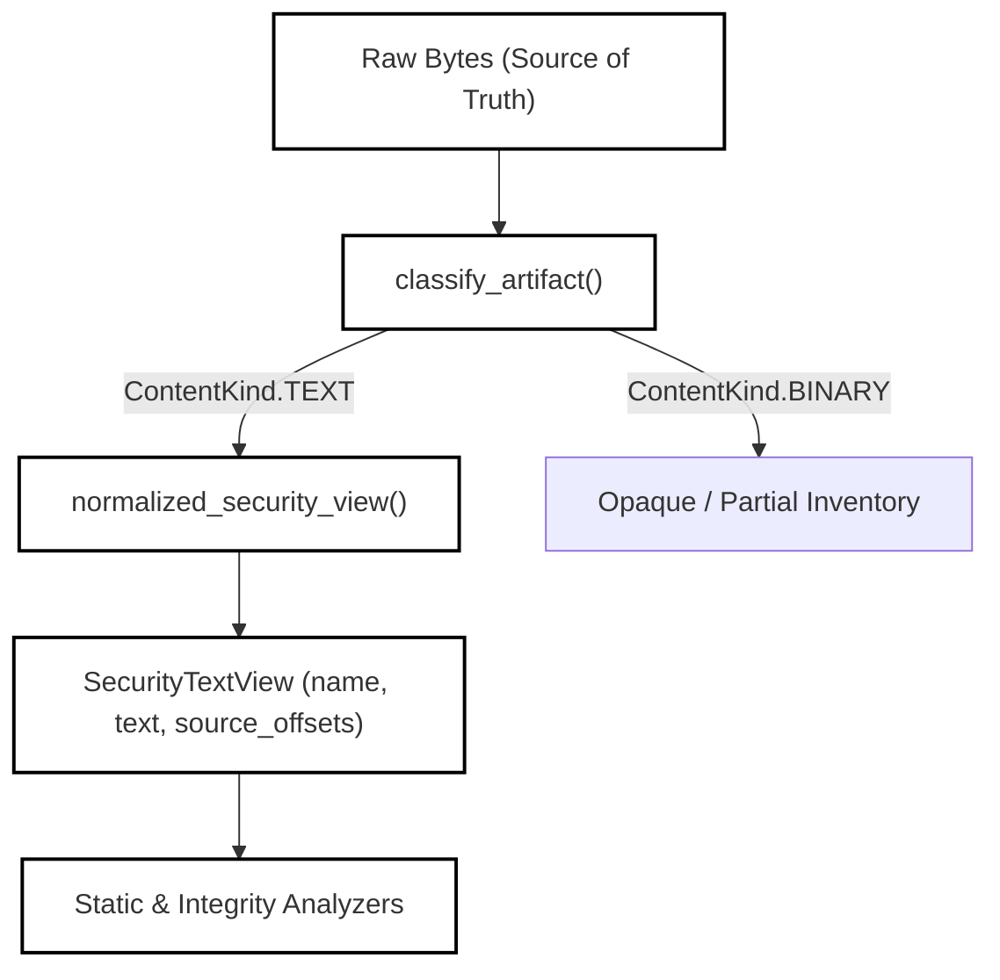
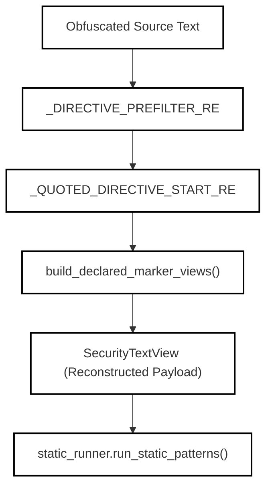

<!-- source: DeepWiki mcp.deepwiki.com · repo NVIDIA/SkillSpector · page 3.6 Artifact Integrity and Evasion Detection (AE Rules) · fetched 2026-10-26 -->

# Artifact Integrity and Evasion Detection (AE Rules)

Relevant source files

The following files were used as context for generating this wiki page:

- [src/skillspector/artifacts.py](src/skillspector/artifacts.py)
- [src/skillspector/inspection_ledger.py](src/skillspector/inspection_ledger.py)
- [src/skillspector/nodes/analyzers/artifact_integrity.py](src/skillspector/nodes/analyzers/artifact_integrity.py)
- [src/skillspector/nodes/analyzers/static_patterns_tool_misuse.py](src/skillspector/nodes/analyzers/static_patterns_tool_misuse.py)
- [src/skillspector/security_reconstruction.py](src/skillspector/security_reconstruction.py)
- [src/skillspector/unicode_confusables.py](src/skillspector/unicode_confusables.py)
- [tests/nodes/analyzers/test_artifact_integrity_bounds.py](tests/nodes/analyzers/test_artifact_integrity_bounds.py)
- [tests/nodes/analyzers/test_security_reconstruction.py](tests/nodes/analyzers/test_security_reconstruction.py)
- [tests/nodes/test_security_end_to_end.py](tests/nodes/test_security_end_to_end.py)
- [tests/nodes/test_security_remediation.py](tests/nodes/test_security_remediation.py)

## Purpose and Scope
This page details the implementation of the `artifact_integrity` analyzer module (`[src/skillspector/nodes/analyzers/artifact_integrity.py]()`), canonical artifact classification (`[src/skillspector/artifacts.py]()`), and bounded security text reconstruction (`[src/skillspector/security_reconstruction.py]()`). The artifact integrity subsystem identifies evasion techniques, malicious file characteristics, script/character anomalies, and structural discrepancies (Rules AE1 through AE6) while enforcing strict execution budgets and ledger audits (`[src/skillspector/inspection_ledger.py]()`).

Sources: `[src/skillspector/nodes/analyzers/artifact_integrity.py:1-41]()`, `[src/skillspector/artifacts.py:1-43]()`, `[src/skillspector/security_reconstruction.py:1-29]()`

---

## 1. Artifact Classification and Security Projections

SkillSpector treats raw bytes as the absolute source of truth. Text and binary analyzers do not inspect raw bytes blindly; instead, they consume derived projections (`SecurityTextView`) with strict offset-mapping guarantees to prevent evasion via unicode manipulation, mixed scripts, or inter-character spacing.

### Content Kinds and Dispositions
Artifacts are evaluated via `classify_artifact()` in `[src/skillspector/artifacts.py]()` which categorizes payloads into:
* `ContentKind.TEXT`: Decodable text content eligible for lexical and pattern analysis.
* `ContentKind.BINARY`: Binary assets (e.g., PNG, ZIP, ELF, PE) tracked in inventory.
* `ContentKind.OPAQUE`: Files with unrecognized magic headers or partial traversal context.

The disposition of an artifact is tracked using `ArtifactDisposition` (`ANALYZED`, `PARTIAL`, `FAILED`, or `OUT_OF_SCOPE`) as defined in `[src/skillspector/artifacts.py:36-43]`.

### Security Text Views
To defeat evasion tactics like zero-width space injection or homoglyph substitution, `normalized_security_view()` and `security_text_views()` construct bounded projection wrappers (`SecurityTextView`) that map derived character coordinates back to exact source offsets (`[src/skillspector/artifacts.py:71-87]()`).

*Diagram 1: Natural Language Space to Code Entity Space — Artifact Normalization Pipeline*

Sources: `[src/skillspector/artifacts.py:28-87](), [tests/nodes/test_security_remediation.py:48-61]()`

---

## 2. The AE Rules Matrix (AE1–AE6)

The `artifact_integrity` analyzer node evaluates rules `AE1` through `AE6` against inventoried components and file caches.

| Rule ID | Rule Name / Description | Target Condition | Code Pointer |
| :--- | :--- | :--- | :--- |
| **AE1** | Unresolved or Partial References | Referenced artifacts within a skill bundle that cannot be resolved or are marked partial/opaque. | `[tests/nodes/test_security_remediation.py:58-61]()` |
| **AE2** | Misleading Extensions | Discrepancy between byte content magic and file extension (e.g., text content in a `.png` or binary payload in a `.md`). | `[tests/nodes/test_security_remediation.py:48-57]()` |
| **AE3** | NUL Byte Injection | Presence of unexpected `NUL` (`\x00`) bytes inside text documents or metadata files. | `[tests/nodes/test_security_remediation.py:133-154]()` |
| **AE4** | Unicode / Mixed-Script Anomalies | High density of homoglyphs, confusable character skeletons, or default-ignorable code points (e.g., Cyrillic `а` mixed into Latin text). | `[src/skillspector/artifacts.py:205-240]()`, `[tests/nodes/test_security_remediation.py:119-131]()` |
| **AE5** | Oversized Artifacts | Files exceeding character or byte limits (`MAX_ANALYZABLE_FILE_BYTES`), forcing partial inspection or truncation. | `[src/skillspector/constants.py:30]()`, `[tests/nodes/test_security_end_to_end.py:35-48]()` |
| **AE6** | Inter-Character Obfuscation | Letter-spacing, concealed instruction spans, or split keywords designed to evade static lexical matching. | `[src/skillspector/artifacts.py:196-203]()`, `[src/skillspector/nodes/analyzers/artifact_integrity.py:49-267]()` |

Sources: `[src/skillspector/nodes/analyzers/artifact_integrity.py:41-267](), [tests/nodes/test_security_remediation.py:48-154]()`

---

## 3. Security Reconstruction Support

When text obfuscation uses declared markers or substitution gaps (e.g., splitting a forbidden command with placeholder characters or zero-width delimiters), SkillSpector invokes `src/skillspector/security_reconstruction.py`.

The function `build_declared_marker_views()` scans bounded directive headers and constructs literal, source-mapped security text views for downstream analysis without executing untrusted code (`[tests/nodes/analyzers/test_security_reconstruction.py:125-139]()`).

*Diagram 2: Natural Language Space to Code Entity Space — Security Reconstruction Architecture*

Sources: `[src/skillspector/security_reconstruction.py:1-139](), [tests/nodes/analyzers/test_security_reconstruction.py:125-156]()`

---

## 4. Budget Enforcement and Inspection Ledger

The `artifact_integrity` analyzer participates in SkillSpector's fail-closed resource governance model. It monitors wall-clock budgets (`transitive_remaining_seconds`), finding counts (`MAX_FINDINGS_PER_ARTIFACT`, `MAX_FINDINGS_PER_ANALYZER`), and character bounds.

### Ledger Outcomes and Reasons
When limits are breached, work items terminate cleanly with recorded ledger reasons (`[src/skillspector/inspection_ledger.py:23-96]()`):
* `LedgerOutcome.PARTIAL` / `LedgerReason.RUNTIME_LIMIT`: Triggered when workflow budgets expire mid-inspection (`[tests/nodes/analyzers/test_artifact_integrity_bounds.py:21-46]()`).
* `LedgerOutcome.PARTIAL` / `LedgerReason.OUTPUT_LIMIT`: Triggered when finding caps (`MAX_FINDINGS_PER_ANALYZER`) are reached (`[tests/nodes/analyzers/test_artifact_integrity_bounds.py:65-93]()`).
* `LedgerOutcome.COMPLETED` / `LedgerReason.OPAQUE_CONTENT`: Assigned to binary or media assets that fall outside text inspection scopes (`[tests/nodes/test_security_remediation.py:75-116]()`).

Sources: `[src/skillspector/inspection_ledger.py:23-96](), [tests/nodes/analyzers/test_artifact_integrity_bounds.py:11-93]()`

---

