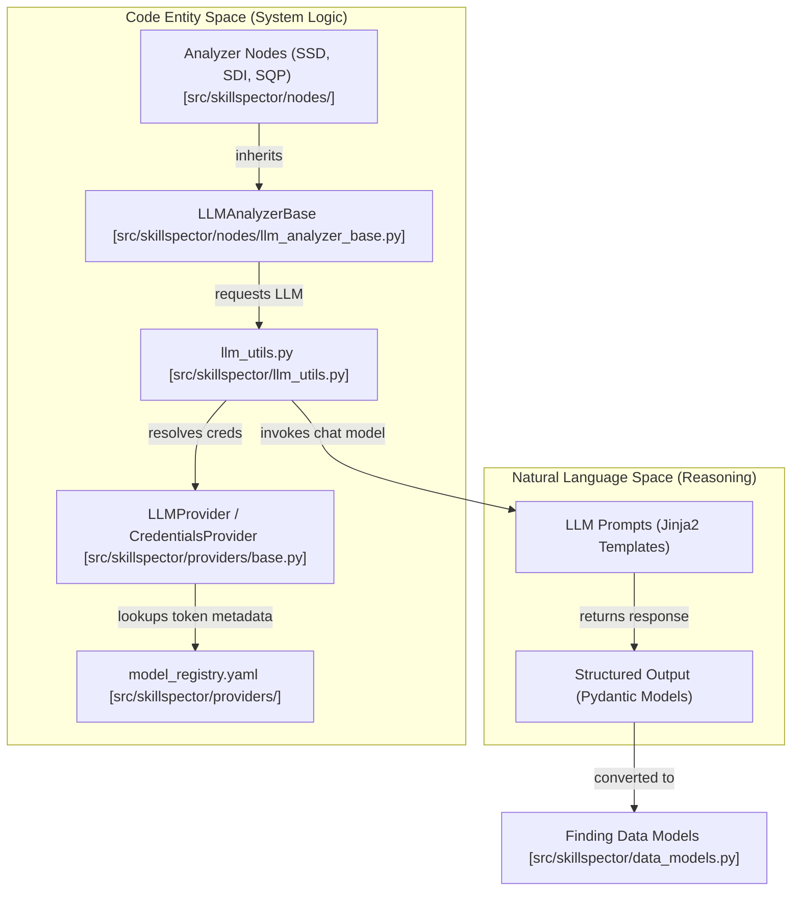
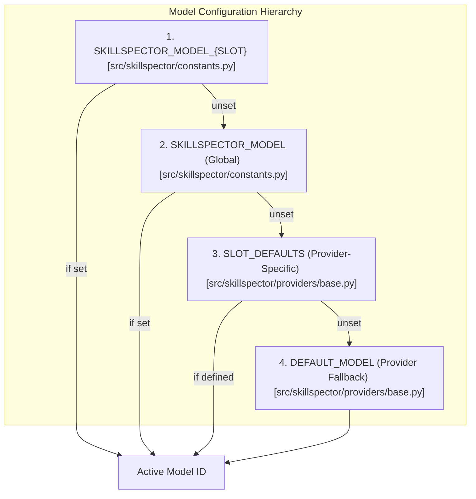

<!-- source: DeepWiki mcp.deepwiki.com · repo NVIDIA/SkillSpector · page 4 LLM Integration and Provider System · fetched 2026-10-26 -->

# LLM Integration and Provider System

Relevant source files

The following files were used as context for generating this wiki page:

- [docs/release/skillspector-2.10.0.md](docs/release/skillspector-2.10.0.md)
- [src/skillspector/cleanup.py](src/skillspector/cleanup.py)
- [src/skillspector/constants.py](src/skillspector/constants.py)
- [src/skillspector/llm_utils.py](src/skillspector/llm_utils.py)
- [src/skillspector/model_info.py](src/skillspector/model_info.py)
- [src/skillspector/providers/__init__.py](src/skillspector/providers/__init__.py)
- [src/skillspector/providers/base.py](src/skillspector/providers/base.py)
- [tests/unit/test_constants.py](tests/unit/test_constants.py)
- [tests/unit/test_llm_utils.py](tests/unit/test_llm_utils.py)
- [tests/unit/test_model_info.py](tests/unit/test_model_info.py)

SkillSpector is designed to be LLM-agnostic, supporting multiple inference backends through a unified provider abstraction. This subsystem manages credential resolution, model metadata (such as context window limits and token budgeting), and structured output generation. The integration ensures that whether a user leverages NVIDIA's API catalog, OpenAI, an enterprise endpoint, or a local CLI-based coding agent, all semantic analyzer nodes receive a consistent interface for security discovery.

For deep technical details, implementation specifics, and configuration guides, refer to the child pages:
- **[Provider System](#4.1)** — Pluggable provider protocols, HTTP/CLI transport backends, and registry configuration.
- **[LLMAnalyzerBase and Meta-Analyzer](#4.2)** — Token-budget chunking, batching, concurrency limits, and the fail-closed meta-analyzer pass.
- **[Inference Usage Telemetry](#4.3)** — Usage tracking, token consumption, latency metrics, and provenance collection.

---

### High-Level LLM Architecture

The LLM integration bridges the gap between the LangGraph-based "Code Entity Space" and the "Natural Language Space" where semantic reasoning occurs.

**LLM Integration and Space Bridging**

Sources: [src/skillspector/llm_utils.py:16-33](), [src/skillspector/providers/base.py:37-82](), [src/skillspector/constants.py:38-79]()

---

### 4.1 Provider System

The Provider System abstracts vendor-specific communication behind the `LLMProvider` protocol, which unifies metadata, credential resolution, and native chat model construction [src/skillspector/providers/base.py:115-116](). Selection is driven by the `SKILLSPECTOR_PROVIDER` environment variable, supporting a wide array of endpoints such as `nv_build`, `openai`, `anthropic`, `bedrock`, `ollama`, and local CLI tools like `claude_cli` and `gemini_cli` [src/skillspector/providers/__init__.py:16-46]().

For a complete breakdown of provider protocols (`ModelMetadataProvider`, `CredentialsProvider`, `ChatModelProvider`, `AgentCLICapable`), file layouts, and configuration rules, see **[Provider System](#4.1)**.

Sources: [src/skillspector/providers/base.py:37-127](), [src/skillspector/providers/__init__.py:16-46]()

---

### 4.2 LLMAnalyzerBase and Meta-Analyzer

Semantic analyzers inherit from `LLMAnalyzerBase`, which automates token-budget chunking, asynchronous batching via `asyncio.gather`, retry policies, and structured output parsing through LangChain [src/skillspector/llm_utils.py:165-172](). In tandem, `LLMMetaAnalyzer` executes a fail-closed review pass over consolidated findings, using local-only file handling to enrich or filter security telemetry.

For detailed documentation on chunking algorithms, concurrency throttles, and the meta-analyzer pass, see **[LLMAnalyzerBase and Meta-Analyzer](#4.2)**.

Sources: [src/skillspector/llm_utils.py:165-172](), [src/skillspector/model_info.py:32-71]()

---

### 4.3 Inference Usage Telemetry

SkillSpector tracks token consumption, latency, and provider provenance across execution runs using `InferenceUsageCollector` [src/skillspector/inference_usage.py](). This telemetry allows auditing token expenditure and ensuring compliance with operational budgets.

For details on metrics collection and reporting formats, see **[Inference Usage Telemetry](#4.3)**.

Sources: [src/skillspector/llm_utils.py:36-49]()

---

### Model Configuration Waterfall and Slot Overrides

Model selection is managed via a hierarchical waterfall that supports global overrides, slot-specific configurations (e.g., separating `meta_analyzer` from `semantic_security_discovery`), and provider defaults [src/skillspector/constants.py:38-79]().

**Model Resolution Priority**

Sources: [src/skillspector/constants.py:61-79](), [src/skillspector/providers/base.py:37-52]()

| Priority | Source | Description |
| :--- | :--- | :--- |
| 1 (Highest) | `SKILLSPECTOR_MODEL_{SLOT}` | Granular environment override for specific node slots (e.g., `SKILLSPECTOR_MODEL_META_ANALYZER`) [src/skillspector/constants.py:61-74](). |
| 2 | `SKILLSPECTOR_MODEL` | Global override environment variable for all analyzer slots [src/skillspector/providers/base.py:43-45](). |
| 3 | `SLOT_DEFAULTS` | Provider-specific dictionary mapping individual analyzer slots to preferred models [src/skillspector/providers/base.py:47-48](). |
| 4 (Lowest) | `DEFAULT_MODEL` | The provider's general-purpose default fallback model [src/skillspector/providers/base.py:47-51](). |

Credential resolution follows a complementary waterfall, querying the active provider's specific credential keys first before falling back to `OPENAI_API_KEY` and `OPENAI_BASE_URL` when unconfigured [src/skillspector/llm_utils.py:16-33]().

Sources: [src/skillspector/constants.py:61-83](), [src/skillspector/llm_utils.py:16-33](), [src/skillspector/providers/base.py:37-60]()

---

