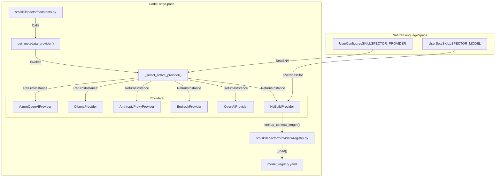
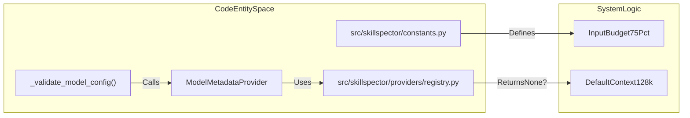

<!-- source: DeepWiki mcp.deepwiki.com · repo NVIDIA/SkillSpector · page 4.1 Provider System · fetched 2026-10-26 -->

# Provider System

Relevant source files

The following files were used as context for generating this wiki page:

- [.env.example](.env.example)
- [src/skillspector/providers/anthropic/provider.py](src/skillspector/providers/anthropic/provider.py)
- [src/skillspector/providers/anthropic_proxy/provider.py](src/skillspector/providers/anthropic_proxy/provider.py)
- [src/skillspector/providers/azure_openai/__init__.py](src/skillspector/providers/azure_openai/__init__.py)
- [src/skillspector/providers/azure_openai/model_registry.yaml](src/skillspector/providers/azure_openai/model_registry.yaml)
- [src/skillspector/providers/azure_openai/provider.py](src/skillspector/providers/azure_openai/provider.py)
- [src/skillspector/providers/bedrock/provider.py](src/skillspector/providers/bedrock/provider.py)
- [src/skillspector/providers/chat_models.py](src/skillspector/providers/chat_models.py)
- [src/skillspector/providers/nv_build/model_registry.yaml](src/skillspector/providers/nv_build/model_registry.yaml)
- [src/skillspector/providers/nv_build/provider.py](src/skillspector/providers/nv_build/provider.py)
- [src/skillspector/providers/ollama/__init__.py](src/skillspector/providers/ollama/__init__.py)
- [src/skillspector/providers/ollama/model_registry.yaml](src/skillspector/providers/ollama/model_registry.yaml)
- [src/skillspector/providers/ollama/provider.py](src/skillspector/providers/ollama/provider.py)
- [src/skillspector/providers/openai/provider.py](src/skillspector/providers/openai/provider.py)
- [src/skillspector/providers/openai_compatible/__init__.py](src/skillspector/providers/openai_compatible/__init__.py)
- [src/skillspector/providers/openai_compatible/model_registry.yaml](src/skillspector/providers/openai_compatible/model_registry.yaml)
- [src/skillspector/providers/openai_compatible/provider.py](src/skillspector/providers/openai_compatible/provider.py)
- [tests/provider/test_provider_endpoint.py](tests/provider/test_provider_endpoint.py)
- [tests/unit/test_anthropic_proxy_provider.py](tests/unit/test_anthropic_proxy_provider.py)
- [tests/unit/test_bedrock_provider.py](tests/unit/test_bedrock_provider.py)
- [tests/unit/test_new_providers.py](tests/unit/test_new_providers.py)
- [tests/unit/test_providers.py](tests/unit/test_providers.py)

The SkillSpector Provider System is a pluggable architecture that abstracts LLM-specific details, including authentication, API endpoints, model selection logic, and token-budget metadata. This allows core analyzer logic to remain agnostic of whether it is communicating with OpenAI, Anthropic, AWS Bedrock, Ollama, Azure OpenAI, or NVIDIA's inference gateways.

This is a parent page covering the core provider protocols, HTTP-based providers, model registries, and provider selection. For details on CLI-transport providers, see [Agent CLI Providers](#4.1.1).

## Core Protocols

The system is built on structural subtyping protocols (PEP 544) defined in `src/skillspector/providers/base.py`. These protocols ensure that any provider implementation provides the necessary interface for the rest of the application.

### ModelMetadataProvider
This protocol manages provider-side knowledge about model capabilities and selection logic [src/skillspector/providers/base.py:25-47]().
*   `get_context_length(model: str)`: Returns the total token window [src/skillspector/providers/base.py:27-28]().
*   `get_max_output_tokens(model: str)`: Returns the provider-imposed limit on generation length [src/skillspector/providers/base.py:30-31]().
*   `resolve_model(slot: str)`: Implements waterfall logic to select a model ID based on the specific use case (the "slot") [src/skillspector/providers/base.py:33-37]().
*   `DEFAULT_MODEL` and `SLOT_DEFAULTS`: Class variables defining baseline model selections [src/skillspector/providers/base.py:39-40]().

### CredentialsProvider
Defines how the system retrieves API keys and base URLs [src/skillspector/providers/base.py:49-57]().
*   `resolve_credentials()`: Returns a tuple of `(api_key, base_url)`. `base_url` can be `None` to defer to the client's default [src/skillspector/providers/base.py:51-57]().

### ChatModelProvider
Defines the factory method for constructing the actual LangChain model instance [src/skillspector/providers/base.py:60-69]().
*   `create_chat_model(...)`: Returns a `BaseChatModel` or `None` if the environment is unconfigured [src/skillspector/providers/base.py:62-69]().

**Sources:** [src/skillspector/providers/base.py:1-74]()

---

## Provider Selection and Data Flow

The active provider is determined at runtime via the `SKILLSPECTOR_PROVIDER` environment variable. The selection logic is encapsulated in `_select_active_provider` [src/skillspector/providers/__init__.py:57-92]().

### Selection Logic Waterfall
1.  **Environment Variable**: Reads `SKILLSPECTOR_PROVIDER` [src/skillspector/providers/__init__.py:60-61]().
2.  **Mapping**:
    *   `openai` → `OpenAIProvider` [src/skillspector/providers/__init__.py:64-65]()
    *   `openai_compatible` → `OpenAICompatibleProvider`
    *   `azure_openai` → `AzureOpenAIProvider`
    *   `ollama` → `OllamaProvider`
    *   `anthropic` → `AnthropicProvider` [src/skillspector/providers/__init__.py:66-67]()
    *   `anthropic_proxy` → `AnthropicProxyProvider` [src/skillspector/providers/__init__.py:68-69]()
    *   `bedrock` → `BedrockProvider` [src/skillspector/providers/__init__.py:70-71]()
    *   `nv_build` → `NvBuildProvider` (Default) [src/skillspector/providers/__init__.py:72-73]()
3.  **Dynamic Extensions**: The system attempts to load `nv_inference` if explicitly requested or as a fallback for internal NVIDIA builds [src/skillspector/providers/__init__.py:79-87]().

### Provider Architecture Diagram

**Model Metadata Resolution Flow**

**Sources:** [src/skillspector/providers/__init__.py:57-92](), [src/skillspector/providers/registry.py:16-65](), [src/skillspector/providers/nv_build/provider.py:1-88]()

---

## Built-in HTTP Providers

SkillSpector ships with a robust set of built-in providers backed by HTTP endpoints, local servers, or cloud gateways. Each hosted or structured provider maintains its own `model_registry.yaml` file defining token limits and constraints.

| Provider | Key Env Var | Default Model | Mechanism |
| :--- | :--- | :--- | :--- |
| **NvBuild** | `NVIDIA_INFERENCE_KEY` | `z-ai/glm-5.2` | OpenAI-compatible [src/skillspector/providers/nv_build/provider.py:41]() |
| **NvInference** | `NVIDIA_INFERENCE_KEY` / `NVIDIA_INFERENCE_METADATA_KEY` | (Catalog-driven) | NVIDIA Catalog API integration |
| **OpenAI** | `OPENAI_API_KEY` | `gpt-4o` | Standard `ChatOpenAI` [src/skillspector/providers/openai/provider.py:41]() |
| **OpenAI Compatible** | `SKILLSPECTOR_COMPAT_API_KEY` / `SKILLSPECTOR_COMPAT_BASE_URL` | `gpt-4o` | Generic gateway client |
| **Azure OpenAI** | `AZURE_OPENAI_API_KEY` / `AZURE_OPENAI_ENDPOINT` | `gpt-4o` | `AzureChatOpenAI` [src/skillspector/providers/azure_openai/provider.py:45-57]() |
| **Ollama** | `OLLAMA_BASE_URL` (optional) | `llama3.1:8b` | Local endpoint via `ChatOpenAI` [src/skillspector/providers/ollama/provider.py]() |
| **Anthropic** | `ANTHROPIC_API_KEY` | `claude-opus-4-6` | Standard `ChatAnthropic` [src/skillspector/providers/anthropic/provider.py:46]() |
| **Anthropic Proxy**| `ANTHROPIC_PROXY_API_KEY` / `ANTHROPIC_PROXY_ENDPOINT_URL` | `claude-3-5-sonnet` | Custom `httpx` rewrite [src/skillspector/providers/anthropic_proxy/provider.py:69-92]() |
| **Bedrock** | `AWS_PROFILE` / `AWS_REGION` | `us.anthropic.claude-sonnet-4-6-20250915-v1:0` | AWS SigV4 via `boto3` [src/skillspector/providers/bedrock/provider.py:102-133]() |

### Shared Chat Model Utilities
The `src/skillspector/providers/chat_models.py` module supplies shared constructors and helpers for configuring reasoning effort, temperature limits, seed forwarding, and base URL safety validation across OpenAI-compatible providers [src/skillspector/providers/chat_models.py:31-108]().

### Model Registry and Configuration
The `registry.py` module parses provider-local `model_registry.yaml` files, caches token allocation boundaries, and respects global overrides specified through `SKILLSPECTOR_MODEL_REGISTRY` [src/skillspector/providers/registry.py:25-65]().

**Sources:** [src/skillspector/providers/chat_models.py:1-108](), [src/skillspector/providers/azure_openai/provider.py:1-95](), [src/skillspector/providers/bedrock/provider.py:1-146]()

---

## Agent CLI Providers

For scenarios where direct API keys are unavailable or local subprocess-based tooling is preferred, SkillSpector implements CLI-transport providers (`claude_cli`, `codex_cli`, `gemini_cli`, `antigravity_cli`). 

For complete implementation details, wrapper isolation rules, structured output extractors, and live integration tests, see [Agent CLI Providers](#4.1.1).

**Sources:** [src/skillspector/providers/_agent_cli.py:1-102]()

---

## Model Slotting and Constants

The `constants.py` module initializes global model configurations by resolving models for specific workflow "slots" (such as `meta_analyzer` or general analysis) [src/skillspector/constants.py:67-75]().

### Resolution Waterfall
For each slot, the model is resolved via `resolve_model(slot)`:
1.  **Global Override**: `SKILLSPECTOR_MODEL` environment variable [src/skillspector/providers/anthropic/provider.py:93-94]().
2.  **Slot Default**: The provider's `SLOT_DEFAULTS` map (e.g., opting for cost-effective models during high-volume meta-analysis filter passes) [src/skillspector/providers/anthropic/provider.py:47-49]().
3.  **General Default**: The provider's `DEFAULT_MODEL` [src/skillspector/providers/anthropic/provider.py:46]().

### Token Calculation Entity Map
SkillSpector uses `MAX_INPUT_TOKENS_PCT` (75%) to calculate safe input chunking bounds, leaving headroom for system prompts and reasoning tokens [src/skillspector/constants.py:26]().

**Sources:** [src/skillspector/constants.py:25-101](), [src/skillspector/providers/base.py:25-47](), [src/skillspector/providers/anthropic/provider.py:86-94]()

---

