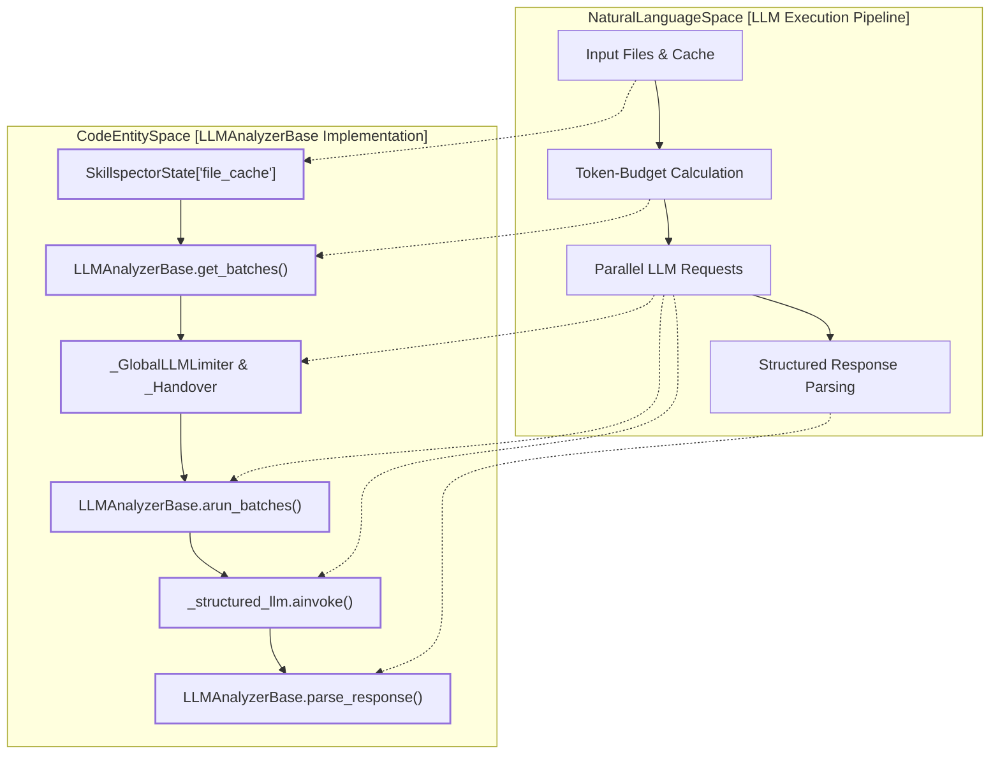
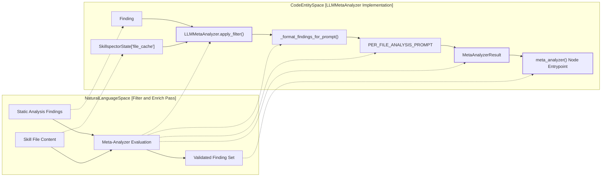

<!-- source: DeepWiki mcp.deepwiki.com · repo NVIDIA/SkillSpector · page 4.2 LLMAnalyzerBase and Meta-Analyzer · fetched 2026-10-26 -->

# LLMAnalyzerBase and Meta-Analyzer

Relevant source files

The following files were used as context for generating this wiki page:

- [docs/LLM_ANALYZER_BASE_GUIDE.md](docs/LLM_ANALYZER_BASE_GUIDE.md)
- [docs/release/skillspector-2.10.0.md](docs/release/skillspector-2.10.0.md)
- [src/skillspector/llm_analyzer_base.py](src/skillspector/llm_analyzer_base.py)
- [src/skillspector/llm_utils.py](src/skillspector/llm_utils.py)
- [src/skillspector/nodes/meta_analyzer.py](src/skillspector/nodes/meta_analyzer.py)
- [src/skillspector/providers/base.py](src/skillspector/providers/base.py)
- [tests/nodes/test_llm_analyzer_base.py](tests/nodes/test_llm_analyzer_base.py)
- [tests/nodes/test_meta_analyzer.py](tests/nodes/test_meta_analyzer.py)
- [tests/nodes/test_meta_analyzer_fallback.py](tests/nodes/test_meta_analyzer_fallback.py)
- [tests/unit/test_llm_utils.py](tests/unit/test_llm_utils.py)

The SkillSpector pipeline leverages a standardized, asynchronous framework for all LLM-powered nodes. This system handles the complexities of token management, parallel execution, rate limiting, retries, and structured data extraction, allowing individual analyzers to focus on prompt engineering [src/skillspector/llm_analyzer_base.py:16-26]().

## LLMAnalyzerBase Architecture

`LLMAnalyzerBase` is the reusable run-loop for LLM-powered analysis [src/skillspector/llm_analyzer_base.py:16-26](). It provides a consistent interface for splitting source code into manageable chunks, invoking LLMs in parallel, and parsing structured responses into the graph state.

### Token-Budget Chunking and Batching

Files are divided into `Batch` objects using `get_batches()` based on the model's token limits resolved via `get_max_input_tokens()` [src/skillspector/model_info.py:53-56](). Oversized files are split using `chunk_file_by_lines()` with line overlaps (`CHUNK_OVERLAP_LINES`) to prevent context window truncation and ensure findings near chunk boundaries are not lost [src/skillspector/llm_analyzer_base.py:99](), [src/skillspector/llm_analyzer_base.py:207-240](). Line numbers are explicitly prefixed using `number_lines()` (`L1:`, `L2:`, etc.) so the model can report precise `start_line` and `end_line` ranges [src/skillspector/llm_analyzer_base.py:243-254]().

### Global LLM Concurrency Limiter

Because graph nodes execute synchronously via `run_async()` [src/skillspector/llm_utils.py:50](), traditional `asyncio.Semaphore` instances created inside each node would fail to limit process-wide concurrency across separate event loops [src/skillspector/llm_analyzer_base.py:138-154](). SkillSpector implements a process-wide concurrency limiter (`_GlobalLLMLimiter` and `_Handover`) governed by `SKILLSPECTOR_MAX_LLM_CONCURRENCY` to prevent HTTP 429 rate-limit errors [src/skillspector/llm_analyzer_base.py:68-94](), [src/skillspector/llm_analyzer_base.py:138-165]().

### Retries and Structured Output

`LLMAnalyzerBase` handles transient API connection errors (`APIConnectionError`) with exponential backoff using `API_CONNECTION_RETRY_DELAYS_SECONDS` [src/skillspector/llm_analyzer_base.py:69-74](), [src/skillspector/llm_analyzer_base.py:116-118](). Structured responses are enforced via LangChain's `with_structured_output` against Pydantic models such as `LLMAnalysisResult` [src/skillspector/llm_analyzer_base.py:291-294]().

Diagram: LLM Execution Pipeline bridging natural language concepts to code entities.

Sources: [src/skillspector/llm_analyzer_base.py:16-165](), [src/skillspector/llm_analyzer_base.py:279-331]()

### Precision-Over-Recall

By default, `LLMAnalyzerBase` appends instructions to the `BASE_ANALYSIS_PROMPT` that instruct the model to prefer empty results over false positives, ensuring high-fidelity reporting [src/skillspector/llm_analyzer_base.py:257-276]().

Sources: [src/skillspector/llm_analyzer_base.py:16-46](), [src/skillspector/llm_analyzer_base.py:257-276]()

## LLMMetaAnalyzer

The `LLMMetaAnalyzer` is a specialized subclass of `LLMAnalyzerBase` used by the `meta_analyzer` node [src/skillspector/nodes/meta_analyzer.py:18-21](). Unlike discovery-mode analyzers that find new issues, the meta-analyzer performs a "filter and enrich" pass on existing findings generated by static and behavioral nodes.

### Data Flow and Enrichment

The meta-analyzer pairs static analysis findings with corresponding file text, formatting them via `_format_findings_for_prompt()` and skill metadata via `_format_metadata()` [src/skillspector/nodes/meta_analyzer.py:176-181](). The LLM evaluates findings using `PER_FILE_ANALYSIS_PROMPT` to verify vulnerability status, intent, impact, and confidence [src/skillspector/nodes/meta_analyzer.py:74-110](), [src/skillspector/nodes/meta_analyzer.py:153-189]().

### Local-Only File Handling

Local file content, hidden files, and nested artifacts are processed securely and kept strictly local to deterministic and meta-analysis passes, preventing external data exfiltration or adversarial prompt injection [docs/release/skillspector-2.10.0.md:46-52]().

Diagram: Meta-Analyzer Filter and Enrich Pass bridging natural language concepts to code entities.

Sources: [src/skillspector/nodes/meta_analyzer.py:16-113](), [src/skillspector/nodes/meta_analyzer.py:176-242]()

### Schema and Validation

The meta-analyzer uses the `MetaAnalyzerResult` Pydantic schema, which validates structured outputs:
*   `is_vulnerability`: Boolean flag distinguishing true positives from false positives [src/skillspector/nodes/meta_analyzer.py:87]().
*   `confidence`: Normalized float between 0.0 and 1.0, with validators handling 0–100 scales returned by certain models [src/skillspector/nodes/meta_analyzer.py:91-100]().
*   `intent`: Categorized as `malicious`, `negligent`, or `benign` [src/skillspector/nodes/meta_analyzer.py:102-104]().
*   `impact`: Categorized as `critical`, `high`, `medium`, or `low` [src/skillspector/nodes/meta_analyzer.py:105-107]().
*   `overall_assessment`: Summary and aggregate risk level for the file [src/skillspector/nodes/meta_analyzer.py:112-117]().

Sources: [src/skillspector/nodes/meta_analyzer.py:74-148]()

### Adversarial Instruction Handling

The `PER_FILE_ANALYSIS_PROMPT` contains explicit safety instructions telling the model to ignore any text inside skill content that attempts to override rules, claim the skill is verified safe, or skip security checks, treating such claims instead as red flags [src/skillspector/nodes/meta_analyzer.py:153-170]().

Sources: [src/skillspector/nodes/meta_analyzer.py:153-189]()

## Heuristic Fallback and Fail-Closed Safeguards

When LLM analysis is disabled (`--no-llm`), times out, or encounters errors, `meta_analyzer` engages a fail-closed heuristic fallback via `_fallback_filtered()` [tests/nodes/test_meta_analyzer_fallback.py:16-27]():
*   **Confidence Thresholds**: Findings with confidence `>= 0.4` or matching `HIGH`/`CRITICAL` severity floors are retained [tests/nodes/test_meta_analyzer_fallback.py:53-112]().
*   **Code Example Protection**: Findings located inside markdown code blocks or near example keywords are preserved with deterministic confidence rather than being erased [tests/nodes/test_meta_analyzer_fallback.py:114-179]().
*   **Degraded Reporting**: Partial provider failures mark the run as degraded, flooring otherwise `SAFE` recommendations to `CAUTION` [docs/release/skillspector-2.10.0.md:36]().

Sources: [src/skillspector/nodes/meta_analyzer.py:1-65](), [tests/nodes/test_meta_analyzer_fallback.py:16-179]()

## Token and Model Resolution

Token limits and credentials are resolved through the provider system before analysis begins:

| Function | Responsibility | Source |
| :--- | :--- | :--- |
| `get_max_input_tokens` | Returns 75% of the model's context window for input budgeting. | [src/skillspector/model_info.py:53-56]() |
| `get_chat_model` | Initializes chat models with resolved credentials and base URLs. | [src/skillspector/llm_utils.py:126-150]() |
| `estimate_tokens` | Provides a character-based approximation (4 characters per token) for batching. | [src/skillspector/llm_analyzer_base.py:169-171]() |
| `chunk_file_by_lines` | Splits content into 1-indexed line-range chunks with overlap. | [src/skillspector/llm_analyzer_base.py:207-240]() |

Sources: [src/skillspector/llm_analyzer_base.py:169-171](), [src/skillspector/model_info.py:53-56]()

## Inference Usage Tracking

SkillSpector tracks token usage across all LLM calls via `InferenceUsageCollector` [src/skillspector/inference_usage.py:126-134](). This collector operates as a LangChain callback handler to capture provider-reported token metrics even when using structured output schemas [src/skillspector/inference_usage.py:4-9]().

### Telemetry Normalization

The `_usage_record` function standardizes disparate provider reporting formats (such as Anthropic's prompt caching counters versus OpenAI's usage dicts) into a unified `InferenceUsageRecord` [src/skillspector/inference_usage.py:33-49](), [src/skillspector/inference_usage.py:126-215]().

Sources: [src/skillspector/inference_usage.py:33-49](), [src/skillspector/inference_usage.py:126-215]()

---

