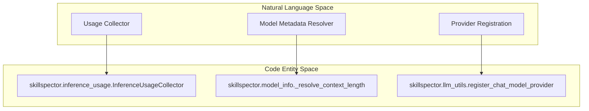
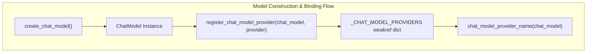
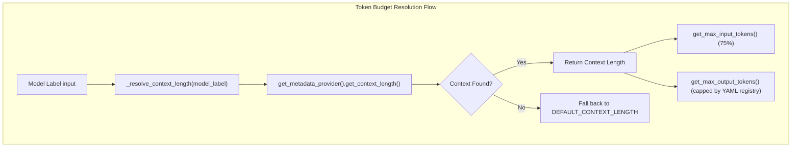

<!-- source: DeepWiki mcp.deepwiki.com · repo NVIDIA/SkillSpector · page 4.3 Inference Usage Telemetry · fetched 2026-10-26 -->

# Inference Usage Telemetry

<details>
<summary>Relevant source files</summary>

The following files were used as context for generating this wiki page:

- [docs/INFERENCE_USAGE.md](docs/INFERENCE_USAGE.md)
- [docs/PI_EXTENSION.md](docs/PI_EXTENSION.md)
- [docs/release/skillspector-2.10.0.md](docs/release/skillspector-2.10.0.md)
- [docs/release/skillspector-2.9.0.md](docs/release/skillspector-2.9.0.md)
- [docs/release/skillspector-2.9.1.md](docs/release/skillspector-2.9.1.md)
- [extensions/skillspector.ts](extensions/skillspector.ts)
- [package.json](package.json)
- [src/skillspector/llm_utils.py](src/skillspector/llm_utils.py)
- [src/skillspector/model_info.py](src/skillspector/model_info.py)
- [src/skillspector/providers/base.py](src/skillspector/providers/base.py)
- [tests/unit/test_llm_utils.py](tests/unit/test_llm_utils.py)
- [tests/unit/test_model_info.py](tests/unit/test_model_info.py)

</details>


## Purpose and Scope

The Inference Usage Telemetry subsystem collects, normalizes, and reports provider-reported LLM usage metrics and model provenance within SkillSpector scan reports. Its core purpose is to provide downstream CI consumers and security pipelines with transparent, raw token consumption and model metadata without requiring log scraping or local estimation. This document covers the internal implementation of `InferenceUsageCollector`, provider registration mechanisms for model provenance, token-budget resolution via `model_info.py`, and the JSON reporting contract defined in `docs/INFERENCE_USAGE.md`.

---

## 1. Inference Usage Collection Architecture

SkillSpector tracks invocation telemetry through stateful collectors that capture successful provider interactions across analyzer nodes. Rather than deriving costs from text length or local tokenizers, the system relies exclusively on provider-reported counters.

The following diagram bridges natural language telemetry concepts to their corresponding code entities in the codebase:


*Figure 1: Telemetry Concepts to Code Entities Mapping.*

Sources: [src/skillspector/llm_utils.py:48-93](), [src/skillspector/model_info.py:32-51](), [docs/INFERENCE_USAGE.md:1-44]()

---

## 2. Provider Registration and Provenance Tracking

To record accurate model provenance, SkillSpector binds constructed chat models to their originating providers using weak references in `src/skillspector/llm_utils.py`. When an LLM client executes a request, the system associates the model instance with a sanitized provider label.


*Figure 2: Chat Model Provenance Binding Flow.*

Key functions involved in provider registration and lookup:
* `register_chat_model_provider(chat_model, provider)`: Stores a weak reference mapping of `id(chat_model)` to its sanitized provider label [src/skillspector/llm_utils.py:67-84]().
* `chat_model_provider_name(chat_model)`: Retrieves the effective provider name recorded during model construction [src/skillspector/llm_utils.py:86-93]().
* `model_source`: Differentiates whether the model name originated from an explicit `provider_response` or a client-configured `requested_model` [docs/INFERENCE_USAGE.md:65-80]().

Sources: [src/skillspector/llm_utils.py:63-93](), [docs/INFERENCE_USAGE.md:65-80]()

---

## 3. Token Limits and Context Window Resolution

Token budgets and input/output chunking constraints are managed by `src/skillspector/model_info.py`. This module acts as a public façade over the provider metadata resolution chain.


*Figure 3: Token Budget and Context Window Resolution.*

Key functions in `model_info.py`:
* `_resolve_context_length(model_label)`: Queries the active metadata provider chain, falling back to `DEFAULT_CONTEXT_LENGTH` with a warning if the model is absent [src/skillspector/model_info.py:32-51]().
* `get_max_input_tokens(model)`: Calculates the input token budget as 75% of the resolved context window (`MAX_INPUT_TOKENS_PCT`) [src/skillspector/model_info.py:53-56]().
* `get_max_output_tokens(model)`: Computes the output token budget using the smaller of the percentage-based remainder and any explicit cap exposed by the provider registry [src/skillspector/model_info.py:58-71]().

Sources: [src/skillspector/model_info.py:16-71](), [src/skillspector/providers/base.py:37-60]()

---

## 4. JSON Contract and Downstream Telemetry Integration

As specified in `docs/INFERENCE_USAGE.md`, successful LLM interactions contribute structured records to `metadata.inference_usage` within JSON scan reports. 

### Telemetry Payload Structure

Each record contains normalized prompt, completion, cache, and reasoning metrics:

```json
{
  "metadata": {
    "llm_requested": true,
    "llm_available": true,
    "inference_usage": [
      {
        "node": "semantic_security_discovery",
        "request_kind": "structured_output",
        "provider": "nv_inference",
        "model": "azure/anthropic/claude-opus-4-6",
        "model_source": "provider_response",
        "usage_source": "provider_response",
        "prompt_tokens": 1000,
        "completion_tokens": 100,
        "cached_tokens": 400,
        "cache_write_tokens": 50,
        "reasoning_tokens": 25,
        "total_tokens": 1100
      }
    ]
  }
}
```

### Normalization and Privacy Rules
* **Additive Pricing Shape**: Uncached prompt tokens are computed as `prompt_tokens - cached_tokens - cache_write_tokens`, and total tokens equal `prompt_tokens + completion_tokens` [docs/INFERENCE_USAGE.md:98-115]().
* **Privacy Boundary**: Telemetry records use an strict allowlist. They contain only bounded labels and non-negative numeric counters—prompts, completions, analyzed skill text, and credentials are strictly excluded [docs/INFERENCE_USAGE.md:146-151]().
* **Fail-Closed Behavior**: An empty `inference_usage` list indicates that usage was unobservable or static-only; it must not be interpreted as zero-cost execution or make an incomplete security scan pass [docs/INFERENCE_USAGE.md:121-145]().

Sources: [docs/INFERENCE_USAGE.md:1-151](), [tests/unit/test_llm_utils.py:36-51]()

---

