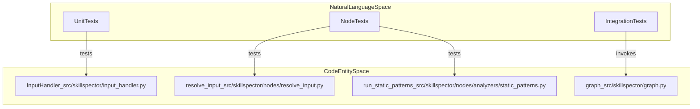
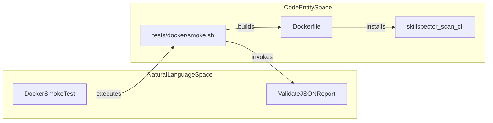

<!-- source: DeepWiki mcp.deepwiki.com · repo NVIDIA/SkillSpector · page 5 Testing · fetched 2026-10-26 -->

# Testing

Relevant source files

The following files were used as context for generating this wiki page:

- [.gitignore](.gitignore)
- [Makefile](Makefile)
- [docs/B.3.2-mcp-tool-poisoning.md](docs/B.3.2-mcp-tool-poisoning.md)
- [docs/SC4-osv-live-vulnerability-lookups.md](docs/SC4-osv-live-vulnerability-lookups.md)
- [src/skillspector/nodes/resolve_input.py](src/skillspector/nodes/resolve_input.py)
- [tests/docker/smoke.sh](tests/docker/smoke.sh)
- [tests/integration/__init__.py](tests/integration/__init__.py)
- [tests/integration/test_graph.py](tests/integration/test_graph.py)
- [tests/nodes/test_resolve_input.py](tests/nodes/test_resolve_input.py)
- [tests/unit/__init__.py](tests/unit/__init__.py)

## Purpose and Scope

This page provides an overview of the SkillSpector test suite structure, test categories (unit, node, analyzer, integration, provider, and docker smoke), test fixtures, and execution workflows. The test suite is designed to ensure the reliability of the LangGraph-based security pipeline [tests/integration/test_graph.py:16-24](), the accuracy of its analyzer nodes, and the robustness of input handling [tests/nodes/test_resolve_input.py:16-23]().

This is a parent page. For deep technical details, see the following child pages:
- [Unit and Node Tests](#5.1)
- [Integration Tests and Test Fixtures](#5.2)
- [Security Regression and Accuracy Suites](#5.3)

---

## Test Execution and Makefile Targets

The project uses `pytest` as its primary testing framework, orchestrated via `Makefile` targets that manage environment setup, provider-specific keys, and coverage collection [Makefile:1-107]().

| Target | Command | Description |
|:---|:---|:---|
| `make test` | `test-unit test-integration` | Runs both unit and integration suites. [Makefile:60-60]() |
| `make test-unit` | `pytest -m "not integration and not provider"` | Runs unit tests only, excluding LLM network calls. [Makefile:63-64]() |
| `make test-provider` | `pytest -m provider` | Runs live tests against LLM providers (`openai`, `anthropic`, `nv_build`). [Makefile:67-91]() |
| `make test-integration` | `pytest -m integration` | Invokes the full graph workflow. [Makefile:97-98]() |
| `make test-cov` | `pytest --cov=src/skillspector --cov-report=html` | Generates HTML and terminal coverage reports. [Makefile:101-102]() |
| `make test-ci` | `pytest --cov=src/skillspector --cov-report=xml` | Optimized for CI pipelines with Cobertura XML output. [Makefile:105-106]() |
| `make docker-smoke` | `tests/docker/smoke.sh` | Builds and smoke-tests the Docker container against local and remote targets. [Makefile:153-154]() |

Sources: [Makefile:1-154]()

---

## Test Hierarchy and Categories

The test hierarchy mirrors the codebase architecture, segmented into isolated unit checks, node-level functional verification, full graph integration, and containerized smoke tests.

### 1. Unit Tests
Located in `tests/unit/`, these validate isolated modules such as argument parsing, utility helpers, model info, OSV client lookups, regex patterns, and SARIF data structures. For details, see [Unit and Node Tests](#5.1).

### 2. Node-Level and Analyzer Tests
Located in `tests/nodes/` and `tests/nodes/analyzers/`, these tests verify individual LangGraph nodes—such as `resolve_input` [tests/nodes/test_resolve_input.py:16-34]()—and analyzer modules (static patterns, YARA rules, AST behavioral analysis, and semantic components). For details, see [Unit and Node Tests](#5.1).

### 3. Integration Tests
Located in `tests/integration/`, these invoke the complete `StateGraph` workflow defined in `graph.py`, verifying fan-out/fan-in topology, ledger accumulation, and end-to-end report generation [tests/integration/test_graph.py:26-43](). For details, see [Integration Tests and Test Fixtures](#5.2).

### 4. Provider and Docker Smoke Tests
Live provider tests in `tests/provider/` validate structured output requests against actual LLM endpoints [Makefile:16-27](). Container smoke tests executed via `tests/docker/smoke.sh` verify that the packaged Docker image correctly initializes and executes scans against local fixtures and remote repositories [tests/docker/smoke.sh:1-64]().

Sources: [Makefile:1-154](), [tests/integration/test_graph.py:26-43](), [tests/nodes/test_resolve_input.py:16-34](), [tests/docker/smoke.sh:1-64]()

---

## Test Fixtures Catalogue

SkillSpector utilizes dedicated fixture directories under `tests/fixtures/` to test detection rules against known safe, malicious, signed, or protocol-specific inputs [tests/integration/test_graph.py:45-49](). 

Key fixture sets include:
- **Clean and Malicious Baselines:** `safe_skill` and `malicious_skill` for baseline regression testing.
- **MCP Protocol Fixtures:** `mcp_*` skill directories testing Model Context Protocol capabilities, tool poisoning, and least privilege.
- **Signatures and Archives:** `oms/` fixtures containing signed skill payloads (e.g., `mcore-split-pr.skill.oms.sig`) to verify scope exclusion and signature verification [tests/integration/test_graph.py:45-87]().
- **Semantic Discovery Datasets:** `sdi/`, `sqp/`, and `ssd/` test directories for semantic evaluation.

For details, see [Integration Tests and Test Fixtures](#5.2).

Sources: [tests/integration/test_graph.py:45-87]()

---

## Natural Language to Code Entity Space Mappings

The following diagrams bridge natural language testing concepts to their exact code implementations in the repository.

### Test Suite to Code Entity Mapping
This diagram associates test categories with the underlying modules and functions they exercise.

Sources: [Makefile:60-98](), [src/skillspector/nodes/resolve_input.py:41-105](), [tests/integration/test_graph.py:26-43]()

### Docker Smoke Test Pipeline Mapping
This diagram maps container smoke test operations to the container entrypoint and verification scripts.

Sources: [Makefile:149-154](), [tests/docker/smoke.sh:11-34]()

---

