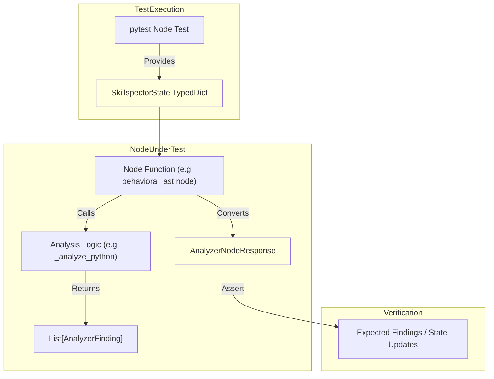
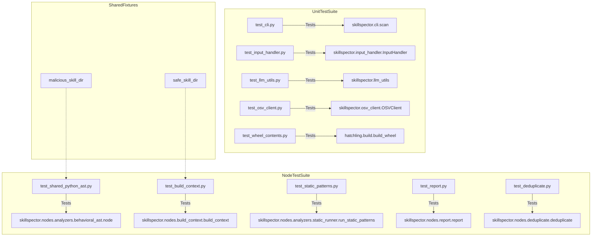

<!-- source: DeepWiki mcp.deepwiki.com · repo NVIDIA/SkillSpector · page 5.1 Unit and Node Tests · fetched 2026-10-26 -->

# Unit and Node Tests

Relevant source files

The following files were used as context for generating this wiki page:

- [src/skillspector/cli.py](src/skillspector/cli.py)
- [src/skillspector/nodes/analyzers/static_patterns_data_exfiltration.py](src/skillspector/nodes/analyzers/static_patterns_data_exfiltration.py)
- [src/skillspector/nodes/analyzers/static_patterns_prompt_injection.py](src/skillspector/nodes/analyzers/static_patterns_prompt_injection.py)
- [src/skillspector/nodes/build_context.py](src/skillspector/nodes/build_context.py)
- [tests/nodes/analyzers/test_shared_python_ast.py](tests/nodes/analyzers/test_shared_python_ast.py)
- [tests/nodes/analyzers/test_static_patterns.py](tests/nodes/analyzers/test_static_patterns.py)
- [tests/nodes/test_build_context.py](tests/nodes/test_build_context.py)
- [tests/unit/test_cli.py](tests/unit/test_cli.py)
- [tests/unit/test_wheel_contents.py](tests/unit/test_wheel_contents.py)

The SkillSpector test suite is divided into two primary categories: **Unit Tests** (validating individual utility modules, configurations, and supporting infrastructure) and **Node Tests** (validating discrete functional units and analyzers within the LangGraph workflow). These tests ensure that both supporting code (CLI, input handlers, LLM providers, OSV clients, wheel packaging) and security inspection routines (AST parsers, static pattern matchers, shared AST caches) operate correctly before integration into the full inspection graph.

---

## Unit Tests (`tests/unit/`)

Unit tests reside in `tests/unit/` and target the core library components, isolating individual functions with `pytest` fixtures and mocks.

### CLI and Input Handling
CLI tests verify command-line argument parsing, environment setup, and error propagation across subcommands.
*   **CLI Invocation**: `test_cli.py` exercises `skillspector scan`, `--version`, and argument handling via `CliRunner` [tests/unit/test_cli.py:52-89](). It verifies that preflight checks reject symlinked parent directories before graph execution [tests/unit/test_cli.py:121-145]() and correctly handles JSON/SARIF output flags [tests/unit/test_cli.py:113-160]().
*   **Input Normalization**: Input handler tests ensure that Git URLs, ZIP archives, and local paths are safely resolved into standardized file caches without security regressions like Zip-Slip or path traversal [src/skillspector/input_handler.py:45-50]().

Sources: [src/skillspector/cli.py](), [src/skillspector/input_handler.py](), [tests/unit/test_cli.py]()

### LLM Utilities, Providers, and Model Info
These tests ensure that the pluggable provider system correctly resolves credentials, manages token budgets, and maps model metadata.
*   **Credential Resolution**: Tests verify priority ordering between active providers, environment variables, and fallback keys [tests/unit/test_llm_utils.py:84-91]().
*   **Provider Metadata**: Tests validate that provider drivers load their bundled YAML registries correctly [tests/unit/test_providers.py:135-147]() and enforce token limits [src/skillspector/constants.py:41-45]().

Sources: [src/skillspector/constants.py](), [tests/unit/test_llm_utils.py](), [tests/unit/test_providers.py]()

### OSV Client (SC4)
The `osv_client` unit tests validate live and fallback vulnerability lookup paths.
*   **Batching & Caching**: Tests verify in-memory caching behavior to minimize redundant API traffic against the OSV.dev batch endpoint [src/skillspector/osv_client.py:45-60]().
*   **Offline Fallback**: Validates graceful degradation to static vulnerability definitions during network errors or air-gapped executions [src/skillspector/osv_client.py:150-165]().

Sources: [src/skillspector/osv_client.py]()

### Suppression, Transitive Traversal, and Wheel Packaging
*   **Wheel Resources**: `test_wheel_contents.py` verifies that built-in distribution wheels (`.whl`) package required non-Python assets—specifically the YARA rule directories and provider model registry YAML files—so runtime scans function correctly when installed from package indexes [tests/unit/test_wheel_contents.py:19-38]().
*   **Baselines**: Tests check YAML/JSON fingerprint serialization and rule-based suppression matching.

Sources: [tests/unit/test_wheel_contents.py](), [src/skillspector/suppression.py](), [src/skillspector/transitive.py]()

---

## Node-Level Tests (`tests/nodes/` and `tests/nodes/analyzers/`)

Node tests validate individual LangGraph nodes and analyzer plugins by passing structured state dictionaries (`SkillspectorState`) and asserting on returned partial state updates or finding lists.

### Core Pipeline Nodes
| LangGraph Node | Test Focus | Source Reference |
| :--- | :--- | :--- |
| `resolve_input` | URL resolution and secure temp directory provisioning. | [src/skillspector/nodes/resolve_input.py:25-50]() |
| `build_context` | Frontmatter parsing (`SKILL.md`), file caching, and manifest extraction. | [tests/nodes/test_build_context.py:82-131]() |
| `report` | Risk score computation (diminishing returns, executable multipliers) and SARIF export. | [tests/nodes/test_report.py:93-148]() |
| `deduplicate` | Cross-analyzer finding collapsing based on `(rule_id, matched_text)`. | [src/skillspector/nodes/deduplicate.py:42-58]() |

Sources: [src/skillspector/nodes/build_context.py](), [src/skillspector/nodes/deduplicate.py](), [src/skillspector/nodes/report.py]()

### Static Pattern Analyzers and Advanced Evasion Checks
Static analyzers rely on `run_static_patterns` to apply regex and lexical rules across windowed security text projections.
*   **Prompt Injection (P1-P4, P9)**: `test_static_patterns.py` validates instruction override detection (P1), HTML comments / hidden strings (P2), and exfiltration command matching (P3) [tests/nodes/analyzers/test_static_patterns.py:53-117]().
*   **Unicode Smuggling & Bidi Controls**: Tests check detection of Trojan Source bidi control characters (CVE-2021-42574) and ASCII tag-block smuggling (`U+E0000–U+E007F`), while ensuring legitimate emoji ZWJ sequences and ISO subdivision flags do not trigger false positives [tests/nodes/analyzers/test_static_patterns.py:87-156]().
*   **Data Exfiltration (E1-E5)**: Validates sink detection for HTTP requests (`requests`, `httpx`), environment variable harvesting (`os.environ`), and cloud storage SDKs (`boto3`, `gsutil`) [src/skillspector/nodes/analyzers/static_patterns_data_exfiltration.py:45-143]().

Sources: [src/skillspector/nodes/analyzers/static_patterns_data_exfiltration.py](), [src/skillspector/nodes/analyzers/static_patterns_prompt_injection.py](), [tests/nodes/analyzers/test_static_patterns.py]()

### Shared AST Caching and Behavioral Analyzers
*   **AST Reuse**: `test_shared_python_ast.py` ensures that Python files are parsed exactly once during `build_context` and reused across parallel behavioral and static Python analyzers (`behavioral_ast`, `behavioral_taint_tracking`, `static_patterns_data_exfiltration`, `static_patterns_output_handling`) [tests/nodes/test_shared_python_ast.py:22-54]().
*   **Dangerous Execution Chains**: Behavioral AST tests confirm that patterns like `AST8` (wrapping a dynamic source inside a dangerous sink such as `exec()`) are correctly identified across varied control flows [tests/nodes/test_shared_python_ast.py:55-64]().

Sources: [src/skillspector/python_ast.py](), [tests/nodes/test_shared_python_ast.py]()

---

## Testing Architecture & Code Entity Mapping

The following diagrams bridge natural language concepts to specific code entities within the test suite.

### Diagram 1: Node Testing Data Flow

Sources: [src/skillspector/state.py](), [tests/nodes/test_build_context.py](), [tests/nodes/analyzers/test_static_patterns.py]()

### Diagram 2: Test Suite Structure and Entity Mapping

Sources: [tests/unit/test_cli.py](), [tests/unit/test_wheel_contents.py](), [tests/nodes/test_build_context.py](), [tests/nodes/test_shared_python_ast.py](), [tests/nodes/analyzers/test_static_patterns.py]()

---

