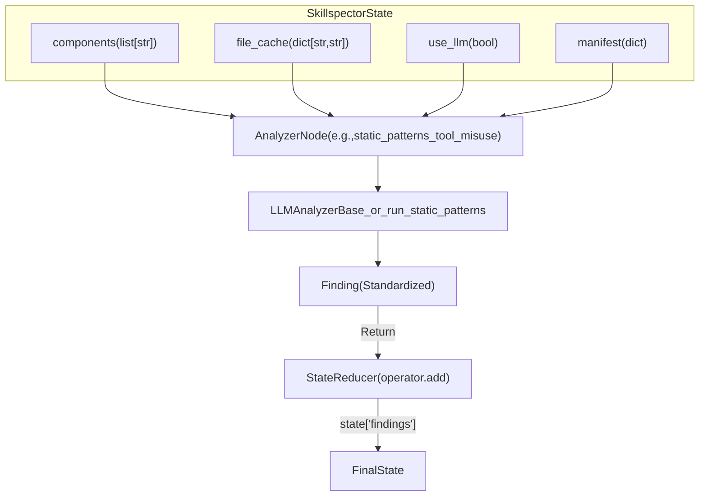
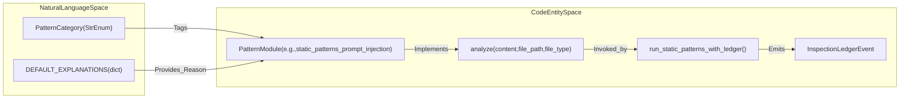

<!-- source: DeepWiki mcp.deepwiki.com · repo NVIDIA/SkillSpector · page 6.1 Adding Analyzer Nodes · fetched 2026-10-26 -->

# Adding Analyzer Nodes

<details>
<summary>Relevant source files</summary>

The following files were used as context for generating this wiki page:

- [docs/LLM_ANALYZER_BASE_GUIDE.md](docs/LLM_ANALYZER_BASE_GUIDE.md)
- [src/skillspector/nodes/analyzers/__init__.py](src/skillspector/nodes/analyzers/__init__.py)
- [src/skillspector/nodes/analyzers/pattern_defaults.py](src/skillspector/nodes/analyzers/pattern_defaults.py)
- [src/skillspector/nodes/analyzers/static_runner.py](src/skillspector/nodes/analyzers/static_runner.py)
- [tests/nodes/analyzers/test_registry.py](tests/nodes/analyzers/test_registry.py)
- [tests/nodes/analyzers/test_static_runner_filtering.py](tests/nodes/analyzers/test_static_runner_filtering.py)
- [tests/unit/test_reviewer_nits.py](tests/unit/test_reviewer_nits.py)

</details>


This page provides a technical guide for implementing and registering new analyzer nodes within the SkillSpector LangGraph workflow. SkillSpector uses a fan-out architecture where multiple independent analyzers process a skill's context in parallel to identify security risks, behavioral anomalies, and policy violations.

## Analyzer Implementation Overview

Every analyzer in SkillSpector is a LangGraph node that consumes the `SkillspectorState` and returns an `AnalyzerNodeResponse` containing a list of `Finding` objects. Analyzers can be built either as static pattern processors using `run_static_patterns` [src/skillspector/nodes/analyzers/static_runner.py:28-58](), behavioral AST/taint analyzers, or semantic analyzers extending `LLMAnalyzerBase`.

### Core Interfaces and Data Models

The system relies on the `AnalyzerPlugin` protocol and standardized finding models to ensure consistency across static, behavioral, and semantic analyzers.

| Entity | Role | Source |
| :--- | :--- | :--- |
| `AnalyzerPlugin` | A `Protocol` defining the interface for analyzer modules: `analyze()` and `is_available()`. | [src/skillspector/models.py:121-133]() |
| `AnalyzerFinding` | Common internal finding type produced by analyzers (static, behavioral, MCP, semantic). | [src/skillspector/models.py:48-62]() |
| `Finding` | The primary model for the graph state and report output. Includes fields for SARIF reporting. | [src/skillspector/models.py:71-91]() |
| `AnalyzerNodeResponse` | A `TypedDict` return type for nodes: `{"findings": list[Finding]}`. | [src/skillspector/state.py:38-42]() |

### Data Flow: From Node to State
The following diagram illustrates how an analyzer node interacts with the global state and the standardized finding models.

**Analyzer Node Data Flow**

Sources: [src/skillspector/state.py:72-114](), [src/skillspector/models.py:71-91](), [src/skillspector/nodes/analyzers/static_runner.py:28-58]()

---

## 1. Implementing Static Pattern Analyzers

Static analyzers use regular expressions or lexical scanning over text views. SkillSpector provides `run_static_patterns` and `run_static_patterns_with_ledger` in `static_runner.py` to handle boilerplate like file-type inference, security text views, windowing, and ledger event emission [src/skillspector/nodes/analyzers/static_runner.py:28-58]().

### The `analyze()` Function and Pattern Modules
A static pattern module must implement an `analyze` function with the following signature:
`def analyze(*, content: str, file_path: str, file_type: str) -> list[AnalyzerFinding]` [tests/nodes/analyzers/test_static_runner_filtering.py:37-43]()

### Default Explanations and Categories
When implementing new static rules, use the `PatternCategory` enum and `DEFAULT_EXPLANATIONS` mapping in `pattern_defaults.py` to provide consistent metadata for findings [src/skillspector/nodes/analyzers/pattern_defaults.py:24-85]().

| Category | Description |
| :--- | :--- |
| `PROMPT_INJECTION` | Attempts to override system instructions. |
| `DATA_EXFILTRATION` | Transmission of sensitive data to external services. |
| `PRIVILEGE_ESCALATION` | Unauthorized access to elevated capabilities (e.g., PE3 for `.env` access). |
| `TOOL_MISUSE` | Dangerous tool parameters or chaining. |

### Natural Language Space to Code Entity Space: Static Analyzer Architecture
The following diagram maps natural-language rule definitions and categories to the concrete code entities used in static pattern detection.

**Static Pattern Code-Entity Mapping**

Sources: [src/skillspector/nodes/analyzers/pattern_defaults.py:24-85](), [src/skillspector/nodes/analyzers/static_runner.py:28-58]()

---

## 2. Building LLM Analyzers on LLMAnalyzerBase

Semantic and discovery-mode analyzers leverage `LLMAnalyzerBase` to perform deep reasoning over skill content [docs/LLM_ANALYZER_BASE_GUIDE.md:1-29]().

### LLMAnalyzerBase Capabilities
`LLMAnalyzerBase` manages the complexity of LLM interactions [docs/LLM_ANALYZER_BASE_GUIDE.md:7-25]():
*   **Token Budgeting**: Automatically chunks large files using line-overlap logic.
*   **Line-Numbered Prompts**: Prefixes code with line numbers (`L01:`, `L02:`) so the LLM reports precise `start_line` values.
*   **Parallelism**: Uses `asyncio.gather` to run cross-file and cross-chunk batches concurrently.
*   **Structured Output**: Uses LangChain's `with_structured_output` to parse LLM responses into Pydantic models.

### Implementation Steps
1.  **Define a Prompt**: Create a detailed security analysis prompt specifying rule ID prefixes (e.g., `SSD-001`) [docs/LLM_ANALYZER_BASE_GUIDE.md:48-58]().
2.  **Initialize Base & Run Batches**: Call `LLMAnalyzerBase`, retrieve batches via `get_batches()`, and execute asynchronously via `arun_batches()` [docs/LLM_ANALYZER_BASE_GUIDE.md:80-84]().

### Natural Language Space to Code Entity Space: LLM Analyzer Architecture
The following diagram illustrates how natural-language prompt instructions map to the underlying LLM classes and execution pipelines.

**Semantic Analyzer Code-Entity Mapping**
```mermaid
graph LR
    subgraph "NaturalLanguageSpace"
        Prompt["ANALYZER_PROMPT(Instructions)"]
    end

    subgraph "CodeEntitySpace"
        Node["node(state: SkillspectorState)"]
        Base["LLMAnalyzerBase"]
        Batch["Batch(dataclass)"]
        Schema["LLMAnalysisResult(Pydantic)"]
        LLMF["LLMFinding"]
    end

    Prompt -->|Injected_into| Base
    Node -->|Initializes| Base
    Base --> Batch
    Batch -->|Processed_by| Schema
    Schema -->|Contains| LLMF
    LLMF -->|to_finding()| Findings["Finding"]
```
Sources: [docs/LLM_ANALYZER_BASE_GUIDE.md:35-207]()

---

## 3. Emitting Ledger Events

Analyzer nodes participate in the audit subsystem by recording inspection metrics and outcomes. When implementing custom nodes outside the standard runners, nodes should emit `InspectionLedgerEvent` records using helpers from `inspection_ledger.py` to document execution status, finding counts, and completeness metrics [src/skillspector/inspection_ledger.py:37-43]().

Sources: [src/skillspector/inspection_ledger.py:37-43]()

---

## 4. Registration and Configuration

Once the analyzer logic is implemented, it must be registered in the central analyzer registry so that `create_graph()` discovers it and incorporates it into the LangGraph workflow.

### Registry Updates
Modify `src/skillspector/nodes/analyzers/__init__.py` to include the new node:

1.  **Dynamic Discovery**: The module uses `pkgutil.iter_modules()` to automatically load modules in the `analyzers` package [src/skillspector/nodes/analyzers/__init__.py:33-61]().
2.  **Attribute Requirements**: Each analyzer module must define `ANALYZER_ID` (a unique string) and `node` (a callable taking `SkillspectorState` and returning `AnalyzerNodeResponse`) [src/skillspector/nodes/analyzers/__init__.py:52-57]().
3.  **Registry Mappings**: Discovered IDs and nodes are appended to `ANALYZER_NODE_IDS`, `ANALYZER_NODES`, and `ANALYZER_MODULES` [src/skillspector/nodes/analyzers/__init__.py:55-59]().

Sources: [src/skillspector/nodes/analyzers/__init__.py:16-63]()

---

## 5. Testing the New Analyzer

Every analyzer requires corresponding test suites to verify registry alignment and correct execution logic.

1.  **Registry Alignment**: Add the new ID to `EXPECTED_ANALYZER_NODE_IDS` in `tests/nodes/analyzers/test_registry.py` to verify that `ANALYZER_NODE_IDS` and `ANALYZER_NODES` match the system specification [tests/nodes/analyzers/test_registry.py:24-52]().
2.  **Node Test**: Create a node-specific test file under `tests/nodes/analyzers/` using `SkillspectorState` fixtures to verify that the node correctly inspects `file_cache` and returns expected findings [tests/nodes/analyzers/test_static_runner_filtering.py:32-35]().

Sources: [tests/nodes/analyzers/test_registry.py:24-52](), [tests/nodes/analyzers/test_static_runner_filtering.py:32-35]()

---

