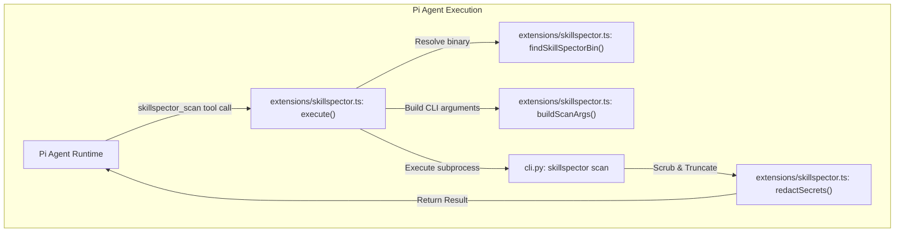
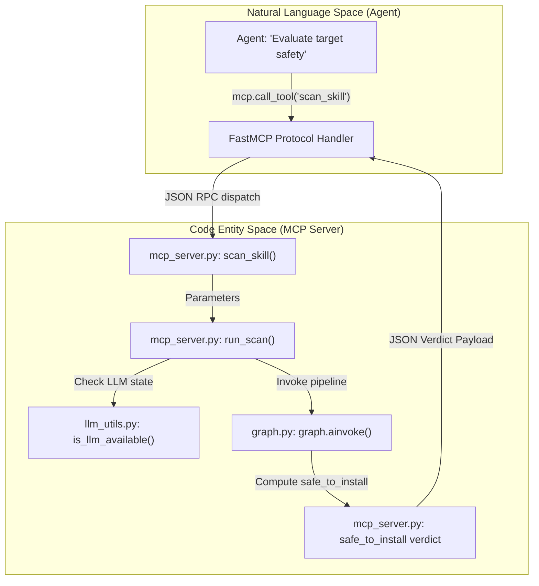
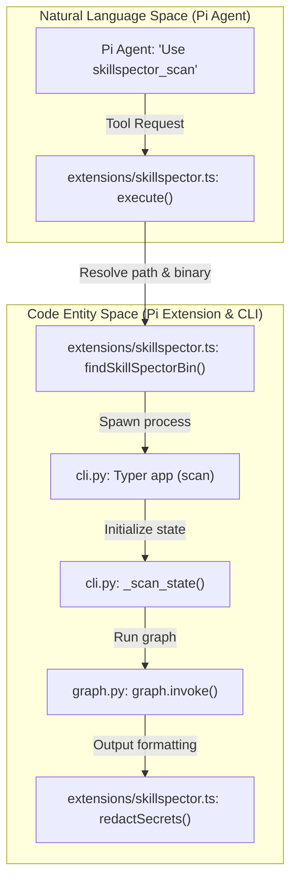

<!-- source: DeepWiki mcp.deepwiki.com · repo NVIDIA/SkillSpector · page 6.3 MCP Server and Pi Extension · fetched 2026-10-26 -->

# MCP Server and Pi Extension

Relevant source files

The following files were used as context for generating this wiki page:

- [docs/INFERENCE_USAGE.md](docs/INFERENCE_USAGE.md)
- [docs/PI_EXTENSION.md](docs/PI_EXTENSION.md)
- [docs/release/skillspector-2.9.0.md](docs/release/skillspector-2.9.0.md)
- [docs/release/skillspector-2.9.1.md](docs/release/skillspector-2.9.1.md)
- [extensions/skillspector.ts](extensions/skillspector.ts)
- [package.json](package.json)
- [skills/skill-inspector/SKILL.md](skills/skill-inspector/SKILL.md)
- [src/skillspector/mcp_server.py](src/skillspector/mcp_server.py)
- [tests/unit/test_mcp_server.py](tests/unit/test_mcp_server.py)

## Purpose and Scope

This page documents the integration of SkillSpector into agentic runtimes via the **Model Context Protocol (MCP)** server (`src/skillspector/mcp_server.py`) and the **Pi coding-agent extension** (`extensions/skillspector.ts`). These subsystems transform SkillSpector from an out-of-band audit utility into a runtime security guardrail, allowing LLM agents to automatically vet skills, packages, and repositories before installation.

Sources: [src/skillspector/mcp_server.py:16-26](), [extensions/skillspector.ts:1-142]()

---

## MCP Server Integration

The MCP server exposes SkillSpector scanning capabilities as a structured tool (`scan_skill`) to any MCP-compliant agent client (such as Claude Code, Codex CLI, or custom agent runtimes) [src/skillspector/mcp_server.py:16-26]().

### Core Logic and `run_scan()`

The primary entry point for the MCP tool is `run_scan()`, which wraps the LangGraph execution pipeline without depending directly on the optional `mcp` SDK package [src/skillspector/mcp_server.py:22-26]().

| Feature | Implementation Detail | Code Pointer |
| :--- | :--- | :--- |
| **Transport Security** | Rejects local targets and local YARA rule directories when HTTP transports disable local target access (`allow_local_targets=False`) to prevent path traversal. | [src/skillspector/mcp_server.py:102-106]() |
| **Install Gating** | Computes `safe_to_install` by checking if `risk_score <= RISK_THRESHOLD`, `execution_successful` is true, and there are no entirely uninspected files or incomplete coverage. | [src/skillspector/mcp_server.py:146-151]() |
| **LLM Accounting** | Explicitly separates `llm_requested`, `llm_available`, and `llm_used` to maintain transparency when credentials are absent. | [src/skillspector/mcp_server.py:162-166]() |
| **Cleanup** | Invokes `cleanup_result(result)` in a `finally` block to purge temporary inspection assets. | [src/skillspector/mcp_server.py:170-171]() |

Sources: [src/skillspector/mcp_server.py:49-172](), [src/skillspector/constants.py:30-30]()

### Transports and Server Building

`build_server()` returns a configured `FastMCP` server instance [src/skillspector/mcp_server.py:174-183](). It supports:
- **stdio transport**: Standard input/output communication for local agent subprocesses.
- **HTTP / SSE transport**: Starlette-based server deployments for remote or multi-agent topologies [src/skillspector/mcp_server.py:180-183]().

Sources: [src/skillspector/mcp_server.py:174-185]()

---

## Pi Coding-Agent Extension

The Pi extension (`extensions/skillspector.ts`) packages SkillSpector as a native tool (`skillspector_scan`) for the `@earendil-works/pi-coding-agent` runtime [extensions/skillspector.ts:83-141]().

### Tool Schema and Execution

The extension defines a strict schema using `typebox` (`scanSchema`) and invokes the local `skillspector` binary via `pi.exec()` [extensions/skillspector.ts:8-27](), [extensions/skillspector.ts:104-109]().

Sources: [extensions/skillspector.ts:59-140](), [docs/PI_EXTENSION.md:3-50]()

---

## Bundled Skill Inspector (`skills/skill-inspector/SKILL.md`)

SkillSpector ships with a specialized agent skill guide (`skills/skill-inspector/SKILL.md`) that trains agents to conduct two-tier reviews combining deterministic static evidence with semantic agent reasoning [skills/skill-inspector/SKILL.md:1-16]().

- **Review Workflow**: Resolves targets, executes `skillspector scan ... --format json`, parses metrics, inspects source files (`SKILL.md`, dependencies, MCP manifests), and applies semantic evaluation criteria [skills/skill-inspector/SKILL.md:31-83]().
- **Rubric & Scoring**: Maps numeric scores to default postures (`APPROVE`, `CAUTION`, `REJECT`), establishing strict barriers against high/critical vulnerabilities regardless of score [skills/skill-inspector/SKILL.md:84-102]().

Sources: [skills/skill-inspector/SKILL.md:1-161]()

---

## Data Flow: Agent Space to Code Space

### MCP Tool Execution Flow

This diagram traces how an agent tool call enters the MCP server layer and executes the LangGraph pipeline.

Sources: [src/skillspector/mcp_server.py:70-168](), [src/skillspector/llm_utils.py:22-35]()

### Pi Extension Tool Flow

This diagram illustrates how Pi tool calls map to local CLI executions and subprocess management.

Sources: [extensions/skillspector.ts:59-140](), [src/skillspector/cli.py:121-170]()

---

