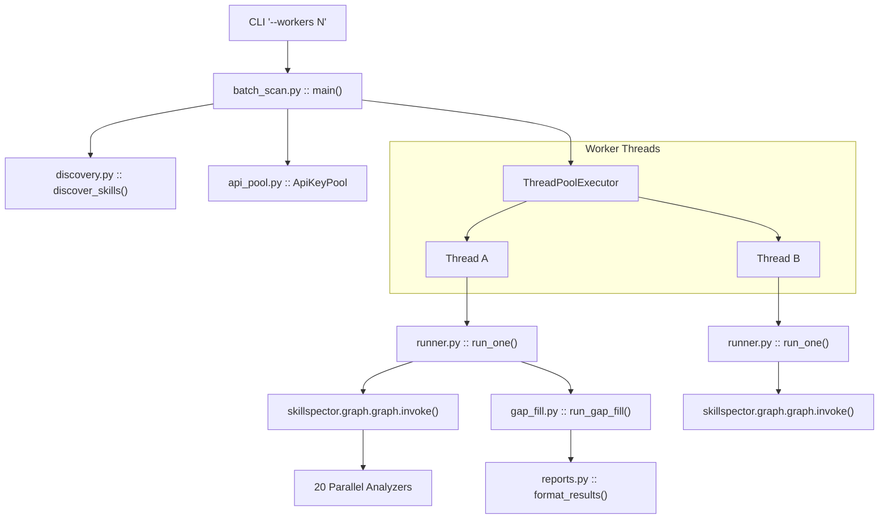
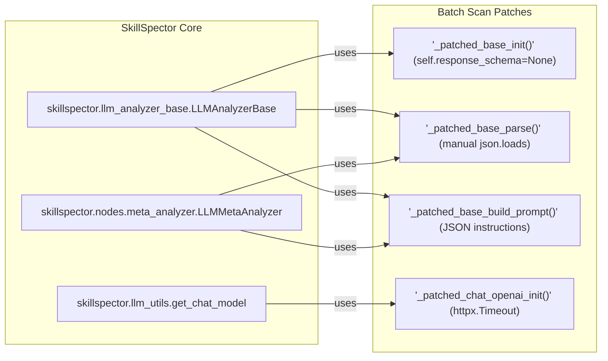

<!-- source: DeepWiki mcp.deepwiki.com · repo NVIDIA/SkillSpector · page 6.4 Batch Scan Contrib Module · fetched 2026-10-26 -->

# Batch Scan Contrib Module

Relevant source files

The following files were used as context for generating this wiki page:

- [contrib/batch_scan/.env.example](contrib/batch_scan/.env.example)
- [contrib/batch_scan/CONTRIBUTING.md](contrib/batch_scan/CONTRIBUTING.md)
- [contrib/batch_scan/__init__.py](contrib/batch_scan/__init__.py)
- [contrib/batch_scan/annotation.py](contrib/batch_scan/annotation.py)
- [contrib/batch_scan/api_pool.py](contrib/batch_scan/api_pool.py)
- [contrib/batch_scan/batch_scan.py](contrib/batch_scan/batch_scan.py)
- [contrib/batch_scan/detection.py](contrib/batch_scan/detection.py)
- [contrib/batch_scan/discovery.py](contrib/batch_scan/discovery.py)
- [contrib/batch_scan/docs/DESIGN.md](contrib/batch_scan/docs/DESIGN.md)
- [contrib/batch_scan/docs/README.md](contrib/batch_scan/docs/README.md)
- [contrib/batch_scan/reports.py](contrib/batch_scan/reports.py)
- [contrib/batch_scan/runner.py](contrib/batch_scan/runner.py)
- [contrib/batch_scan/tests/test_inspection_reporting.py](contrib/batch_scan/tests/test_inspection_reporting.py)
- [contrib/batch_scan/tests/test_monkeypatch_fragility.py](contrib/batch_scan/tests/test_monkeypatch_fragility.py)
- [contrib/batch_scan/tests/tests-pro/test_api_pool.py](contrib/batch_scan/tests/tests-pro/test_api_pool.py)
- [docs/release/skillspector-2.5.0.md](docs/release/skillspector-2.5.0.md)
- [docs/release/skillspector-2.6.0.md](docs/release/skillspector-2.6.0.md)
- [docs/release/skillspector-2.7.0.md](docs/release/skillspector-2.7.0.md)
- [docs/release/skillspector-2.7.2.md](docs/release/skillspector-2.7.2.md)

The `contrib/batch_scan` module is a high-performance extension for SkillSpector designed to scan large directories of AI agent skills in parallel [contrib/batch_scan/batch_scan.py:16-21](). It introduces a three-layer concurrency model, a robust API key load-balancer, and targeted multilingual support to handle non-English skills where static pattern matching may lose recall [contrib/batch_scan/docs/DESIGN.md:39-45]().

Sources: [contrib/batch_scan/batch_scan.py:16-21](), [contrib/batch_scan/docs/DESIGN.md:39-45]()

## Concurrency Architecture

SkillSpector Batch Scan utilizes a three-layer concurrency model to maximize throughput while maintaining stability [contrib/batch_scan/batch_scan.py:23-34]().

### Three-Layer Concurrency Model

| Layer | Component | Implementation | Responsibility |
| :--- | :--- | :--- | :--- |
| **Layer 3** | `batch_scan.py` | `ThreadPoolExecutor` | Parallelizes scanning of independent skill directories [contrib/batch_scan/batch_scan.py:34-34](). |
| **Layer 2** | `LLMAnalyzerBase` | `asyncio.Semaphore(10)` | Limits concurrent LLM requests per analyzer to prevent local resource exhaustion [contrib/batch_scan/batch_scan.py:32-33](). |
| **Layer 1** | `graph.py` | LangGraph Fan-out | Executes up to 20 analyzer nodes in parallel for a single skill [contrib/batch_scan/batch_scan.py:31-31](). |

The `ThreadPoolExecutor` manages a pool of workers (default 4, configurable via `--workers`) [contrib/batch_scan/batch_scan.py:27-28](). Each worker executes the `run_one` function, which invokes the standard LangGraph pipeline [contrib/batch_scan/runner.py:75-76]().

Title: Batch Scan Execution Flow

Sources: [contrib/batch_scan/batch_scan.py:16-46](), [contrib/batch_scan/docs/DESIGN.md:9-24](), [contrib/batch_scan/docs/DESIGN.md:39-45](), [contrib/batch_scan/runner.py:75-76]()

## API Key Pool and Rate-Limit Protection

To support high-concurrency LLM scans without hitting provider rate limits, the module implements an `ApiKeyPool` [contrib/batch_scan/api_pool.py:16-22]().

### Least-Loaded Scheduling
The pool distributes requests across multiple keys using a least-loaded scheduler [contrib/batch_scan/api_pool.py:19-20](). Each `ApiKey` object tracks its own `active_requests` and `max_concurrent` slots (default 5) [contrib/batch_scan/api_pool.py:80-108](). The `acquire()` method blocks only when all non-rate-limited keys are at capacity [contrib/batch_scan/api_pool.py:165-191]().

### Backoff and Recovery
When an LLM call returns an HTTP 429 (Rate Limit), the key is marked as `rate_limited` and removed from rotation [contrib/batch_scan/api_pool.py:214-228]().
* **Backoff Calculation:** $30 \times 2^n$ seconds, where $n$ is the number of consecutive failures, capped at 300 seconds [contrib/batch_scan/api_pool.py:98-99]().
* **Recovery:** The pool automatically restores keys once their `rate_limited_until` timestamp has passed [contrib/batch_scan/api_pool.py:170-171]().

### Dual-Patch Wiring
The `ApiKeyPool` is injected into SkillSpector's core using a dual-patch mechanism in `runner.py` [contrib/batch_scan/docs/DESIGN.md:150-158](). It patches:
1. `skillspector.llm_utils.get_chat_model` [contrib/batch_scan/runner.py:110-110]()
2. `skillspector.llm_analyzer_base.get_chat_model` [contrib/batch_scan/runner.py:111-111]()

This ensures that graph-internal analyzers (SSD, SDI, SQP, Meta-Analyzer) and the `GapFillAnalyzer` all share the same rate-limiting logic [contrib/batch_scan/docs/DESIGN.md:155-158]().

Sources: [contrib/batch_scan/api_pool.py:16-150](), [contrib/batch_scan/docs/DESIGN.md:135-158](), [contrib/batch_scan/runner.py:70-96]()

## Multilingual Support and Gap-Fill

The batch scanner provides enhanced detection and analysis for non-English skills (Chinese, Japanese, Korean) [contrib/batch_scan/docs/DESIGN.md:109-110]().

### Language Detection
`detect_skill_language` uses a Unicode script-ratio heuristic [contrib/batch_scan/detection.py:16-20](). It calculates the ratio of CJK, Hiragana/Katakana, or Hangul characters relative to total alphabetic characters [contrib/batch_scan/docs/DESIGN.md:111-119]().
* **zh:** $\ge 10\%$ CJK Unified [contrib/batch_scan/docs/DESIGN.md:115-115]().
* **ja:** $\ge 5\%$ Hiragana + Katakana [contrib/batch_scan/docs/DESIGN.md:116-116]().
* **ko:** $\ge 10\%$ Hangul Syllables [contrib/batch_scan/docs/DESIGN.md:117-117]().

### Gap-Fill Analysis
Static pattern matching (regex) loses recall on non-English text. The `run_gap_fill` function invokes a targeted LLM pass for 8 vulnerability categories that lack semantic analyzer equivalents [contrib/batch_scan/docs/DESIGN.md:124-133]():
* **Harmful Content:** P5 [contrib/batch_scan/docs/DESIGN.md:129-129]().
* **System Prompt Leakage:** P6, P7, P8 [contrib/batch_scan/docs/DESIGN.md:129-129]().
* **Memory Poisoning:** MP1, MP2, MP3 [contrib/batch_scan/docs/DESIGN.md:130-130]().
* **Rogue Agent:** RA1, RA2 [contrib/batch_scan/docs/DESIGN.md:130-130]().

Sources: [contrib/batch_scan/detection.py:16-40](), [contrib/batch_scan/gap_fill.py:16-45](), [contrib/batch_scan/docs/DESIGN.md:109-134]()

## DeepSeek Compatibility Patches

Because some models (like DeepSeek) do not support the OpenAI `response_format` (structured output) parameter, the module includes a `deepseek_compat` context manager [contrib/batch_scan/runner.py:307-310]().

### Patch Mechanism
The `deepseek_compat()` manager applies seven targeted monkey-patches to SkillSpector internals [contrib/batch_scan/docs/DESIGN.md:63-71]():
1. **Disable Structured Output:** Sets `self.response_schema = None` on `LLMAnalyzerBase` instances to force raw text responses [contrib/batch_scan/docs/DESIGN.md:65-65]().
2. **Manual Parsing:** Patches `parse_response` in `LLMAnalyzerBase` and `LLMMetaAnalyzer` to manually parse JSON strings with Pydantic validation [contrib/batch_scan/docs/DESIGN.md:66-67]().
3. **Prompt Enhancement:** Appends "Respond in JSON format" instructions to all LLM prompts [contrib/batch_scan/docs/DESIGN.md:68-69]().
4. **Httpx Hardening:** Injects an 8s connection / 30s read timeout into `ChatOpenAI` to prevent hung threads [contrib/batch_scan/docs/DESIGN.md:70-70]().

Title: DeepSeek Patch Interaction

Sources: [contrib/batch_scan/runner.py:307-450](), [contrib/batch_scan/docs/DESIGN.md:57-108](), [contrib/batch_scan/tests/test_monkeypatch_fragility.py:16-32]()

## CLI Usage and Output

The module is invoked as a Python module: `python -m contrib.batch_scan.batch_scan` [contrib/batch_scan/batch_scan.py:43-46]().

### CLI Flags
* `--workers N`: Number of parallel skill scans (default 4) [contrib/batch_scan/batch_scan.py:210-210]().
* `--lang {auto,en,zh,ja,ko}`: Force a language or use auto-detection [contrib/batch_scan/batch_scan.py:214-214]().
* `--no-llm`: Disable all LLM-based analyzers and gap-fill [contrib/batch_scan/batch_scan.py:219-219]().
* `-f, --format {terminal,json,markdown}`: Select output format [contrib/batch_scan/batch_scan.py:223-223]().
* `-o, --output FILE`: Write the aggregated report to a file [contrib/batch_scan/batch_scan.py:228-228]().

### Aggregated Reports
The `reports.py` module aggregates results from all threads into a single report, sorted by risk score [contrib/batch_scan/reports.py:33-39](). It preserves all `analysis_completeness` ledger exceptions from child scans, ensuring that failed file reads or analyzer timeouts are visible in the batch summary [contrib/batch_scan/reports.py:48-66]().

Sources: [contrib/batch_scan/batch_scan.py:181-250](), [contrib/batch_scan/reports.py:16-100](), [contrib/batch_scan/tests/test_inspection_reporting.py:41-66]()

---

