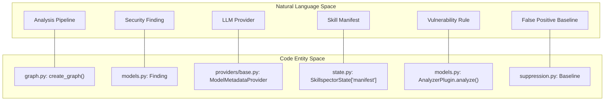
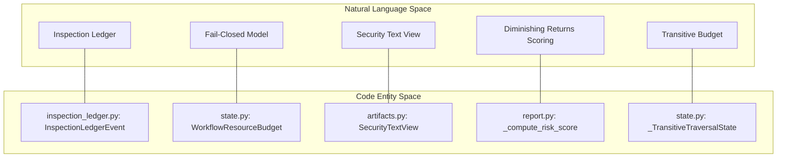

<!-- source: DeepWiki mcp.deepwiki.com · repo NVIDIA/SkillSpector · page 7 Glossary · fetched 2026-10-26 -->

# Glossary

Relevant source files

The following files were used as context for generating this wiki page:

- [README.md](README.md)
- [docs/DEVELOPMENT.md](docs/DEVELOPMENT.md)
- [src/skillspector/artifacts.py](src/skillspector/artifacts.py)
- [src/skillspector/cleanup.py](src/skillspector/cleanup.py)
- [src/skillspector/constants.py](src/skillspector/constants.py)
- [src/skillspector/nodes/analyzers/artifact_integrity.py](src/skillspector/nodes/analyzers/artifact_integrity.py)
- [src/skillspector/nodes/report.py](src/skillspector/nodes/report.py)
- [src/skillspector/providers/__init__.py](src/skillspector/providers/__init__.py)
- [src/skillspector/sarif_models.py](src/skillspector/sarif_models.py)
- [src/skillspector/state.py](src/skillspector/state.py)
- [tests/nodes/analyzers/test_artifact_integrity_bounds.py](tests/nodes/analyzers/test_artifact_integrity_bounds.py)
- [tests/nodes/analyzers/test_sc8_shipped_bytecode.py](tests/nodes/analyzers/test_sc8_shipped_bytecode.py)
- [tests/nodes/test_report.py](tests/nodes/test_report.py)
- [tests/nodes/test_sarif_rules_and_empty_findings.py](tests/nodes/test_sarif_rules_and_empty_findings.py)
- [tests/nodes/test_security_end_to_end.py](tests/nodes/test_security_end_to_end.py)
- [tests/nodes/test_security_remediation.py](tests/nodes/test_security_remediation.py)
- [tests/unit/test_constants.py](tests/unit/test_constants.py)

This glossary provides technical definitions for codebase-specific terms, rule identifier families (`P`, `E`, `PE`, `AS`, `SC`, `TR`, `OH`, `EA`, `MP`, `TM`, `AE`, `AST`, `TT`, `YR`, `LP`, `TP`, `SSD`, `SDI`, `SQP`), abbreviations, and core domain concepts within SkillSpector. It serves as a comprehensive reference for onboarding engineers to understand the mapping between high-level security architecture and its concrete implementation in the codebase.

## System Concepts and Code Entities

The following diagrams bridge natural language concepts to their concrete Python implementations across the repository.

### Mapping: Natural Language to Code Space (Core Pipeline)

**Sources:** [src/skillspector/graph.py:91](), [src/skillspector/models.py:42-42](), [src/skillspector/state.py:72-100](), [src/skillspector/suppression.py:64-64]()

### Mapping: Domain Concepts to Code Space

**Sources:** [src/skillspector/inspection_ledger.py:31-40](), [src/skillspector/state.py:80-145](), [src/skillspector/artifacts.py:71-88](), [src/skillspector/nodes/report.py:179-204]()

---

## Core Domain Concepts

| Concept | Definition | Code Pointer |
|:---|:---|:---|
| **Inspection Ledger** | Structured audit trail recording files excluded, skipped, or failed during analysis, capturing completion state and coverage percentages. | [src/skillspector/inspection_ledger.py:31-40]() |
| **Fail-Closed** | Security design where resource exhaustion, unparsable bundles, or parser limit breaches immediately truncate analysis and raise blocking error states rather than ignoring failures. | [src/skillspector/state.py:80-145]() |
| **Local-Only** | Operational execution guarantee ensuring scanned files and internal metadata never leave local storage unless explicitly transferred via user-configured remote LLM endpoints. | [src/skillspector/nodes/report.py:108-124]() |
| **Security Text View** | Bounded derived text projection with direct offset maps back to raw character bytes, defeating Unicode normalization gaps and obfuscation. | [src/skillspector/artifacts.py:71-88]() |
| **Diminishing Returns Scoring** | Risk scoring algorithm where repeating the same rule ID yields exponentially decaying point contributions (`1.0`, `0.5`, `0.25`, then `0`), preventing finding spam from distorting the score. | [src/skillspector/nodes/report.py:179-204]() |
| **Baseline** | Persistent configuration containing glob rules and SHA256 fingerprints to suppress known findings during re-scans. | [src/skillspector/suppression.py:64-103]() |
| **Transitive Budget** | Bounded traversal accounting object tracking remaining time, byte consumption, and file depth across external reference expansions. | [src/skillspector/state.py:80-145]() |

**Sources:** [src/skillspector/inspection_ledger.py:31-40](), [src/skillspector/state.py:80-145](), [src/skillspector/artifacts.py:71-88](), [src/skillspector/nodes/report.py:179-204](), [src/skillspector/suppression.py:64-103]()

---

## Rule ID Families

SkillSpector organizes its vulnerability and security checks into standardized rule identifier families.

| Prefix Family | Category / Domain | Implementation Module / Code Pointer |
|:---|:---|:---|
| **P** (P1-P9) | Prompt Injection & System Leakage | [src/skillspector/nodes/analyzers/static_patterns_prompt_injection.py:15-30]() |
| **E** (E1-E5) | Data Exfiltration | [src/skillspector/nodes/analyzers/static_patterns_data_exfiltration.py:15-25]() |
| **PE** (PE1-PE5) | Privilege Escalation | [src/skillspector/nodes/analyzers/static_patterns_privilege_escalation.py:15-25]() |
| **AS** (AS1-AS3) | Agent Snooping & Context Theft | [src/skillspector/nodes/analyzers/static_patterns_agent_snooping.py:15-25]() |
| **SC** (SC1-SC9) | Supply Chain Vulnerabilities & Dependencies | [src/skillspector/nodes/analyzers/static_patterns_supply_chain.py:16-30]() |
| **TR** (TR1-TR3) | Trigger Abuse & Autonomous Activation | [src/skillspector/nodes/analyzers/static_patterns_trigger_abuse.py:15-25]() |
| **OH** (OH1-OH3) | Output Handling & Unescaped Rendering | [src/skillspector/nodes/analyzers/static_patterns_output_handling.py:15-25]() |
| **EA** (EA1-EA4) | Excessive Agency | [src/skillspector/nodes/analyzers/static_patterns_excessive_agency.py:15-25]() |
| **MP** (MP) | Memory Poisoning | [src/skillspector/nodes/analyzers/static_patterns_memory_poisoning.py:15-25]() |
| **TM** (TM) | Tool Misuse | [src/skillspector/nodes/analyzers/static_patterns_tool_misuse.py:15-25]() |
| **AE** (AE1-AE6) | Artifact Integrity & Evasion Signals | [src/skillspector/nodes/analyzers/artifact_integrity.py:41-45]() |
| **AST** (AST1-AST9) | Behavioral Code Analysis (Abstract Syntax Tree) | [src/skillspector/nodes/analyzers/behavioral_ast.py:20-35]() |
| **TT** (TT1-TT5) | Behavioral Taint Tracking | [src/skillspector/nodes/analyzers/behavioral_taint_tracking.py:20-35]() |
| **YR** (YR) | YR (YARA-Based Malware Signatures) | [src/skillspector/nodes/analyzers/static_yara.py:20-35]() |
| **LP** (LP1-LP4) | MCP Least Privilege Verification | [src/skillspector/nodes/analyzers/mcp_least_privilege.py:16-30]() |
| **TP** (TP1-TP4) | MCP Tool Poisoning | [src/skillspector/nodes/analyzers/mcp_tool_poisoning.py:16-30]() |
| **SSD** | Semantic Security Discovery (LLM-powered) | [src/skillspector/nodes/analyzers/semantic_security_discovery.py:20-35]() |
| **SDI** (SDI-1..4) | Semantic Developer Intent (LLM-powered) | [src/skillspector/nodes/analyzers/semantic_developer_intent.py:20-35]() |
| **SQP** | Semantic Quality Policy (LLM-powered) | [src/skillspector/nodes/analyzers/semantic_quality_policy.py:20-35]() |

**Sources:** [src/skillspector/nodes/analyzers/static_patterns_prompt_injection.py:15-30](), [src/skillspector/nodes/analyzers/static_patterns_supply_chain.py:16-30](), [src/skillspector/nodes/analyzers/artifact_integrity.py:41-45](), [src/skillspector/nodes/analyzers/behavioral_ast.py:20-35](), [src/skillspector/nodes/analyzers/mcp_tool_poisoning.py:16-30]()

---

## Technical Abbreviations and Terms

| Term / Abbreviation | Definition | Code Pointer |
|:---|:---|:---|
| **AST** | Abstract Syntax Tree. Python code structure representation parsed via standard library `ast`. | [src/skillspector/nodes/analyzers/behavioral_ast.py:20-20]() |
| **CVE** | Common Vulnerabilities and Exposures. Tracked via live queries to OSV.dev. | [src/skillspector/nodes/analyzers/static_patterns_supply_chain.py:119-123]() |
| **MCP** | Model Context Protocol. Standard protocol for agent-tool interaction. | [src/skillspector/nodes/analyzers/mcp_tool_poisoning.py:16-16]() |
| **SARIF** | Static Analysis Results Interchange Format (JSON-based schema 2.1.0). | [src/skillspector/sarif_models.py:45-60]() |
| **OMS** | NVIDIA Open Model Specification / Signature format. | [src/skillspector/state.py:84-84]() |
| **OSV** | Open Source Vulnerabilities database client. | [src/skillspector/nodes/analyzers/static_patterns_supply_chain.py:119-123]() |
| **ZWJ** | Zero-Width Joiner. Unicode character used in smuggling attacks. | [tests/nodes/analyzers/test_static_patterns.py:139-158]() |

**Sources:** [src/skillspector/sarif_models.py:45-60](), [src/skillspector/nodes/analyzers/static_patterns_supply_chain.py:119-123](), [src/skillspector/nodes/analyzers/behavioral_ast.py:20-20]()