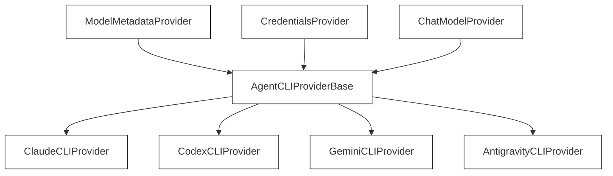
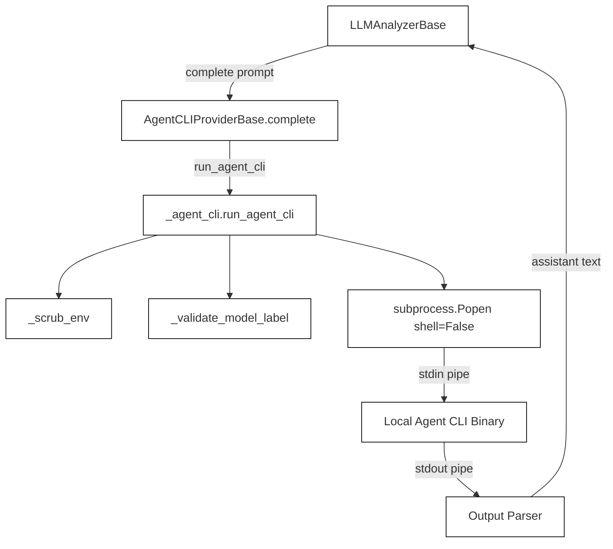
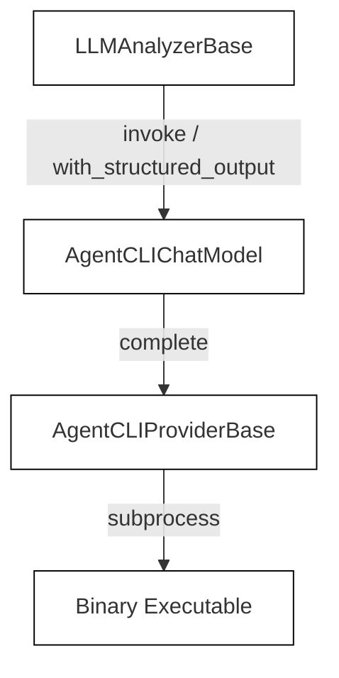

<!-- source: DeepWiki mcp.deepwiki.com · repo NVIDIA/SkillSpector · extra page Agent CLI Providers · fetched 2026-10-26 -->

# Agent CLI Providers

Relevant source files

The following files were used as context for generating this wiki page:

- [docs/release/skillspector-2.10.0.md](docs/release/skillspector-2.10.0.md)
- [src/skillspector/llm_utils.py](src/skillspector/llm_utils.py)
- [src/skillspector/providers/_agent_cli.py](src/skillspector/providers/_agent_cli.py)
- [src/skillspector/providers/_agent_cli_base.py](src/skillspector/providers/_agent_cli_base.py)
- [src/skillspector/providers/antigravity_cli/__init__.py](src/skillspector/providers/antigravity_cli/__init__.py)
- [src/skillspector/providers/antigravity_cli/provider.py](src/skillspector/providers/antigravity_cli/provider.py)
- [src/skillspector/providers/base.py](src/skillspector/providers/base.py)
- [src/skillspector/providers/claude_cli/__init__.py](src/skillspector/providers/claude_cli/__init__.py)
- [src/skillspector/providers/claude_cli/provider.py](src/skillspector/providers/claude_cli/provider.py)
- [src/skillspector/providers/codex_cli/provider.py](src/skillspector/providers/codex_cli/provider.py)
- [src/skillspector/providers/gemini_cli/provider.py](src/skillspector/providers/gemini_cli/provider.py)
- [tests/integration/test_agent_cli_live.py](tests/integration/test_agent_cli_live.py)
- [tests/unit/test_agent_cli.py](tests/unit/test_agent_cli.py)
- [tests/unit/test_llm_utils.py](tests/unit/test_llm_utils.py)

## Purpose and Scope

This document details the architecture and implementation of CLI-transport LLM providers within SkillSpector (`claude_cli`, `codex_cli`, `gemini_cli`, and `antigravity_cli`). These providers allow SkillSpector's stage-2 LLM analysis (such as `meta_analyzer` and semantic analyzers) to operate locally via installed agent CLI binaries rather than consuming cloud API keys. 

Topics covered include the `AgentCLICapable` protocol, `AgentCLIProviderBase` inheritance, the hardened subprocess execution core (`_agent_cli.py`), the `AgentCLIChatModel` LangChain adapter, structured output extraction, availability probing, and optional live integration test harnesses.

---

## 1. Provider Protocols and Base Implementation

SkillSpector defines an optional structural protocol `AgentCLICapable` for providers that bypass the standard HTTP/`ChatOpenAI` pipeline [src/skillspector/providers/base.py:84-113](). Providers satisfying this protocol implement `is_available()` and `complete()`.

*Figure 1: Class hierarchy mapping provider protocols to concrete CLI providers.*

Sources: `[src/skillspector/providers/base.py:84-113](), [src/skillspector/providers/_agent_cli_base.py:33-100]()`

Concrete CLI providers (`ClaudeCLIProvider`, `CodexCLIProvider`, `GeminiCLIProvider`, and `AntigravityCLIProvider`) inherit from `AgentCLIProviderBase` [src/skillspector/providers/_agent_cli_base.py:33-100](). They require no API credentials (`resolve_credentials` returns `None`), delegating authentication entirely to the underlying binary's local session.

| Provider Class | Binary Name (`BINARY_NAME`) | Authentication Method | Notes |
| :--- | :--- | :--- | :--- |
| `ClaudeCLIProvider` | `claude` | Local OAuth / Keychain (`claude auth login`) [src/skillspector/providers/claude_cli/provider.py:33-44]() | Standard Claude Code integration |
| `CodexCLIProvider` | `codex` | Local Codex auth | Sandbox read-only mode |
| `GeminiCLIProvider` | `gemini` | Local Gemini auth | Clean JSON over stdin |
| `AntigravityCLIProvider` | `agy` | Local auth | Registered but **disabled** (TTY-only output prevents pipe capture) [src/skillspector/providers/antigravity_cli/provider.py:16-48]() |

Sources: `[src/skillspector/providers/_agent_cli_base.py:33-100](), [src/skillspector/providers/claude_cli/provider.py:33-44](), [src/skillspector/providers/antigravity_cli/provider.py:16-48]()`

---

## 2. Hardened Subprocess Execution Core (`_agent_cli.py`)

All CLI calls are funneled through `run_agent_cli` in `src/skillspector/providers/_agent_cli.py`, which acts as the single security chokepoint for subprocess execution.

*Figure 2: Data flow and security barriers during CLI provider execution.*

Sources: `[src/skillspector/providers/_agent_cli.py:16-46](), [src/skillspector/providers/_agent_cli_base.py:59-80]()`

### Key Security Enforcement Mechanisms
1. **No Shell Execution:** `shell=False` is strictly enforced with an explicit argument list (`argv`) [src/skillspector/providers/_agent_cli.py:24]().
2. **Untrusted Content via Stdin Only:** Prompts containing untrusted skill content are passed strictly through process `stdin`, never injected into command-line arguments [src/skillspector/providers/_agent_cli.py:25-27]().
3. **Environment Scrubbing:** `_scrub_env()` strips API keys (`ANTHROPIC_API_KEY`, `OPENAI_API_KEY`, `NVIDIA_INFERENCE_KEY`), cloud credentials, SSH agent sockets, and token variables from the child environment [src/skillspector/providers/_agent_cli.py:76-126]().
4. **Capability Stripping:** Disables tools, MCP access, and extra directories. Flags like `--dangerously-skip-permissions` are explicitly blocked [src/skillspector/providers/_agent_cli.py:28-30]().
5. **Resource Bounds and Timeouts:** Inputs are capped at `MAX_INPUT_BYTES` (1 MB) and outputs at `MAX_OUTPUT_BYTES` (10 MB). Calls time out after `CLI_TIMEOUT_SECONDS` (300 seconds) [src/skillspector/providers/_agent_cli.py:71-74]().
6. **Fail-Closed Behavior:** Non-zero exit codes, timeouts, missing binaries, or malformed parsing raise `AgentCLIError` [src/skillspector/providers/_agent_cli.py:37-38]().

Sources: `[src/skillspector/providers/_agent_cli.py:16-126]()`

---

## 3. LangChain Adapter (`AgentCLIChatModel`)

Because LangGraph analyzers and `LLMAnalyzerBase` expect a LangChain `BaseChatModel` supporting `.invoke()` and `.with_structured_output()`, `skillspector.llm_utils` implements the `AgentCLIChatModel` adapter [src/skillspector/llm_utils.py:162-171]().

*Figure 3: Interfacing LangChain callers with local CLI binaries through `AgentCLIChatModel`.*

Sources: `[src/skillspector/llm_utils.py:162-171]()`

### Structured Output Extraction
When analyzers request structured JSON schemas via Pydantic models (`.with_structured_output(schema)`), `AgentCLIChatModel` extracts and parses JSON objects using `_extract_json_object()` from the raw text returned by the agent CLI. If parsing fails, it raises `StructuredOutputParseError`.

Sources: `[src/skillspector/llm_utils.py:38-41]()`

---

## 4. Availability Checks and Live Integration Tests

### Availability Probing
`is_llm_available()` in `skillspector.llm_utils` inspects the active provider. If the provider implements `AgentCLICapable`, it invokes `provider.is_available()`, which verifies that the binary exists on `PATH` and that the CLI tool is authenticated [src/skillspector/llm_utils.py:127-136]().

Sources: `[src/skillspector/llm_utils.py:127-136](), [src/skillspector/providers/base.py:84-113]()`

### Testing Suites
* **Unit Tests (`tests/unit/test_agent_cli.py`):** Mocks subprocess execution to verify `shell=False`, environment scrubbing, argument validation (`_validate_model_label`), and fail-closed exception handling [tests/unit/test_agent_cli.py:16-32]().
* **Live Integration Tests (`tests/integration/test_agent_cli_live.py`):** Marked with `@pytest.mark.integration`, these optional tests invoke real local binaries (`claude`, `codex`, `gemini`). They skip automatically if a binary is missing or unauthenticated [tests/integration/test_agent_cli_live.py:16-70]().

Sources: `[tests/unit/test_agent_cli.py:16-32](), [tests/integration/test_agent_cli_live.py:16-70]()`

---

