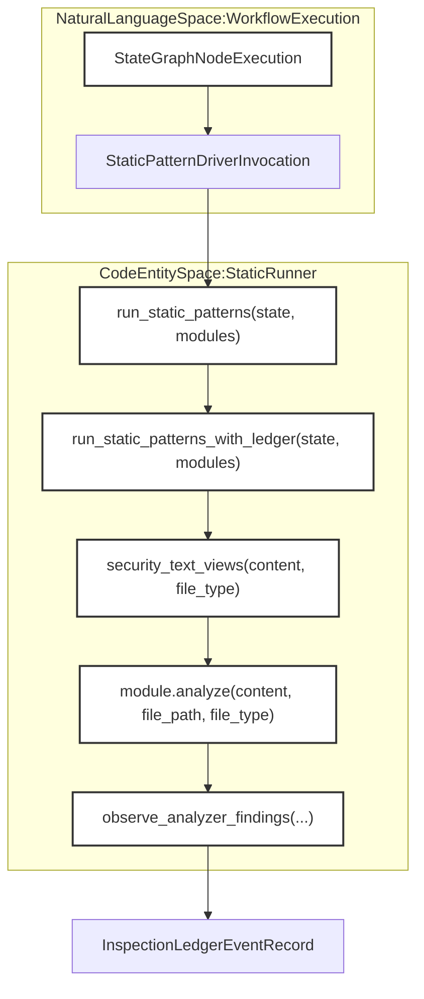
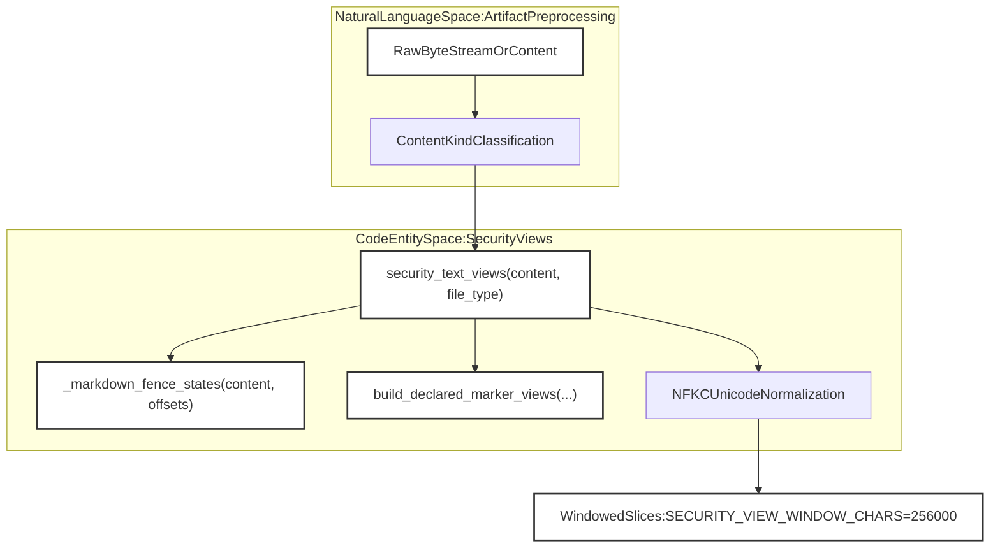
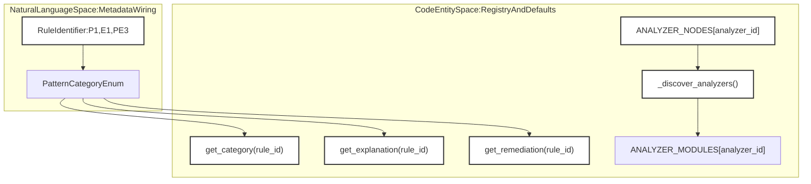

<!-- source: DeepWiki mcp.deepwiki.com · repo NVIDIA/SkillSpector · extra page Static Runner and Pattern Framework · fetched 2026-10-26 -->

# Static Runner and Pattern Framework

<details>
<summary>Relevant source files</summary>

The following files were used as context for generating this wiki page:

- [src/skillspector/nodes/analyzers/__init__.py](src/skillspector/nodes/analyzers/__init__.py)
- [src/skillspector/nodes/analyzers/common.py](src/skillspector/nodes/analyzers/common.py)
- [src/skillspector/nodes/analyzers/pattern_defaults.py](src/skillspector/nodes/analyzers/pattern_defaults.py)
- [src/skillspector/nodes/analyzers/static_runner.py](src/skillspector/nodes/analyzers/static_runner.py)
- [tests/fixtures/pe3_bare_keyring/SKILL.md](tests/fixtures/pe3_bare_keyring/SKILL.md)
- [tests/fixtures/pe3_bare_keyring/issue-396-keyring.md](tests/fixtures/pe3_bare_keyring/issue-396-keyring.md)
- [tests/nodes/analyzers/test_registry.py](tests/nodes/analyzers/test_registry.py)
- [tests/nodes/analyzers/test_static_runner_filtering.py](tests/nodes/analyzers/test_static_runner_filtering.py)
- [tests/unit/test_reviewer_nits.py](tests/unit/test_reviewer_nits.py)

</details>


## Purpose and Scope

This page documents the internal architecture of the static pattern execution subsystem in SkillSpector. The static runner (`run_static_patterns` and `run_static_patterns_with_ledger`) serves as the core orchestration driver that feeds normalized text streams, windowed security views, and markdown fence contexts to individual pattern analysis modules. It enforces strict resource bounds, computes deduplication keys, applies false-positive heuristics (such as license boilerplate and documentation code examples), and wires pattern defaults and registry metadata.

Sources: `[src/skillspector/nodes/analyzers/static_runner.py:16-125]()`

---

## Execution Driver and Ledger Integration

The static pattern subsystem processes file contents retrieved from the workflow state cache (`state["file_cache"]`) across registered pattern modules. The driver exposes two primary entry points: `run_static_patterns` and `run_static_patterns_with_ledger`.


Sources: `[src/skillspector/nodes/analyzers/static_runner.py:20-67]()`, `[src/skillspector/models.py:40-46]()`

When `run_static_patterns_with_ledger` executes, it records granular execution telemetry into the audit subsystem using `ledger_event`. Each artifact-module pair emits outcome statuses (`LedgerOutcome.SUCCESS`, `LedgerOutcome.SKIPPED`, `LedgerOutcome.FAILED`) paired with reasons such as `LedgerReason.COMPLETED`, `LedgerReason.EXCEEDED_CHARACTER_LIMIT`, or `LedgerReason.TIMEOUT`.

Sources: `[src/skillspector/inspection_ledger.py:36-43]()`, `[src/skillspector/nodes/analyzers/static_runner.py:174-178]()`

---

## Artifact Projections and Security Views

To defeat text obfuscation, homograph attacks, and cross-boundary injection tricks, the runner converts raw file inputs into multi-view security projections before passing them to analyzers.


Sources: `[src/skillspector/artifacts.py:29-35]()`, `[src/skillspector/nodes/analyzers/static_runner.py:89-138]()`, `[src/skillspector/security_reconstruction.py:52-56]()`

### Key View Projections & Fences
- **Windowed Security Text Views**: Files exceeding `MAX_FILE_CHARS` (aligned with `MAX_PYTHON_AST_SOURCE_CHARS`) or `SECURITY_VIEW_WINDOW_CHARS` (256,000 characters) are partitioned into overlapping windows (`_WINDOW_OVERLAP_CHARS = 8192`) to maintain continuity across boundary breaks.
- **Markdown Fence Context**: The runner maintains stateful markdown fence tracking via `_advance_markdown_fence` and `_markdown_fence_states` to distinguish whether a match occurs inside a fenced code block or document prose.
- **Continuity Views**: Auxiliary projections bridge attacker-controlled separators while respecting bounded-gap limits (`_CONTINUITY_SEPARATOR_CHARS`).

Sources: `[src/skillspector/nodes/analyzers/static_runner.py:89-146]()`, `[src/skillspector/nodes/common.py:27-30]()`

---

## Resource Bounds and Finding Budgets

To protect against denial-of-service through regex catastrophic backtracking or infinite generation loops, the static runner enforces strict limits:

| Bound Constant | Value | Description |
| :--- | :--- | :--- |
| `MAX_FINDINGS_PER_ARTIFACT` | `10,000` | Maximum findings allowed from a single file component. |
| `MAX_FINDINGS_PER_ANALYZER` | `10,000` | Maximum findings aggregated per analyzer node. |
| `MAX_STATIC_ANALYSIS_SECONDS_PER_ARTIFACT` | `30.0` | Wall-clock time budget per artifact evaluation. |
| `SECURITY_VIEW_WINDOW_CHARS` | `256,000` | Maximum character length for a single security text view window. |

Sources: `[src/skillspector/nodes/analyzers/static_runner.py:90-119]()`

---

## False-Positive Filtering and Deduplication

Static patterns often match documentation examples, license texts, or environment reference templates. The runner filters these out using domain heuristics:

- **License Boilerplate Filter**: Files matching `_LICENSE_BASENAME` (e.g., `LICENSE`, `COPYING.lesser`) within text or markdown views have non-critical rule findings suppressed.
- **Code Example Detection**: Helpers like `is_code_example` in `src/skillspector/nodes/analyzers/common.py` inspect surrounding context for markers (````, `example:`, `e.g.`, `// ✅`) to filter out benign documentation snips. Note that `SKILL.md` is explicitly never treated as a code example to prevent attackers from bypassing prompt injection checks by placing a code fence nearby.
- **Deduplication**: Findings are deduplicated using `classification_metadata_key` from `src/skillspector/nodes/deduplicate.py` to collapse overlapping window views into a single unique record.

Sources: `[src/skillspector/nodes/analyzers/static_runner.py:120-125]`, `[src/skillspector/nodes/analyzers/common.py:47-80]`, `[src/skillspector/nodes/deduplicate.py:46()`]`

---

## Pattern Defaults and Registry Wiring

Each static pattern module maps rule identifiers (e.g., `P1`, `E1`, `PE3`) to default explanations, remediations, and categories using `pattern_defaults.py`.


Sources: `[src/skillspector/nodes/analyzers/pattern_defaults.py:20-85]()`, `[src/skillspector/nodes/analyzers/__init__.py:33-61]()`

The analyzer package initializer (`src/skillspector/nodes/analyzers/__init__.py`) dynamically iterates over package modules via `pkgutil.iter_modules`, inspecting `ANALYZER_ID` and `node` callables to populate `ANALYZER_NODE_IDS`, `ANALYZER_NODES`, and `ANALYZER_MODULES`.

Sources: `[src/skillspector/nodes/analyzers/__init__.py:33-61]()`

---

