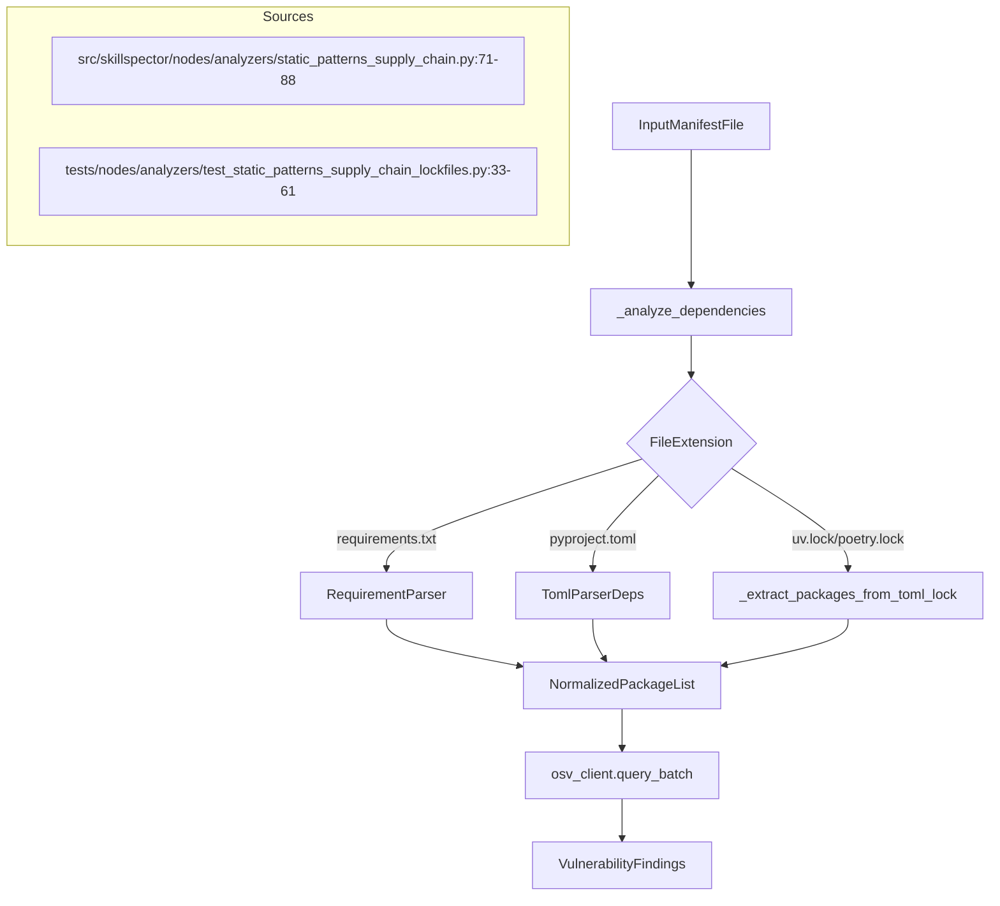
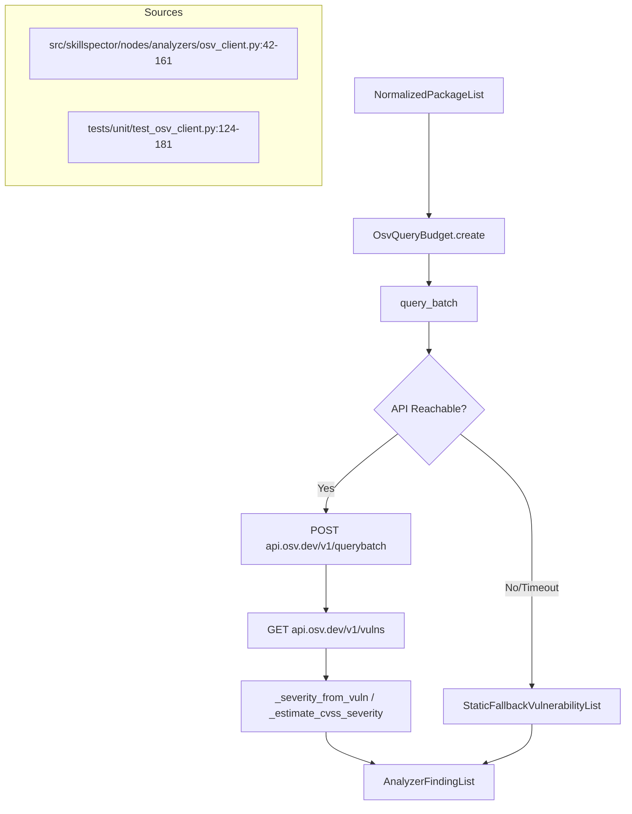
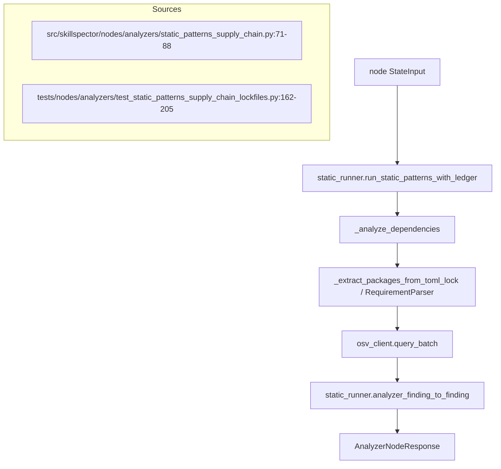

<!-- source: DeepWiki mcp.deepwiki.com · repo NVIDIA/SkillSpector · extra page Supply Chain and Trigger Analyzers (SC/TR) · fetched 2026-10-26 -->

# Supply Chain and Trigger Analyzers (SC/TR)

<details>
<summary>Relevant source files</summary>

The following files were used as context for generating this wiki page:

- [src/skillspector/nodes/analyzers/osv_client.py](src/skillspector/nodes/analyzers/osv_client.py)
- [src/skillspector/nodes/analyzers/static_patterns_agent_snooping.py](src/skillspector/nodes/analyzers/static_patterns_agent_snooping.py)
- [src/skillspector/nodes/analyzers/static_patterns_output_handling.py](src/skillspector/nodes/analyzers/static_patterns_output_handling.py)
- [src/skillspector/nodes/analyzers/static_patterns_supply_chain.py](src/skillspector/nodes/analyzers/static_patterns_supply_chain.py)
- [tests/nodes/analyzers/test_static_patterns_supply_chain_lockfiles.py](tests/nodes/analyzers/test_static_patterns_supply_chain_lockfiles.py)
- [tests/unit/test_osv_client.py](tests/unit/test_osv_client.py)
- [tests/unit/test_patterns_new.py](tests/unit/test_patterns_new.py)

</details>


## Purpose and Scope

This page provides a deep technical dive into the supply chain (`SC1`–`SC9`) and trigger abuse (`TR1`–`TR3`) static pattern analyzers implemented in `src/skillspector/nodes/analyzers/static_patterns_supply_chain.py`. It covers dependency manifest parsing across multiple formats (`requirements.txt`, `pyproject.toml`, `uv.lock`, `poetry.lock`), live vulnerability resolution via `src/skillspector/nodes/analyzers/osv_client.py`, container image security checks, bytecode detection, concealed executable artifacts, and agent trigger validation.

Sources: `src/skillspector/nodes/analyzers/static_patterns_supply_chain.py:1-96` [src/skillspector/nodes/analyzers/static_patterns_supply_chain.py:1-96](), `src/skillspector/nodes/analyzers/osv_client.py:1-80` [src/skillspector/nodes/analyzers/osv_client.py:1-80]()

---

## 1. Rule Catalog: Supply Chain (SC1–SC9) and Trigger Abuse (TR1–TR3)

The supply chain and trigger analyzer evaluates dependency configurations, build scripts, manifest files, and agent metadata declarations for malicious or risky patterns. 

- **SC1 (Unpinned or Loose Dependencies)**: Detects packages specified without strict version constraints (e.g., wildcard versions, `*`, `latest`, or loose `^` ranges) [src/skillspector/nodes/analyzers/static_patterns_supply_chain.py:100-111]().
- **SC2 (Risky Remote Fetch & Execute)**: Identifies insecure shell pipe-to-interpreter patterns (e.g., `curl ... | bash`, `wget ... | sh`, or inline `exec(urllib.request.urlopen(...).read())`) [src/skillspector/nodes/analyzers/static_patterns_supply_chain.py:112-126]().
- **SC3 (Obfuscated or Encoded Payloads)**: Detects runtime decoding or deserialization of concealed payloads (e.g., `base64.b64decode`, `marshal.loads`, zlib decompressions, or large hex/base64 string literals) [src/skillspector/nodes/analyzers/static_patterns_supply_chain.py:127-145]().
- **SC4 (Known Vulnerable Dependencies)**: Cross-references parsed dependency names and locked versions against the live OSV.dev batch API (`src/skillspector/nodes/analyzers/osv_client.py`), using local fallback lists when offline [src/skillspector/nodes/analyzers/static_patterns_supply_chain.py:16-19]().
- **SC5 (Abandoned Packages)**: Flags known-abandoned or archived upstream packages that present unmaintained supply-chain risks [src/skillspector/nodes/analyzers/static_patterns_supply_chain.py:20-20]().
- **SC6 (Typosquatting)**: Identifies package names structurally similar to popular ecosystem libraries designed to spoof legitimate dependencies [src/skillspector/nodes/analyzers/static_patterns_supply_chain.py:21-21]().
- **SC7 (Untrusted Container Image Pulls)**: Flags container pulls or orchestration commands with content-trust or signature verification disabled (e.g., `--disable-content-trust`, `DOCKER_CONTENT_TRUST=0`, `--insecure-registry`) [src/skillspector/nodes/analyzers/static_patterns_supply_chain.py:147-160]().
- **SC8 (Shipped Python Bytecode)**: Flags precompiled bytecode artifacts (`__pycache__/`, `*.pyc`, `*.pyo`) embedded inside skill bundles that standard directory discovery normally bypasses [src/skillspector/nodes/analyzers/static_patterns_supply_chain.py:22-23]().
- **SC9 (Concealed Executable Artifacts)**: Flags raw binaries or compiled executables nested within documentation or hidden skill assets [src/skillspector/nodes/analyzers/static_patterns_supply_chain.py:24-24]().
- **TR1–TR3 (Trigger Abuse)**: Identifies overly broad capability triggers (`TR1`), command/intent shadowing (`TR2`), and social engineering or baiting triggers (`TR3`) [src/skillspector/nodes/analyzers/static_patterns_supply_chain.py:25-25]().

Sources: `src/skillspector/nodes/analyzers/static_patterns_supply_chain.py:16-160` [src/skillspector/nodes/analyzers/static_patterns_supply_chain.py:16-160]()

---

## 2. Lockfile Parsing and Dependency Extraction

Dependency analysis is governed by strict resource bounds defined at the module level in `src/skillspector/nodes/analyzers/static_patterns_supply_chain.py` to prevent denial-of-service vulnerabilities during large repository scans:

```python
MAX_DEPENDENCY_FILES_PER_SCAN = 64
MAX_DEPENDENCY_PACKAGES_PER_FILE = 256
MAX_DEPENDENCY_PACKAGES_PER_SCAN = 1_024
MAX_DEPENDENCY_FINDINGS_PER_FILE = 512
MAX_DEPENDENCY_FINDINGS_PER_SCAN = 2_048
MAX_DEPENDENCY_ANALYSIS_SECONDS = 30.0
```
*(Reference: `src/skillspector/nodes/analyzers/static_patterns_supply_chain.py:86-91`)*

### Supported Formats and Parsing Logic
- **`requirements.txt`**: Parsed via `packaging.requirements.Requirement` to extract package names and specifiers.
- **`pyproject.toml`, `uv.lock`, and `poetry.lock`**: Parsed using Python's standard `tomllib` library [src/skillspector/nodes/analyzers/static_patterns_supply_chain.py:38-38](). Specifically, `_extract_packages_from_toml_lock` extracts table arrays under `[[package]]` entries, accurately anchoring line numbers to package blocks [tests/nodes/analyzers/test_static_patterns_supply_chain_lockfiles.py:84-99]().


Sources: `src/skillspector/nodes/analyzers/static_patterns_supply_chain.py:71-88` [src/skillspector/nodes/analyzers/static_patterns_supply_chain.py:71-88](), `tests/nodes/analyzers/test_static_patterns_supply_chain_lockfiles.py:33-61` [tests/nodes/analyzers/test_static_patterns_supply_chain_lockfiles.py:33-61]()

---

## 3. OSV.dev Integration (SC4)

The SC4 rule delegates vulnerability lookups to `src/skillspector/nodes/analyzers/osv_client.py`. 

### Query Architecture and Budgeting
1. **Batching**: Packages extracted from manifests are batched into requests sent to `https://api.osv.dev/v1/querybatch` [src/skillspector/nodes/analyzers/osv_client.py:42-42]().
2. **`OsvQueryBudget`**: Enforces strict operational ceilings across requests, response payload sizes (`MAX_OSV_RESPONSE_BYTES = 4MB`), batch counts (`MAX_OSV_QUERY_BATCHES = 4`), and execution deadlines [src/skillspector/nodes/analyzers/osv_client.py:58-66]().
3. **Severity Estimation**: Vulnerabilities returned by OSV are mapped to normalized `Severity` tiers (`CRITICAL`, `HIGH`, `MEDIUM`, `LOW`) by parsing CVSS v3/v4 vector strings (`_estimate_cvss_severity`) or database-specific fields (`_severity_from_vuln`) [tests/unit/test_osv_client.py:48-122]().
4. **Fallback Handling**: If the OSV API is unreachable due to network timeouts, connection refusals, or air-gapped environments, the analyzer records a partial inspection ledger outcome and falls back to a curated static list [src/skillspector/nodes/analyzers/osv_client.py:173-181]().


Sources: `src/skillspector/nodes/analyzers/osv_client.py:42-181` [src/skillspector/nodes/analyzers/osv_client.py:42-181](), `tests/unit/test_osv_client.py:124-181` [tests/unit/test_osv_client.py:124-181]()

---

## 4. Trigger Abuse Analyzers (TR1–TR3)

Trigger abuse rules inspect skill activation descriptors (such as prompt invocation triggers, tool bindings, and skill frontmatter definitions) to catch deceptive or overly broad activation vectors.

- **TR1 (Overly Broad Triggers)**: Flags wildcard or unconstrained trigger phrases designed to hijack every user utterance regardless of intent.
- **TR2 (Trigger Shadowing)**: Detects triggers that mimic core system commands or built-in tool names to intercept control flow.
- **TR3 (Baiting/Social Engineering Triggers)**: Identifies deceptive instructions disguised as urgent security prompts or administrative overrides to manipulate agent routing.

Sources: `src/skillspector/nodes/analyzers/static_patterns_supply_chain.py:16-28` [src/skillspector/nodes/analyzers/static_patterns_supply_chain.py:16-28]()

---

## 5. End-to-End Data Flow

The complete flow from skill components to supply chain findings and ledger event recording is illustrated below:


Sources: `src/skillspector/nodes/analyzers/static_patterns_supply_chain.py:71-88` [src/skillspector/nodes/analyzers/static_patterns_supply_chain.py:71-88](), `tests/nodes/analyzers/test_static_patterns_supply_chain_lockfiles.py:162-205` [tests/nodes/analyzers/test_static_patterns_supply_chain_lockfiles.py:162-205]()

---

