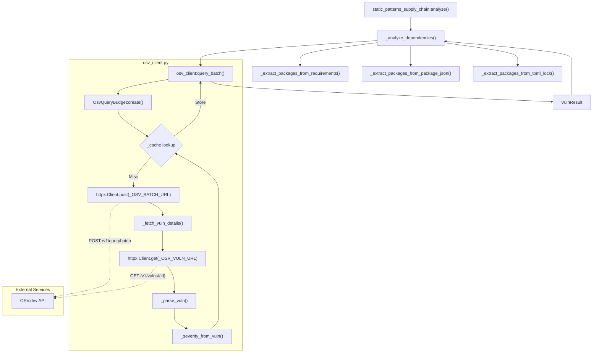
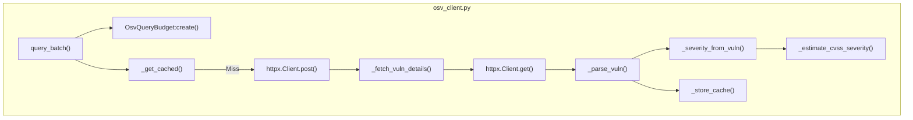

<!-- source: DeepWiki mcp.deepwiki.com · repo NVIDIA/SkillSpector · extra page Supply Chain: OSV.dev Live Vulnerability Lookups (SC4) · fetched 2026-10-26 -->

# Supply Chain: OSV.dev Live Vulnerability Lookups (SC4)

Relevant source files

The following files were used as context for generating this wiki page:

- [src/skillspector/nodes/analyzers/osv_client.py](src/skillspector/nodes/analyzers/osv_client.py)
- [src/skillspector/nodes/analyzers/static_patterns_agent_snooping.py](src/skillspector/nodes/analyzers/static_patterns_agent_snooping.py)
- [src/skillspector/nodes/analyzers/static_patterns_output_handling.py](src/skillspector/nodes/analyzers/static_patterns_output_handling.py)
- [src/skillspector/nodes/analyzers/static_patterns_supply_chain.py](src/skillspector/nodes/analyzers/static_patterns_supply_chain.py)
- [tests/nodes/analyzers/test_static_patterns_supply_chain_lockfiles.py](tests/nodes/analyzers/test_static_patterns_supply_chain_lockfiles.py)
- [tests/unit/test_osv_client.py](tests/unit/test_osv_client.py)
- [tests/unit/test_patterns_new.py](tests/unit/test_patterns_new.py)

The **SC4** rule in SkillSpector provides automated detection of known vulnerabilities (CVEs, GHSAs) in a skill's dependencies. Unlike static patterns that rely on hardcoded fallback lists, SC4 primarily utilizes the [OSV.dev](https://osv.dev) API via `osv_client.py` to perform live, ecosystem-aware vulnerability lookups for Python (PyPI) and Node.js (npm) packages.

Sources: [src/skillspector/nodes/analyzers/static_patterns_supply_chain.py:16-28](), [src/skillspector/nodes/analyzers/osv_client.py:16-23]()

## 1. Architecture and Data Flow

The SC4 subsystem bridges static manifest parsing and live threat intelligence. When the `static_patterns_supply_chain` analyzer processes a skill component, it extracts package manifests and queries the OSV database using `osv_client.py`.

### System Interaction Diagram
The following diagram illustrates how the `static_patterns_supply_chain` module interacts with `osv_client.py` and external network services.

"SC4 Data Flow: From File to API"

Sources: [src/skillspector/nodes/analyzers/static_patterns_supply_chain.py:423-455](), [src/skillspector/nodes/analyzers/osv_client.py:121-161]()

## 2. Dependency Extraction (`_analyze_dependencies`)

SkillSpector targets two primary ecosystems for SC4 lookups:
1. **PyPI**: Extracted from `requirements.txt`, `pyproject.toml`, `poetry.lock`, or `uv.lock`. Lockfile parsers such as `_extract_packages_from_toml_lock` extract pinned versions to ensure precise lookups [tests/nodes/analyzers/test_static_patterns_supply_chain_lockfiles.py:33-60]().
2. **npm**: Extracted from `package.json` manifest formats [src/skillspector/nodes/analyzers/static_patterns_supply_chain.py:553-575]().

The extractor identifies the package name and version string. This version is critical because OSV.dev performs server-side version-range matching using PEP 440 (Python) or SemVer (npm) semantics.

Sources: [src/skillspector/nodes/analyzers/static_patterns_supply_chain.py:530-575](), [tests/nodes/analyzers/test_static_patterns_supply_chain_lockfiles.py:33-97]()

## 3. OSV Client Implementation (`osv_client.py`)

The `osv_client.py` module manages all HTTP communication with the OSV database, query batching, timeouts, and result caching.

### Batch Querying and Budget Enforcement
To minimize network overhead, SkillSpector uses the OSV `querybatch` endpoint (`_OSV_BATCH_URL`) [src/skillspector/nodes/analyzers/osv_client.py:42](). Requests are bounded by `OsvQueryBudget`, which enforces aggregate ceilings on packages, batches, response bytes, and execution time [src/skillspector/nodes/analyzers/osv_client.py:121-161](). The request timeout defaults to `30.0` seconds and can be overridden via `SKILLSPECTOR_OSV_TIMEOUT` [src/skillspector/nodes/analyzers/osv_client.py:44-53]().

### Severity Estimation
When OSV returns CVSS vectors instead of categorical severity strings, the internal helper `_estimate_cvss_severity` parses v3 and v4 vector strings to map them into standard severity bands [tests/unit/test_osv_client.py:48-92]():
* **CRITICAL**: High-impact metrics ratio $\ge$ 0.75
* **HIGH**: Ratio $\ge$ 0.5
* **MEDIUM**: Ratio $\ge$ 0.25
* **LOW**: Ratio $<$ 0.25

### In-Memory Caching
To prevent redundant API calls during multi-skill scans, `osv_client.py` implements an in-memory cache `_cache` [src/skillspector/nodes/analyzers/osv_client.py:73]() protected against unbounded growth (`MAX_OSV_CACHE_ENTRIES = 4_096`) [src/skillspector/nodes/analyzers/osv_client.py:66]().

### Code Entity Space: OSV Client Internals
The following diagram maps the internal functions and classes within `osv_client.py`:

"OSV Client Code Entity Mapping"

Sources: [src/skillspector/nodes/analyzers/osv_client.py:42-161](), [tests/unit/test_osv_client.py:48-92]()

## 4. Resilience, Caching, and Air-Gapped Fallbacks

SkillSpector functions in air-gapped or network-restricted environments where `api.osv.dev` is unreachable.

### The Network Waterfall
1. **Live API**: Primary lookup via `query_batch()` [src/skillspector/nodes/analyzers/osv_client.py:214-250]().
2. **Status Tracking**: The global boolean `_last_query_ok` records whether the most recent API call succeeded, exposed via `was_osv_reachable()` [src/skillspector/nodes/analyzers/osv_client.py:73-75]().
3. **Static Fallback**: If network errors occur, the analyzer falls back to `_sc4_from_fallback()` using built-in lists of historical vulnerabilities (`_FALLBACK_VULNERABLE_PYPI` and `_FALLBACK_VULNERABLE_NPM`) [src/skillspector/nodes/analyzers/static_patterns_supply_chain.py:168-200]().

Sources: [src/skillspector/nodes/analyzers/osv_client.py:51-75](), [src/skillspector/nodes/analyzers/static_patterns_supply_chain.py:168-200]()

## 5. Credential Handling and Security Boundaries

The OSV.dev public API is unauthenticated and does not require API keys or bearer tokens. Consequently, `osv_client.py` makes unauthenticated HTTP requests via `httpx.Client` without sending any user credentials or local environment secrets. Network operations respect standard HTTP proxy environment variables (`HTTP_PROXY`, `HTTPS_PROXY`) natively handled by `httpx`.

Sources: [src/skillspector/nodes/analyzers/osv_client.py:42-44]()

---

