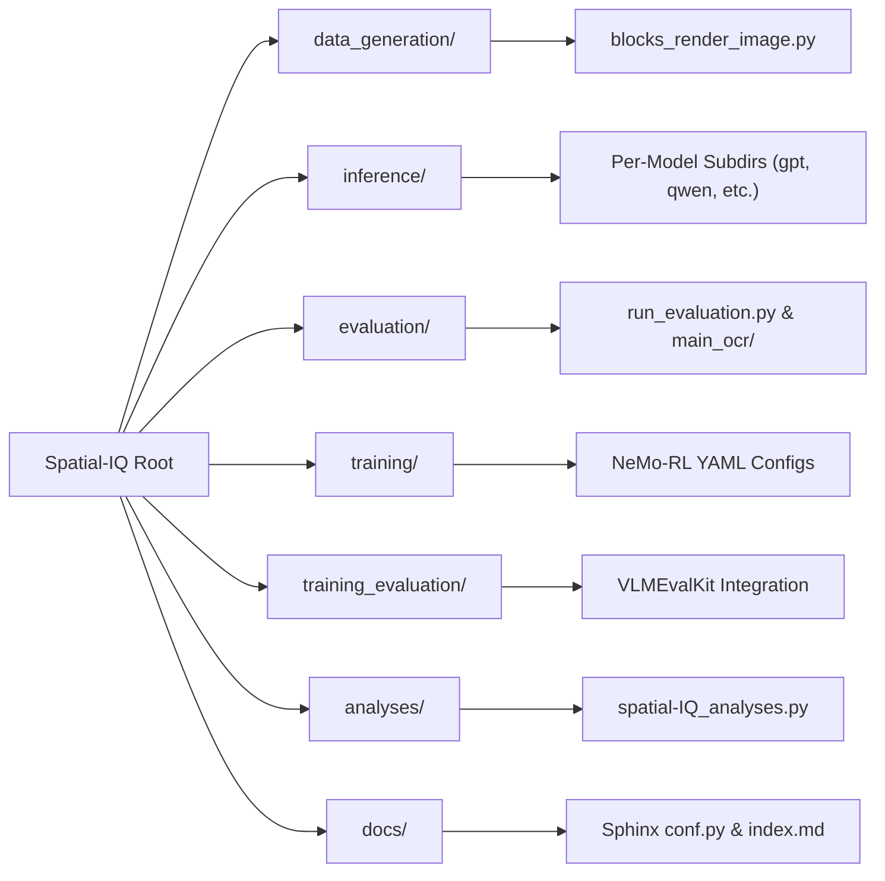

<!-- source: DeepWiki mcp.deepwiki.com · repo NVIDIA/Spatial-IQ · page 1 Overview · fetched 2026-10-26 -->

# Overview

<details>
<summary>Relevant source files</summary>

The following files were used as context for generating this wiki page:

- [LICENSE](LICENSE)
- [README.md](README.md)
- [THIRD_PARTY_LICENSES.md](THIRD_PARTY_LICENSES.md)

</details>


Spatial-IQ is a benchmark designed to evaluate multimodal LLMs on **3D spatial reasoning** using procedurally generated stacked-block scenes [README.md:11-16](). It deconstructs spatial intelligence into a hierarchical set of atomic and composite capability tests [README.md:18-19](). 

The benchmark features an end-to-end pipeline spanning synthetic data generation, multi-model inference across various API and local endpoints, multi-modality evaluation (text, MCQ, image editing, and OCR consensus), and an analysis pipeline that reproduces manuscript tables and figures [README.md:11-16]().

## End-to-End Pipeline

The Spatial-IQ workflow flows sequentially from scene generation to statistical analysis. The diagram below maps these conceptual stages to their corresponding code entities and execution entry points in the repository.

```mermaid
graph TD
    A["Scene Generation"] -->|"blocks_render_image.py"| B["Inference Layer"]
    B -->|"inference/*/inference_*.py"| C["Evaluation & Scoring"]
    C -->|"run_evaluation.py"| D["Analyses & Artifacts"]
    D -->|"spatial-IQ_analyses.py"| E["Paper Tables & Figures"]

    sub-graph DataGen ["data_generation/"]
        A1["data_generation/blocks_render_image.py"]
    end

    sub-graph Inf ["inference/"]
        B1["inference/gpt/"]
        B2["inference/qwen/"]
        B3["inference/claude/"]
    end

    sub-graph Eval ["evaluation/"]
        C1["evaluation/run_evaluation.py"]
        C2["evaluation/evaluation_text.py"]
        C3["evaluation/evaluation_mcq.py"]
        C4["evaluation/evaluation_image.py"]
        C5["evaluation/main_ocr/evaluate_main_ocr.py"]
    end

    sub-graph Anals ["analyses/"]
        D1["analyses/spatial-IQ_analyses.py"]
        D2["analyses/hierarchy_dependency.py"]
    end

    A -.-> A1
    B -.-> B1
    B -.-> B2
    B -.-> B3
    C -.-> C1
    C1 --> C2
    C1 --> C3
    C1 --> C4
    C1 --> C5
    D -.-> D1
    D1 --> D2
```
*Figure 1: End-to-end pipeline linking high-level benchmark phases to codebase entry points.*

Sources: [`README.md:25-38]()`, [`data_generation/blocks_render_image.py:1-50`]() (implied by layout), [`evaluation/run_evaluation.py:1-50`]() (implied by layout), [`analyses/spatial-IQ_analyses.py:1-50`]() (implied by layout).

---

## Repository Layout and Component Architecture

The repository is organized into self-contained subpackages corresponding to each phase of the benchmark lifecycle. The architecture isolates simulation, inference clients, scoring logic, training recipes, and analytical reporting.


*Figure 2: Repository directory structure mapping top-level subpackages to their primary execution components.*

Sources: [`README.md:25-38`]()

---

## Child Pages & Detailed Topics

For deeper technical specifications, installation steps, and API contracts, refer to the child pages:

- **[Getting Started & Environment Setup](#1.1)** — Python environment management (`uv`, requirements per subpackage), API key configuration, model weight placement, ignored artifacts, and external dependencies such as Isaac Sim, vLLM, Tesseract, and PaddleOCR.
- **[Benchmark Concepts: Tasks, Views and Modalities](#1.2)** — Definitions for `task_main` and `task1`–`task11`, view directory structure (`offset`/`fov`/`dist`), subset manifests, answer modalities (text, MCQ, image, OCR), and file naming slugs.
- **[Project Governance: License, Security, Third-Party Notices](#1.3)** — BSD-3-Clause licensing terms, PSIRT vulnerability reporting protocol, and comprehensive third-party dependency license inventories.

Sources: [`README.md:1-120`]()

---

