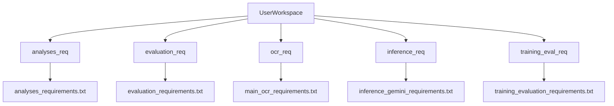
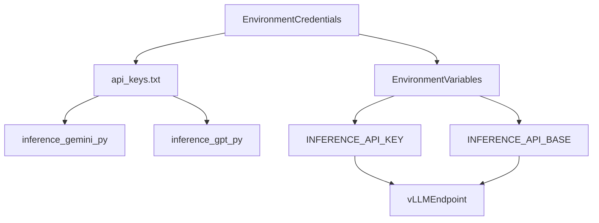
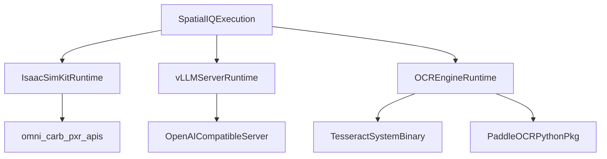

<!-- source: DeepWiki mcp.deepwiki.com · repo NVIDIA/Spatial-IQ · page 1.1 Getting Started & Environment Setup · fetched 2026-10-26 -->

# Getting Started & Environment Setup

<details>
<summary>Relevant source files</summary>

The following files were used as context for generating this wiki page:

- [.gitignore](.gitignore)
- [README.md](README.md)
- [THIRD_PARTY_LICENSES.md](THIRD_PARTY_LICENSES.md)

</details>


## Purpose and Scope

This page outlines the foundational environment configuration required to run Spatial-IQ. Because Spatial-IQ spans diverse computational domains—including synthetic 3D rendering via NVIDIA Isaac Sim, lightweight API client dispatching, deep learning inference with Hugging Face/vLLM, multi-engine OCR consensus pipelines, and rigorous statistical analysis—the repository eschews a monolithic, heavy requirements file in favor of **scoped subpackage requirements**. 

This document details Python environment management using `uv` or `pip`, secure credential handling, local model weight placement, ignored runtime artifacts via `.gitignore`, and the integration of heavy external runtimes (Isaac Sim, vLLM, and Tesseract/PaddleOCR).

Sources: `README.md:96-120` [README.md:96-120]()

---

## Scoped Python Environment & `uv` Integration

Spatial-IQ does not maintain a top-level `requirements.txt` or a single global virtual environment configuration. Instead, dependencies are compartmentalized by functional subsystem. End users install only the specific requirements corresponding to the modules they intend to execute.


*Figure 1: Subpackage dependency isolation mapping human-level subsystem names to scoped requirement manifests.*

Sources: `README.md:100-112` [README.md:100-112](), `THIRD_PARTY_LICENSES.md:15-24` [THIRD_PARTY_LICENSES.md:15-24]()

### Subpackage Manifest Inventory

The repository defines distinct requirement files across subsystems:
* **`analyses/requirements.txt`**: Scientific and statistical stack (`numpy`, `scipy`, `pandas`, `matplotlib`, `pillow`) [THIRD_PARTY_LICENSES.md:27-36]().
* **`evaluation/requirements.txt`**: Exact-match and MCQ correctness evaluation tooling [README.md:107]().
* **`evaluation/main_ocr/requirements.txt`**: OCR consensus dependencies (`pytesseract`, `PaddleOCR`) [THIRD_PARTY_LICENSES.md:49-54]().
* **`inference/gemini/requirements.txt`**: Lightweight HTTP request client (`requests`) [THIRD_PARTY_LICENSES.md:35]().
* **`inference/qwen/requirements_image_edit.txt`**: Diffusers-based local image-editing client dependencies (`torch`, `diffusers`, `transformers`) [THIRD_PARTY_LICENSES.md:58-63]().
* **`training_evaluation/requirements.txt`**: VLMEvalKit companion benchmark dependencies [THIRD_PARTY_LICENSES.md:72-105]().

Virtual environments can be established using standard Python venv or fast package managers like `uv`:

```bash
# Example: Setting up the evaluation environment
python -m venv .venv
source .venv/bin/activate
pip install -r evaluation/requirements.txt
```

Sources: `README.md:96-120` [README.md:96-120]()

---

## API Keys & Secrets Management

To interact with proprietary hosted multimodal models (such as GPT, Gemini, Claude, Kimi, and GLM), API credentials must be supplied via local configuration files or environment variables. 

Secrets are strictly partitioned from version control. The file `inference/api_keys.txt` and exclusion lists are explicitly ignored by version control to prevent accidental credential leakage [.gitignore:32-35]().


*Figure 2: Credential flow mapping runtime configuration files and environment variables to inference clients (`inference_gemini_py`, `vLLMEndpoint`).*

Sources: `.gitignore:32-35` [.gitignore:32-35](), `README.md:113-120` [README.md:113-120]()

---

## Model Weights Placement

For local execution (such as open-weights models served via vLLM or custom SFT/DAPO checkpoints), large model weights must be stored locally outside of tracked repository content. 

As defined in `.gitignore`, weights directories must be placed directly inside model-specific inference folders [.gitignore:36-39]():
* `inference/*/weights/`
* `inference/*/weights_*/`

Users should fetch weights following upstream Hugging Face instructions for each respective model family (e.g., Qwen2.5-VL, Nemotron, Hunyuan) and place them in these designated paths before launching local inference scripts.

Sources: `.gitignore:36-39` [.gitignore:36-39](), `README.md:36-39` [README.md:36-39]()

---

## Ignored Artifacts & Runtime Outputs

To maintain a clean repository state, runtime outputs, build caches, and generated analysis datasets are excluded from tracking [.gitignore:1-41](). 

Key ignored categories include:
* **Python Caches**: `__pycache__/`, `*.py[cod]`, `.venv/`, `venv/` [.gitignore:5-11]()
* **Documentation Builds**: `docs/_build/`, `_site/`, `public/` [.gitignore:13-16]()
* **Runtime Inference and Evaluation Results**: `evaluation_results/` and per-model prediction text/image outputs [.gitignore:40-41]()
* **Analysis Outputs**: `difficulty_analysis_output/` and temporary matplotlib configuration directories [.gitignore:1-3]()

Sources: `.gitignore:1-41` [.gitignore:1-41]()

---

## External Dependencies & Heavy Runtimes

Certain subsystems rely on heavy external binary runtimes or system packages that cannot be resolved via standard PyPI `pip` installation alone.


*Figure 3: External dependency topology linking system-level binaries and simulators (`IsaacSimKitRuntime`, `TesseractSystemBinary`) to Spatial-IQ functional blocks.*

Sources: `THIRD_PARTY_LICENSES.md:49-55` [THIRD_Party_LICENSES.md:49-55](), `THIRD_PARTY_LICENSES.md:112-115` [THIRD_PARTY_LICENSES.md:112-115]()

### 1. NVIDIA Isaac Sim
Dataset generation is powered by NVIDIA Isaac Sim 4.5 (`data_generation/blocks_render_image.py`) [README.md:29](). Isaac Sim must be installed independently by the end user in accordance with the NVIDIA Isaac Sim EULA [THIRD_PARTY_LICENSES.md:112-115](). The codebase communicates with the simulator strictly through public Python bindings (`omni.*`, `carb.*`, `pxr`) [THIRD_PARTY_LICENSES.md:112-115]().

### 2. Local vLLM Endpoints
Local evaluation of open-weights models (such as Qwen, Nemotron, and VLA variants) expects an OpenAI-compatible vLLM server [README.md:32](). The openai Python client library (`openai`) acts as the bridge to these local endpoints [THIRD_PARTY_LICENSES.md:43]().

### 3. Tesseract and PaddleOCR
The OCR consensus pipeline (`evaluation/main_ocr/`) requires both the system-level `tesseract` binary (typically installed via `conda-forge`) and the `PaddleOCR` Python package to extract structured object counts from rendered image outputs [THIRD_PARTY_LICENSES.md:49-54]().

Sources: `THIRD_PARTY_LICENSES.md:49-55` [THIRD_PARTY_LICENSES.md:49-55](), `THIRD_PARTY_LICENSES.md:112-115` [THIRD_PARTY_LICENSES.md:112-115]()

---

