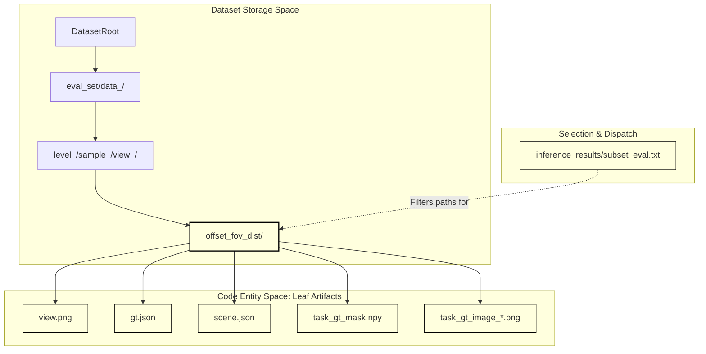
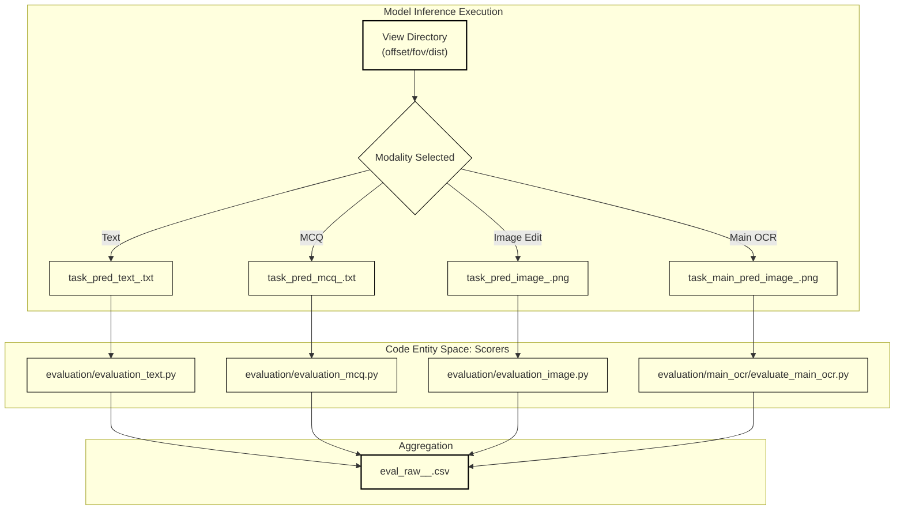

<!-- source: DeepWiki mcp.deepwiki.com · repo NVIDIA/Spatial-IQ · page 1.2 Benchmark Concepts: Tasks, Views and Modalities · fetched 2026-10-26 -->

# Benchmark Concepts: Tasks, Views and Modalities

<details>
<summary>Relevant source files</summary>

The following files were used as context for generating this wiki page:

- [README.md](README.md)
- [analyses/analyses_results/tables/table_05_task_queries.csv](analyses/analyses_results/tables/table_05_task_queries.csv)

</details>


## Purpose and Scope

This page covers the core benchmark concepts of **Spatial-IQ**, focusing on the hierarchical spatial reasoning tasks (`task_main` and `task1`–`task11`), the physical view directory layout and subset files, the four answer modalities (text, MCQ, image, and OCR-based main scoring), and the slug-based file naming conventions used throughout the pipeline [README.md:41-94](). 

---

## 1. View Directory Layout & Dataset Structure

The Spatial-IQ dataset is organized as a hierarchical directory tree rooted at `<dataset_root>/eval_set/`. Each distinct camera perspective on a 3D stacked-block scene is isolated into a unique leaf directory known as a **view** [README.md:43-58]().

### Directory Hierarchy

A typical path to a single view follows this pattern:
```
<dataset_root>/eval_set/data_<timestamp>/level_<L>/sample_<NN>/view_<VV>/offset<O>_fov<F>_dist<D>/
```

Inside each leaf view directory, the data generation pipeline (`data_generation/blocks_render_image.py`) emits a standardized set of artifacts [README.md:29, 47-53]():

- `view.png` — The rendered RGB input image presented to multimodal models.
- `gt.json` — Ground-truth metadata containing counts, MCQ correct letters, and structural attributes.
- `scene.json` — Scene-level metadata describing object placements and physical properties.
- `task<N>_gt_mask.npy` — Per-task NumPy binary pixel masks used for image-modality evaluation.
- `task<N>_gt_image_*.png` — Pre-rendered MCQ option images (e.g., 3-way, 4-way, or 5-way choice panels).

### Subset Files

To restrict inference and evaluation runs to specific benchmarks or subsets, the framework uses subset files such as [`inference_results/subset_eval.txt`]() [README.md:37, 56-58](). These files contain plain text lists of relative paths pointing to specific leaf view directories.



*Sources: [README.md:27-64]()*

---

## 2. Benchmark Tasks (`task_main` and `task1`–`task11`)

Spatial-IQ evaluates multimodal models across 11 atomic spatial reasoning sub-tasks (`task1` through `task11`) and one composite target task (`task_main`) [README.md:67-79](). 

### Task Definitions and Query Mapping

The table below maps the task identifiers used in code (`task1`–`task11`, `main`) to their paper descriptions and query texts [analyses/analyses_results/tables/table_05_task_queries.csv:1-13]():

| Task ID | Source Task Code | Task Name | Query Text |
| :--- | :--- | :--- | :--- |
| **Target1** | `main` | Object Counting | How many objects are in the stacked structure in total? [analyses/analyses_results/tables/table_05_task_queries.csv:11-11]() |
| **Task1** | `task1` | Object Categorization | What object category composes the stacked structure? [analyses/analyses_results/tables/table_05_task_queries.csv:2-2]() |
| **Task2** | `task9` | Cluster Count | How many non-laterally-adjacent clusters of objects are present? [analyses/analyses_results/tables/table_05_task_queries.csv:3-3]() |
| **Task3** | `task3` | Column Count | How many columns are in the stacked structure? [analyses/analyses_results/tables/table_05_task_queries.csv:4-4]() |
| **Task4** | `task4` | Layer Count | How many horizontal layers are in the stacked structure? [analyses/analyses_results/tables/table_05_task_queries.csv:5-5]() |
| **Task5** | `task5` | Visible Object Count | How many visible objects are present? [analyses/analyses_results/tables/table_05_task_queries.csv:6-6]() |
| **Task6** | `task2` | Top Layer | How many objects are in the top-most layer? [analyses/analyses_results/tables/table_05_task_queries.csv:7-7]() |
| **Task7** | `task6` | Direct Support | How many visible objects directly support the top-most object(s)? [analyses/analyses_results/tables/table_05_task_queries.csv:8-8]() |
| **Task8** | `task7` | Support Column | How many visible objects are in columns supporting the top-most object(s)? [analyses/analyses_results/tables/table_05_task_queries.csv:9-9]() |
| **Task9** | `task8` | Hidden Object Count | How many hidden objects must exist to support the visible structure? [analyses/analyses_riters/tables/table_05_task_queries.csv:10-10]()* |
| **Target2a** | `task10` | Mental Rotation 90 | Which objects are visible in the adjacent view but not the reference view? [analyses/analyses_results/tables/table_05_task_queries.csv:12-12]() |
| **Target2b** | `task11` | Mental Rotation 180 | Which objects are visible in the opposite view but not the reference view? [analyses/analyses_results/tables/table_05_task_queries.csv:13-13]() |

* `task_main` requires computing total blocks, including occluded blocks logically required by gravity assumptions [README.md:71-74]().

*Sources: [README.md:67-80](), [analyses/analyses_results/tables/table_05_task_queries.csv:1-13]()*

---

## 3. Answer Modalities & Scoring Pathways

Models interact with the benchmark across four distinct answer modalities [README.md:81-89](). Each modality writes prediction files directly into the view directory and is evaluated by dedicated scripts under the `evaluation/` directory [README.md:31, 83-89]().



*Sources: [README.md:81-92]()*

### Modality Specifications

1. **Free-Response Text (`text`)**:
   - **Prediction File**: `task<N>_pred_text_<slug>.txt` [README.md:85]()
   - **Scorer**: `evaluation/evaluation_text.py` [README.md:85]()
   - **Metric**: Exact-match or Pearson correlation against numeric/categorical ground truth [README.md:85]().
2. **Multiple Choice Question (`MCQ`)**:
   - **Prediction File**: `task<N>_pred_mcq_<slug>.txt` [README.md:86]()
   - **Scorer**: `evaluation/evaluation_mcq.py` [README.md:86]()
   - **Metric**: Letter match (A–E) across 3-, 4-, or 5-way option panels [README.md:86]().
3. **Image Editing (`image`)**:
   - **Prediction File**: `task<N>_pred_image_<slug>.png` [README.md:87]()
   - **Scorer**: `evaluation/evaluation_image.py` [README.md:87]()
   - **Metric**: Pixel-level silhouette score against ground-truth binary masks (`task<N>_gt_mask.npy`) [README.md:51, 87]().
4. **Main OCR Consensus (`main`)**:
   - **Prediction File**: `task_main_pred_image_<slug>.png` [README.md:88]()
   - **Scorer**: `evaluation/main_ocr/evaluate_main_ocr.py` [README.md:88]()
   - **Metric**: Ensemble OCR consensus (Tesseract + PaddleOCR + Qwen2.5-VL) extracting block counts from annotated images [README.md:32, 88]().

*Sources: [README.md:31-32, 51, 81-89]()*

---

## 4. Slugs and File Naming Conventions

A **slug** represents the unique directory name of an inference client under the `inference/` directory (e.g., `gemini`, `claude`, `vla0`, `qwen`) [README.md:30, 90-92](). 

### Slug Propagation Pipeline

Slugs flow immutably through the entire lifecycle of an evaluation run:
1. **Inference**: Client scripts read prompt templates from `prompt_*_Type1.json` and write outputs tagged with the model's slug [README.md:30, 91]().
2. **Evaluation**: `run_evaluation.py` scans view directories for files matching the active slug and computes scores [README.md:31, 91]().
3. **Outputs**: Scored results are aggregated into CSV files named according to the formula `eval_raw_<slug>_<mode>.csv` [README.md:91]().

*Sources: [README.md:30-31, 90-92]()*

---

