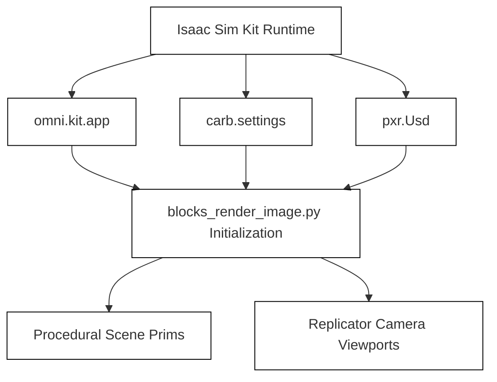
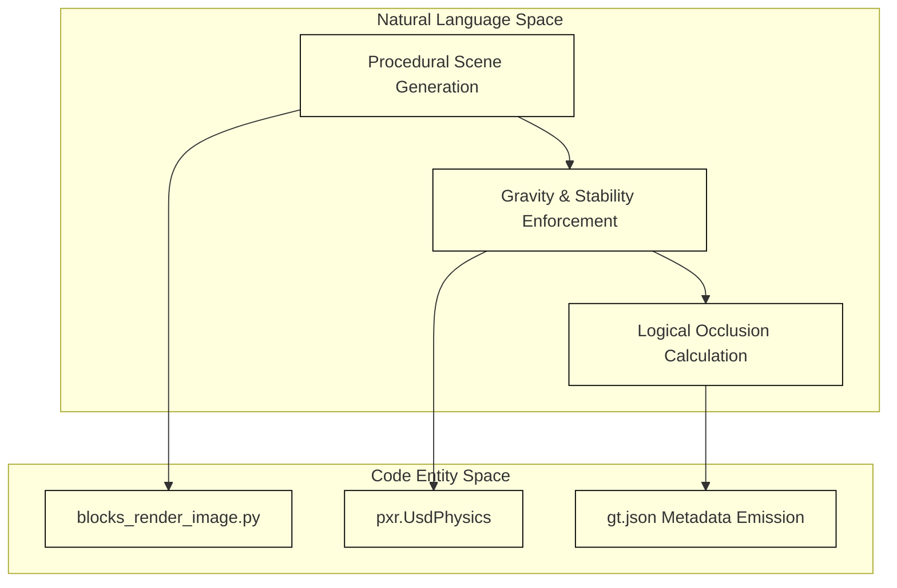
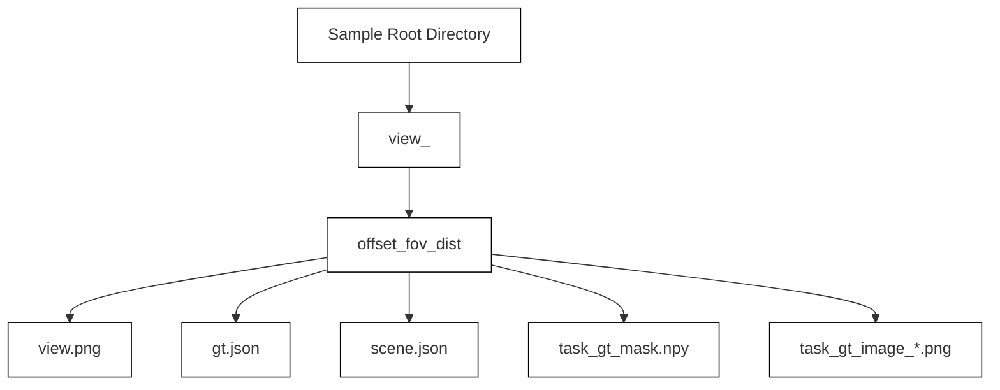

<!-- source: DeepWiki mcp.deepwiki.com · repo NVIDIA/Spatial-IQ · page 2.1 blocks_render_image.py Scene Renderer · fetched 2026-10-26 -->

# blocks_render_image.py Scene Renderer

Relevant source files

The following files were used as context for generating this wiki page:

- [README.md](README.md)
- [THIRD_PARTY_LICENSES.md](THIRD_PARTY_LICENSES.md)

## Purpose and Scope

The `blocks_render_image.py` script serves as the core synthetic data generation engine for Spatial-IQ [README.md:29](). Operating within NVIDIA Isaac Sim 4.5 and Omniverse Kit, it procedurally samples stacked-block scenes, configures multi-view camera perspectives, computes ground-truth masks for eleven atomic tasks and the composite main task, emits structured metadata (`gt.json` and `scene.json`), and optionally synchronizes generated assets to remote S3 buckets. 

Sources: [README.md:25-35](), [THIRD_PARTY_LICENSES.md:112-115]()

---

## Omniverse and Isaac Sim API Integration

The renderer interfaces directly with NVIDIA Isaac Sim through public Python bindings provided by the Omniverse ecosystem. It relies on three primary namespace modules:
- `omni`: Manages core Omniverse application states, extension lifecycles, and rendering viewports.
- `carb`: Handles low-level carburetors, logging, settings, and hardware-level interface sub-systems.
- `pxr`: Exposes Universal Scene Description (USD) primitives for stage construction, rigid body physics, prim manipulation, and camera transforms.

*Figure 1: Omniverse framework integration and runtime bootstrapping.*

Sources: [THIRD_PARTY_LICENSES.md:112-115]()

---

## Scene Sampling and Procedural Generation

Scenes are generated procedurally by stacking volumetric blocks subject to gravity constraints, physical stability checks, and logical occlusion hierarchies. The sampling logic constructs levels (`level_<L>`) and samples (`sample_<NN>`) by programmatically instancing USD primitives onto the physics stage.

*Figure 2: Bridging natural language scene concepts to USD and metadata generation entities.*

Sources: [README.md:41-54]()

---

## Camera Views and Multi-Perspective Parameterization

For each generated sample, the script orbits a virtual camera around the scene using a structured combination of spatial offsets, fields of view, and radial distances. Each unique view path follows the directory schema:

$$\text{data}\_\text{timestamp}/\text{level}\_L/\text{sample}\_{NN}/\text{view}\_{VV}/\text{offset}O\_\text{fov}F\_\text{dist}D/$$

Each leaf directory corresponds to a distinct **view** [README.md:41-55](), acting as the fundamental unit for subsequent model inference and evaluation.

*Figure 3: View directory tree structure and emitted artifact layout.*

Sources: [README.md:41-54]()

---

## Mask and Ground-Truth JSON Emission

During rendering, the engine captures high-resolution RGB frames (`view.png`), renders per-task binary pixel masks (`task<N>_gt_mask.npy`), generates multi-choice option images (`task<N>_gt_image_*.png`), and serializes structural metrics into two distinct metadata files:
- `gt.json`: Contains ground-truth answer attributes, block counts, support relations, and correct multiple-choice indices.
- `scene.json`: Stores full 3D transformation matrices, block dimensions, material IDs, and camera intrinsics/extrinsics.

Sources: [README.md:41-54]()

---

## S3 Environment Variables and Optional Cloud Upload

When cloud-scale generation is deployed, `blocks_render_image.py` integrates with `boto3` and `botocore` to export generated datasets directly to object storage. This behavior is strictly guarded by execution environment variables:

| Environment Variable | Type | Description |
|---|---|---|
| `UPLOAD_TO_S3` | Integer / Flag | When set to `1`, enables automated synchronization of generated dataset trees to remote S3 buckets. |
| `AWS_ACCESS_KEY_ID` | String | Standard AWS credentials utilized by the underlying `boto3` client session. |
| `AWS_SECRET_ACCESS_KEY` | String | Standard AWS secret key for authentication. |
| `S3_BUCKET_NAME` | String | Target bucket destination for output directories. |

Sources: [README.md:29](), [THIRD_PARTY_LICENSES.md:37-39]()

---

