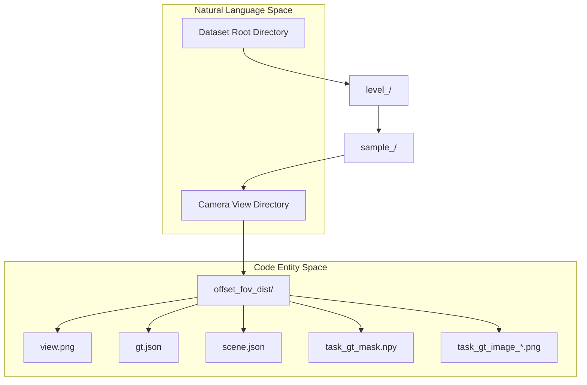
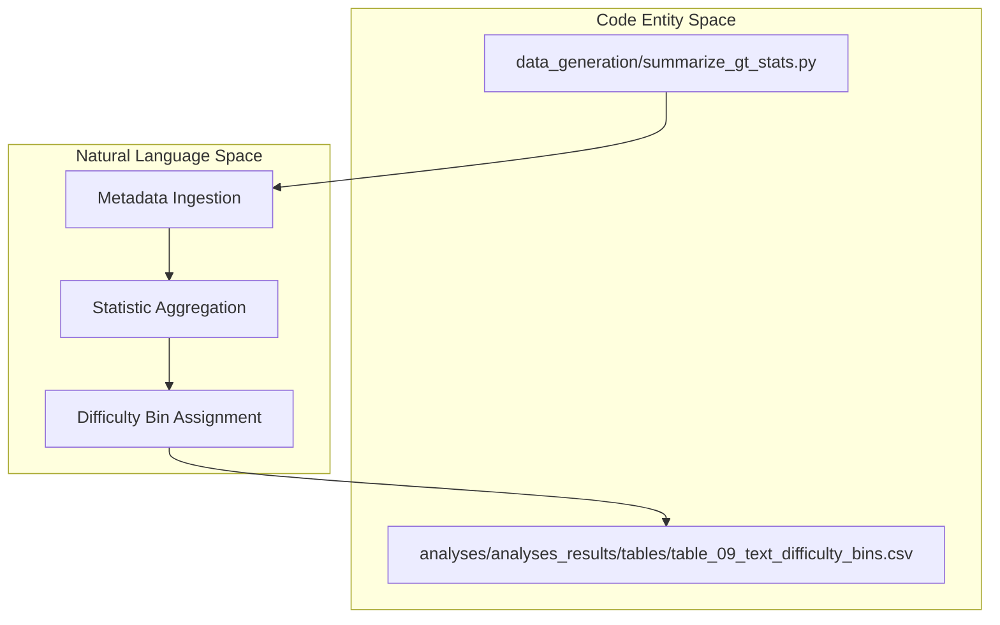

<!-- source: DeepWiki mcp.deepwiki.com · repo NVIDIA/Spatial-IQ · page 2.2 Ground-Truth Statistics & Dataset Layout · fetched 2026-10-26 -->

# Ground-Truth Statistics & Dataset Layout

Relevant source files

The following files were used as context for generating this wiki page:

- [README.md](README.md)
- [analyses/analyses_results/tables/table_09_text_difficulty_bins.csv](analyses/analyses_results/tables/table_09_text_difficulty_bins.csv)

## Purpose and Scope
This page details the structural organization of the Spatial-IQ dataset under the `eval_set/` directory tree, the per-view ground-truth assets generated by the simulation subsystem, the extraction and aggregation of metadata via `summarize_gt_stats.py`, and the downstream difficulty attributes and binning mechanisms utilized in performance analyses.

---

## 1. Dataset Directory Tree & Per-View Asset Layout

The Spatial-IQ dataset is organized as a hierarchical tree of per-view directories rooted at `<dataset_root>/eval_set/` [README.md:41-47](). Each leaf node represents a single camera **view** defined by specific offset, field-of-view (FOV), and distance parameters (`offset<O>_fov<F>_dist<D>`) [README.md:47-58](). These leaf directories serve as the fundamental unit of inference and evaluation [README.md:55-58]().

*Figure 1: Dataset Directory Tree and Per-View Asset Architecture.*

Sources: `README.md:41-58()`

---

## 2. Per-View Metadata and Ground-Truth Assets

Within each leaf directory, several critical assets are emitted during the rendering and generation phase [README.md:29()]:

*   `view.png`: The primary RGB input image rendered from the sampled camera perspective [README.md:48()].
*   `gt.json`: Ground-truth metadata containing object counts, hierarchical relationships, MCQ correct letter answers, and spatial parameters [README.md:49()].
*   `scene.json`: Scene-level metadata describing global lighting, object poses, and layout configurations [README.md:50()].
*   `task<N>_gt_mask.npy`: NumPy binary arrays storing per-task pixel-level segmentation masks for evaluation [README.md:51()].
*   `task<N>_gt_image_*.png`: Multi-choice option images generated for MCQ-style spatial tasks [README.md:52()].

Sources: `README.md:47-54()`

---

## 3. Ground-Truth Statistics Aggregation (`summarize_gt_stats.py`)

The script `data_generation/summarize_gt_stats.py` traverses the dataset hierarchy to compute global and per-subset statistics. It ingests metadata from `gt.json` and `scene.json` across all active samples, aggregating attributes such as total object counts, layer depths, column distributions, and fill ratios. 

*Figure 2: Ground-Truth Statistics Aggregation Pipeline from Dataset Generation to Analysis Tables.*

Sources: `data_generation/summarize_gt_stats.py`, `analyses/analyses_results/tables/table_09_text_difficulty_bins.csv:1-21()`

---

## 4. Downstream Difficulty Attributes & Bins

Downstream analyses utilize structural attributes extracted from the ground-truth metadata to categorize scenes into difficulty bins. These bins isolate model performance across varying geometric complexity axes [analyses/analyses_results/tables/table_09_text_difficulty_bins.csv:1-21]().

| Factor Attribute | Description | Typical Difficulty Bins |
| :--- | :--- | :--- |
| `total_blocks` | Total number of objects including occluded items | `4-8`, `9-12`, `13-18`, `19-25`, `26+` [analyses/analyses_results/tables/table_09_text_difficulty_bins.csv:2-6]() |
| `num_hidden_blocks` | Number of occluded blocks required by gravity | `0`, `1`, `2-3`, `4+` [analyses/analyses_results/tables/table_09_text_difficulty_bins.csv:7-10]() |
| `num_layers` | Vertical stack depth of the scene | `1`, `2`, `3`, `4` [analyses/analyses_results/tables/table_09_text_difficulty_bins.csv:11-14]() |
| `num_columns` | Number of distinct vertical block columns | `3-5`, `6-8`, `9-11`, `12-14` [analyses/analyses_results/tables/table_09_text_difficulty_bins.csv:15-18]() |
| `fill_ratio` | Density classification of the spatial layout | `Sparse`, `Medium`, `Dense` [analyses/analyses_results/tables/table_09_text_difficulty_bins.csv:19-21]() |

Sources: `analyses/analyses_results/tables/table_09_text_difficulty_bins.csv:1-21()`

---

