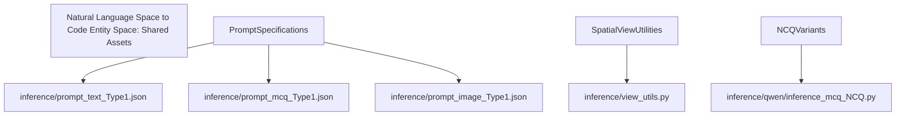

<!-- source: DeepWiki mcp.deepwiki.com · repo NVIDIA/Spatial-IQ · page 3 Inference Layer · fetched 2026-10-26 -->

# Inference Layer

Relevant source files

The following files were used as context for generating this wiki page:

- [README.md](README.md)

The inference layer (`inference/`) provides a unified execution interface for evaluating multimodal Large Language Models (LLMs) across three core answer modalities (free-response text, MCQ letter choices, and image-editing output) [README.md:11-16, README.md:30](). It houses per-model client directories for both commercial hosted APIs and local vLLM-served weights, alongside centralized prompt specifications and shared spatial view utilities [README.md:30]().

For details on dataset view definitions, see [Benchmark Concepts: Tasks, Views and Modalities](#1.2).

---

## Architecture Overview

```mermaid
graph TD
    sub-title1["Natural Language Space to Code Entity Space: Inference Clients"]
    A["HostedAPIModels"] --> B["inference/gpt/inference_text_gpt.py"]
    A --> C["inference/gemini/inference_text_gemini.py"]
    A --> D["inference/claude/inference_text_claude.py"]
    A --> E["inference/kimi/inference_text_kimi.py"]
    A --> F["inference/glm/inference_text_glm.py"]
    G["LocalvLLMModels"] --> H["inference/qwen/inference_text_qwen.py"]
    G --> I["inference/qwen3b/inference_text_qwen3b.py"]
    G --> J["inference/nemotron/inference_text_nemotron.py"]
    G --> K["inference/vla0/inference_text_vla0.py"]
    G --> L["inference/hunyuan/inference_text_hunyuan.py"]
    M["FineTunedCheckpoints"] --> N["inference/qwen_finetuned/inference_text_qwen_finetuned.py"]
```

Sources: [README.md:30]()

Sources: [README.md:30]()

---

## 3.1 Prompt Templates and Shared Utilities

Prompt specifications are standardized across all models via Type-1 JSON configuration templates (`prompt_text_Type1.json`, `prompt_mcq_Type1.json`, `prompt_image_Type1.json`) [README.md:30](). Spatial view traversal, coordinate extraction, and batch dispatch helpers are centralized in view utility modules, while specialized scripts such as `inference_mcq_NCQ.py` handle non-choices-question (NCQ) MCQ formatting variants [README.md:30]().

For deep technical details, implementation structures, and prompt layouts, see [Prompt Templates and Shared Utilities](#3.1).
Sources: [README.md:30]()

---

## 3.2 Hosted API Clients (GPT, Gemini, Claude, Kimi, GLM)

Commercial closed-source and managed models utilize dedicated client directories under `inference/gpt/`, `inference/gemini/`, `inference/claude/`, `inference/kimi/`, and `inference/glm/` [README.md:30](). These clients manage authentication via environment variables (`INFERENCE_API_KEY`, `INFERENCE_BASE`) or local configuration files (`api_keys.txt`), exposing uniform text, MCQ, and image execution scripts [README.md:30]().

For deep technical details, execution flags, and request formatting rules, see [Hosted API Clients (GPT, Gemini, Claude, Kimi, GLM)]().
Sources: [README.md:30]()

---

## 3.3 Local vLLM Clients (Qwen, Qwen3B, Nemotron, VLA0, Hunyuan)

Open-weights models rely on high-throughput local serving infrastructure via OpenAI-compatible vLLM endpoints [README.md:30](). Model directories such as `inference/qwen/`, `inference/qwen3b/`, `inference/nemotron/`, `inference/vla0/`, and `inference/hunyuan/` provide scripts configured with model weight paths, base-url parameters, and modality-specific inference pipelines (including image-edit diffusion modules) [README.md:30]().

For deep technical details, vLLM server configurations, and endpoint arguments, see [Local vLLM Clients (Qwen, Qwen3B, Nemotron, VLA0, Hunyuan)]().
Sources: [README.md:30]()

---

## 3.4 Fine-Tuned Checkpoint Inference (`qwen_finetuned`)

The `inference/qwen_finetuned/` directory bridges training outputs to benchmark evaluation [README.md:30](). It provides utilities for converting NeMo-RL Distributed Checkpoint (DCP) sharded weights into Hugging Face-compatible layouts, allowing direct inference execution using SFT and DAPO checkpoint iterations for paper reproducibility [README.md:30]().

For deep technical details, weight conversion workflows, and evaluation execution instructions, see [Fine-Tuned Checkpoint Inference (qwen_finetuned)]().
Sources: [README.md:30]()

---

