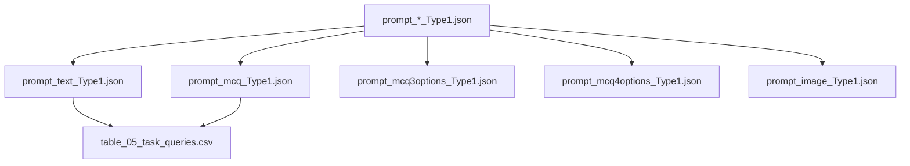
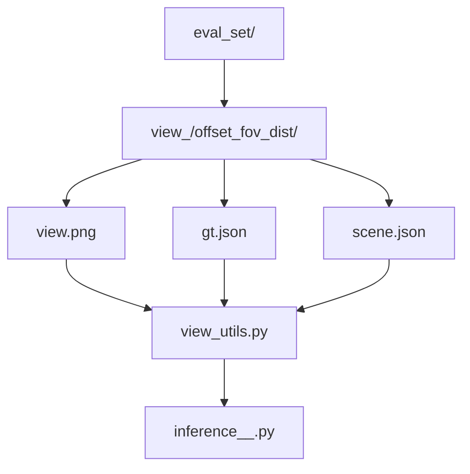

<!-- source: DeepWiki mcp.deepwiki.com · repo NVIDIA/Spatial-IQ · page 3.1 Prompt Templates and Shared Utilities · fetched 2026-10-26 -->

# Prompt Templates and Shared Utilities

Relevant source files

The following files were used as context for generating this wiki page:

- [README.md](README.md)
- [analyses/analyses_results/tables/table_05_task_queries.csv](analyses/analyses_results/tables/table_05_task_queries.csv)

## Purpose and Scope

This section covers the shared infrastructure underpinning the Spatial-IQ inference layer (`inference/`), specifically focusing on standardized prompt templates (`prompt_*_Type1.json`), view-management helpers (`view_utils.py`), and specialized MCQ/NCQ execution scripts (`inference_mcq_NCQ.py`). These components decouple prompt definitions and data loading from model-specific client implementations across all evaluation tasks (`task1` through `task11` and `task_main`) [README.md:25-30]().

---

## Prompt Templates (`prompt_*_Type1.json`)

Prompt templates in Spatial-IQ standardize how questions and instructions are presented to multimodal models across different answer modalities. Located in the root of the inference subsystem [README.md:30](), these JSON files define Type-1 prompt specifications for various response formats:

- `prompt_text_Type1.json`: Formats free-response text queries where the model must output a numeric or categorical answer.
- `prompt_mcq_Type1.json`: Formats standard multiple-choice questions with 5 options (A–E).
- `prompt_mcq3options_Type1.json` / `prompt_mcq4options_Type1.json`: Formats reduced-choice variants (3-way and 4-way MCQ).
- `prompt_image_Type1.json`: Formats image-editing prompts where models are expected to output visual markup or segmentation masks.

Each template maps task identifiers (such as `task1` through `task11` and `target1` / `main`) to specific natural language query strings corresponding to the benchmark's hierarchical tasks [analyses/analyses_results/tables/table_05_task_queries.csv:1-13]().

*Diagram 1: Mapping Natural Language Space (task query texts) to Code Entity Space (`prompt_*_Type1.json`).*

**Sources:** `README.md:25-30`, `analyses/analyses_results/tables/table_05_task_queries.csv:1-14`

---

## Shared Utilities (`view_utils.py`)

The `view_utils.py` module provides common helper functions utilized by inference clients to traverse dataset directories, load views, and structure inputs. A single dataset view is defined by a leaf directory path containing visual assets and ground-truth metadata [README.md:43-58]().

Key responsibilities of `view_utils.py`:
- **View Discovery**: Locates leaf directories matching `offset*_fov*_dist*` under `<dataset_root>/eval_set/` [README.md:46-55]().
- **Asset Loading**: Reads input images (`view.png`), scene metadata (`scene.json`), and ground truth files (`gt.json`) [README.md:48-50]().
- **Payload Construction**: Formats multi-modal request payloads combining prompt text, image bytes, and choice options for consumption by API or local inference clients [README.md:30]().

*Diagram 2: Data flow bridging dataset files to inference scripts via `view_utils.py` helpers.*

**Sources:** `README.md:41-60`

---

## Inference Variant (`inference_mcq_NCQ.py`)

The `inference_mcq_NCQ.py` script serves as a specialized evaluation variant within the inference pipeline. While standard inference scripts handle single modalities directly per model [README.md:30](), `inference_mcq_NCQ.py` manages non-standard multiple-choice query (NCQ) workflows where models process complex multi-image choice sets or alternative MCQ configurations. It integrates prompt templates with model invocation loops, ensuring prediction outputs are serialized to disk with the correct naming convention (`task<N>_pred_mcq_<slug>.txt`) for downstream evaluators [README.md:86]().

**Sources:** `README.md:25-35`, `README.md:83-93`

---

