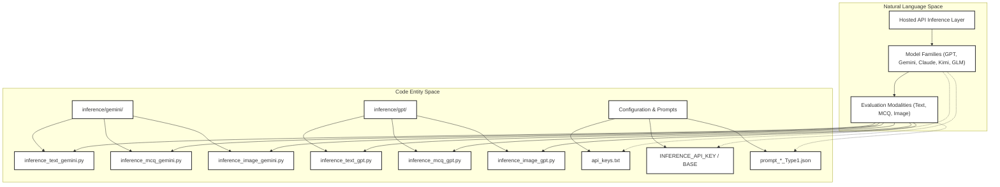

<!-- source: DeepWiki mcp.deepwiki.com · repo NVIDIA/Spatial-IQ · page 3.2 Hosted API Clients (GPT, Gemini, Claude, Kimi, GLM) · fetched 2026-10-26 -->

# Hosted API Clients (GPT, Gemini, Claude, Kimi, GLM)

<details>
<summary>Relevant source files</summary>

The following files were used as context for generating this wiki page:

- [README.md](README.md)
- [analyses/inference_results/eval_raw_claude_text.csv](analyses/inference_results/eval_raw_claude_text.csv)
- [analyses/inference_results/eval_raw_gemini_mcq.csv](analyses/inference_results/eval_raw_gemini_mcq.csv)
- [analyses/inference_results/eval_raw_glm_text.csv](analyses/inference_results/eval_raw_glm_text.csv)
- [analyses/inference_results/eval_raw_gpt_text.csv](analyses/inference_results/eval_raw_gpt_text.csv)
- [analyses/inference_results/eval_raw_kimi_mcq.csv](analyses/inference_results/eval_raw_kimi_mcq.csv)

</details>


## Purpose and Scope

This page documents the hosted API inference clients implemented in the `inference/` directory of the Spatial-IQ codebase. These clients provide programmatic access to closed-source or remotely hosted multimodal large language models—specifically GPT, Gemini, Claude, Kimi, and GLM—across three evaluation modalities: free-response text, multiple-choice questions (MCQ), and image editing/generation [README.md:25-30](). 

The scope covers API credential resolution (`api_keys.txt`, `INFERENCE_API_KEY`, and `INFERENCE_API_BASE`), directory and script naming conventions per model family, prompt template loading, and the request-response data flow from benchmark leaf directories to prediction output files.

---

## 1. API Key Handling and Configuration

Hosted API clients require valid authentication credentials and endpoint configurations to communicate with external provider gateways. The repository standardizes key handling through a dual mechanism: local configuration files (`api_keys.txt`) and environment variables (`INFERENCE_API_KEY` and `INFERENCE_API_BASE`).

### Credential Resolution Priority
1. **Environment Variables**: Scripts inspect `INFERENCE_API_KEY` (and optionally `INFERENCE_API_BASE` for custom gateways or proxy endpoints) in the runtime environment.
2. **Key Files**: If environment variables are absent, clients fall back to reading credentials from a local `api_keys.txt` file located within the specific model's subdirectory or project root.

```
[Runtime Environment] ──(Check)──> INFERENCE_API_KEY / INFERENCE_API_BASE
                                          │
                                    (If Missing)
                                          ▼
                             [api_keys.txt Configuration File]
```

### Sources
* `README.md:25-35`
* `README.md:100-120`

---

## 2. Model Family Directory Structure and Modality Scripts

The `inference/` directory isolates each hosted model family into a dedicated subdirectory (`gpt/`, `gemini/`, `claude/`, `kimi/`, `glm/`). Each family directory houses modular execution scripts tailored to the respective API provider's payload requirements for text, MCQ, and image modalities [README.md:30]().

| Model Family | Directory Path | Supported Modality Scripts | Primary API Client Dependencies |
| :--- | :--- | :--- | :--- |
| **Gemini** | `inference/gemini/` | `inference_text_gemini.py`<br>`inference_mcq_gemini.py`<br>`inference_image_gemini.py` | `requests` [README.md:109-119]() |
| **GPT** | `inference/gpt/` | `inference_text_gpt.py`<br>`inference_mcq_gpt.py`<br>`inference_image_gpt.py` | `requests`, `openai` |
| **Claude** | `inference/claude/` | `inference_text_claude.py`<br>`inference_mcq_claude.py`<br>`inference_image_claude.py` | `requests` |
| **Kimi** | `inference/kimi/` | `inference_text_kimi.py`<br>`inference_mcq_kimi.py`<br>`inference_image_kimi.py` | `requests` |
| **GLM** | `inference/glm/` | `inference_text_glm.py`<br>`inference_mcq_glm.py`<br>`inference_image_glm.py` | `requests` |

### Sources
* `README.md:25-35`
* `README.md:100-120`

---

## 3. Natural Language Space to Code Entity Space: Hosted API Subsystem

The following diagram bridges the high-level conceptual model families and evaluation modalities to their concrete implementation classes, configuration artifacts, and execution scripts within the repository.



### Sources
* `README.md:25-35`
* `README.md:100-120`

---

## 4. Execution Data Flow and Request Lifecycle

The hosted inference pipeline executes iteratively across leaf directories defined in subset manifests such as `inference_results/subset_eval.txt` [README.md:37-58](). 

### Step-by-Step Data Flow
1. **View Discovery**: The inference runner loads view paths pointing to leaf directories containing `view.png`, `gt.json`, and task-specific assets [README.md:46-54]().
2. **Prompt Construction**: Task prompts are loaded from shared JSON specifications (`prompt_text_Type1.json`, `prompt_mcq_Type1.json`, etc.) [README.md:30]().
3. **Payload Formatting**: Images are base64-encoded or referenced via URL, combined with system instructions and user queries according to provider-specific schema requirements.
4. **API Transmission**: Requests are dispatched via HTTPS POST using `requests` or provider SDKs, authenticated via resolved environment credentials (`INFERENCE_API_KEY`) [README.md:109-119]().
5. **Prediction Persistence**: Responses are parsed and written back to the view directory using standardized slugs [README.md:83-93]():
   - Text predictions: `task<N>_pred_text_<slug>.txt` [README.md:85]()
   - MCQ predictions: `task<N>_pred_mcq_<slug>.txt` [README.md:86]()
   - Image predictions: `task<N>_pred_image_<slug>.png` [README.md:87]()

```mermaid
sequenceDiagram
    participant Runner as "InferenceRunner"
    subgraph "Code Entity Space"
        participant ViewUtils as "view_utils.py"
        participant ClientScript as "inference_{modality}_{model}.py"
        participant APIClient as "Requests/HTTPS Client"
    end
    participant Provider as "Hosted API Gateway (GPT/Gemini/Claude/etc)"

    Runner->>ViewUtils: "Load subset_eval.txt & parse leaf view path"
    ViewUtils->>ClientScript: "Provide view.png & gt.json metadata"
    ClientScript->>ClientScript: "Load prompt JSON & format payload"
    ClientScript->>APIClient: "POST request with INFERENCE_API_KEY"
    APIClient->>Provider: "HTTPS Payload (Image + Prompt)"
    Provider-->>APIClient: "JSON/Image Response"
    APIClient-->>ClientScript: "Raw model output"
    ClientScript->>Runner: "Write task<N>_pred_<modality>_<slug>.{txt/png}"
```

### Sources
* `README.md:30-35`
* `README.md:46-60`
* `README.md:83-93`
* `README.md:109-119`

---

