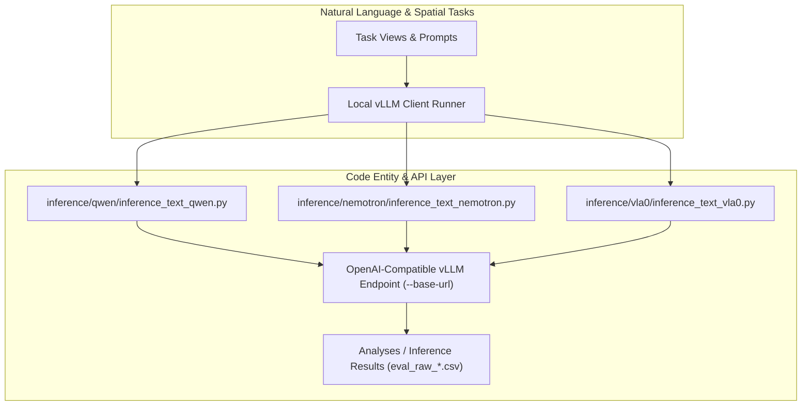
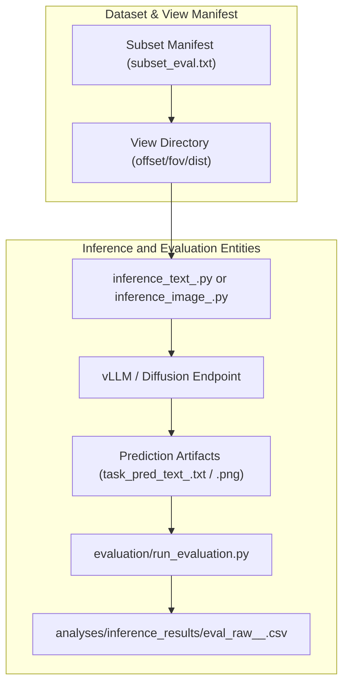

<!-- source: DeepWiki mcp.deepwiki.com · repo NVIDIA/Spatial-IQ · page 3.3 Local vLLM Clients (Qwen, Qwen3B, Nemotron, VLA0, Hunyuan) · fetched 2026-10-26 -->

# Local vLLM Clients (Qwen, Qwen3B, Nemotron, VLA0, Hunyuan)

Relevant source files

The following files were used as context for generating this wiki page:

- [README.md](README.md)
- [analyses/inference_results/eval_raw_image_hunyuan.csv](analyses/inference_results/eval_raw_image_hunyuan.csv)
- [analyses/inference_results/eval_raw_image_qwen-image-edit.csv](analyses/inference_results/eval_raw_image_qwen-image-edit.csv)
- [analyses/inference_results/eval_raw_qwen3b_mcq.csv](analyses/inference_results/eval_raw_qwen3b_mcq.csv)
- [analyses/inference_results/eval_raw_qwen_text.csv](analyses/inference_results/eval_raw_qwen_text.csv)
- [analyses/inference_results/eval_raw_vla0_text.csv](analyses/inference_results/eval_raw_vla0_text.csv)

## Purpose and Scope

This page documents the local vLLM inference clients and specialized local model runners within the Spatial-IQ framework (`inference/`) [README.md:30](). Spatial-IQ provides dedicated client directories for serving local weights via OpenAI-compatible vLLM endpoints, custom local model variations (`qwen`, `qwen3b`, `nemotron`, `vla0`, `hunyuan`), and diffusion-based image-editing pipelines (`qwen-image-edit`) [README.md:30](). These clients accept standard benchmark views, format prompts using shared specifications, interact with local OpenAI-compatible APIs using `--base-url` and `--model` CLI flags, and write structured prediction artifacts evaluated downstream.

---

## 1. Local vLLM Endpoint Integration Architecture

Local models in Spatial-IQ decouple inference execution from proprietary cloud APIs by leveraging OpenAI-compatible vLLM serving servers. Each client script handles payload formatting for multi-modal inputs (images and text) and routes requests through HTTP endpoints configured via command-line flags.

### Architecture Mapping: Natural Language Inference to vLLM Endpoints

**Sources:** `README.md:25-38`

---

## 2. Per-Model Client Directories and Implementation

The inference layer houses scoped directories for each local model family under `inference/` [README.md:30](). Each directory contains specific scripts tailored to the three primary answer modalities plus composite tasks: free-response text, multiple-choice questions (MCQ), and image editing/generation [README.md:30]().

| Model Family Directory | Target Models / Backbones | Modality Scripts Available | Key Runtime Flags |
|------------------------|---------------------------|----------------------------|-------------------|
| `inference/qwen/` [README.md:30]() | Qwen2.5-VL / Qwen-Image-Edit | `inference_text_qwen.py`, `inference_mcq_qwen.py`, `inference_image_qwen.py` [README.md:30]() | `--base-url`, `--model`, `--image-edit` |
| `inference/qwen3b/` [README.md:30]() | Qwen2.5-VL-3B-Instruct | `inference_text_qwen3b.py`, `inference_mcq_qwen3b.py`, `inference_image_qwen3b.py` [README.md:30]() | `--base-url`, `--model` |
| `inference/nemotron/` [README.md:30]() | NVIDIA Nemotron-Vision | `inference_text_nemotron.py`, `inference_mcq_nemotron.py` [README.md:30]() | `--base-url`, `--model` |
| `inference/vla0/` [README.md:30]() | VLA0 Local Backbone | `inference_text_vla0.py`, `inference_mcq_vla0.py`, `inference_image_vla0.py` [README.md:30]() | `--base-url`, `--model` |
| `inference/hunyuan/` [README.md:30]() | Tencent Hunyuan-Vision | `inference_text_hunyuan.py`, `inference_mcq_hunyuan.py`, `inference_image_hunyuan.py` [README.md:30]() | `--base-url`, `--model` |

**Sources:** `README.md:25-38`

---

## 3. Image-Edit Inference and Specialized Modalities

Certain local architectures like `qwen` support image-edit inference where the model outputs modified spatial visual artifacts (such as highlighted block masks or bounding silhouettes) rather than raw text [README.md:100-112](). These runs depend on specialized libraries like Diffusers (`inference/qwen/requirements_image_edit.txt`) [README.md:100-112]() and interact with local diffusion or vLLM endpoints to render prediction PNGs.

### Execution Data Flow for Local Model Inference and Evaluation Sinks

**Sources:** `README.md:33-58`, `analyses/inference_results/eval_raw_image_hunyuan.csv:1-33`, `analyses/inference_results/eval_raw_image_qwen-image-edit.csv:1-33`

---

## 4. CLI Configuration Flags and Runtime Execution

Local vLLM clients are invoked via standard Python CLI execution patterns. They rely on uniform configuration flags to route requests to locally deployed model weights:

- `--base-url`: Specifies the network location of the vLLM OpenAI-compatible server (e.g., `http://localhost:8000/v1`).
- `--model`: Defines the model identifier registered in the vLLM server process matching the requested weights.
- Modality-specific flags routing execution to text generation, multi-choice evaluation schemas, or image-edit output rendering.

Outputs generated by these clients follow strict slug-based naming conventions (`task<N>_pred_text_<slug>.txt`, `task<N>_pred_mcq_<slug>.txt`, `task<N>_pred_image_<slug>.png`) [README.md:83-93](), which are subsequently ingested by the evaluation subsystem and aggregated into raw evaluation CSVs under `analyses/inference_results/` [README.md:35]().

**Sources:** `README.md:83-93`, `analyses/inference_results/eval_raw_qwen3b_mcq.csv:1-21`, `analyses/inference_results/eval_raw_qwen_text.csv:1-45`

---

