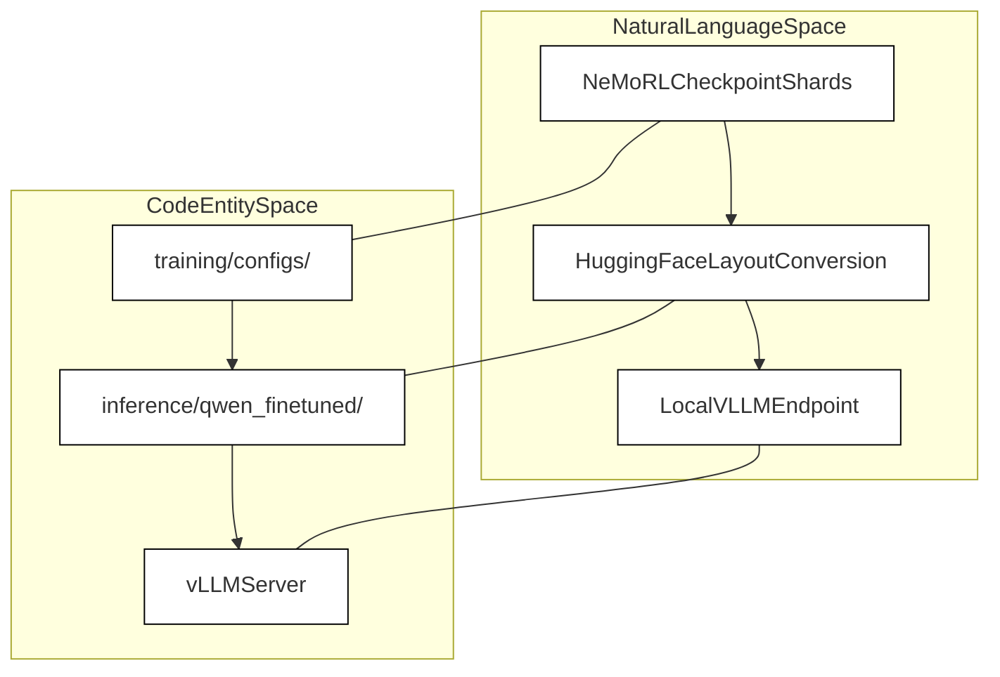
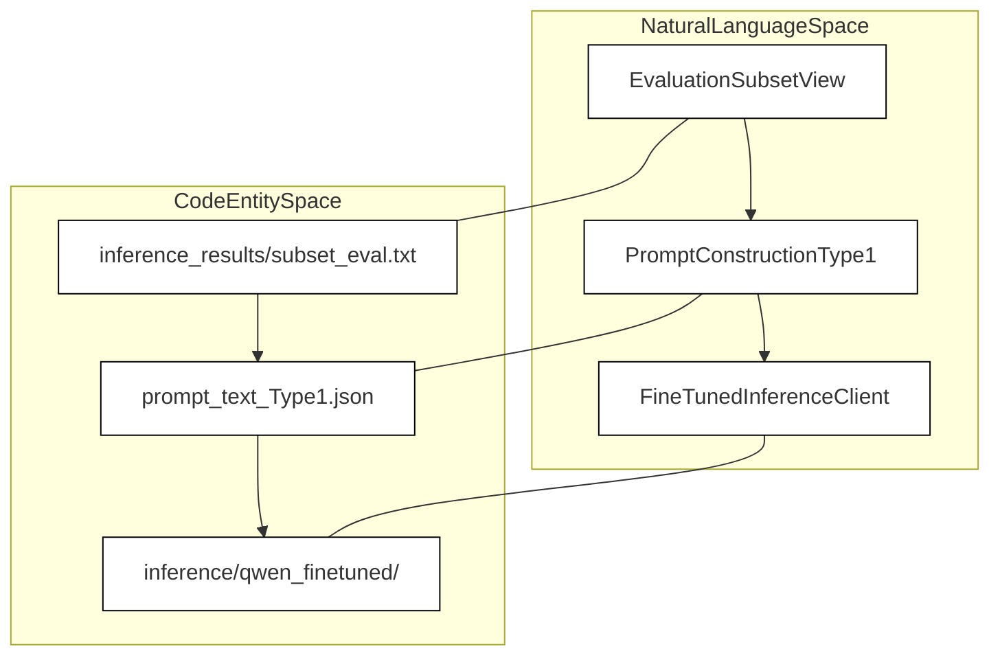

<!-- source: DeepWiki mcp.deepwiki.com · repo NVIDIA/Spatial-IQ · page 3.4 Fine-Tuned Checkpoint Inference (qwen_finetuned) · fetched 2026-10-26 -->

# Fine-Tuned Checkpoint Inference (qwen_finetuned)

Relevant source files

The following files were used as context for generating this wiki page:

- [README.md](README.md)
- [analyses/inference_results/eval_raw_dapo-32b-tight_text.csv](analyses/inference_results/eval_raw_dapo-32b-tight_text.csv)
- [analyses/inference_results/eval_raw_sft-7b-cot-100pct_text.csv](analyses/inference_results/eval_raw_sft-7b-cot-100pct_text.csv)

The `inference/qwen_finetuned/` subsystem handles the execution of inference pipelines for models trained via the NeMo-RL framework (such as SFT, Chain-of-Thought (CoT), and DAPO variants) [README.md:30-33](). Because NeMo-RL natively stores model weights as Distributed Checkpoint (DCP) shards, this module provides the necessary translation logic to convert these shards into standard HuggingFace (HF) layouts. Once converted, these fine-tuned checkpoints are served locally via OpenAI-compatible vLLM endpoints to execute benchmark reruns across the Spatial-IQ evaluation set [README.md:11-16]().

---

## 1. NeMo-RL DCP to HuggingFace Layout Conversion

NeMo-RL training runs produce sharded distributed checkpoints optimized for cluster training [README.md:33](). To evaluate these checkpoints using standard multimodal inference engines like vLLM or specialized evaluation harnesses, the DCP shards must be converted into standard HuggingFace model directories containing `config.json` and weight files (`model.safetensors` or PyTorch `.bin` weights).

The conversion utility reads the underlying tensor parallelism and pipeline parallelism metadata from the NeMo checkpoint directory, restructures the state dict keys to match the HuggingFace Qwen2.5-VL naming conventions, and exports the metadata and weights.

**Sources:** [README.md:30-33]()

---

## 2. Serving Fine-Tuned Checkpoints

Once converted to the HuggingFace layout, checkpoints corresponding to specialized training configurations—such as `sft-7b-cot-100pct` or `dapo-32b-tight`—are hosted locally using vLLM [README.md:33](). 

The inference framework queries these local model instances using request payloads defined by the shared prompt specifications [README.md:30](). The client scripts manage the token generation, handling both free-response text predictions and structured reasoning traces when Chain-of-Thought (CoT) prompts are enabled.

**Sources:** [README.md:30-37]()

---

## 3. Benchmark Reruns and Result Mapping

Inference execution over the evaluation views produces raw prediction files that feed directly into the analysis pipeline [README.md:31-35](). The slugs assigned to these fine-tuned runs (e.g., `sft-7b-cot-100pct` and `dapo-32b-tight`) determine the filenames of the generated raw evaluation datasets [analyses/inference_results/eval_raw_dapo-32b-tight_text.csv:1-2](), [analyses/inference_results/eval_raw_sft-7b-cot-100pct_text.csv:1-2]().

Each row in the resulting CSV output correlates specific view paths, ground-truth block attributes (`total_blocks`, `num_hidden_blocks`, `num_columns`, `num_layers`), and sub-task predictions (`task2` through `task9`, `main`) [analyses/inference_results/eval_raw_dapo-32b-tight_text.csv:1-5](), [analyses/inference_results/eval_raw_sft-7b-cot-100pct_text.csv:1-5]().

**Sources:** [analyses/inference_results/eval_raw_dapo-32b-tight_text.csv:1-50](), [analyses/inference_results/eval_raw_sft-7b-cot-100pct_text.csv:1-50]()

---

