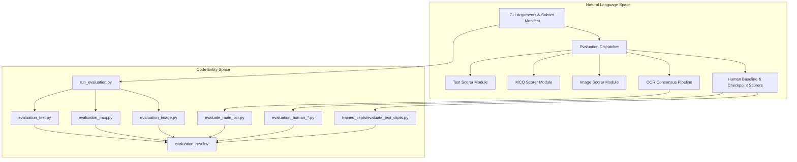
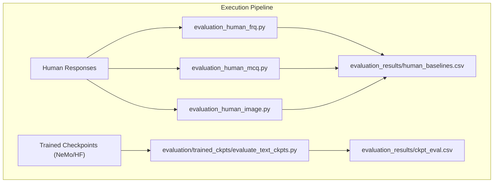

<!-- source: DeepWiki mcp.deepwiki.com · repo NVIDIA/Spatial-IQ · page 4 Evaluation & Scoring · fetched 2026-10-26 -->

# Evaluation & Scoring

Relevant source files

The following files were used as context for generating this wiki page:

- [README.md](README.md)

## Purpose and Scope

The `evaluation/` subsystem is responsible for assessing model predictions produced across the Spatial-IQ benchmark. It acts as the bridge between raw model outputs (`task<N>_pred_<modality>_<slug>.txt` or `.png`) and the analytical pipeline. The central dispatcher, `run_evaluation.py`, orchestrates view discovery, selects the appropriate scorer based on task and modality, and writes aggregated evaluation summaries (`eval_raw_<slug>_<mode>.csv` and JSON metrics) into `evaluation_results/` [README.md:31-92].

This page provides a high-level overview of the evaluation framework. For detailed technical implementations, see the child pages:
- [run_evaluation.py Dispatcher and Output Schema](#4.1)
- [Modality Scorers: Text, MCQ, Image](#4.2)
- [OCR Consensus Pipeline (main_ocr)](#4.3)
- [Human Baselines and Trained-Checkpoint Evaluation](#4.4)

---

## Evaluation Architecture and Code Flow

The following diagram bridges the natural language concepts of evaluation to the actual code entities within the `evaluation/` package, showing how the dispatcher delegates to specific modality scorers and consensus pipelines.

*Figure 4.1: Mapping evaluation tasks from conceptual workflows to Python modules.*

Sources: `README.md:31-35`, `README.md:83-92`

---

## 4.1 Dispatcher and Output Schema

The primary entry point for scoring inference outputs is `run_evaluation.py`. It reads subset manifests (such as `inference_results/subset_eval.txt`), discovers target view directories under the dataset root, parses command-line arguments specifying the model slug and evaluation mode, and executes task-specific scoring routines [README.md:31-92].

Outputs are standardized into machine-readable comma-separated values (`eval_raw_<slug>_<mode>.csv`) and accompanying JSON summaries stored within the `evaluation_results/` directory. These files serve as foundational inputs for downstream analyses [README.md:35, README.md:92].

For details, see [run_evaluation.py Dispatcher and Output Schema](#4.1).

Sources: `README.md:31-92`

---

## 4.2 Modality Scorers: Text, MCQ, and Image

Spatial-IQ evaluates models across three primary answer modalities, each handled by a dedicated scoring script located in the `evaluation/` directory [README.md:31-89]:

- **Text Modality (`evaluation_text.py`)**: Parses free-response text files (`task<N>_pred_text_<slug>.txt`) to evaluate exact-match accuracy and Pearson correlation against ground-truth counts stored in `gt.json` [README.md:48-85].
- **MCQ Modality (`evaluation_mcq.py`)**: Validates multiple-choice predictions (`task<N>_pred_mcq_<slug>.txt`) against ground-truth letter answers (A–E) across 3-, 4-, and 5-way options [README.md:83-86].
- **Image Modality (`evaluation_image.py`)**: Computes silhouette and mask-alignment scores by comparing generated image predictions (`task<N>_pred_image_<slug>.png`) against ground-truth task pixel masks (`task<N>_gt_mask.npy`) [README.md:48-89].

For details, see [Modality Scorers: Text, MCQ, Image](#4.2).

Sources: `README.md:48-89`

---

## 4.3 OCR Consensus Pipeline (`main_ocr`)

For models that output images for the composite `task_main` prompt, standard direct-text extraction is insufficient. The `evaluation/main_ocr/` subsystem implements a specialized consensus pipeline managed by `evaluate_main_ocr.py` [README.md:32, README.md:88].

This pipeline combines multiple extraction engines—including Tesseract, PaddleOCR, and Qwen2.5-VL served via vLLM—to reliably extract block counts from annotated visual outputs. Disagreements between engines trigger dedicated review CSV logs to ensure robust dataset verification [README.md:32].

For details, see [OCR Consensus Pipeline (main_ocr)](#4.3).

Sources: `README.md:32, README.md:88`

---

## 4.4 Human Baselines and Trained-Checkpoint Evaluation

To contextualize multimodal LLM performance, Spatial-IQ incorporates human evaluation workflows and fine-tuned checkpoint scoring scripts [README.md:31]:

- **Human Baselines (`evaluation_human_{frq,mcq,image}.py`)**: Parse human participant responses across free-response, multiple-choice, and image modalities to establish human performance bounds [README.md:31].
- **Trained-Checkpoint Evaluation (`evaluation/trained_ckpts/`)**: Leverages utilities like `evaluate_text_ckpts.py` to run automated evaluations against fine-tuned model checkpoints (such as NeMo-RL trained models) [README.md:31].

The integration of these scorers is outlined in the workflow diagram below:

*Figure 4.2: Human baseline and trained-checkpoint scoring workflows.*

For details, see [Human Baselines and Trained-Checkpoint Evaluation](#4.4).

Sources: `README.md:31`

---

