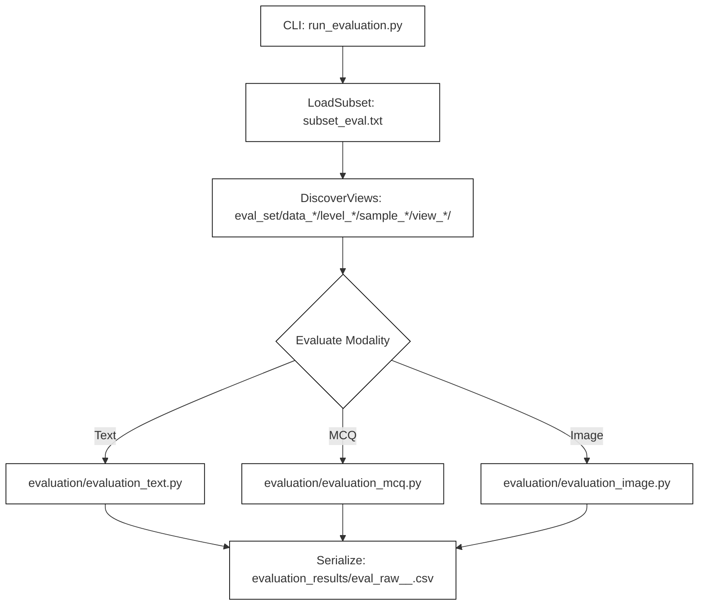
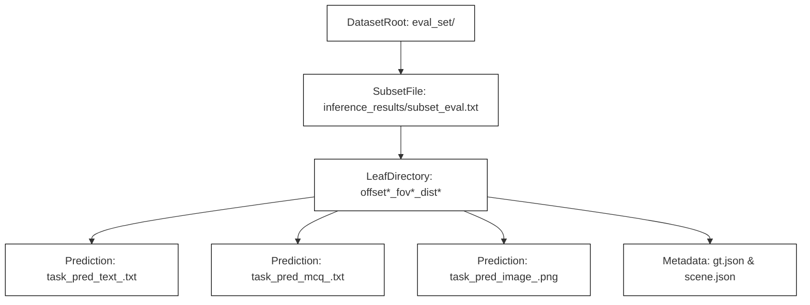

<!-- source: DeepWiki mcp.deepwiki.com · repo NVIDIA/Spatial-IQ · page 4.1 run_evaluation.py Dispatcher and Output Schema · fetched 2026-10-26 -->

# run_evaluation.py Dispatcher and Output Schema

Relevant source files

The following files were used as context for generating this wiki page:

- [.gitignore](.gitignore)
- [README.md](README.md)
- [analyses/inference_results/eval_raw_qwen_mcq.csv](analyses/inference_results/eval_raw_qwen_mcq.csv)

## Purpose and Scope

This page provides full technical documentation for `run_evaluation.py`, the core evaluation dispatcher for the Spatial-IQ benchmark [README.md:31-31](). The dispatcher coordinates the scoring of model predictions across 11 atomic spatial sub-tasks (`task1`–`task11`) and the composite target task (`task_main`) [README.md:67-79](). It discovers evaluation views, invokes the appropriate modality-specific scoring modules (`evaluation_text.py`, `evaluation_mcq.py`, `evaluation_image.py`), aggregates task performance, and serializes raw per-view results into structured CSV and JSON outputs within the `evaluation_results/` directory [README.md:31-31, 40-41]().

Sources: [README.md:31-91]()

---

## Dispatcher Architecture and CLI Arguments

The `run_evaluation.py` script serves as the command-line entry point for scoring inference outputs. It parses command-line flags to determine the target model slug, answer modality, dataset root, and subset configuration, then dispatches execution to the corresponding evaluation backend.

*Figure 1: Dispatcher execution flow from CLI entry point to modality evaluation and CSV serialization, mapping Natural Language tasks to code entities.*

Sources: [README.md:31-92]()

---

## View Discovery and Subset Evaluation

Evaluation targets are defined by views—individual leaf directories containing input images, ground-truth metadata, and prediction files [README.md:43-58](). The dispatcher reads subset files such as `inference_results/subset_eval.txt` to identify which views to process [README.md:56-58]().

*Figure 2: Dataset view hierarchy traversal and artifact mapping linking spatial view directories to prediction files and ground-truth metadata.*

Sources: [README.md:43-58](), [analyses/inference_results/eval_raw_qwen_mcq.csv:1-21]()

---

## Per-Task Aggregation and Output Schema

Once evaluation metrics are computed per view and per task, `run_evaluation.py` compiles the results into a consolidated raw CSV file (`eval_raw_<slug>_<mode>.csv`) stored in `evaluation_results/` [README.md:31-41, 83-92](). 

The CSV schema captures view identifiers, scene statistics (such as `object_type`, `total_blocks`, `num_hidden_blocks`, `num_columns`, and `num_layers`), and per-task correctness indicators paired with choice or error types [analyses/inference_results/eval_raw_qwen_mcq.csv:1-21]().

### Raw Evaluation CSV Schema Example

| Column Name | Description | Source Reference |
| :--- | :--- | :--- |
| `view` | Path to the evaluation view leaf directory | [analyses/inference_results/eval_raw_qwen_mcq.csv:2-21]() |
| `object_type` | Geometric primitive type (e.g., `cube`) | [analyses/inference_results/eval_raw_qwen_mcq.csv:2-21]() |
| `total_blocks` | Total block count including required gravity supports | [analyses/inference_results/eval_raw_qwen_mcq.csv:2-21]() |
| `num_hidden_blocks` | Count of occluded supporting blocks | [analyses/inference_results/eval_raw_qwen_mcq.csv:2-21]() |
| `num_columns` | Number of distinct columns in the scene | [analyses/inference_results/eval_raw_qwen_mcq.csv:2-21]() |
| `num_layers` | Vertical layer count | [analyses/inference_results/eval_raw_qwen_mcq.csv:2-21]() |
| `task<N>` | Binary score (0 or 1) or numerical error for task $N$ | [analyses/inference_results/eval_raw_qwen_mcq.csv:2-21]() |
| `task<N>_choice_type` | Categorical classification of model error or correct choice | [analyses/inference_results/eval_raw_qwen_mcq.csv:2-21]() |

Sources: [README.md:31-41](), [analyses/inference_results/eval_raw_qwen_mcq.csv:1-21]()

---

