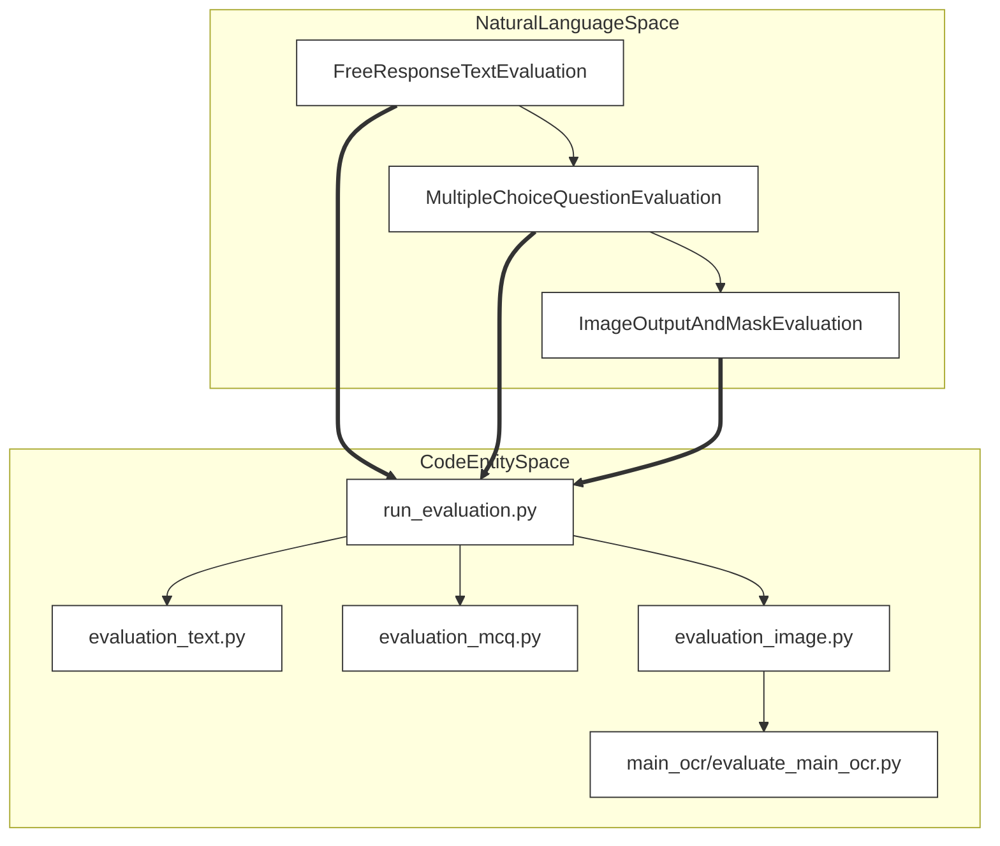
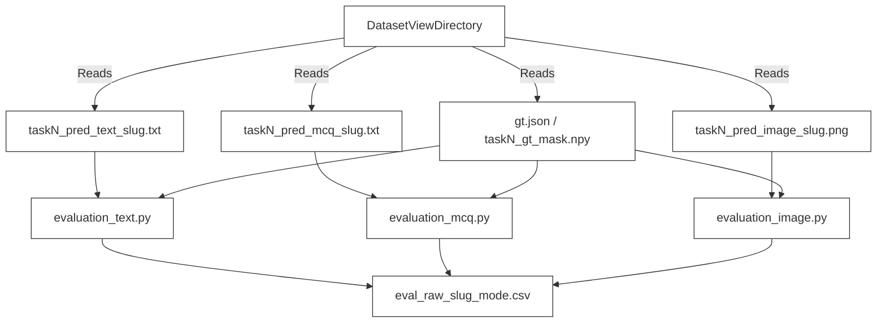

<!-- source: DeepWiki mcp.deepwiki.com · repo NVIDIA/Spatial-IQ · page 4.2 Modality Scorers: Text, MCQ, Image · fetched 2026-10-26 -->

# Modality Scorers: Text, MCQ, Image

Relevant source files

The following files were used as context for generating this wiki page:

- [README.md](README.md)
- [analyses/analyses_results/tables/table_01_text_summary.csv](analyses/analyses_results/tables/table_01_text_summary.csv)
- [analyses/analyses_results/tables/table_02_mcq_summary.csv](analyses/analyses_results/tables/table_02_mcq_summary.csv)
- [analyses/analyses_results/tables/table_03_image_summary.csv](analyses/analyses_results/tables/table_03_image_summary.csv)

This page details the implementation, parsing rules, and correctness metrics used by the modality-specific evaluation scorers (`evaluation_text.py`, `evaluation_mcq.py`, and `evaluation_image.py`) within the `evaluation/` subsystem of Spatial-IQ [README.md:31](). These modules process model prediction artifacts generated across 11 atomic spatial sub-tasks and the composite target task (`task_main`) [README.md:69-89]().

Sources: [README.md:31](), [README.md:69-89]()

---

## Text Modality Evaluation (`evaluation_text.py`)

The free-response text evaluation pipeline processes text prediction files (`task<N>_pred_text_<slug>.txt`) located within each view's directory structure [README.md:46-53, 85](). 

### Parsing Rules and Correctness Metrics
1. **Raw Text Ingestion**: The script reads the content of the prediction file corresponding to a given task `task<N>` or `task_main`.
2. **Numeric Extraction & Normalization**: For counting tasks (such as `task_main` and column counts), the text parser extracts integer quantities from the string, handling trailing punctuation, conversational filler, and markdown formatting.
3. **Metric Computation**: 
   - **Exact Match / Accuracy**: Evaluated for categorical or discrete integer answers by checking if the extracted numeric or string token matches the ground-truth value stored in `gt.json` [README.md:49]().
   - **Correlation**: Computes statistical metrics such as Pearson correlation across the evaluation set to measure alignment between predicted counts and ground truth across difficulty bins.

Sources: [README.md:46-53](), [README.md:85]()

---

## MCQ Modality Evaluation (`evaluation_mcq.py`)

Multiple-Choice Question (MCQ) evaluation handles choice-based responses across 3-way, 4-way, and 5-way configurations (`3options`, `4options`, standard MCQ) [README.md:30, 86]().

### Parsing Rules and Correctness Metrics
1. **Prediction Slug Mapping**: Reads `task<N>_pred_mcq_<slug>.txt` where models output option identifiers (typically letters `A`, `B`, `C`, `D`, or `E`) [README.md:86]().
2. **Robust Letter Extraction**: The parser uses regular expressions to isolate the primary chosen option letter from model outputs, stripping explanatory text, XML tags, or markdown blocks.
3. **Correctness Evaluation**: Compares the extracted letter against the ground-truth correct option letter defined in `gt.json` [README.md:49](). Scoring is binary (0 or 1 per sample), aggregated downstream into per-task accuracy summaries and sub-category metrics (e.g., visible support, hidden support, referential chains).

Sources: [README.md:30](), [README.md:49](), [README.md:86]()

---

## Image Modality Evaluation (`evaluation_image.py`)

Image evaluation processes visual output artifacts (`task<N>_pred_image_<slug>.png`) generated by multimodal models performing image-editing or visual-reasoning tasks [README.md:87]().

### Parsing Rules and Correctness Metrics
1. **Mask Loading**: Loads the model's generated image output and aligns it with the corresponding ground-truth binary or categorical pixel mask (`task<N>_gt_mask.npy`) stored in the view directory [README.md:46-53]().
2. **Spatial Similarity Scoring**: Computes spatial overlap metrics, silhouette scores, or Intersection-over-Union (IoU) comparing the generated mask/image against the ground truth.
3. **Alternative OCR Consensus Path**: For composite object counting tasks (`task_main`), image outputs are additionally routed through the `evaluation/main_ocr/` pipeline, utilizing Tesseract, PaddleOCR, and Qwen2.5-VL consensus to extract block counts from annotated renderings [README.md:32, 88]().

Sources: [README.md:46-53](), [README.md:88]()

---

## Cross-Modality Architecture and Data Flow

The following diagrams illustrate the transition from natural language evaluation concepts to the concrete code entities within the evaluation pipeline, mapping out how scorers consume prediction assets and compute metrics.

### Diagram 1: Natural Language Space to Code Entity Space (Modality Dispatch)

Sources: [README.md:31](), [README.md:83-89]()

### Diagram 2: Evaluation Execution Pipeline and Artifact Parsing

Sources: [README.md:31](), [README.md:46-53](), [README.md:83-89]()

---

